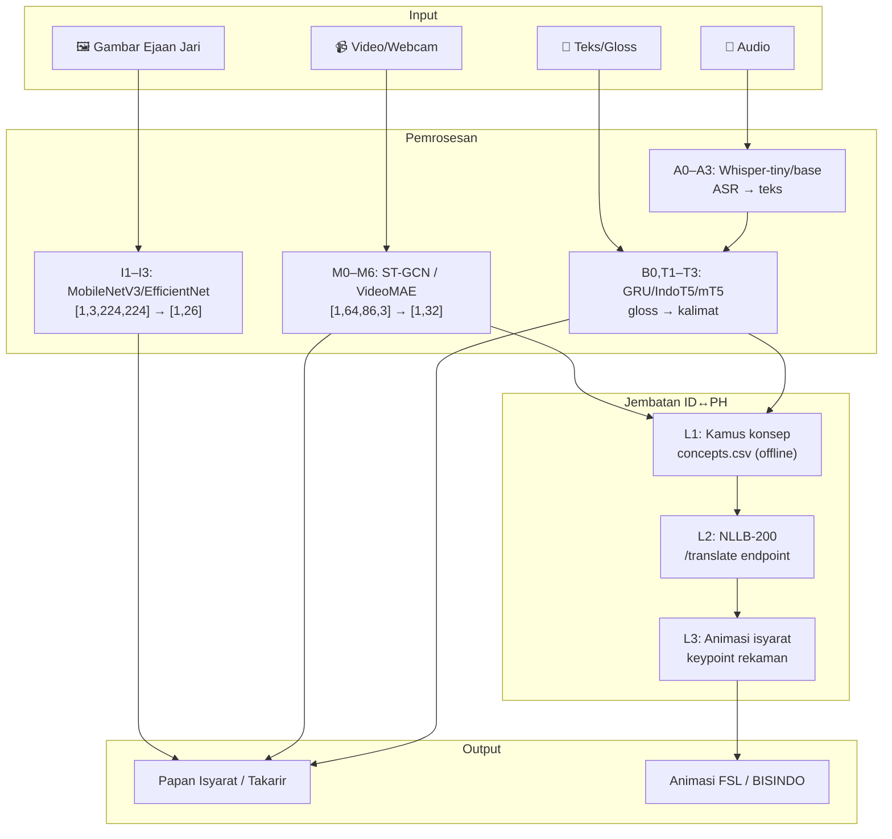
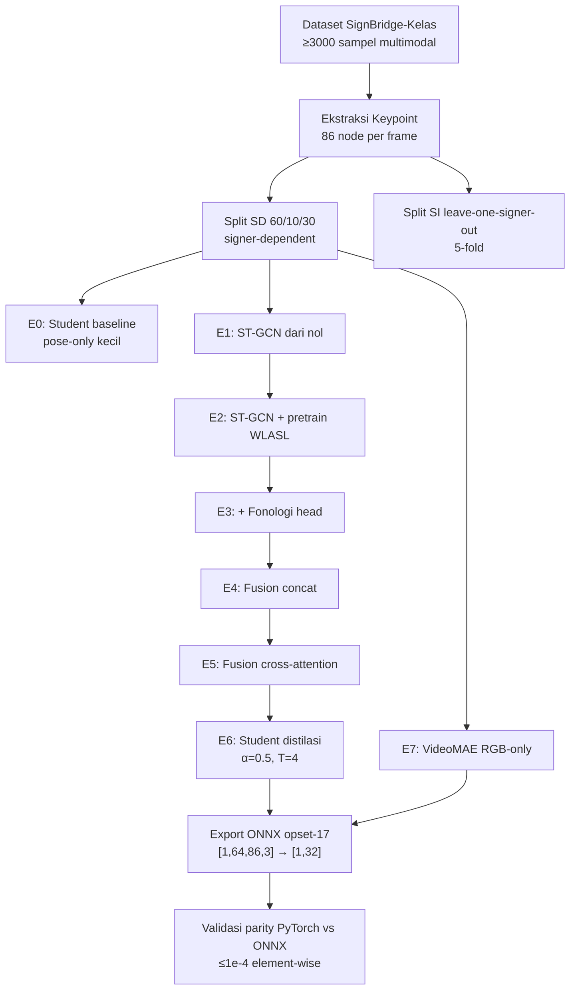
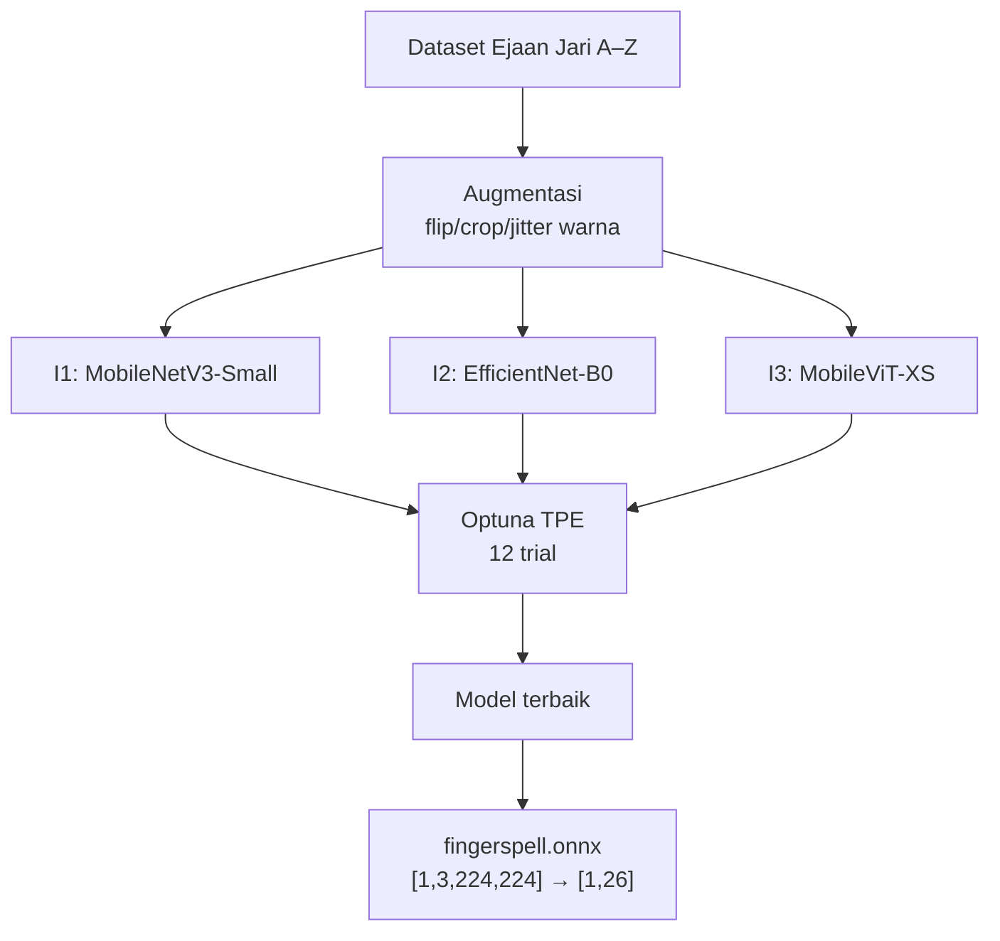

# Design Document — SignBridge ID–PH: Jembatan Komunikasi Real-Time BISINDO–FSL untuk ASEAN

## Overview

SignBridge ID–PH adalah sistem pengenalan dan penerjemahan bahasa isyarat lintas-negara yang
menghubungkan **BISINDO** (Bahasa Isyarat Indonesia) dengan **FSL** (Filipino Sign Language)
secara real-time melalui browser tanpa instalasi. Sistem mengimplementasikan **4 modalitas input**:

| Kode | Modalitas | Deskripsi |
|------|-----------|-----------|
| M0–M6 | Video/Keypoint | Pengenalan gloss dari video webcam via ST-GCN / VideoMAE |
| I1–I3 | Gambar Ejaan Jari | Klasifikasi huruf A–Z dari frame statis |
| A0–A3 | Audio ASR | Transkripsi ucapan → teks (Whisper) |
| B0, T1–T3 | Teks Gloss→Kalimat | Konversi urutan gloss ke kalimat alami |

**Jembatan ID↔PH** (MT0–MT3, X1–X4, A4) menerjemahkan antara BISINDO dan FSL melalui tiga lapis:
kamus konsep offline, terjemahan neural NLLB, dan animasi keypoint rekaman.

### Kontribusi Ilmiah

1. Dataset **SignBridge-Kelas** ≥3.000 sampel multimodal (video + audio + gambar + teks + keypoint)
2. Arsitektur **two-stream gated fusion** dengan distilasi pengetahuan untuk BISINDO
3. **Jembatan 3 lapis** BISINDO↔FSL (kamus + neural MT + animasi isyarat)
4. Infrastruktur **PWA + WebRTC** berbasis browser tanpa instalasi
5. Benchmark terbuka (model ONNX, kode, dataset) untuk komunitas ASEAN

---

## Architecture

### High-Level Architecture — 4 Modalitas

```
┌──────────────────────────────────────────────────────────────────────────────┐
│                        SignBridge ID–PH System                               │
│                                                                              │
│  ┌────────────┐  ┌────────────┐  ┌────────────┐  ┌────────────────────┐    │
│  │ M0–M6      │  │ I1–I3      │  │ A0–A3      │  │ B0, T1–T3          │    │
│  │ Video /    │  │ Gambar     │  │ Audio ASR  │  │ Gloss → Kalimat    │    │
│  │ Keypoint   │  │ Ejaan Jari │  │ (Whisper)  │  │ (GRU/IndoT5/mT5)  │    │
│  └─────┬──────┘  └─────┬──────┘  └─────┬──────┘  └────────┬───────────┘    │
│        │               │               │                   │                │
│        └───────────────┴───────────────┴───────────────────┘                │
│                                        │                                     │
│                               ┌────────▼────────┐                           │
│                               │  FastAPI Server  │                           │
│                               │  /predict  /asr  │                           │
│                               │  /sentence       │                           │
│                               │  /translate  /ws │                           │
│                               └────────┬─────────┘                           │
│                                        │                                     │
│                        ┌──────────────┬┴──────────────┐                     │
│                         │                              │                     │
│               ┌─────────▼─────────┐      ┌────────────▼──────────┐         │
│               │  Jembatan ID↔PH   │      │   Web Application     │         │
│               │  L1 Kamus offline │      │   PWA + WebRTC        │         │
│               │  L2 NLLB neural   │      │   GitHub Pages        │         │
│               │  L3 Animasi KP    │      │   port 8080           │         │
│               └───────────────────┘      └───────────────────────┘         │
└──────────────────────────────────────────────────────────────────────────────┘
```

### Two-Stream Gated Fusion Architecture (Model Video)

```
Video Input
    │
    ├─────────────────────────────────────┐
    ▼                                     ▼
MediaPipe Holistic                   Frame Resize
Keypoint Extraction                  (224×224 RGB)
Reduksi → [T, 86, 3]               [T, 3, 224, 224]
    │                                     │
    ▼  Normalisasi bahu                   ▼
┌─────────────┐                  ┌──────────────────┐
│  Stream_A   │                  │    Stream_B      │
│  ST-GCN /   │                  │  VideoMAE RGB    │
│  Pose-only  │                  │  (pretrained)    │
│  → p̄ [B,512]│                  │  → r̄ [B, 512]   │
└──────┬──────┘                  └────────┬─────────┘
       │                                  │
       └────────────┬─────────────────────┘
                    ▼
        ┌───────────────────────┐
        │   Gated Fusion        │
        │  g = σ(W[p̄; r̄])     │
        │  z = g⊙p̄ + (1-g)⊙r̄  │
        │  → z [B, 512]         │
        └───────────┬───────────┘
                    │
           ┌────────┴────────┐
           ▼                 ▼
   ┌──────────────┐ ┌──────────────────────┐
   │  Gloss Head  │ │  Fonologi_Head        │
   │  FC→LN→GELU  │ │  handshape / lokasi  │
   │  → [B, 32]   │ │  / arah_gerak        │
   └──────────────┘ └──────────────────────┘
```

### Diagram 4 Modalitas — Alur Lengkap



### Mermaid — Training Workflow Video (E0–E7)



### Mermaid — Training Workflow Gambar Ejaan Jari (I1–I3)



---

## Components and Interfaces

### 1. Data Pipeline

#### 1.1 DatasetDownloader

```python
class DatasetDownloader:
    """Unduh dan validasi dataset SignBridge-Kelas, WLASL, dan FLEURS."""

    def download_signbridge_kelas(self, source: str, output_dir: Path) -> DownloadResult:
        """
        Unduh dataset SignBridge-Kelas ≥3000 sampel multimodal.
        Returns: DownloadResult(success, files_downloaded, validation_errors)
        """

    def download_wlasl(self, output_dir: Path) -> DownloadResult:
        """Unduh WLASL dengan retry logic dan validasi file."""

    def download_fleurs_id(self, output_dir: Path) -> DownloadResult:
        """Unduh FLEURS id_id untuk fine-tune Whisper."""

    def validate_signbridge_integrity(self, data_dir: Path) -> ValidationReport:
        """
        Verifikasi manifest.csv: kolom wajib (id, gloss, signer_id, split,
        video_path, audio_path, image_path, keypoint_path, text).
        Raises: DataValidationError jika ada ketidaksesuaian.
        """
```

#### 1.2 DatasetSplitter

```python
class DatasetSplitter:
    """Split dataset dengan dua protokol: SD dan SI."""

    def split_signer_dependent(
        self,
        metadata: list[SampleMetadata],
        ratios: tuple[float, float, float] = (0.60, 0.10, 0.30)
    ) -> DataSplit:
        """
        Split SD: 60/10/30. Signer bisa muncul di beberapa split.
        Stratifikasi per gloss.
        """

    def split_signer_independent(
        self,
        metadata: list[SampleMetadata],
        n_folds: int = 5
    ) -> list[DataSplit]:
        """
        Split SI: leave-one-signer-out, 5-fold.
        Setiap signer muncul di tepat satu fold sebagai test.
        Returns: list 5 DataSplit
        """
```

#### 1.3 KeypointExtractor

```python
class KeypointExtractor:
    """Ekstraksi dan reduksi keypoint MediaPipe Holistic → 86 node relevan."""

    # Layout 86 keypoint (kontrak tidak boleh berubah — constants.py)
    # [0:21]  — tangan kanan (21 keypoint)
    # [21:42] — tangan kiri (21 keypoint)
    # [42:75] — pose tubuh (33 keypoint)
    # [75:86] — wajah selektif (11 keypoint)

    def extract_video(self, video_path: Path) -> KeypointResult:
        """
        Ekstrak [T, 86, 3] float32.
        Interpolasi linear untuk frame yang hilang (jendela ±5).
        Zero-padding jika tidak ada frame valid dalam jendela.
        """

    def normalize_pose(self, keypoints: np.ndarray) -> np.ndarray:
        """
        Normalisasi terhadap bahu:
        x = (x - 0.5*(bahupL + bahupR)) / ||bahupL - bahupR||
        Fallback ke bounding box frame sebelumnya jika jarak bahu = 0.
        """

    def batch_extract(
        self,
        video_paths: list[Path],
        output_dir: Path,
        num_workers: int = 4
    ) -> BatchExtractionReport:
        """Batch processing paralel dengan laporan progres."""
```

#### 1.4 DataParser / DataSerializer

```python
class KeypointParser:
    """Parser dan validator untuk file keypoint .npy."""

    # Kontrak: shape [T, 86, 3], dtype float32
    REQUIRED_SHAPE_SUFFIX = (86, 3)

    def load(self, path: Path) -> np.ndarray:
        """
        Load dan validasi array [T, 86, 3], dtype=float32.
        Raises: SchemaValidationError jika tidak valid.
        """

    def save(self, array: np.ndarray, path: Path) -> None:
        """Simpan array keypoint tervalidasi ke .npy."""

class ManifestParser:
    """Parser dan validator untuk manifest.csv."""

    REQUIRED_COLUMNS = {
        "id", "gloss", "signer_id", "split",
        "video_path", "audio_path", "image_path",
        "keypoint_path", "text"
    }
    VALID_SPLITS = {"train", "val", "test"}

    def load(self, path: Path) -> list[SampleMetadata]:
        """
        Load setiap baris, validasi kolom wajib.
        Raises: SchemaValidationError dengan detail per-baris.
        """

    def save(self, records: list[SampleMetadata], path: Path) -> None:
        """Serialize ke CSV dengan header tetap."""
```

#### 1.5 GraphBuilder

```python
class KeypointGraphBuilder:
    """Konstruksi dan validasi Keypoint_Graph dari YAML (86 node)."""

    def build_from_yaml(self, config_path: Path) -> KeypointGraph:
        """
        Load konfigurasi YAML, validasi semua node index ∈ [0, 85].
        Periksa tidak ada isolated node.
        Raises: GraphConfigError jika tidak valid.
        """

    def normalize_coordinates(
        self,
        keypoints: np.ndarray,  # [T, 86, 3]
        fallback_to_prev: bool = True
    ) -> np.ndarray:
        """
        Normalisasi pose terhadap bahu (lihat KeypointExtractor.normalize_pose).
        Fallback ke frame sebelumnya jika jarak bahu = 0.
        """
```

---

### 2. Augmentation Pipeline

```python
class AugmentationPipeline:
    """Pipeline augmentasi yang dikonfigurasi via YAML."""

    def __init__(self, config: AugmentationConfig):
        self.enabled = config.enabled
        self.split = config.split  # train / val / test

    def __call__(self, sample: AugmentationSample) -> AugmentationSample:
        """
        Jika enabled=False atau split ∈ {val, test}: hanya normalisasi standar.
        Jika enabled=True dan split=train: terapkan semua augmentasi.
        """

class TemporalAugmenter:
    speed_range: tuple = (0.7, 1.3)
    max_frame_drop_ratio: float = 0.20
    max_temporal_jitter: int = 3

class SpatialKeypointAugmenter:
    flip_prob: float = 0.5
    rotation_range: tuple = (-15.0, 15.0)  # degrees
    noise_std: float = 0.02  # normalized units

    def flip(self, keypoints: np.ndarray) -> tuple[np.ndarray, bool]:
        """Returns (flipped_keypoints, was_flipped) — swap tangan kanan/kiri."""

class SpatialRGBAugmenter:
    crop_scale_range: tuple = (0.8, 1.0)
    brightness: float = 0.2
    contrast: float = 0.2
    saturation: float = 0.2
```

---

### 3. Model Video (M0–M7)

#### 3.1 Stream_A — ST-GCN / Pose-Transformer

```python
class StreamA(nn.Module):
    """
    Stream pemrosesan keypoint skeleton.
    Input: [B, T_max=64, 86, 3]  (kontrak ONNX tidak boleh berubah)
    Output: [B, 512]
    """

    def __init__(self, config: StreamAConfig):
        # config.arch: "stgcn" | "pose_transformer"
        # config.num_blocks: 4–20 (default: 10)
        # config.hidden_dim: 128–512 (default: 256)
        # config.num_heads: 1–16 (default: 8)
        ...

    def forward(
        self,
        keypoints: torch.Tensor,    # [B, 64, 86, 3]
        padding_mask: torch.Tensor  # [B, 64], True=valid
    ) -> torch.Tensor:              # [B, 512]
        ...

class STGCNBlock(nn.Module):
    """Blok ST-GCN: spatial graph conv + temporal conv."""

class PoseTransformerEncoder(nn.Module):
    """Transformer encoder dengan positional + temporal embedding."""
```

#### 3.2 Stream_B — VideoMAE RGB

```python
class StreamB(nn.Module):
    """
    Stream pemrosesan penampilan visual RGB.
    Input: [B, T_sample=16, 3, 224, 224]
    Output: [B, 512]
    """

    IMAGENET_MEAN = [0.485, 0.456, 0.406]
    IMAGENET_STD  = [0.229, 0.224, 0.225]

    def __init__(self, config: StreamBConfig):
        # config.arch: "videomae" | "i3d"
        # config.pretrained_url: URL sumber bobot
        # config.frozen_layers: list[str] layer yang dibekukan
        ...

    def preprocess(self, frames: torch.Tensor) -> torch.Tensor:
        """Resize ke 224×224, normalisasi ImageNet."""

    def temporal_sample(self, frames: torch.Tensor, n: int = 16) -> torch.Tensor:
        """
        Uniform temporal sampling → T=16.
        Jika video < 16 frame, replikasi frame terakhir.
        """

    def forward(self, frames: torch.Tensor) -> torch.Tensor:  # [B, 512]
        ...
```

#### 3.3 Gated Fusion Module

```python
class GatedFusionModule(nn.Module):
    """
    Gated Fusion: g = σ(W[p̄; r̄]), z = g⊙p̄ + (1-g)⊙r̄
    Input: feat_pose p̄ [B, 512], feat_rgb r̄ [B, 512]
    Output: z [B, 512]
    """

    def __init__(self, dim: int = 512):
        self.gate_fc = nn.Linear(dim * 2, dim)  # W untuk concat [p̄; r̄]
        self.sigmoid = nn.Sigmoid()

    def forward(
        self,
        feat_pose: torch.Tensor,   # p̄ [B, 512]
        feat_rgb: torch.Tensor     # r̄ [B, 512]
    ) -> torch.Tensor:             # z [B, 512]
        concat = torch.cat([feat_pose, feat_rgb], dim=-1)  # [B, 1024]
        g = self.sigmoid(self.gate_fc(concat))             # [B, 512]
        return g * feat_pose + (1 - g) * feat_rgb

class CrossAttentionFusionModule(nn.Module):
    """
    Alternatif E5: Bidirectional Cross-Attention Fusion.
    Input: feat_A [B, 512], feat_B [B, 512]
    Output: fused [B, 512], attn_weights dict
    """

    def __init__(self, dim: int = 512, num_heads: int = 8):
        self.cross_attn_A2B = nn.MultiheadAttention(dim, num_heads)
        self.cross_attn_B2A = nn.MultiheadAttention(dim, num_heads)
        self.layer_norm_1 = nn.LayerNorm(dim)
        self.layer_norm_2 = nn.LayerNorm(dim)
```

#### 3.4 Classification Heads

```python
class GlossHead(nn.Module):
    """
    Kepala klasifikasi gloss.
    Input: [B, 512] → Output: [B, 32]
    """
    def __init__(self, in_dim: int = 512, num_classes: int = 32):
        # FC(512) → LayerNorm → GELU → FC(num_classes)
        ...

class FonologiHead(nn.Module):
    """
    Kepala prediksi fitur fonologis (multitask).
    Tiga sub-head independen.
    """
    def __init__(
        self,
        in_dim: int,
        num_handshape: int,   # 10–50
        num_lokasi: int,      # 5–20
        num_arah_gerak: int   # 4–12
    ): ...

    def forward(self, fused: torch.Tensor) -> FonologiOutput:
        # Returns FonologiOutput(handshape_logits, lokasi_logits, arah_gerak_logits)
        ...
```

#### 3.5 Full Teacher Model

```python
class SignBridgeTeacher(nn.Module):
    """
    Teacher_Model: Stream_A + Stream_B + GatedFusion + Heads.

    Loss teacher:
    ℒ = CE_ls(y) + 0.3*(CE_pose + CE_rgb)
        + 0.5 * (1/|F|) * Σ_f CE(fonologi_f)
    """
    def forward(
        self,
        keypoints: torch.Tensor,    # [B, 64, 86, 3]
        frames: torch.Tensor,       # [B, 16, 3, 224, 224]
        padding_mask: torch.Tensor  # [B, 64]
    ) -> ModelOutput:
        p_bar = self.stream_a(keypoints, padding_mask)   # [B, 512]
        r_bar = self.stream_b(frames)                    # [B, 512]
        z = self.fusion(p_bar, r_bar)                    # [B, 512]
        gloss_logits = self.gloss_head(z)                # [B, 32]
        phono = self.fonologi_head(z) if self.use_phono else None
        return ModelOutput(gloss_logits, p_bar, r_bar, phono)

class StudentModel(nn.Module):
    """
    Student_Model (pose-only).
    Input ONNX: float32 [1, 64, 86, 3]
    Output ONNX: logits [1, 32]
    Target: ≤10 MB INT8

    Loss distilasi:
    ℒ = α*CE(y,s) + (1-α)*T²*KL(σ(t/T) || σ(s/T))
    α=0.5, T=4
    """
```

---

### 4. Model Gambar Ejaan Jari (I1–I3)

```python
class ImageClassifier:
    """
    Klasifikasi huruf ejaan jari A–Z dari gambar statis.
    Input ONNX: float32 [1, 3, 224, 224]
    Output ONNX: logits [1, 26]
    Label: fingerspell.json (kontrak tidak boleh berubah)
    """

class FingerspellI1(ImageClassifier):
    """I1: MobileNetV3-Small — baseline ringan."""
    arch = "mobilenetv3_small"

class FingerspellI2(ImageClassifier):
    """I2: EfficientNet-B0 — efisien akurat."""
    arch = "efficientnet_b0"

class FingerspellI3(ImageClassifier):
    """I3: MobileViT-XS — hybrid CNN-ViT."""
    arch = "mobilevit_xs"
```

**Kontrak antarmuka (tidak boleh berubah):**
- File ONNX: `fingerspell.onnx`, input `[1,3,224,224]`, output `[1,26]`
- Label: `fingerspell.json` (urutan A–Z, 26 kelas)
- Preprocessing: `features.py` ≡ `features.js` (diuji `parity.test.mjs`)

**Hyperparameter tuning:** Optuna TPE, 12 trial per arsitektur.

---

### 5. Model Audio ASR (A0–A3)

```python
class ASRModel:
    """
    Automatic Speech Recognition menggunakan Whisper.
    Data: FLEURS id_id
    Metrik: WER, CER, RTF (Real-Time Factor)
    """

class ASRA0:
    """A0: Whisper-tiny zero-shot (baseline tanpa fine-tune)."""

class ASRA1:
    """A1: Whisper-tiny fine-tune pada FLEURS id_id."""

class ASRA2:
    """A2: Whisper-base fine-tune pada FLEURS id_id."""

class ASRA3:
    """A3: Whisper-base fine-tune + augmentasi noise."""
```

**Endpoint FastAPI:**
```
POST /asr
  Content-Type: multipart/form-data
  Body: audio=<file wav/mp3/webm>
  Returns: {"text": "saya mau makan"}
  Error 400: format tidak valid
  Error 413: ukuran > 10 MB
```

---

### 6. Model Teks Gloss→Kalimat (B0, T1–T3)

```python
class TextModel:
    """
    Konversi urutan pseudo-gloss → kalimat bahasa alami.
    Metrik: BLEU, chrF, WER, exact match
    """

class TextB0:
    """B0: Aturan heuristik (baseline)."""

class TextT1:
    """T1: GRU + Bahdanau Attention."""

class TextT2:
    """T2: IndoT5-small (fine-tune)."""

class TextT3:
    """T3: mT5-small (fine-tune)."""
```

**Endpoint FastAPI:**
```
POST /sentence
  Content-Type: application/json
  Body: {"gloss": "SAYA MAKAN NASI"}
  Returns: {"text": "Saya sedang makan nasi."}
```

---

### 7. Jembatan BISINDO–FSL (MT0–MT3, X1–X4, A4)

#### 7.1 BridgeModule — 3 Lapis

```
┌─────────────────────────────────────────────────────────────────┐
│                     Jembatan ID↔PH 3 Lapis                      │
│                                                                  │
│  L1: Kamus Konsep (offline)                                      │
│      concepts.csv: concept_id, bisindo_gloss, fsl_gloss,        │
│                    bisindo_label_id, fsl_label_id                │
│      → Lookup langsung tanpa jaringan                            │
│                                                                  │
│  L2: Terjemahan Neural (NLLB-200)                                │
│      POST /translate {text, src_lang, tgt_lang}                  │
│      → Kalimat Indonesia ↔ Filipino                              │
│                                                                  │
│  L3: Animasi Isyarat Rujukan                                     │
│      Keypoint rekaman diputar ulang di browser                   │
│      → Visualisasi gerakan BISINDO / FSL                         │
└─────────────────────────────────────────────────────────────────┘
```

```python
class BridgeModule:
    """Orkestrator 3-lapis jembatan BISINDO–FSL."""

    def translate_concept(
        self,
        gloss: str,
        direction: Literal["ID2PH", "PH2ID"]
    ) -> BridgeResult:
        """
        Coba L1 (kamus offline) dulu.
        Jika tidak ditemukan → L2 (NLLB neural).
        Sertakan path keypoint untuk L3 (animasi).
        """

class TranslationModel:
    """Model terjemahan neural BISINDO ↔ FSL."""

class TransMT0:
    """MT0: Kamus statis (baseline)."""

class TransMT1:
    """MT1: M2M100-418M fine-tune."""

class TransMT2:
    """MT2: NLLB-600M fine-tune."""

class TransMT3:
    """MT3: NLLB-1.3B fine-tune."""

class FSLModel:
    """Model FSL-side (simetris dengan model BISINDO)."""

class FSLX1:
    """X1: Init bobot dari WLASL."""

class FSLX2:
    """X2: Init bobot dari BISINDO."""

class FSLX3:
    """X3: Latih dari nol."""

class FSLX4:
    """X4: Student distilasi."""
```

**Endpoint FastAPI:**
```
POST /translate
  Content-Type: application/json
  Body: {"text": "SAYA LAPAR", "src": "BISINDO", "tgt": "FSL"}
  Returns: {"translation": "GUTOM AKO", "layer_used": "L1"}
```

---

### 8. Web Application (PWA + WebRTC)

```
Teknologi: HTML/CSS/JS murni, WebRTC + PeerJS, Service Worker (PWA)
Hosting: GitHub Pages (port 8080 dev), Azure Static Web Apps (produksi)

Fitur utama:
  ┌─────────────────────────────────────────────────────────┐
  │  Papan Isyarat   — input gloss, tampil kalimat          │
  │  Ejaan Jari      — kamera → huruf real-time (I1–I3)     │
  │  Takarir Suara   — mikrofon → teks (A0–A3)              │
  │  Jembatan ID↔PH  — terjemah BISINDO ↔ FSL              │
  │  Kelas Multi-    — WebRTC ruang kelas ≥2 perangkat      │
  │  Perangkat                                              │
  │  Rekam Data      — multimodal: video+audio+gambar+teks  │
  └─────────────────────────────────────────────────────────┘
```

```javascript
// Kontrak antarmuka preprocessing (features.js — identik dengan features.py)
function extractAndNormalize(landmarksHolistic) {
    // Urutan 86 node: tangan kanan [0:21], tangan kiri [21:42],
    //                 pose [42:75], wajah selektif [75:86]
    // Normalisasi bahu: x = (x - midBahu) / distBahu
    // Output: Float32Array shape [1, 64, 86, 3]
}
```

---

### 9. FastAPI Server

```
Endpoints:
  POST /predict   — keypoint [1,64,86,3] → gloss + confidence
  POST /asr       — audio file → {text}
  POST /sentence  — {gloss} → {text}
  POST /translate — {text, src, tgt} → {translation, layer_used}
  GET  /ws/{kode} — WebSocket relay untuk kelas multi-perangkat

Port: 7860 (API), 8080 (web)
Rate limit: 60 req/min/IP, header Retry-After
```

```python
@app.post("/predict")
async def predict(keypoints: UploadFile) -> PredictResponse:
    """
    Input: float32 binary [1, 64, 86, 3]
    Returns: {"gloss": "MAKAN", "confidence": 0.92,
              "top5": [...], "inference_time_ms": 45.2}
    """

@app.websocket("/ws/{kode}")
async def websocket_relay(websocket: WebSocket, kode: str):
    """WebSocket relay untuk sinkronisasi kelas multi-perangkat."""
```

---

### 10. Docker Deployment

```yaml
# docker-compose.yml
services:
  web:
    image: signbridge-web
    ports: ["8080:8080"]
    # Menyajikan HTML/JS/CSS murni

  api:
    image: signbridge-api
    ports: ["7860:7860"]
    volumes:
      - ./models:/app/models  # ONNX files
    environment:
      - NLLB_MODEL=facebook/nllb-200-distilled-600M
```

**Azure deployment:**
- Web: Azure Static Web Apps (GitHub Actions CI/CD)
- API: Azure Container Apps (auto-scaling)

---

### 11. Training System

```python
class LossFunctions:

    @staticmethod
    def teacher_loss(
        gloss_logits: torch.Tensor,
        pose_logits: torch.Tensor,
        rgb_logits: torch.Tensor,
        fonologi_logits: list[torch.Tensor],
        labels: torch.Tensor,
        fonologi_labels: list[torch.Tensor],
        smoothing: float = 0.1
    ) -> torch.Tensor:
        """
        ℒ = CE_ls(y) + 0.3*(CE_pose + CE_rgb)
            + 0.5 * (1/|F|) * Σ_f CE(fonologi_f)
        """

    @staticmethod
    def distillation_loss(
        student_logits: torch.Tensor,
        teacher_logits: torch.Tensor,
        hard_labels: torch.Tensor,
        alpha: float = 0.5,     # kontrak: α=0.5
        temperature: float = 4.0  # kontrak: T=4
    ) -> torch.Tensor:
        """
        ℒ = α*CE(y,s) + (1-α)*T²*KL(σ(t/T) || σ(s/T))
        """

class TrainerConfig:
    base_lr: float               # 1e-5 to 1e-2, default: 1e-4
    pretrained_lr_factor: float  # 0.1 × base_lr untuk lapisan pretrained
    early_stopping_patience: int # default: 10
    max_checkpoints: int         # default: 3
    seed: int                    # default: 42
    label_smoothing: float       # [0.0, 1.0), default: 0.1
    optuna_trials_video: int     # default: 20
    optuna_trials_image: int     # default: 12
```

---

### 12. Recording Script Interface

```
record_dataset.py
  --gloss <name>          : gloss yang akan direkam
  --signer-id <id>        : ID signer
  --output-dir <path>     : direktori output
  --fps 30                : frame rate
  --resolution 640x480    : resolusi minimum
  --audio                 : rekam audio serentak
  --image                 : rekam gambar ejaan jari

Alur multimodal:
  1. Tampilkan instruksi gloss (Bahasa Indonesia)
  2. Hitung mundur 3 detik
  3. Rekam video + audio serentak (2–5 detik)
  4. Tangkap gambar ejaan jari (opsional)
  5. Simpan semua file dalam struktur SignBridge-Kelas
  6. Update manifest.csv secara otomatis
```

---

## Data Models

### SampleMetadata — manifest.csv (kontrak tidak boleh berubah)

```python
@dataclass
class SampleMetadata:
    id: str           # wajib — unique identifier
    gloss: str        # wajib — label gloss
    signer_id: str    # wajib — ID signer
    split: str        # wajib — "train" | "val" | "test"
    video_path: str   # wajib — path relatif ke file video
    audio_path: str   # wajib — path relatif ke file audio
    image_path: str   # wajib — path relatif ke gambar ejaan jari
    keypoint_path: str # wajib — path relatif ke file .npy keypoint
    text: str         # wajib — teks kalimat
```

### KeypointArray Schema (kontrak tidak boleh berubah)

```
File:    <sample_id>.npy
Shape:   [T, 86, 3]
dtype:   float32
Values:  normalized (normalisasi bahu)
T range: [1, 10000]

Layout 86 keypoint (urutan di constants.py):
  [0:21]  — tangan kanan (21 keypoint)
  [21:42] — tangan kiri (21 keypoint)
  [42:75] — pose tubuh (33 keypoint)
  [75:86] — wajah selektif (11 keypoint)
```

### ONNX Interface (kontrak tidak boleh berubah)

```
Model Video:
  Input:  float32 [1, 64, 86, 3]   (T_max=64)
  Output: float32 [1, 32]           (logits)
  Labels: labels.json               (32 gloss BISINDO)

Model Gambar:
  Input:  float32 [1, 3, 224, 224]
  Output: float32 [1, 26]           (logits)
  Labels: fingerspell.json          (A–Z)
```

### KeypointGraph (YAML)

```yaml
# graph_config.yaml
num_nodes: 86
node_labels:
  - "right_wrist"       # index 0
  - "right_thumb_tip"   # index 1
  # ... 21 tangan kanan
  - "left_wrist"        # index 21
  # ... 21 tangan kiri
  - "nose"              # index 42
  # ... 33 pose tubuh
  - "left_eye"          # index 75
  # ... 11 wajah selektif
edges:
  spatial:
    - [0, 1]    # right_wrist — right_thumb_tip
    - [42, 11]  # nose — left_shoulder (pose)
    # ...
  temporal:
    # digenerate programatik: node_i frame_t → node_i frame_t+1
  symmetry:
    - [0, 21]   # right_wrist ↔ left_wrist
    # ...
```

### FonologiAnnotation (phonology.csv)

```
Kolom: gloss, handshape, lokasi, arah_gerak
Contoh:
  MAKAN, B-flat, mouth, towards-body
  MINUM, C-shape, mouth, towards-body
  TERIMA_KASIH, B-flat, forehead, away-body
```

### ConceptsBridge (concepts.csv — L1 Kamus)

```
Kolom: concept_id, bisindo_gloss, fsl_gloss,
       bisindo_label_id, fsl_label_id
Contoh:
  EAT, MAKAN, KAIN, 7, 12
  DRINK, MINUM, INOM, 8, 15
```

### ModelConfig (YAML)

```yaml
# configs/train_bisindo.yaml
seed: 42
model:
  num_classes: 32
  use_fonologi_head: true
  t_max: 64              # kontrak ONNX: tidak boleh berubah
  num_keypoints: 86      # kontrak: tidak boleh berubah
  stream_a:
    arch: "stgcn"
    num_blocks: 10       # valid: 4–20
    hidden_dim: 256      # valid: 128–512
    num_heads: 8         # valid: 1–16
  stream_b:
    arch: "videomae"
    pretrained_url: "..."
    frozen_layers: []
  fusion:
    type: "gated"        # "gated" | "cross_attention"
    dim: 512
  gloss_head:
    label_smoothing: 0.1 # valid: [0.0, 1.0)
  fonologi_head:
    num_handshape: 20
    num_lokasi: 10
    num_arah_gerak: 8
training:
  base_lr: 1.0e-4        # valid: 1e-5 to 1e-2
  pretrained_lr_factor: 0.1
  early_stopping_patience: 10
  max_checkpoints: 3
  optuna_trials_video: 20
  optuna_trials_image: 12
distillation:
  alpha: 0.5             # kontrak: tidak boleh berubah
  temperature: 4.0       # kontrak: tidak boleh berubah
  onnx_opset: 17
  max_model_size_mb: 10
augmentation:
  enabled: true
  temporal:
    speed_range: [0.7, 1.3]
    max_frame_drop_ratio: 0.20
    max_temporal_jitter: 3
  spatial_keypoint:
    rotation_range: [-15.0, 15.0]
    noise_std: 0.02
  spatial_rgb:
    crop_scale_range: [0.8, 1.0]
    brightness: 0.2
    contrast: 0.2
    saturation: 0.2
```

### API Response Schemas

```json
// /predict
{
  "gloss": "MAKAN",
  "confidence": 0.92,
  "top5": [
    {"gloss": "MAKAN", "confidence": 0.92},
    {"gloss": "MINUM", "confidence": 0.05}
  ],
  "inference_time_ms": 45.2
}

// /asr
{"text": "saya mau makan nasi"}

// /sentence
{"text": "Saya ingin makan nasi."}

// /translate
{"translation": "GUTOM AKO", "layer_used": "L1"}
```

### ONNX Validation Result

```python
@dataclass
class ONNXValidationResult:
    passed: bool
    num_samples_tested: int        # 100
    max_prob_difference: float     # threshold: ≤ 1e-4
    failed_samples: list[int]      # indeks sampel yang gagal
```

---

## Correctness Properties

*A property is a characteristic or behavior that should hold true across all valid executions of a system.*

### Property 1: Dataset Validation Completeness

*For any* dataset directory dengan manifest.csv, the validator SHALL detect and report any record
missing a required column (`id`, `gloss`, `signer_id`, `split`, `video_path`, `audio_path`,
`image_path`, `keypoint_path`, `text`), and the number of reported errors SHALL equal exactly
the count of non-conforming records.

**Validates: manifest.csv schema contract**

---

### Property 2: Signer-Dependent Split Correctness (60/10/30)

*For any* set of metadata records, the SD splitter SHALL produce train/val/test splits with
proportions approximating 60/10/30 within ±3 percentage points.

**Validates: Split SD protocol**

---

### Property 3: Signer-Independent Split No Leakage

*For any* set of metadata records with K unique signers (K ≥ 5), the SI splitter SHALL produce
5 folds such that for each fold, no signer_id appears in both the test set and the train set
of that fold.

**Validates: Split SI protocol (leave-one-signer-out)**

---

### Property 4: Manifest Round-Trip

*For any* valid SampleMetadata object (semua kolom wajib hadir dengan tipe benar), serializing
ke manifest.csv lalu deserializing SHALL menghasilkan object dengan nilai identik untuk semua
9 kolom wajib.

**Validates: manifest.csv parser/serializer**

---

### Property 5: Keypoint Array Round-Trip

*For any* valid NumPy array dengan shape [T, 86, 3], dtype float32, saving ke `.npy` lalu
loading SHALL menghasilkan array dengan shape, dtype, dan values yang identik.

**Validates: KeypointParser**

---

### Property 6: Keypoint Normalization Bahu

*For any* keypoint frame di mana jarak bahu > 0, koordinat setelah normalisasi bahu SHALL
memiliki nilai bahu kiri = −0.5 dan bahu kanan = +0.5 pada sumbu x (dalam toleransi floating
point 1e-6).

**Validates: KeypointExtractor.normalize_pose**

---

### Property 7: Keypoint Interpolation Validity

*For any* keypoint sequence [T, 86, 3] dengan missing detections, interpolated sequence SHALL
tidak memiliki NaN, dan untuk frame f dengan neighbor valid dalam ±5 frame, interpolated value
SHALL berada di antara nilai neighbor tersebut.

**Validates: KeypointExtractor.extract_video**

---

### Property 8: Graph Topology Validation

*For any* graph config YAML di mana setidaknya satu edge mereferensikan node index di luar
[0, 85], graph validator SHALL menolak config dan mengembalikan error yang mengidentifikasi
indeks invalid. Demikian pula untuk isolated nodes.

**Validates: KeypointGraphBuilder**

---

### Property 9: Augmentation Non-Contamination

*For any* input sample melalui val/test augmentation pipeline (apa pun setting `augmentation.enabled`),
output SHALL identik dengan menerapkan hanya normalisasi standar — tidak ada random transform
yang diterapkan.

**Validates: AugmentationPipeline**

---

### Property 10: Horizontal Flip Involution

*For any* keypoint sequence, applying horizontal flip dua kali SHALL menghasilkan sequence
identik dengan original, dan single application SHALL menukar keypoint tangan kanan (index 0–20)
dengan tangan kiri (index 21–41).

**Validates: SpatialKeypointAugmenter.flip**

---

### Property 11: Temporal Augmentation Bounds

*For any* frame sequence panjang T dan speed factor s ∈ [0.7, 1.3], augmented output length
SHALL = ⌊T/s⌋ ± 1; dan *for any* max_frame_drop_ratio r ∈ [0, 0.20], output SHALL retain
≥ ⌈T×(1-r)⌉ frames.

**Validates: TemporalAugmenter**

---

### Property 12: Stream_A Output Shape Invariance

*For any* keypoint input [B, 64, 86, 3] (T_max=64 adalah kontrak ONNX), Stream_A SHALL
menghasilkan output tensor shape [B, 512]. Padding mask SHALL memiliki tepat T `True` values
dan (64-T) `False` values untuk sequence panjang T.

**Validates: StreamA, ONNX contract T_max=64**

---

### Property 13: Stream_B Temporal Sampling Consistency

*For any* input video ≥1 frame, uniform temporal sampler SHALL menghasilkan tepat 16 frames.
*For any* input ≥16 frames, 16 frame yang di-sample SHALL diambil pada indeks yang merata
mencakup seluruh temporal range.

**Validates: StreamB.temporal_sample**

---

### Property 14: Gated Fusion Output Bounds

*For any* pair feat_pose [B, 512] dan feat_rgb [B, 512], Gated Fusion SHALL menghasilkan
output z [B, 512] di mana setiap elemen adalah convex combination dari elemen p̄ dan r̄
yang bersesuaian (karena g ∈ [0,1] secara element-wise).

**Validates: GatedFusionModule**

---

### Property 15: Classification Head Dynamic Dimensionality

*For any* num_classes ≥ 2, GlossHead yang diinisialisasi dengan num_classes tersebut SHALL
menghasilkan output logits shape [B, num_classes] untuk input [B, 512].

**Validates: GlossHead**

---

### Property 16: Teacher Loss Non-Negativity

*For any* valid training step dengan use_fonologi_head=true, setiap komponen loss (CE_ls,
CE_pose, CE_rgb, CE_fonologi_f) SHALL bernilai finite non-negatif, dan total teacher loss
SHALL bernilai finite non-negatif.

**Validates: LossFunctions.teacher_loss**

---

### Property 17: Distillation Loss Formula Correctness

*For any* valid training step dengan α=0.5, T=4 (kontrak), distillation loss SHALL sama dengan
0.5*CE(y,s) + 0.5*16*KL(σ(t/4) || σ(s/4)), dengan setiap komponen finite non-negatif.

**Validates: LossFunctions.distillation_loss, α=0.5 T=4 contract**

---

### Property 18: ONNX Interface Contract

*For any* Student_Model yang diekspor, ONNX model SHALL menerima input shape [1, 64, 86, 3]
float32 dan menghasilkan output shape [1, 32] float32. Perbedaan absolut antara output ONNX
dan PyTorch untuk 100 sampel validasi SHALL ≤ 1e-4 element-wise.

**Validates: StudentModel ONNX export, preprocessing parity**

---

### Property 19: Fingerspell ONNX Interface Contract

*For any* model ejaan jari yang diekspor, ONNX model SHALL menerima input [1, 3, 224, 224]
float32 dan menghasilkan output [1, 26] float32. `fingerspell.json` SHALL berisi tepat 26
entri A–Z dalam urutan alphabetis.

**Validates: ImageClassifier ONNX export, fingerspell.json contract**

---

### Property 20: Preprocessing Parity Python–JavaScript

*For any* frame input yang diproses oleh `features.py` (Python) dan `features.js` (JavaScript),
output Float32 SHALL identik element-wise dalam toleransi 1e-5, diverifikasi oleh
`parity.test.mjs`.

**Validates: Cross-platform preprocessing contract**

---

### Property 21: ASR Response Schema

*For any* valid audio file yang dikirim ke `POST /asr`, respons SHALL memiliki field `text`
bertipe string (tidak null, bisa kosong jika audio tidak terdeteksi).

**Validates: ASRModel endpoint**

---

### Property 22: Bridge Layer Fallback Order

*For any* gloss BISINDO yang ada dalam `concepts.csv`, BridgeModule SHALL mengembalikan
hasil dari L1 (kamus offline) tanpa memanggil L2 (network). *For any* gloss yang tidak ada
dalam kamus, BridgeModule SHALL mencoba L2 sebelum mengembalikan error.

**Validates: BridgeModule fallback chain**

---

### Property 23: Schema Validation Rejection

*For any* `.npy` file yang array-nya tidak sesuai shape [T, 86, 3], atau dtype bukan float32,
KeypointParser SHALL raise `SchemaValidationError` dengan nama file dan constraint yang dilanggar.
*For any* manifest.csv record yang kehilangan kolom wajib, ManifestParser SHALL raise
`SchemaValidationError` dengan nomor baris dan nama kolom.

**Validates: KeypointParser, ManifestParser**

---

### Property 24: Configuration Range Validation

*For any* parameter di luar rentang valid (num_blocks luar [4,20], hidden_dim luar [128,512],
num_heads luar [1,16], label_smoothing luar [0.0,1.0), base_lr luar [1e-5,1e-2]), config
validator SHALL menolak dengan pesan yang menyebut nama parameter dan rentang valid.

**Validates: TrainerConfig, ModelConfig**

---

## Error Handling

### Error Taxonomy

| Error Class | Trigger | Response |
|---|---|---|
| `DataValidationError` | manifest.csv integrity failure | Tulis `data/validation_errors.txt`, hentikan proses |
| `SchemaValidationError` | .npy / manifest.csv tidak sesuai skema | Raise dengan nama file, field/dimensi bermasalah |
| `GraphConfigError` | Node index invalid atau isolated node | Raise dengan indeks bermasalah |
| `ConfigValidationError` | Parameter di luar rentang valid | Raise dengan nama parameter, nilai, rentang valid |
| `CheckpointNotFoundError` | Path checkpoint `--resume` tidak ada | Hentikan dengan pesan path yang dicari |
| `WebcamError` | Webcam tidak terdeteksi | Pesan Bahasa Indonesia, hentikan tanpa output |
| `CameraPermissionError` | getUserMedia ditolak | Pesan + tautan panduan mengaktifkan izin |
| `InferenceInitError` | MediaPipe / ONNX init gagal <5 detik | Pesan + tawarkan mode fallback upload |
| `BridgeNetworkError` | L2 NLLB tidak terjangkau | Fallback ke L1 kamus, log warning |
| HTTP 400 | Format / ukuran file tidak valid | JSON error message Bahasa Indonesia |
| HTTP 413 | File audio > 10 MB | JSON error + panduan kompresi |
| HTTP 429 | Rate limit terlampaui | Header `Retry-After` dalam detik |

### Error Propagation Strategy

```
Data Pipeline errors  → ditulis ke file log DAN raise exception
Training errors       → dicatat ke W&B / TensorBoard, raise jika fatal
Inference errors      → logged, fallback ke mode upload, tampilkan ke user
Bridge errors         → fallback L2→L1, log layer yang digunakan
Browser errors        → ditampilkan dalam Bahasa Indonesia, tanpa detail teknis
```

### Interpolation Fallback Chain (Keypoint)

```
Frame missing detection
  → Coba interpolasi linear dari frame valid dalam ±5 frame
    → Jika tidak ada frame valid: zero-pad
      → Catat ke log: {frame_index, keypoint_group, num_zeroed}
```

### Normalisasi Bahu Fallback

```
Jika ||bahupL - bahupR|| = 0 pada frame t:
  → Gunakan bounding box dari frame t-1
  → Jika t=0: gunakan bounding box default (normalized [-1,1])
  → Catat ke log: {frame_index, reason: "zero_shoulder_distance"}
```

### Threshold Warnings

```
Setelah training video selesai (threshold per model):
  E0–E6: IF top1 < 70% → LOG WARNING dengan rekomendasi
  E7:    IF top1 < 65% → LOG WARNING
  Proses TIDAK dihentikan — hanya warning.

Setelah distilasi:
  IF top1 < 78% → LOG WARNING:
    "Student accuracy di bawah threshold.
     Rekomendasi: turunkan alpha, naikkan temperature, atau tambah epoch."

Setelah fine-tune ASR:
  IF WER > 20% → LOG WARNING:
    "WER di atas threshold. Tambah data augmentasi noise."
```

---

## Testing Strategy

### Overview

Strategi pengujian menggunakan pendekatan dual:
1. **Unit tests / example-based tests** — behavior spesifik, edge cases, error conditions
2. **Property-based tests (PBT)** — universal properties pada semua input valid

Library PBT: **Hypothesis** (Python) — minimum **100 iterasi** per property test
(`@settings(max_examples=100)`).

Parity test JavaScript: **`parity.test.mjs`** menggunakan Node.js + onnxruntime-node.

---

### Unit Tests

**Data Pipeline:**
- `test_manifest_validation_report` — verifikasi laporan validasi format benar
- `test_split_sd_ratios` — verifikasi split 60/10/30
- `test_split_si_folds` — verifikasi 5 fold leave-one-signer-out
- `test_keypoint_extraction_shape` — verifikasi output [T, 86, 3]
- `test_normalization_bahu` — verifikasi posisi bahu setelah normalisasi
- `test_manifest_load_missing_column` — verifikasi `SchemaValidationError`
- `test_graph_yaml_invalid_index` — verifikasi `GraphConfigError`

**Model Video:**
- `test_stgcn_forward_shape` — verifikasi output [B, 512] untuk input [B,64,86,3]
- `test_videomae_preprocessing_shape` — verifikasi output [3, 224, 224]
- `test_gated_fusion_convex` — verifikasi g ∈ [0,1], output convex combination
- `test_gloss_head_num_classes` — verifikasi output shape berbagai num_classes
- `test_teacher_loss_nonneg` — verifikasi semua komponen loss ≥ 0

**Model Gambar:**
- `test_fingerspell_onnx_shape` — verifikasi output [1, 26]
- `test_fingerspell_json_26_classes` — verifikasi fingerspell.json berisi A–Z

**Model Audio:**
- `test_asr_endpoint_schema` — verifikasi respons memiliki field `text`
- `test_asr_empty_audio` — verifikasi respons kosong untuk audio bisu

**Model Teks:**
- `test_text_b0_heuristic` — verifikasi output kalimat dari aturan dasar
- `test_text_t2_indot5_inference` — verifikasi format output

**Jembatan:**
- `test_bridge_l1_hit` — verifikasi L2 tidak dipanggil jika gloss ada di kamus
- `test_bridge_l1_miss_l2_called` — verifikasi L2 dipanggil jika gloss tidak di kamus
- `test_bridge_network_fallback` — verifikasi fallback ke L1 jika L2 error

**API:**
- `test_fastapi_predict_valid` — verifikasi respons JSON valid
- `test_fastapi_asr_valid_wav` — verifikasi respons ASR
- `test_fastapi_rate_limiting` — verifikasi HTTP 429 setelah 60 req/menit
- `test_fastapi_oversized_audio` — verifikasi HTTP 413 untuk audio > 10 MB

---

### Property-Based Tests

Semua property test menggunakan tag komentar:
`# Feature: signbridge-bisindo, Property N: <property_text>`

```python
# Feature: signbridge-bisindo, Property 4: Manifest Round-Trip
@given(st.builds(SampleMetadata, ...))
@settings(max_examples=100)
def test_manifest_roundtrip(metadata):
    ManifestParser().save([metadata], tmp_path)
    loaded = ManifestParser().load(tmp_path)
    assert loaded[0].gloss == metadata.gloss
    assert loaded[0].signer_id == metadata.signer_id
    # ... semua 9 field

# Feature: signbridge-bisindo, Property 5: Keypoint Array Round-Trip
@given(arrays(dtype=np.float32, shape=st.tuples(st.integers(1,100), st.just(86), st.just(3)),
              elements=st.floats(-5.0, 5.0, allow_nan=False)))
@settings(max_examples=100)
def test_keypoint_array_roundtrip(arr):
    save_keypoints(arr, tmp_path)
    loaded = load_keypoints(tmp_path)
    np.testing.assert_array_equal(arr, loaded)

# Feature: signbridge-bisindo, Property 10: Horizontal Flip Involution
@given(keypoint_sequence_strategy())
@settings(max_examples=100)
def test_flip_involution(keypoints):
    flipped_once, _ = augmenter.flip(keypoints)
    flipped_twice, _ = augmenter.flip(flipped_once)
    np.testing.assert_array_almost_equal(keypoints, flipped_twice)

# Feature: signbridge-bisindo, Property 3: Signer-Independent Split No Leakage
@given(signer_metadata_strategy(min_signers=5, max_signers=15))
@settings(max_examples=100)
def test_si_split_no_leakage(metadata):
    folds = splitter.split_signer_independent(metadata, n_folds=5)
    for fold in folds:
        train_signers = {m.signer_id for m in fold.train}
        test_signers  = {m.signer_id for m in fold.test}
        assert train_signers.isdisjoint(test_signers)

# Feature: signbridge-bisindo, Property 12: Stream_A Output Shape Invariance
@given(st.integers(1, 64))
@settings(max_examples=100)
def test_stream_a_output_shape(T):
    keypoints = torch.zeros(1, T, 86, 3)
    out = stream_a(pad_to_64(keypoints), pad_mask(T, 64))
    assert out.shape == (1, 512)

# Feature: signbridge-bisindo, Property 14: Gated Fusion Output Bounds
@given(
    arrays(dtype=np.float32, shape=(2, 512), elements=st.floats(-5, 5)),
    arrays(dtype=np.float32, shape=(2, 512), elements=st.floats(-5, 5))
)
@settings(max_examples=100)
def test_gated_fusion_convex(pose, rgb):
    p = torch.tensor(pose)
    r = torch.tensor(rgb)
    z = fusion(p, r)
    # z harus berada antara min(p,r) dan max(p,r) element-wise
    assert ((z >= torch.min(p, r) - 1e-5) & (z <= torch.max(p, r) + 1e-5)).all()

# Feature: signbridge-bisindo, Property 24: Configuration Range Validation
@given(st.integers().filter(lambda x: not (4 <= x <= 20)))
@settings(max_examples=100)
def test_invalid_num_blocks_rejected(invalid_num_blocks):
    with pytest.raises(ConfigValidationError) as exc:
        validate_config({"num_blocks": invalid_num_blocks})
    assert "num_blocks" in str(exc.value)
    assert "[4, 20]" in str(exc.value)
```

---

### Parity Test (Python ≡ JavaScript)

```javascript
// parity.test.mjs
// Feature: signbridge-bisindo, Property 20: Preprocessing Parity
import { extractAndNormalize } from './features.js';
import { loadTestFrames } from './test_helpers.mjs';

const frames = loadTestFrames('test_fixtures/parity_frames.json');
const jsOutput = extractAndNormalize(frames);       // Float32Array [1,64,86,3]
const pyOutput = loadNpy('test_fixtures/parity_py.npy');

for (let i = 0; i < jsOutput.length; i++) {
    assert(Math.abs(jsOutput[i] - pyOutput[i]) < 1e-5,
        `Mismatch at index ${i}: JS=${jsOutput[i]}, PY=${pyOutput[i]}`);
}
```

---

### Integration Tests

- **End-to-end pipeline video**: ekstrak → split → augment → DataLoader → training 1 epoch
- **End-to-end pipeline gambar**: dataset → augment → train I1 → export ONNX
- **End-to-end ASR**: FLEURS id_id → fine-tune A1 → evaluasi WER
- **End-to-end teks**: pseudo-gloss → T2 IndoT5 → evaluasi BLEU
- **ONNX validation video**: ekspor E6 → inferensi ONNX → parity PyTorch ≤1e-4
- **ONNX validation gambar**: ekspor I2 → inferensi ONNX → parity PyTorch ≤1e-4
- **FastAPI server**: spin-up → /predict, /asr, /sentence, /translate → verifikasi JSON
- **WebSocket relay**: dua klien → kirim pesan → verifikasi relay diterima
- **Jembatan 3 lapis**: L1 hit, L1 miss → L2, L2 fail → error dengan L1 fallback

---

### Smoke Tests

- `smoke_test.py` — verifikasi import semua modul, file konfigurasi ada, constants.py konsisten
- `test_manifest_exists` — verifikasi `manifest.csv` ada dengan semua kolom wajib
- `test_concepts_csv_exists` — verifikasi `concepts.csv` ada dengan kolom wajib
- `test_phonology_csv_exists` — verifikasi `phonology.csv` ada
- `test_labels_json_32` — verifikasi `labels.json` berisi tepat 32 gloss
- `test_fingerspell_json_26` — verifikasi `fingerspell.json` berisi tepat 26 huruf A–Z
- `test_onnx_files_present` — verifikasi `model.onnx` dan `fingerspell.onnx` ada
- `test_webcam_detection` — verifikasi skrip perekaman mendeteksi webcam
- `test_docker_compose_valid` — verifikasi `docker-compose.yml` valid YAML

---

## Performance Targets

### Target Per Modalitas

| Modalitas | Metrik | Target | Metode Pengujian |
|---|---|---|---|
| Video (E6 Student) | Top-1 SD | ≥ 80% | 5-fold SD test |
| Video (E6 Student) | Top-1 SI | ≥ 70% | 5-fold SI LOSO |
| Video (E5 Teacher) | Top-1 SD | ≥ 85% | 5-fold SD test |
| Video (E5 Teacher) | Top-5 SD | ≥ 97% | 5-fold SD test |
| Gambar (I2 best) | Akurasi A–Z | ≥ 90% | Test set holdout |
| Audio (A2 fine-tune) | WER id_id | ≤ 15% | FLEURS id_id test |
| Audio (A2 fine-tune) | RTF | ≤ 0.5× | Profiling CPU i5 |
| Teks (T2 IndoT5) | BLEU | ≥ 25 | Test set holdout |
| Teks (T2 IndoT5) | chrF | ≥ 40 | Test set holdout |
| Jembatan (L1+L2) | Coverage | ≥ 95% | Evaluasi kamus |

### Target Sistem

| Metrik | Target | Metode Pengujian |
|---|---|---|
| Ekstraksi keypoint throughput | ≥ 1.000 video / jam (GPU ≥8GB) | Profiling tqdm |
| Inferensi browser (Student ONNX) | ≤ 100 ms/frame (Core i5 gen-8) | Performance.now() |
| FastAPI /predict latency | ≤ 2 detik (video 1–3 dtk) | pytest + httpx timing |
| FastAPI /asr latency | ≤ 3 detik (audio 5 dtk) | pytest + httpx timing |
| ONNX model size (video) | ≤ 10 MB INT8 | `os.path.getsize()` |
| ONNX model size (gambar) | ≤ 5 MB INT8 | `os.path.getsize()` |
| Inisialisasi browser | ≤ 5 detik (10 Mbps) | Browser DevTools |
| Parity Python–JS preprocessing | Δ ≤ 1e-5 element-wise | `parity.test.mjs` |

---

### Evaluation Protocol

**Video:**
- Split SD (60/10/30): Top-1 dan Top-5 Accuracy pada test set
- Split SI (5-fold LOSO): Top-1 Accuracy mean ± std atas 5 fold
- Optuna TPE: 20 trial hyperparameter tuning per arsitektur

**Gambar Ejaan Jari:**
- Split 70/15/15 per huruf
- Optuna TPE: 12 trial per arsitektur (I1, I2, I3)
- Metrik: Top-1 Accuracy per kelas A–Z

**Audio ASR:**
- Dataset: FLEURS id_id
- Metrik: WER, CER, RTF
- Baseline: A0 zero-shot Whisper-tiny

**Teks Gloss→Kalimat:**
- Split 80/10/10 dari dataset pseudo-gloss
- Metrik: BLEU-4, chrF, WER, exact match
- Baseline: B0 aturan heuristik

**Jembatan:**
- Coverage: persentase gloss yang bisa diterjemahkan via L1 atau L2
- Latensi L1: < 1 ms (lookup offline)
- Latensi L2: diukur via `/translate` endpoint

Semua laporan evaluasi dihasilkan sebagai Markdown yang siap disalin ke paper penelitian.
