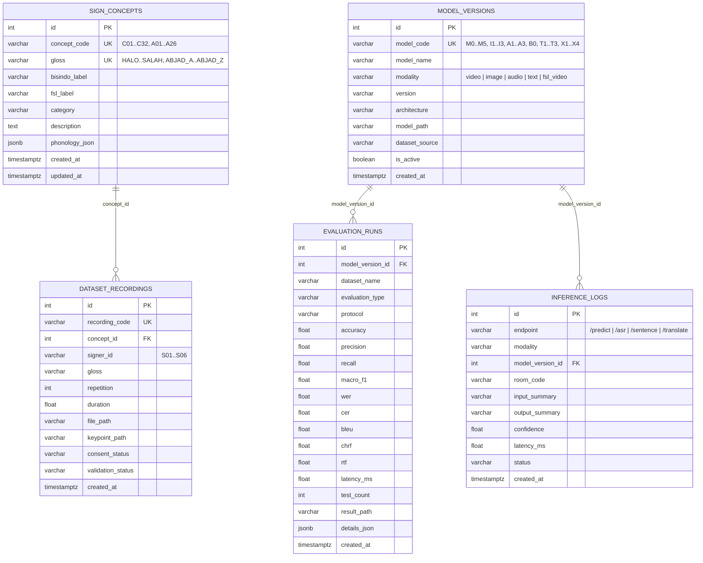

# Dokumentasi Database Operasional & Telemetri (`docs/DATABASE.md`)

## 1. Peran & Arsitektur Database
Pada proyek **SignBridge ID–PH**, **PostgreSQL 16** digunakan sebagai **Operational & Telemetry Database** (bukan sebagai tempat penyimpanan file biner berukuran besar seperti video `.mp4`, audio `.wav`, tensor `.npy`/`.npz`, checkpoint `.pt`, ataupun model `.onnx`).

Seluruh berkas dataset pelatihan dan bobot model tetap disimpan di sistem berkas (`data/`, `checkpoints/`, `web/model/`), sedangkan PostgreSQL menyimpan:
1. Referensi konsep & fonologi kosakata (`sign_concepts`: 32 Konsep Kelas BISINDO $\leftrightarrow$ FSL + 26 Abjad Ejaan Jari `A`–`Z` = 58 entri).
2. Registri versi model lintas 4 modalitas (`model_versions`: 20 konfigurasi model `M0`–`M5`, `I1`–`I3`, `A1`–`A3`, `B0`, `T1`–`T3`, `X1`–`X4`).
3. Hasil evaluasi model yang telah diverifikasi (`evaluation_runs`).
4. Log aktivitas inferensi secara *non-blocking* (`inference_logs`).
5. Metadata rekaman mandiri `SignBridge-Kelas` (`dataset_recordings`).

---

## 2. Diagram Relasi Entitas (ERD)



---

## 3. Strategi Graceful Fallback
Modul [`server/database.py`](file:///d:/SEMESTER%205/ML/Projek_1/server/database.py) menerapkan pola **Graceful Degradation**:
- Saat `DATABASE_URL` mengarah ke PostgreSQL 16 dan service aktif, sistem menggunakan PostgreSQL dengan *connection pooling* (`pool_size=5, max_overflow=10, pool_pre_ping=True, connect_timeout=2`).
- Apabila service PostgreSQL belum dinyalakan di mesin lokal, sistem otomatis beralih ke `SIGNBRIDGE_FALLBACK_DB_URL` (`sqlite:///./data/signbridge_operational.db`) sehingga aplikasi web, model ONNX, dan seluruh pengujian tetap berjalan tanpa gangguan.
- Apabila kedua database gagal atau disimulasikan mati (`simulate_failure = True`), `log_inference_safe()` menangkap eksepsi secara senyap sehingga endpoint `/predict`, `/asr`, `/sentence`, dan `/translate` tidak pernah gagal akibat masalah database.

---

## 4. Cara Menjalankan Migrasi & Seeding
1. Menggunakan skrip migrasi Python:
   ```powershell
   python scripts/migrate_db.py
   ```
2. Menggunakan DDL SQL murni pada PostgreSQL 16:
   ```powershell
   psql -U signbridge -d signbridge_db -f migrations/001_initial_schema.sql
   ```

