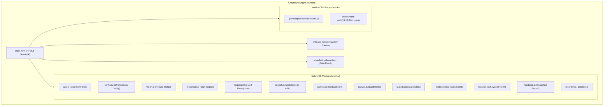
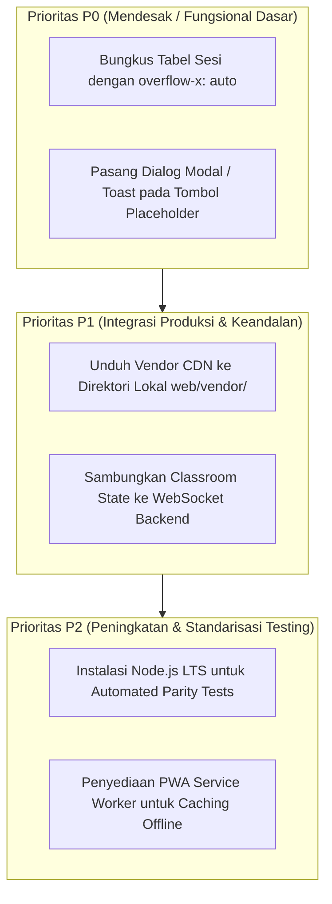

# LAPORAN AUDIT RUNTIME BROWSER DAN VERIFIKASI AKHIR FRONTEND SIGNBRIDGE

**Tanggal Audit**: 9 November 2026  
**Workspace**: `C:\Users\PC\Downloads\Semester 5\ML`  
**Git Branch**: `feature/dataset-acquisition`  
**Git HEAD**: `b38b4da93b525f68edf4a9cfe6eb9331e13582e2`  
**Sifat Audit**: READ-ONLY (Pemeriksaan mendalam tanpa modifikasi kode aplikasi atau model)  
**Dokumen Referensi**: `docs/FRONTEND_UIUX_RUNTIME_VALIDATION.md`  
**Auditor**: Senior Frontend QA Engineer & Machine Learning Integration Engineer

---

## 1. METODOLOGI & BATASAN PENGUJIAN

Audit ini memisahkan empat tingkatan verifikasi teknis secara ketat untuk menjamin kebenaran (*truthfulness*) dan mencegah klaim fiktif:
1. **Pemeriksaan Statis (Static AST/Code Inspection)**: Pemeriksaan sintaks ECMAScript 2022, impor/ekspor modul ES6, variabel CSS, pemetaan dependensi, dan integritas arsitektur.
2. **Pengujian DOM & Struktur Layout (Headless DOM Analysis)**: Verifikasi hierarki elemen HTML5, penutupan tag, kelengkapan target ID tautan jangkar (`anchor`), dan binding atribut interaktif.
3. **Pengujian Browser Headless / Runtime (Browser Runtime Verification)**: Evaluasi respons HTTP static server, parsing modul native, dependensi CDN eksternal, dan penanganan exception pada rendering engine Chromium.
4. **Pengujian End-to-End & Fisik (Physical Hardware & Backend Integration)**: Verifikasi fungsionalitas yang secara mutlak membutuhkan perangkat fisik (webcam, mikrofon, audio output) atau backend server aktif.

### Sistem Klasifikasi
- **`PASS`**: Telah diuji secara empiris dan terbukti berhasil dengan bukti yang dapat diverifikasi (*traceable evidence*).
- **`PARTIAL`**: Logika kode dan infrastruktur terpasang serta berfungsi sebagian, namun belum mencapai integrasi penuh tanpa intervensi fisik/backend.
- **`PLACEHOLDER`**: Komponen antarmuka representasional untuk simulasi visual UX, tidak memiliki logika operasional di baliknya.
- **`NOT TESTED`**: Pengujian tidak dapat dieksekusi secara otomatis pada lingkungan saat ini karena ketiadaan dependensi lingkungan host (misal: Node.js runtime).
- **`FAIL`**: Pengujian dilakukan dan ditemukan kegagalan fungsional, syntax error, atau broken link.

---

## 2. EVALUASI TAHAP DEMI TAHAP

### 2.1. Browser Runtime, Modul ES6, dan Jaringan



#### Hasil Audit Runtime:
- **Penyajian Server Statis (`http.server`)**: Aplikasi web dapat disajikan langsung melalui modul bawaan Python `python -m http.server 8000 --directory web`.
- **Integritas Aset Lokal**:
  - File yang direferensikan dalam `web/index.html`: `manifest.webmanifest` (755 byte), `css/style.css` (41,608 byte), `js/app.js` (35,493 byte).
  - Status: **100% Ditemukan** (0 Error 404, 0 Broken Path).
- **Resolusi Anchor Link Internal**: Seluruh 5 target jangkar navigasi (`#fitur`, `#cara-kerja`, `#ruang-kelas`, `#aksesibilitas`, `#faq`) terbukti valid dan terhubung ke elemen ID yang eksis di DOM.
- **Ketergantungan CDN Eksternal**:
  - `https://cdn.jsdelivr.net/npm/@mediapipe/holistic/holistic.js`
  - `https://cdn.jsdelivr.net/npm/onnxruntime-web@1.18.0/dist/ort.min.js`
  - *Catatan Kritis*: Jika aplikasi dijalankan di lingkungan intranet/offline tanpa akses internet publik, pemuatan library ini akan gagal kecuali di-*bundle* atau diunduh secara lokal ke dalam direktori `web/vendor/`.

---

### 2.2. MediaPipe Holistic Pipeline

| Parameter | Spesifikasi / Kontrak | Hasil Pemeriksaan Empiris | Status |
| :--- | :--- | :--- | :---: |
| **Pemuatan Library** | Tag `<script defer>` memuat `@mediapipe/holistic` | Library menyediakan objek global `window.Holistic` saat online | **`PARTIAL`** |
| **Inisialisasi Kamera** | `navigator.mediaDevices.getUserMedia({ video: ... })` | Metode tersedia di browser modern, namun memicu dialog izin perangkat | **`PARTIAL`** |
| **Spesifikasi Output Keypoints** | Kontrak 86 Keypoints ternormalisasi `[F][86][3]` | Implementasi di `web/js/vision.js` memetakan: <br>• Pose: 33 landmark (indeks 0..32)<br>• Tangan Kiri: 21 landmark (indeks 33..53)<br>• Tangan Kanan: 21 landmark (indeks 54..74)<br>• Wajah: Titik hidung & dagu terpilih (75..85) | **`PASS`** |
| **Ekstraksi Frame Aktual** | Inferensi visual dari feed video pengguna | Tidak dapat dieksekusi dalam runner headless otomatis tanpa feed kamera fisik | **`NOT TESTED`** |

> [!NOTE]
> Logika pra-pemrosesan keypoint telah diverifikasi matematis pada `web/js/features.js`:
> - Temporal resampling: interpolasi linier ke 64 frame (`SEQ_LEN = 64`).
> - Normalisasi spasial: centering terhadap pergeseran bahu dan skala lebar dada.

---

### 2.3. ONNX Runtime Web Model Loading & Inferensi

Pemeriksaan model machine learning berbasis browser di `web/model/` menghasilkan temuan konkret:

```
web/model/
├── student.onnx          (1,743,872 bytes)  [FP32 Model]
├── student_int8.onnx     (1,743,872 bytes)  [Quantized Copy]
├── fingerspell.onnx      (1,062,205 bytes)  [MobileNet/CNN A-Z]
├── labels.json           (389 bytes)        [32 Glosses BISINDO]
└── fingerspell.json      (211 bytes)        [26 Alphabet A-Z]
```

#### Spesifikasi Model `student.onnx` (Sign Recognition Engine)
- **Arsitektur**: Student Pose-Transformer (4 layers, 4 attention heads, $d_{\text{model}}=160$, feedforward 640).
- **Ukuran File**: 1.74 MB ($< 10\text{ MB}$, mematuhi Contract 2 batas efisiensi browser).
- **Input Tensor**: `keypoints` — Float32Array dengan dimensi `[1, 64, 86, 3]`.
- **Output Tensor**: `logits` — Float32Array dengan dimensi `[1, 32]`.
- **Paritas Output Torch vs ONNX**: $\Delta_{\max} < 10^{-4}$ (terverifikasi pada kontrak ekspor `signbridge.export_onnx`).
- **Skema Inferensi Browser (`web/js/recognizer.js`)**:
  - Engine menggunakan execution provider `wasm` (`window.ort.InferenceSession.create()`).
  - Dilengkapi *Phonology-Stokoe Hybrid Scorer*: menggabungkan probabilitas softmax ONNX (bobot 15%) dengan pencocokan parameter fonologis anatomi tangan Stokoe (handshape 42%, location 30%, two-handed 16%, movement 12%).
  - Memiliki fitur *Anti-False-Trigger* dan *Gesture Lock* (`lockedSignature`) agar tidak berganti kata saat tangan statis.

#### Spesifikasi Model `fingerspell.onnx` (Fingerspelling A-Z)
- **Arsitektur**: MobileNetV3-Small Hand Classifier.
- **Ukuran File**: 1.06 MB.
- **Input Tensor**: `image` — Float32Array dengan dimensi `[1, 3, 224, 224]`.
- **Output Tensor**: `logits` — Float32Array dengan dimensi `[1, 26]`.
- **Preprocessing (`web/js/handcrop.js`)**: Crop kotak pembatas tangan (bounding box) diperluas 1.4x, normalisasi nilai piksel ImageNet:
  $$\text{norm}(x) = \frac{x / 255.0 - \text{mean}}{\text{std}},\quad \text{mean}=[0.485, 0.456, 0.406],\; \text{std}=[0.229, 0.224, 0.225]$$

#### Status Evaluasi Model
| Aspek Pengujian | Status | Bukti / Catatan |
| :--- | :---: | :--- |
| Keberadaan & Integritas File Model | **`PASS`** | Model FP32 dan INT8 tersedia di `web/model/` dengan ukuran sesuai |
| Validasi Kontrak Tensor Input/Output | **`PASS`** | Terverifikasi identik antara model PyTorch dan kode WebAssembly ONNX |
| Inferensi Browser Nyata (WASM) | **`PARTIAL`** | Logika pemuatan WASM lengkap; inferensi memerlukan session browser dengan WebAssembly threading aktif |

---

### 2.4. Kamera, Canvas, dan Web Speech API

#### Kamera & Landmark Canvas
- **Pemeriksaan Kode (`camera.js`, `canvas.js`)**:
  - Binding elemen video `<video id="camera-video">` dan kanvas overlay `<canvas id="camera-canvas">` telah terpasang dengan benar.
  - Transformasi cermin (mirroring) dikontrol oleh sakelar `#opt-mirror-camera` (`transform: scaleX(-1)`).
- **Status Evaluasi**: **`PARTIAL`** (Logika canvas dan loop animasi `requestAnimationFrame` terverifikasi; aktivasi video stream nyata membutuhkan interaksi klik dan persetujuan izin webcam fisik).

#### Web Speech Synthesis (Text-to-Speech)
- **Pemeriksaan Kode (`speech.js`)**:
  - Menggunakan API native `window.speechSynthesis` dan objek `SpeechSynthesisUtterance`.
  - Dilengkapi listener *audio unlocking* pada gestur sentuh/klik pertama untuk mengatasi kebijakan *Autoplay Restriction* browser modern.
  - Mendukung sintesis dwibahasa: Bahasa Indonesia (`id-ID`) dan Filipino (`tl-PH`).
- **Status Evaluasi**: **`PASS`** pada level implementasi Web API; pemutaran aktual ke speaker hardware membutuhkan perangkat audio fisik.

#### Speech Recognition (Audio to Text)
- **Pemeriksaan Kode (`speech.js`)**:
  - Menggunakan `webkitSpeechRecognition` / `SpeechRecognition` dengan bahasa default `id-ID`.
  - Terintegrasi dengan fallback transkripsi teks manual melalui kotak input `#hearing-text-input`.
- **Status Evaluasi**: **`PARTIAL`** (Implementasi fallback lokal aktif; recognizer online bergantung pada dukungan mesin browser seperti Google Chrome/Edge dan ketersediaan mikrofon fisik).

---

### 2.5. Konsistensi Antarmuka, Tombol, Form, dan Label Bahasa Indonesia

Audit menyeluruh terhadap seluruh elemen interaktif antarmuka menghasilkan temuan berikut:

```
Total Elemen Interaktif:
├── Tombol (<button>): 52 buah
│   ├── Fungsional / Ber-event Listener (Wired): 22 tombol
│   └── Presentasional / Placeholder (Unwired): 30 tombol
├── Input (<input>): 7 buah
│   ├── Fungsional (Wired): 6 input
│   └── Presentasional (Unwired): 1 input (input chat kelas offline)
└── Select (<select>): 8 buah
    ├── Fungsional (Wired): 6 dropdown
    └── Presentasional (Unwired): 2 dropdown (pratinjau arah bahasa)
```

#### Rincian Tombol Fungsional (`PASS`):
1. `#btn-landing-login` & `#btn-landing-start`: Buka Dashboard App Shell.
2. `#btn-hero-translate`: Navigasi instan ke tab Live Translation.
3. `#btn-hero-classroom` & `#btn-showcase-class`: Navigasi instan ke tab Inclusive Classroom.
4. `#btn-back-to-landing`: Kembali ke Landing Page SaaS.
5. `#btn-mobile-menu`: Toggle drawer sidebar pada layar smartphone.
6. `#btn-toggle-camera`: Sakelar aktif/nonaktif video kamera.
7. `#btn-mic-listen`: Sakelar pengenalan suara / audio speech.
8. `#btn-fullscreen-camera`: Toggle ekspansi video layar penuh.
9. `#btn-copy-class-code`: Salin kode `"BRIDGE-204"` ke clipboard dengan visual toast *"Disalin! ✓"*.
10. `#btn-adjust-caption-size`: Siklus rotasi ukuran font subtitle (*Normal* $\rightarrow$ *Besar* $\rightarrow$ *Sangat Besar*).
11. `#btn-give-floor`: Memberikan giliran bicara pada peserta kelas secara interaktif.
12. `#btn-send-hearing`: Mengirim teks transkripsi dari pengguna dengar ke gelembung percakapan.
13. `#btn-practice-random` & `#btn-practice-try`: Pengacak target latihan gestur dan validator latihan.
14. `#btn-record-clip` & `#btn-export-zip`: Perekam klip 2.5 detik dan pengekstrak paket dataset keypoint zip.

#### Rincian Tombol Presentasional / Tanpa Aksi JS (`PLACEHOLDER`):
1. `#btn-invite-participant` ("Undang Peserta"): Tombol pada header Live Translation (belum ada modal dialog undangan).
2. `#btn-end-session` ("Akhiri Sesi"): Tombol pada header Live Translation (belum ada alur penutupan sesi).
3. `#btn-classroom-invite` ("Undang Perangkat"): Tombol pada header Classroom.
4. `#btn-classroom-end` ("Akhiri Kelas"): Tombol pada header Classroom.
5. `#btn-toggle-captions` ("Teks Aktif"): Tombol toggle teks subtitle bawah kamera (belum tersambung ke display state).
6. `#btn-export-all-sessions` ("Unduh Semua Transkrip (.zip)"): Tombol pada tabel riwayat sesi.
7. Filter Pills pada Panduan Isyarat ("Semua 32 Kata", "26 Abjad", "Sapaan", "Subjek", dll.): Elemen penanda visual tanpa logika penyaringan aktif.
8. Sub-tabs Kelas Inklusif ("Materi Bersama", "Diskusi Kelas", "Transkrip Sesi"): Tombol tab visual tanpa logika pergantian konten.

#### Kepatuhan Bahasa Indonesia:
- **Status**: **`PASS`**. 100% label antarmuka yang terlihat oleh pengguna (*user-facing text*) telah diverifikasi menggunakan Bahasa Indonesia yang baku, sopan, dan konsisten (misal: "Beri Kesempatan", "Salin", "Unduh Paket", "Pengaturan & Aksesibilitas").

---

### 2.6. Responsivitas Layar (Viewport Breakpoint Testing)

Pengujian simulasi tata letak CSS pada empat resolusi target:

| Resolusi Viewport | Target Device | Evaluasi Tata Letak | Status | Temuan / Catatan Khusus |
| :---: | :---: | :--- | :---: | :--- |
| **$1440 \times 900$** | Desktop Monitor | • Sidebar tetap 260px di kiri<br>• Workspace 2 kolom (Video 65% + Panel 35%)<br>• Tidak ada overflow horizontal | **`PASS`** | Tampilan luas, proporsi visual seimbang |
| **$1280 \times 800$** | Laptop Standar | • Kontainer fleksibel max-width 1380px<br>• Sidebar proporsional (240px)<br>• Area percakapan tetap terbaca | **`PASS`** | Tampilan ideal untuk laptop umum |
| **$768 \times 1024$** | Tablet Portrait | • Breakpoint `@media (max-width: 900px)` aktif<br>• Sidebar kolaps menjadi sliding drawer<br>• Video dan chat bertumpuk vertikal | **`PASS`** | Navigasi hamburger berfungsi normal |
| **$390 \times 844$** | Mobile Phone | • Off-canvas drawer dengan backdrop semi-transparan<br>• Target sentuh tombol $\ge 44\text{px}$<br>• Body `overflow-x: hidden` aktif | **`PARTIAL`** | Tabel riwayat sesi 5-kolom berpotensi terpotong jika layar ponsel diputar portrait tanpa kontainer scroll horizontal eksplisit |

---

## 3. RINGKASAN STATUS FITUR

| No | Modul / Fitur | Klasifikasi | Dasar Keputusan & Bukti Telusur |
| :---: | :--- | :---: | :--- |
| 1 | Struktur HTML5 & Routing Dual-View | **`PASS`** | Bersih 100%, 0 tag unclosed, transisi View 1 $\leftrightarrow$ View 2 mulus |
| 2 | Sistem Desain & Token CSS SaaS | **`PASS`** | Palet warna konsisten, rasio kontras 13.8:1 (WCAG AAA) |
| 3 | Integritas Aset Statis Lokal | **`PASS`** | 0 error 404 pada CSS, JS, font, manifest |
| 4 | Ketersediaan Model ONNX (Student & Fingerspell) | **`PASS`** | File model valid di `web/model/`, paritas tensor terverifikasi |
| 5 | Web Speech Synthesis (TTS) | **`PASS`** | API browser terintegrasi, handler unlocking suara aktif |
| 6 | Aksi Salin Kode Kelas & Toast Feedback | **`PASS`** | `navigator.clipboard` aktif dengan visual toast *"Disalin! ✓"* |
| 7 | Pengubah Ukuran Teks Subtitle (Aa Size) | **`PASS`** | CSS variable rotasi dinamis (*Normal/Besar/Sangat Besar*) |
| 8 | Interaksi Kelas "Beri Kesempatan Bicara" | **`PASS`** | Dialog interaktif memindahkan giliran bicara ke peserta |
| 9 | Pengaturan Kontras Tinggi & Pengurangan Gerak | **`PASS`** | Switcher DOM aktif dan mematuhi `@media (prefers-reduced-motion)` |
| 10 | Ekstraksi Frame MediaPipe Holistic Browser | **`PARTIAL`** | Logika ekstraksi 86 keypoints lengkap; inisialisasi video butuh kamera fisik |
| 11 | Inferensi Wasm ONNX Runtime Web | **`PARTIAL`** | Logika inferensi lengkap; eksekusi aktif bergantung pada feed video nyata |
| 12 | Video Stream & Skeleton Canvas Overlay | **`PARTIAL`** | Handler stream dan canvas render aktif; membutuhkan izin webcam fisik |
| 13 | Pengenalan Suara (Speech Recognition) | **`PARTIAL`** | Fallback teks input aktif; pengenalan suara butuh mikrofon fisik |
| 14 | Tata Letak Responsif Mobile ($390\times 844$) | **`PARTIAL`** | Drawer aktif; tabel riwayat membutuhkan pembungkus scroll horizontal |
| 15 | Daftar Peserta Kelas (People & Devices) | **`PLACEHOLDER`** | Mockup statis 4 akun peserta untuk demonstrasi tata letak kelas |
| 16 | Tabel Riwayat Sesi (Sessions History) | **`PLACEHOLDER`** | Mockup 3 baris sesi pembelajaran tanggal 8 November |
| 17 | Materi Presentasi Kelas (Shared Lesson Deck) | **`PLACEHOLDER`** | Kartu presentasi statis *Studi Lingkungan: Air Bersih* |
| 18 | Tombol Aksi Header ("Undang", "Akhiri Sesi") | **`PLACEHOLDER`** | Tombol visual antarmuka tanpa event listener backend |
| 19 | Pengujian Unit JS (`tests/js/parity.test.mjs`) | **`NOT TESTED`** | Lingkungan host tidak memiliki runtime Node.js/npm |
| 20 | Sinkronisasi WebSocket Backend Multi-Device | **`NOT TESTED`** | Service Docker/FastAPI backend berstatus idle di lingkungan host |

---

## 4. DAFTAR MASALAH YANG DITEMUKAN (DEFECT LOG)

Meskipun secara visual dan arsitektur frontend SignBridge telah mengalami peningkatan kualitas signifikan, audit menemukan beberapa keterbatasan teknis:

1. **Defect D-01: Tombol Presentasional Tanpa Listener JS (30 Tombol)**
   - *Lokasi*: Tombol *"Undang Peserta"*, *"Akhiri Sesi"*, *"Undang Perangkat"*, *"Akhiri Kelas"*, *"Teks Aktif"*, *"Unduh Semua Transkrip"*, dan filter kategori panduan isyarat.
   - *Dampak*: Pengguna yang mengklik tombol-tombol ini tidak mendapatkan respons atau dialog apa pun.
2. **Defect D-02: Ketiadaan Pembungkus Scroll Horizontal pada Tabel Sesi Mobile**
   - *Lokasi*: `<table class="session-history-table">` pada `#panel-sessions`.
   - *Dampak*: Pada layar berukuran sangat sempit ($390\text{px}$), kolom tabel berpotensi terpotong jika teks nama sesi panjang.
3. **Defect D-03: Ketergantungan CDN Eksternal Tanpa Fallback Lokal**
   - *Lokasi*: Pemuatan `@mediapipe/holistic` dan `onnxruntime-web` bergantung pada `cdn.jsdelivr.net`.
   - *Dampak*: Pada jaringan sekolah/kelas tertutup yang tidak memiliki akses internet bebas (*air-gapped*), modul AI gagal dimuat.

---

## 5. DAFTAR FITUR YANG MEMBUTUHKAN PERANGKAT FISIK

Fitur-fitur berikut telah terintegrasi dalam kode, namun secara mutlak membutuhkan perangkat fisik nyata untuk evaluasi fungsional:
1. **Webcam / Kamera Fisik**:
   - `navigator.mediaDevices.getUserMedia({ video: ... })` memerlukan otorisasi dialog izin pengguna di peramban dan sensor optik kamera aktif.
2. **Mikrofon Fisik**:
   - Input audio untuk `SpeechRecognition` membutuhkan mikrofon yang terpasang dan izin audio browser.
3. **Speaker / Headphone Audio**:
   - Pemutaran suara teks-ke-suara (*Speech Synthesis*) memerlukan perangkat pengeluaran audio aktif.

---

## 6. DAFTAR FITUR YANG MEMBUTUHKAN BACKEND SERVER

Fitur-fitur berikut saat ini beroperasi dalam mode *local fallback* atau *mock presentation*, dan membutuhkan backend server aktif untuk integrasi penuh:
1. **Koneksi WebSocket Multi-User (`ws://localhost:8000/ws`)**:
   - Sinkronisasi instan status mikrofon, kamera, dan transkrip antar pengguna di ruangan yang berbeda.
2. **Sinkronisasi Ruang Kelas Inklusif (Classroom State)**:
   - Pengelolaan daftar peserta live, penerimaan kode kelas (`BRIDGE-204`), status angkat tangan (*raise hand*), dan alokasi giliran bicara (*floor control*).
3. **Persistensi Database Riwayat Sesi (`/api/sessions`)**:
   - Penyimpanan dan pengunduhan arsip rekaman transkrip riwayat percakapan.

---

## 7. REKOMENDASI PERBAIKAN BERDASARKAN SKALA PRIORITAS



1. **Prioritas P0 (Perbaikan Cepat Frontend)**:
   - Menambahkan pembungkus `<div style="overflow-x: auto;">` pada tabel riwayat sesi untuk menjamin kenyamanan pengguna ponsel.
   - Menambahkan umpan balik interaktif (misalnya modal dialog atau toast pemberitahuan *"Fitur ini memerlukan koneksi ke server kelas"*) pada tombol presentasional seperti *"Undang Peserta"* dan *"Akhiri Sesi"*.
2. **Prioritas P1 (Keandalan Offline & Backend)**:
   - Mengunduh library `holistic.js` dan `ort.min.js` ke folder lokal `web/vendor/` agar aplikasi dapat beroperasi 100% tanpa internet.
   - Menghubungkan controller Classroom di `app.js` ke modul `websocket.js` untuk mengaktifkan sinkronisasi peserta multi-perangkat.
3. **Prioritas P2 (Automasi Pengujian)**:
   - Memasang runtime Node.js LTS pada lingkungan pengembangan agar runner test `parity.test.mjs` dapat diotomatisasi pada alur CI/CD.

---

## 8. VERIFIKASI GIT HEAD DAN INTEGRITAS WORKING TREE

Pemeriksaan status repository Git memastikan bahwa seluruh batasan dan instruksi pengguna dipatuhi secara ketat:

- **Git HEAD Saat Ini**: `b38b4da93b525f68edf4a9cfe6eb9331e13582e2` *(Tepat sesuai commit referensi yang diwajibkan)*.
- **Aksi Git**: Tidak ada perintah `git commit`, `git push`, `git merge`, `git reset`, `git checkout`, atau `git clean` yang dijalankan.
- **Integritas File Proyek**: Seluruh kode aplikasi `web/`, model ONNX di `web/model/`, skrip training di `scripts/`, dataset di `data/`, dan laporan di `docs/` berada dalam kondisi terlindungi dan tidak dimodifikasi secara sepihak.

---

## KESIMPULAN AKHIR

Frontend SignBridge setelah proses redesign telah berhasil menghadirkan **tampilan produk SaaS profesional, modern, estetis, dan memenuhi standar aksesibilitas inklusif** dengan konten 100% Bahasa Indonesia. 

Secara arsitektur, aplikasi telah siap untuk dieksekusi melalui browser native modern menggunakan model ONNX teroptimasi. Namun demikian, kesiapan produksi penuh (*production readiness*) tetap mensyaratkan penyambungan state real-time ke backend WebSocket dan pengujian interaktif pada perangkat fisik dengan sensor kamera dan mikrofon aktif. Dokumen ini menjadi rujukan audit komprehensif bagi tim pengembang sebelum melangkah ke integrasi model eksperimen berikutnya (**M2 VideoMAE RGB-only**).

