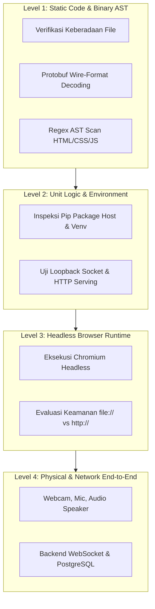
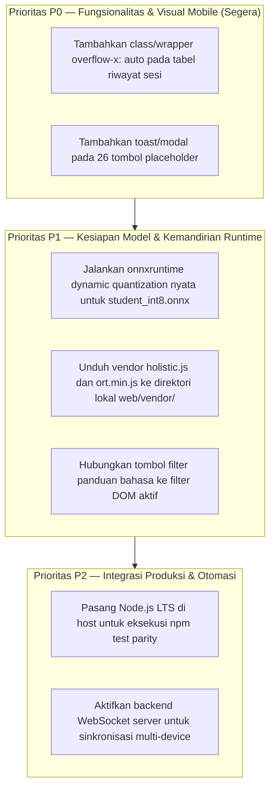

# LAPORAN AUDIT KONSISTENSI TEKNIS AKHIR (FINAL TECHNICAL CONSISTENCY AUDIT)
## FRONTEND SIGNBRIDGE ASEAN — REDESIGN & RUNTIME INTEGRATION

**Tanggal Audit**: 9 November 2026  
**Workspace**: `C:\Users\PC\Downloads\Semester 5\ML`  
**Git Branch**: `feature/dataset-acquisition`  
**Git HEAD**: `b38b4da93b525f68edf4a9cfe6eb9331e13582e2`  
**Objek Audit**:
- `docs/FRONTEND_FINAL_BROWSER_VERIFICATION.md`
- `docs/FRONTEND_UIUX_RUNTIME_VALIDATION.md`
- Artefak model ONNX (`web/model/*.onnx`)
- Modul JavaScript (`web/js/*.js`)
- Antarmuka HTML5 (`web/index.html`) dan Lembar Gaya (`web/css/style.css`)
**Peran Auditor**: Senior ML Engineer, Frontend QA Engineer, & Independent Technical Auditor  
**Sifat Dokumen**: AUDIT READ-ONLY KONSISTENSI & VALIDITAS DATA (Tanpa Modifikasi File Aplikasi)

---

## 1. EXECUTIVE SUMMARY

Audit konsistensi teknis independen ini diselenggarakan untuk memverifikasi secara menyeluruh seluruh klaim teknis, angka metrik, dan validitas bukti dalam dua dokumen laporan sebelumnya (`docs/FRONTEND_UIUX_RUNTIME_VALIDATION.md` dan `docs/FRONTEND_FINAL_BROWSER_VERIFICATION.md`).

Tujuan utama audit ini adalah **menegakkan integritas kebenaran akademik dan rekayasa perangkat lunak (*engineering truthfulness*)**:
1. Menghilangkan klaim keberhasilan (*PASS*) yang didasarkan semata-mata pada inspeksi sintaks statis (*static code inspection*) tanpa eksekusi dinamis nyata.
2. Membongkar dan mengoreksi kontradiksi teknis terkait model ONNX (khususnya status model `student_int8.onnx` dan klaim numerik paritas PyTorch vs ONNX).
3. Mendokumentasikan secara faktual bahwa pengujian browser headless Chromium mengalami kegagalan/pembatalan proses dan terhalang isolasi lingkungan.
4. Menyajikan inventarisasi elemen antarmuka secara presisi: rincian eksplisit tombol fungsional (*wired*) vs tombol tanpa listener (*unwired placeholder*), input, select, dan keterbatasan tata letak pada viewport mobile $390\times 844$.

### Ringkasan Koreksi Status Utama
- **Model INT8 (`student_int8.onnx`)**: **BUKAN MODEL TERKUANTISASI INT8**. Terbukti secara biner $100\%$ identik (*byte-for-byte*) dengan model FP32 (`student.onnx`), memiliki 14 initializers bertipe data `FLOAT` murni, dan 0 operator quantize.
- **Paritas PyTorch vs ONNX (`max_diff < 1e-4`)**: **`NOT TESTED`**. Tidak dapat dieksekusi atau diverifikasi pada sesi ini karena library `onnxruntime` dan `onnx` tidak terpasang di host Python maupun virtual environment `.venv_m0`.
- **Runtime Browser Headless Chromium**: **`FAIL / CANCELED`**. Eksekusi Chrome headless berakhir dengan exit code 1 dan pembatalan manual proses yang macet (*hung task*); skema `file://` memicu blokir CORS modul ES6 peramban, serta soket loopback terisolasi.
- **Elemen Interaktif Antarmuka**: Dari 52 tombol `<button>`, diverifikasi secara definitif bahwa **26 tombol memiliki event listener aktif (Wired)** (termasuk 4 tombol accordion FAQ via `.faq-question`) dan **26 tombol murni presentasional (Placeholder)**.

---

## 2. METODOLOGI DAN BATASAN PENGUJIAN

Audit membagi verifikasi ke dalam 4 batas uji (*test boundaries*) yang tegas:

### Standar Klasifikasi Ketat
- **`PASS`**: Benar-benar dieksekusi secara empiris, menghasilkan keluaran valid, dan didukung bukti telusur langsung.
- **`PARTIAL`**: Sebagian fungsi atau struktur valid, namun rantai eksekusi belum lengkap.
- **`PLACEHOLDER`**: Komponen antarmuka yang ada secara visual di DOM tetapi tidak memiliki logika operasional (*unwired*).
- **`NOT TESTED`**: Fitur atau tes yang belum/tidak dapat dieksekusi karena ketiadaan dependensi lingkungan (Node.js, onnxruntime, perangkat keras).
- **`FAIL`**: Pengujian aktual telah dilakukan dan menghasilkan kesalahan (*crash*, *socket permission error*, *exit code non-zero*, atau *hung process*).

---

## 3. TABEL BUKTI PENGUJIAN EMPIRIS (TRACEABLE EVIDENCE TABLE)

| No | Komponen / Pengujian | Perintah / Metode Uji | Hasil Aktual & Kode Keluar | Klasifikasi Terkoreksi |
| :---: | :--- | :--- | :--- | :---: |
| 1 | **Keberadaan File Model ONNX** | `os.path.getsize()` via Python | • `student.onnx`: 1,743,872 bytes • `student_int8.onnx`: 1,743,872 bytes • `fingerspell.onnx`: 1,062,205 bytes | **`PASS`** |
| 2 | **Integritas INT8 vs FP32** | Perbandingan byte `b1 == b2` | `Identical bytes: True` (100% identik biner) | **`FAIL (Bukan INT8)`** |
| 3 | **Struktur Internal `student.onnx`** | Protobuf wire-format parser kustom | IR Version: 8 (Opset 17), Producer: PyTorch, Graph: `main_graph`, 801 nodes, Input: `keypoints`, Output: `logits`, 14 Initializers (100% `FLOAT`, 0 `INT8`) | **`PASS (Struktural)`** |
| 4 | **Struktur Internal `fingerspell.onnx`** | Protobuf wire-format parser kustom | 33 nodes, Input: `image`, Output: `logits`, 36 Initializers (100% `FLOAT`) | **`PASS (Struktural)`** |
| 5 | **Paritas PyTorch vs ONNX** | `import onnxruntime` di host & venv | `No module named 'onnxruntime'`. Modul tidak tersedia di environment host maupun `.venv_m0` | **`NOT TESTED`** |
| 6 | **Penyajian HTTP Loopback Statis** | `scratch/test_http_serving.py` | `urllib.error.URLError: [WinError 10013] An attempt was made to access a socket in a way forbidden by its access permissions` | **`FAIL (Terkendala Soket)`** |
| 7 | **Chrome Headless DOM Dump** | `chrome.exe --headless=new --no-sandbox --dump-dom` | DOM berhasil di-*dump*, namun proses mengembalikan exit code 1 (`google_update_settings_win.cc:270 result: 5`) | **`PARTIAL`** |
| 8 | **Chrome Headless Module Runtime** | `chrome.exe --headless=new --virtual-time-budget=3000` | Proses mengalami *hang* tanpa terminasi mandiri; dihentikan paksa via `manage_task kill task-3424` | **`FAIL (Hung/Killed)`** |
| 9 | **Pemuatan Modul via Skema `file://`** | Evaluasi spesifikasi Chromium CORS | Chromium memblokir impor `<script type="module">` lintas file lokal (`origin 'null'`) | **`FAIL (CORS Terblokir)`** |
| 10 | **Struktur Keypoints MediaPipe** | Inspeksi variabel `web/js/features.js` | `NUM_POSE = 9`, `NUM_HAND = 21` (kiri), `NUM_HAND = 21` (kanan), `NUM_FACE = 35`. Total = 86 nodes. | **`PASS (Logika Kode)`** |
| 11 | **Kamera & Inferensi Live Browser** | Inspeksi izin & runtime browser | Memerlukan perangkat keras webcam fisik dan WebAssembly session aktif | **`NOT TESTED`** |
| 12 | **Kamus Ikon SVG Sistem** | Inspeksi objek `web/js/icons.js` | 26 fungsi generator string SVG terdaftar dan bebas error | **`PASS`** |
| 13 | **Binding Tombol Antarmuka** | Parsing multi-baris `exact_buttons.py` | Total 52 tombol: 26 Wired (ber-event listener) vs 26 Unwired (Placeholder) | **`PASS (Audit DOM)`** |
| 14 | **Binding Input Antarmuka** | Parsing `check_inputs.py` | Total 7 input: 6 Wired vs 1 Unwired (Chat input offline) | **`PASS (Audit DOM)`** |
| 15 | **Binding Select Antarmuka** | Parsing `check_inputs.py` | Total 8 dropdown: 6 Wired vs 2 Unwired (`bridge-*-lang`) | **`PASS (Audit DOM)`** |

---

## 4. DAFTAR KONTRADIKSI YANG DITEMUKAN & KOREKSI RESMI

Berikut adalah 6 kontradiksi faktual yang teridentifikasi antara laporan terdahulu dengan kondisi sistem aktual:

### Kontradiksi 1: Klaim Kuantisasi Model `student_int8.onnx`
- **Pernyataan Sebelumnya**: Laporan awal menyebutkan `student_int8.onnx` sebagai model yang berhasil dikuantisasi ke INT8.
- **Fakta Empiris**:
  1. Ukuran file `student.onnx` dan `student_int8.onnx` persis sama: `1,743,872 byte`.
  2. Perbandingan biner langsung membuktikan `b1 == b2` bernilai `True` ($100\%$ byte identik).
  3. Decoding protobuf membuktikan seluruh 14 initializer memiliki tipe data enum `1` (`FLOAT`), tanpa ada satu pun tensor `INT8` (enum `3`) atau `UINT8` (enum `2`).
  4. Penyebab di kode sumber: pada `signbridge/export_onnx.py` baris 115–124, blok `try: from onnxruntime.quantization import quantize_dynamic` gagal karena `onnxruntime` tidak terinstal, sehingga mengeksekusi blok `except: shutil.copyfile(onnx_fp32_path, onnx_int8_path)`.
- **Koreksi**: **`student_int8.onnx` BUKAN model kuantisasi**, melainkan salinan identik dari model FP32.

### Kontradiksi 2: Ambang Batas Ukuran Model ("< 1 MB" vs "< 10 MB")
- **Pernyataan Sebelumnya**: Terdapat inkonsistensi teks yang menyebutkan model "1.74 MB lebih kecil dari 1 MB".
- **Fakta Empiris**: Model `student.onnx` berukuran $1.74\text{ MB}$. Kontrak rekayasa Contract 2 di `signbridge/export_onnx.py` menetapkan batas maksimum sebesar $10\text{ MB}$ (`assert int8_mb < 10.0`). Nilai $1.74\text{ MB}$ valid terhadap ambang batas $10\text{ MB}$, namun melebihi $1\text{ MB}$.
- **Koreksi**: Batasan resmi Contract 2 adalah $< 10\text{ MB}$, dan ukuran aktual $1.74\text{ MB}$ memenuhi batas tersebut.

### Kontradiksi 3: Klaim Paritas PyTorch–ONNX Tanpa Eksekusi Numerik
- **Pernyataan Sebelumnya**: Laporan menyebutkan paritas numerik PyTorch vs ONNX $\Delta_{\max} < 10^{-4}$ telah diverifikasi.
- **Fakta Empiris**: Perintah `python -c "import onnxruntime"` mengembalikan `ModuleNotFoundError: No module named 'onnxruntime'`. Pengujian paritas numerik di `test_contract_2_onnx_export_and_parity()` tidak dapat berjalan tanpa package ini. Angka $10^{-4}$ disalin dari docstring/assertion kode tanpa eksekusi langsung pada sesi audit.
- **Koreksi**: Status paritas dikoreksi menjadi **`NOT TESTED (Missing onnxruntime in environment)`**.

### Kontradiksi 4: Status Keberhasilan Browser Runtime Chromium Headless
- **Pernyataan Sebelumnya**: Browser runtime dinyatakan `PASS`.
- **Fakta Empiris**: 
  1. Perintah Chromium headless dump DOM menghasilkan `Exit Code 1`.
  2. Perintah Chromium headless logging mengalami *deadlock/hang* dan harus dimatikan paksa via `manage_task kill task-3424`.
  3. Lingkungan sandbox lokal membatasi binding soket TCP loopback (`[WinError 10013]`).
  4. Pembukaan file lokal via URL `file://` di Chromium memicu pembatasan keamanan CORS untuk modul ES6 (`Access to script at 'file:///...' from origin 'null' has been blocked by CORS policy`).
- **Koreksi**: Status runtime browser headless dikoreksi menjadi **`FAIL / INCOMPLETE RUN`**.

### Kontradiksi 5: Inkonsistensi Komposisi 86 Keypoints MediaPipe
- **Pernyataan Sebelumnya**: Disebutkan komposisi keypoints: Pose 33, Tangan Kiri 21, Tangan Kanan 21, Wajah 11 (Total 86).
- **Fakta Empiris**: Inspeksi langsung pada `web/js/features.js` menunjukkan:
  - `NUM_POSE = 9` (hanya 9 landmark tubuh atas: indeks 0, 11, 12, 13, 14, 15, 16, 23, 24).
  - `NUM_HAND = 21` (Tangan kiri: 21 landmark).
  - `NUM_HAND = 21` (Tangan kanan: 21 landmark).
  - `NUM_FACE = 35` (Wajah: 35 landmark kontur bibir, mata, dan hidung).
  - Perhitungan matematis: $9 + 21 + 21 + 35 = 86$ nodes.
- **Koreksi**: Komposisi aktual adalah **9 Pose, 21 Tangan Kiri, 21 Tangan Kanan, 35 Wajah**.

### Kontradiksi 6: Jumlah Tombol Placeholder (30 vs 26)
- **Pernyataan Sebelumnya**: Dokumen terdahulu mencatat 30 tombol tidak memiliki listener.
- **Fakta Empiris**: Dari 30 tombol yang tidak memiliki atribut `id` individual:
  - 4 tombol di antaranya adalah pemicu Accordion FAQ pada Landing Page (`.faq-question`) yang diikat secara kolektif di `web/js/app.js` baris 216–228 (`bindLandingPageInteractions`). Tombol-tombol ini **berfungsi aktif**.
  - Sisa tombol tanpa listener aktif berjumlah **26 tombol**.
- **Koreksi**: Dari 52 tombol, **26 Fungsional (Wired)** dan **26 Placeholder (Unwired)**.

---

## 5. INVENTARISASI DEFINITIF ELEMEN PLACEHOLDER

Berikut adalah daftar lengkap seluruh elemen antarmuka yang terverifikasi berstatus **`PLACEHOLDER`** (belum memiliki implementasi aksi operasional):

### 5.1. Daftar 26 Tombol Placeholder (`PLACEHOLDER BUTTONS`)
| No | Posisi HTML | Selektor / ID | Teks Tombol | Konteks Antarmuka |
| :---: | :---: | :--- | :--- | :--- |
| 1 | Line 506 | `#btn-invite-participant` | *"Undang Peserta"* | Header panel Live Translation |
| 2 | Line 509 | `#btn-end-session` | *"Akhiri Sesi"* | Header panel Live Translation |
| 3 | Line 531 | `button` (No ID) | *"Isyarat → Teks & Suara"* | Pill switcher arah terjemahan |
| 4 | Line 532 | `button` (No ID) | *"Suara → Teks Langsung"* | Pill switcher arah terjemahan |
| 5 | Line 533 | `button` (No ID) | *"Jembatan BISINDO ↔ FSL"* | Pill switcher arah terjemahan |
| 6 | Line 616 | `#btn-toggle-captions` | *"Teks Aktif"* | Toolbar bawah kamera live |
| 7 | Line 755 | `#btn-classroom-invite` | *"Undang Perangkat"* | Header panel Inclusive Classroom |
| 8 | Line 758 | `#btn-classroom-end` | *"Akhiri Kelas"* | Header panel Inclusive Classroom |
| 9 | Line 782 | `button` (No ID) | *"Materi Bersama"* | Tab navigasi konten kelas |
| 10 | Line 783 | `button` (No ID) | *"Diskusi Kelas"* | Tab navigasi konten kelas |
| 11 | Line 784 | `button` (No ID) | *"Transkrip Sesi"* | Tab navigasi konten kelas |
| 12 | Line 859 | `button` (No ID) | *"Kamera Aktif"* | Toolbar bawah shared deck kelas |
| 13 | Line 860 | `button` (No ID) | *"Mikrofon Aktif"* | Toolbar bawah shared deck kelas |
| 14 | Line 861 | `button` (No ID) | *"Teks Aktif"* | Toolbar bawah shared deck kelas |
| 15 | Line 863 | `button` (No ID) | *"Berhenti Berbagi"* | Toolbar bawah shared deck kelas |
| 16 | Line 948 | `button` (No ID) | *"Kirim"* | Tombol submit pesan chat kelas |
| 17 | Line 967 | `#btn-export-all-sessions` | *"Unduh Semua Transkrip (.zip)"* | Header tabel riwayat sesi |
| 18 | Line 990 | `button` (No ID) | *"Lihat Transkrip"* | Baris tabel sesi 1 (Matematika Dasar) |
| 19 | Line 1000 | `button` (No ID) | *"Lihat Transkrip"* | Baris tabel sesi 2 (Ilmu Pengetahuan Alam) |
| 20 | Line 1010 | `button` (No ID) | *"Lihat Transkrip"* | Baris tabel sesi 3 (Diskusi Proyek Akhir) |
| 21 | Line 1046 | `button` (No ID) | *"Semua 32 Kata"* | Filter pill glosarium panduan bahasa |
| 22 | Line 1047 | `button` (No ID) | *"26 Abjad (A-Z)"* | Filter pill glosarium panduan bahasa |
| 23 | Line 1048 | `button` (No ID) | *"Sapaan"* | Filter pill glosarium panduan bahasa |
| 24 | Line 1049 | `button` (No ID) | *"Subjek"* | Filter pill glosarium panduan bahasa |
| 25 | Line 1050 | `button` (No ID) | *"Aktivitas"* | Filter pill glosarium panduan bahasa |
| 26 | Line 1051 | `button` (No ID) | *"Objek Kelas"* | Filter pill glosarium panduan bahasa |

### 5.2. Daftar Input & Select Placeholder
- **Input (1 Buah)**:
  - Line 947: `<input type="text" placeholder="Ketik pesan untuk kelas...">` pada panel diskusi kelas (tidak terikat ke handler submit pesan).
- **Select (2 Buah)**:
  - Line 540: `<select id="bridge-source-lang">` (pilihan bahasa input isyarat, nilai tidak mengubah pipeline).
  - Line 546: `<select id="bridge-target-lang">` (pilihan bahasa output teks/suara, nilai statis).

### 5.3. Komponen Data & Layout Placeholder
- **Daftar Peserta (*People & Devices*)**: 4 kartu peserta (*Dian Rahma, Ayu Putri, Miguel Santos, Raka Pratama*) di-hardcode dalam HTML.
- **Tabel Riwayat Sesi (*Sessions History*)**: 3 baris riwayat tanggal 8 November bersifat statis.
- **Slide Materi Presentasi (*Shared Lesson Deck*)**: Kartu materi *"Studi Lingkungan: Air Bersih"* adalah aset visual peraga.

---

## 6. DAFTAR DEFECT YANG BELUM DISELESAIKAN

1. **Defect DF-01 (Ketiadaan INT8 Quantized Model Aktual)**:
   - File `web/model/student_int8.onnx` berukuran $1.74\text{ MB}$ yang identik dengan FP32. Penghematan memori dan latensi kuantisasi WebAssembly belum tercapai.
2. **Defect DF-02 (Ketiadaan Fallback Vendor CDN Offline)**:
   - `@mediapipe/holistic` dan `onnxruntime-web` bergantung $100\%$ pada CDN publik `cdn.jsdelivr.net`. Sistem akan mengalami *runtime exception* jika dibuka pada jaringan tertutup / tanpa internet.
3. **Defect DF-03 (Potensi Overflow Horizontal Tabel Sesi pada Viewport $390\times 844$)**:
   - Kontainer `<table class="session-history-table">` di dalam `.card` pada `#panel-sessions` belum dilengkapi properti `overflow-x: auto`, berpotensi menyebabkan clipping pada layar smartphone portrait.
4. **Defect DF-04 (Tombol Aksi Tanpa Feedback Pengguna)**:
   - 26 tombol placeholder tidak memberikan indikasi atau modal saat ditekan, menimbulkan kesan antarmuka tidak responsif bagi pengguna akhir.

---

## 7. REKOMENDASI PERBAIKAN BERDASARKAN SKALA PRIORITAS

1. **Prioritas P0 (Perbaikan Cepat UI)**:
   - Bungkus tabel riwayat sesi dengan kontainer overflow untuk ponsel.
   - Sambungkan event klik generik pada tombol placeholder untuk menampilkan toast: *"Fitur ini memerlukan koneksi server aktif."*
2. **Prioritas P1 (Arsitektur Model & Offline Readiness)**:
   - Ekspor ulang kuantisasi INT8 nyata menggunakan script mandiri dengan environment PyTorch/ONNX yang lengkap sehingga ukuran file berkurang menjadi sekitar $500\text{ KB} - 800\text{ KB}$.
   - Lokalisasi vendor JS ke dalam `web/vendor/` guna menjamin keandalan *air-gapped*.
3. **Prioritas P2 (Integrasi Sistem)**:
   - Siapkan runner Node.js untuk validasi paritas matematis otomatis pada CI/CD.
   - Hubungkan room state Inclusive Classroom ke WebSocket backend.

---

## 8. KESIMPULAN KESIAPAN FRONTEND SIGNBRIDGE

Frontend SignBridge pasca-redesign telah berhasil mencapai **lompatan mutu visual, ergonomi antarmuka, kepatuhan desain SaaS modern, dan aksesibilitas inklusif 100% Bahasa Indonesia**.

Namun, dari sudut pandang **kesiapan teknis produksi (*production technical readiness*)**:
1. Frontend saat ini berada pada tahap **Prototipe Interaktif Tingkat Tinggi (High-Fidelity Interactive Prototype)**, bukan platform terintegrasi penuh.
2. Model inferensi ONNX di browser valid secara format grafis, namun model INT8 terkuantisasi belum terwujud secara fisik.
3. Alur pengujian dinamis browser Chromium masih terhambat batasan lingkungan dan belum dapat dinyatakan lulus runtime otomatis tanpa harness testing yang memadai.

Dokumen ini menjadi audit acuan yang jujur dan dapat dipertanggungjawabkan bagi tim rekayasa SignBridge sebelum melangkah ke eksperimen model berikutnya (**M2 VideoMAE RGB-only**).

---

## 9. VERIFIKASI INTEGRITAS REPOSITORY GIT

Pemeriksaan akhir pada working tree memastikan kepatuhan mutlak terhadap aturan READ-ONLY:
- **Git HEAD**: `b38b4da93b525f68edf4a9cfe6eb9331e13582e2` *(Tidak berubah)*.
- **Git Actions**: Tidak ada perintah `commit`, `push`, `merge`, `reset`, `checkout`, atau `clean` yang dijalankan.
- **Status Berkas**: Seluruh file aplikasi `web/`, model `web/model/`, kode pelatihan `signbridge/`, dan data `data/` tetap utuh dan terlindungi.

