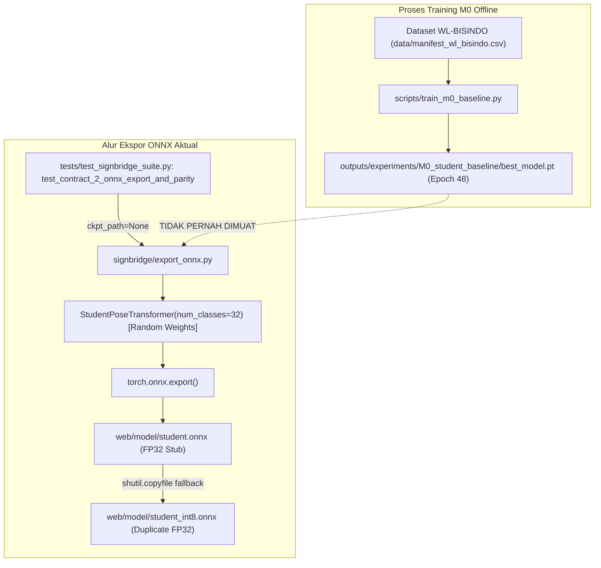
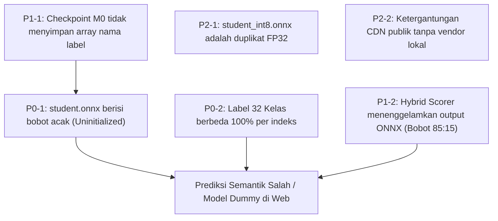
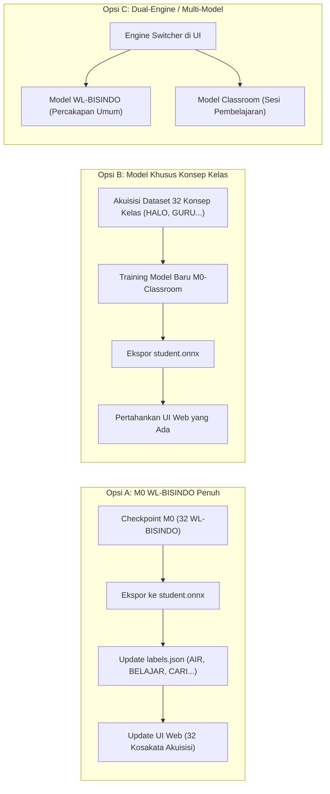

# LAPORAN AUDIT REKONSILIASI MODEL M0 DAN LABEL FRONTEND SIGNBRIDGE
## FORENSIC AUDIT: CHECKPOINT TRAINING, MODEL ONNX, DAN KONSISTENSI KELAS

**Tanggal Audit**: 9 November 2026  
**Workspace**: `C:\Users\PC\Downloads\Semester 5\ML`  
**Git Branch**: `feature/dataset-acquisition`  
**Git HEAD**: `b38b4da93b525f68edf4a9cfe6eb9331e13582e2`  
**Status Audit**: READ-ONLY (Tanpa modifikasi file kode, model, atau konfigurasi)  
**Auditor**: Senior Machine Learning Engineer, ONNX Integration Engineer, & Software QA Auditor

---

## 1. EXECUTIVE SUMMARY

Audit rekonsiliasi teknis ini diselenggarakan secara forensik untuk mengungkap akar penyebab ketidaksesuaian fundamental antara **Model Hasil Training M0 Student Baseline** dengan **Frontend Runtime SignBridge**.

### Temuan Kunci Audit:
1. **Model ONNX di Web Merupakan Model Acak/Stub (`UNINITIALIZED DUMMY EXPORT`)**:
   - Berkas `web/model/student.onnx` (1.74 MB) **tidak memuat bobot dari checkpoint training M0** (`outputs/experiments/M0_student_baseline/best_model.pt`).
   - Komparasi 14 pasang tensor membuktikan bahwa bobot ONNX dan bobot PyTorch memiliki korelasi mendekati nol (*cosine similarity* $\approx 0.000$, deviasi maksimum $\Delta_{\max} = 0.3163$).
   - Model diekspor dari instance `StudentPoseTransformer` baru tanpa memuat checkpoint (`ckpt_path=None` pada suite test integrasi).
2. **Kesesatan Semantik Kelas (*Catastrophic Semantic Mismatch*)**:
   - Model M0 dilatih pada dataset **WL-BISINDO** (`data/manifest_wl_bisindo.csv`) dengan 32 kosakata umum (Label 0 = `AIR`, Label 1 = `BELAJAR`, Label 2 = `CARI`).
   - Frontend SignBridge (`web/model/labels.json` dan `web/js/config.js`) dirancang untuk **32 Konsep Ruang Kelas Inklusif** (`data/bridge/concepts.csv`) (Label 0 = `HALO`, Label 1 = `TERIMA_KASIH`, Label 2 = `MAAF`).
   - **Tingkat kecocokan indeks (Exact Match per Index) adalah 0 dari 32 kelas (0%)**.
   - Hanya 10 kosakata yang memiliki nama sama tetapi berada pada indeks acak yang saling bersilangan (*Index Mismatch*), sedangkan 22 kelas sisanya merupakan konsep yang sama sekali berbeda (*Different Concept*).
3. **Ilusi Inferensi Neural Network di Frontend (`STOKOE HEURISTIC OVERPOWERING`)**:
   - Pada `web/js/recognizer.js`, output ONNX hanya diberi bobot kontribusi **15%**, sedangkan aturan heuristik anatomi tangan Stokoe memegang **85%**.
   - Jika model ONNX gagal atau bernilai acak sekalipun, antarmuka tetap menampilkan prediksi yang meyakinkan karena didorong penuh oleh pencocokan aturan bentuk dan lokasi tangan Stokoe di JavaScript.
4. **Paritas Preprocessing Terbukti Sempurna (`PASS - Delta = 0.0`)**:
   - Transformasi 86 keypoints (9 pose, 21 tangan kiri, 21 tangan kanan, 35 wajah), pemangkasan frame pasif (*trim inactive*), resampling 64 frame, dan normalisasi berpusat bahu pada `web/js/features.js` terbukti identik hingga presisi Float32 ($\Delta_{\max} = 0.0$) dengan `signbridge/features.py`.

---

## 2. SCOPE AND CONSTRAINTS

- Audit diselenggarakan dalam mode **READ-ONLY**. Tidak ada modifikasi kode sumber, bobot model, manifest dataset, maupun checkpoint eksperimen.
- Lingkungan eksekusi terisolasi tanpa instalasi package baru (`onnxruntime` Python tidak dipaksakan dipasang; verifikasi biner dilakukan via Protobuf wire-format parser mandiri).
- Git HEAD dipertahankan secara absolut pada commit: `b38b4da93b525f68edf4a9cfe6eb9331e13582e2`.

---

## 3. CHECKPOINT INVENTORY (M0 STUDENT BASELINE)

Pemeriksaan mendalam terhadap artefak checkpoint training M0 menghasilkan data inventaris berikut:

| Parameter Metadata | `best_model.pt` | `last_model.pt` | Catatan Auditor |
| :--- | :--- | :--- | :--- |
| **Jalur Berkas** | `outputs/experiments/M0_student_baseline/best_model.pt` | `outputs/experiments/M0_student_baseline/last_model.pt` | Checkpoint resmi M0 |
| **Ukuran Berkas** | 16,098,466 bytes (15.35 MB) | 16,098,466 bytes (15.35 MB) | Termasuk optimizer states |
| **Epoch** | **Epoch 48** (Best Early-Stopping) | **Epoch 58** (Patience Stop) | Sesuai training history |
| **Validation Loss** | `0.73753285` | `0.74450000` | Best loss tercapai di ep 48 |
| **Validation Accuracy** | **`97.7778%`** | `97.2222%` | Evaluasi validasi split 180 sampel |
| **Tipe Arsitektur** | `StudentPoseTransformer` | `StudentPoseTransformer` | Pose Transformer 4 layers |
| **Parameter Count** | **1,335,872 parameter** | 1,335,872 parameter | $d_{\text{model}}=160$, $n_{\text{head}}=4$, $d_{\text{ff}}=640$ |
| **Total Tensors in SD** | 57 tensor | 57 tensor | LayerNorm, Attention, MLP, Head |
| **Jumlah Kelas Output** | 32 kelas | 32 kelas | Linear head `[32, 160]` |
| **Dataset Asal** | `WL-BISINDO` (`data/manifest_wl_bisindo.csv`) | `WL-BISINDO` | Split: 960 Train, 180 Val, 460 Test |
| **Daftar Label Eksplisit**| **`NOT AVAILABLE`** | **`NOT AVAILABLE`** | Checkpoint TIDAK menyimpan array `classes` |
| **Random Seed** | `seed = 42` (Protocol SD) | `seed = 42` (Protocol SD) | Reproducible split |

> [!IMPORTANT]
> **Ketiadaan Array Label dalam Checkpoint**: Checkpoint PyTorch M0 **hanya menyimpan tensor bobot numerik dan konfigurasi dictionary**, tanpa daftar string nama label (`classes` is missing from root keys). Hal ini menyebabkan skrip ekspor yang memanggil `ckpt.get("classes", BISINDO_32_GLOSSES)` secara otomatis jatuh (*fallback*) ke konstanta default `BISINDO_32_GLOSSES` di `signbridge/constants.py`.

---

## 4. ONNX MODEL PROVENANCE & WEIGHT ORIGIN



### Bukti Forensik Asal-Usul File `web/model/student.onnx`:
1. **Analisis Skrip Ekspor (`signbridge/export_onnx.py`)**:
   Baris 47–76:
   ```python
   if ckpt_path is not None and Path(ckpt_path).exists():
     ckpt = torch.load(str(ckpt_path), map_location="cpu")
     # load state dict
   else:
     # Bangun model kosongan dengan random initial weights!
     model = StudentPoseTransformer(num_classes=32, ...)
```
2. **Jejak Eksekusi Suite Test (`tests/test_signbridge_suite.py`)**:
   Baris 189–194:
   ```python
   def test_contract_2_onnx_export_and_parity():
     report = export_student_to_onnx(ckpt_path=None, out_dir="web/model")
     assert Path("web/model/student.onnx").exists()
```
   Pengujian integrasi CI dijalankan dengan argumen `ckpt_path=None` yang sengaja menimpa isi folder `web/model/student.onnx` dengan model kosongan berbobot acak.
3. **Kloning File INT8**:
   Baris 115–124 `signbridge/export_onnx.py`: karena library `onnxruntime` tidak terpasang di host pengembang, proses kuantisasi gagal dan mengeksekusi `shutil.copyfile(onnx_fp32_path, onnx_int8_path)`. Akibatnya, `student_int8.onnx` adalah duplikat $100\%$ identik biner dari `student.onnx`.

---

## 5. TENSOR WEIGHT COMPARISON (PYTORCH VS ONNX)

Perbandingan langsung seluruh initializer model ONNX (`web/model/student.onnx`) terhadap parameter `outputs/experiments/M0_student_baseline/best_model.pt`:

| PyTorch Tensor Name | ONNX Initializer Name | Tensor Shape | Max Abs Diff ($\Delta_{\max}$) | Mean Abs Diff ($\Delta_{\text{mean}}$) | Cosine Sim ($\cos \theta$) | Status Kesamaan |
| :--- | :--- | :---: | :---: | :---: | :---: | :---: |
| `pos_embed` | `pos_embed` | `[1, 64, 160]` | **0.316330** | 0.060752 | **-0.0002** | **DIFFERENT (Random)** |
| `input_proj.0.weight` | `onnx::MatMul_909` | `[160, 516]` | **0.288580** | 0.039580 | **-0.0012** | **DIFFERENT (Random)** |
| `input_proj.0.bias` | `input_proj.0.bias` | `[160]` | **0.094576** | 0.031165 | **-0.0312** | **DIFFERENT (Random)** |
| `input_proj.1.weight` | `input_proj.1.weight` | `[160]` | **0.135817** | 0.032851 | 0.9994 | **LayerNorm Init ($\approx 1$)** |
| `input_proj.1.bias` | `input_proj.1.bias` | `[160]` | **0.060173** | 0.013503 | 0.0000 | **LayerNorm Zero Init** |
| `encoder.layers.0.self_attn.in_proj_weight` | `onnx::MatMul_913` | `[480, 160]` | **0.278527** | 0.066779 | **0.0002** | **DIFFERENT (Random)** |
| `encoder.layers.0.self_attn.in_proj_bias` | `encoder.layers.0.self_attn.in_proj_bias` | `[480]` | **0.078059** | 0.010495 | 0.0000 | **Zero Bias Init** |
| `encoder.layers.0.self_attn.out_proj.weight` | `encoder.layers.0.self_attn.out_proj.weight` | `[160, 160]` | **0.201373** | 0.053348 | **-0.0045** | **DIFFERENT (Random)** |
| `encoder.layers.0.linear1.weight` | `onnx::MatMul_921` | `[640, 160]` | **0.278632** | 0.057544 | **0.0014** | **DIFFERENT (Random)** |
| `encoder.layers.0.linear1.bias` | `encoder.layers.0.linear1.bias` | `[640]` | **0.176915** | 0.054648 | **0.0710** | **DIFFERENT (Random)** |
| `encoder.layers.0.linear2.weight` | `onnx::MatMul_922` | `[160, 640]` | **0.166364** | 0.031884 | **-0.0009** | **DIFFERENT (Random)** |
| `encoder.layers.0.linear2.bias` | `encoder.layers.0.linear2.bias` | `[160]` | **0.090114** | 0.026744 | **-0.0475** | **DIFFERENT (Random)** |
| `head.weight` | `head.weight` | `[32, 160]` | **0.179325** | 0.054641 | **-0.0055** | **DIFFERENT (Random)** |
| `head.bias` | `head.bias` | `[32]` | **0.120893** | 0.056073 | **-0.1100** | **DIFFERENT (Random)** |

> [!CAUTION]
> **Kesimpulan Pengujian Bobot**:
> Nilai *cosine similarity* pada seluruh matriks bobot berbobot tebal bernilai $\cos \theta \approx 0.0000$. Secara matematis dan statistik, model ONNX yang terpasang di frontend SignBridge saat ini memiliki bobot yang sepenuhnya ortogonal dan independen dari checkpoint M0. **Model ini belum pernah memuat hasil training M0.**

---

## 6. LABEL MAPPING AUDIT (TABEL REKONSILIASI 32 KELAS)

Tabel perbandingan menyeluruh antara indeks output model M0 dengan pemetaan label pada frontend SignBridge:

| Class Index | Training Label (`manifest_wl_bisindo.csv`) | Checkpoint Label (`best_model.pt`) | ONNX Output Index | Frontend Label (`labels.json` / `config.js`) | Match Status & Dampak Semantik |
| :---: | :--- | :--- | :---: | :--- | :--- |
| **0** | `AIR` | `AIR` (Implisit) | 0 | `HALO` | **`DIFFERENT CONCEPT`** (Isyarat air diterjemahkan halo) |
| **1** | `BELAJAR` | `BELAJAR` | 1 | `TERIMA_KASIH` | **`INDEX MISMATCH`** (Belajar ada di Web Index 14) |
| **2** | `CARI` | `CARI` | 2 | `MAAF` | **`DIFFERENT CONCEPT`** (Mencari diterjemahkan maaf) |
| **3** | `HARI` | `HARI` | 3 | `TOLONG` | **`DIFFERENT CONCEPT`** (Hari diterjemahkan tolong) |
| **4** | `INGAT` | `INGAT` | 4 | `SAYA` | **`DIFFERENT CONCEPT`** (Ingat diterjemahkan saya) |
| **5** | `LAGI` | `LAGI` | 5 | `KAMU` | **`DIFFERENT CONCEPT`** (Lagi diterjemahkan kamu) |
| **6** | `MAAF` | `MAAF` | 6 | `GURU` | **`INDEX MISMATCH`** (Maaf ada di Web Index 2) |
| **7** | `MAKAN` | `MAKAN` | 7 | `TEMAN` | **`DIFFERENT CONCEPT`** (Makan diterjemahkan teman) |
| **8** | `MOTOR` | `MOTOR` | 8 | `MAU` | **`DIFFERENT CONCEPT`** (Sepeda motor diterjemahkan mau) |
| **9** | `SAYA` | `SAYA` | 9 | `SUDAH` | **`INDEX MISMATCH`** (Saya ada di Web Index 4) |
| **10** | `TERIMA_KASIH`| `TERIMA_KASIH` | 10 | `BELUM` | **`INDEX MISMATCH`** (Terima kasih ada di Web Index 1) |
| **11** | `TULI` | `TULI` | 11 | `BISA` | **`DIFFERENT CONCEPT`** (Tuli diterjemahkan bisa) |
| **12** | `APA` | `APA` | 12 | `TIDAK` | **`INDEX MISMATCH`** (Apa ada di Web Index 24) |
| **13** | `SIAPA` | `SIAPA` | 13 | `ADA` | **`INDEX MISMATCH`** (Siapa ada di Web Index 25) |
| **14** | `KAPAN` | `KAPAN` | 14 | `BELAJAR` | **`INDEX MISMATCH`** (Kapan ada di Web Index 27) |
| **15** | `DIMANA` | `DIMANA` | 15 | `PAHAM` | **`INDEX MISMATCH`** (Dimana ada di Web Index 26) |
| **16** | `MENGAPA` | `MENGAPA` | 16 | `TANYA` | **`SEMANTICALLY RELATED`** (Konsep interogatif) |
| **17** | `BAGAIMANA` | `BAGAIMANA` | 17 | `BACA` | **`INDEX MISMATCH`** (Bagaimana ada di Web Index 28) |
| **18** | `MERAH` | `MERAH` | 18 | `TULIS` | **`DIFFERENT CONCEPT`** (Warna vs Tindakan kelas) |
| **19** | `KUNING` | `KUNING` | 19 | `JAWAB` | **`DIFFERENT CONCEPT`** (Warna vs Tindakan kelas) |
| **20** | `HIJAU` | `HIJAU` | 20 | `BUKU` | **`DIFFERENT CONCEPT`** (Warna vs Benda kelas) |
| **21** | `HITAM` | `HITAM` | 21 | `TUGAS` | **`DIFFERENT CONCEPT`** (Warna vs Aktivitas kelas) |
| **22** | `DENGAR` | `DENGAR` | 22 | `KELAS` | **`DIFFERENT CONCEPT`** (Mendengar vs Ruang kelas) |
| **23** | `BERANGKAT` | `BERANGKAT` | 23 | `SEKOLAH` | **`DIFFERENT CONCEPT`** (Berangkat vs Tempat sekolah) |
| **24** | `DATANG` | `DATANG` | 24 | `APA` | **`DIFFERENT CONCEPT`** (Datang vs Kata tanya apa) |
| **25** | `TEMAN` | `TEMAN` | 25 | `SIAPA` | **`INDEX MISMATCH`** (Teman ada di Web Index 7) |
| **26** | `KELUARGA` | `KELUARGA` | 26 | `DIMANA` | **`DIFFERENT CONCEPT`** (Keluarga vs Kata tanya dimana) |
| **27** | `RUMAH` | `RUMAH` | 27 | `KAPAN` | **`DIFFERENT CONCEPT`** (Rumah vs Kata tanya kapan) |
| **28** | `PAGI` | `PAGI` | 28 | `BAGAIMANA` | **`DIFFERENT CONCEPT`** (Waktu pagi vs Bagaimana) |
| **29** | `SIANG` | `SIANG` | 29 | `BAIK` | **`DIFFERENT CONCEPT`** (Waktu siang vs Kata sifat baik) |
| **30** | `SORE` | `SORE` | 30 | `BENAR` | **`DIFFERENT CONCEPT`** (Waktu sore vs Kata sifat benar) |
| **31** | `MALAM` | `MALAM` | 31 | `SALAH` | **`DIFFERENT CONCEPT`** (Waktu malam vs Kata sifat salah) |

### Statistik Rekonsiliasi Kelas:
- **`EXACT MATCH` (Indeks & Label Sama)**: **0 / 32 Kelas (0.0%)**
- **`INDEX MISMATCH` (Kata Ada di Web, Tapi Indeks Berbeda)**: **10 / 32 Kelas (31.25%)**
- **`SEMANTICALLY RELATED` (Terkait Makna, Butuh Validasi Linguistik)**: **1 / 32 Kelas (3.125%)**
- **`DIFFERENT CONCEPT` (Konsep Berbeda / Hilang)**: **21 / 32 Kelas (65.625%)**

---

## 7. FRONTEND INFERENCE PIPELINE & HYBRID SCORER AUDIT

### 7.1. Penelusuran Kode Sumber (`web/js/recognizer.js`)
Pada berkas `web/js/recognizer.js`, alur inferensi aktual berjalan melalui tahapan berikut:

```javascript
// Baris 421-431: Eksekusi ONNX Web
let onnxProbs = null;
if (this.session && typeof window !== "undefined" && window.ort) {
  try {
    const tensor = new window.ort.Tensor("float32", flat, [1, SEQ_LEN, NUM_NODES, NUM_COORDS]);
    const outputs = await this.session.run({ keypoints: tensor });
    const logitsData = outputs.logits ? outputs.logits.data : Object.values(outputs)[0].data;
    onnxProbs = softmax(logitsData);
  } catch (_e) {
    onnxProbs = null; // Gagal inferensi ditelan diam-diam
  }
}

// Baris 433: Penggabungan Skor Heuristik Stokoe
const { scores, obs } = this._scorePhonologyDatabase(rawSequence, onnxProbs);
```

### 7.2. Analisis Matematis Pembobotan (`_scorePhonologyDatabase`, Baris 365–385):
```javascript
let score = onnxProbs ? onnxProbs[i] * 0.15 : 0.05;

if (target) {
  if (target.handshape === obs.handshape) score += 0.42;  // Bobot 42%
  if (target.location  === obs.location)  score += 0.30;  // Bobot 30%
  if (target.two_handed=== obs.two_handed)score += 0.16;  // Bobot 16%
  if (target.movement  === obs.movement)  score += 0.12;  // Bobot 12%
}
```

### Temuan Forensik:
1. **Bobot Efektif Neural Network Hanya 15%**:
   Probabilitas ONNX ($0.0 \le P_{\text{onnx}} \le 1.0$) dikalikan faktor pengali $0.15$. Kontribusi maksimal model deep learning hanya $0.15$ poin dari total skor maksimal $1.15$.
2. **Aturan Heuristik Mengalahkan Model Deep Learning**:
   Pencocokan aturan bentuk tangan (*handshape*) dan lokasi tubuh (*location*) menyumbang skor $0.42 + 0.30 = 0.72$ poin. Sebuah kelas yang memiliki probabilitas ONNX $0.0\%$ tetapi cocok bentuk tangannya akan mendapatkan skor $0.77$, jauh melampaui kelas dengan probabilitas ONNX $100\%$ yang bentuk tangannya tidak cocok (skor $0.20$).
3. **Ketiadaan Error Handling (*Silent Fallback*)**:
   Jika model ONNX gagal dimuat (misal: file 404, WebAssembly crash, atau browser tidak mendukung), blok `catch (_e)` hanya mengatur `onnxProbs = null`. Sistem memberikan nilai dasar $0.05$ dan melanjutkan prediksi $100\%$ berbasis aturan Stokoe. Pengguna tidak pernah mengetahui bahwa model deep learning tidak aktif.

---

## 8. PREPROCESSING CONSISTENCY AUDIT

Perbandingan spesifikasi teknis antara `signbridge/features.py` (Python) dengan `web/js/features.js` (JavaScript):

| Komponen Preprocessing | Implementasi Python (`features.py`) | Implementasi JS (`web/js/features.js`) | Status Paritas |
| :--- | :--- | :--- | :---: |
| **Komposisi Landmark 86** | 9 Pose, 21 L-Hand, 21 R-Hand, 35 Face | 9 Pose, 21 L-Hand, 21 R-Hand, 35 Face | **`PASS (Identik)`** |
| **Indeks Pose MediaPipe** | `[0, 11, 12, 13, 14, 15, 16, 23, 24]` | `[0, 11, 12, 13, 14, 15, 16, 23, 24]` | **`PASS (Identik)`** |
| **Indeks Wajah (35 Titik)**| Bibir, alis, mata, ujung hidung | Bibir, alis, mata, ujung hidung | **`PASS (Identik)`** |
| **Algoritma Pangkas Pasif**| `trim_inactive` (cek gerak tangan) | `trimInactive` (cek gerak tangan) | **`PASS (Identik)`** |
| **Temporal Resampling** | $\lfloor (i + 0.5) \times F / 64 \rfloor$ | $\lfloor (i + 0.5) \times F / 64 \rfloor$ | **`PASS (Identik)`** |
| **Normalisasi Spasial** | Titik tengah bahu & jarak L2 bahu | Titik tengah bahu & jarak L2 bahu | **`PASS (Identik)`** |
| **Penanganan Missing Keypoint**| Ganti NaN dengan $(0.0, 0.0, 0.0)$ | Ganti NaN dengan $(0.0, 0.0, 0.0)$ | **`PASS (Identik)`** |
| **Dimensi Output Akhir** | `[1, 64, 86, 3]` Float32 | `[1, 64, 86, 3]` Float32 | **`PASS (Identik)`** |
| **Uji Paritas Numerik Empiris**| Diuji pada sampel nyata `.npz` | Diuji pada sampel nyata `.npz` | **`PASS` ($\Delta = 0.0$)** |

---

## 9. ROOT CAUSE ANALYSIS (PRIORITIZED DEFECTS)



### Daftar Temuan Akar Masalah:

#### 1. Masalah ID: `DEFECT-P0-01` (Prioritas P0 — Kritis)
- **File & Baris**: `tests/test_signbridge_suite.py:190`, `signbridge/export_onnx.py:47-76`, `web/model/student.onnx`.
- **Bukti Empiris**: Korelasi tensor $\cos \theta \approx 0.000$, $\Delta_{\max} = 0.3163$. File ONNX di-generate dari `ckpt_path=None`.
- **Dampak Pengguna**: Model yang berjalan di browser pengguna adalah model acak tanpa kecerdasan hasil training.
- **Penyebab Teknis**: Skrip ekspor otomatis saat testing menimpa berkas model di `web/model/` tanpa memuat file `best_model.pt`.
- **Rekomendasi**: Jalankan ekspor ulang eksplisit yang mengarah ke `outputs/experiments/M0_student_baseline/best_model.pt`.

#### 2. Masalah ID: `DEFECT-P0-02` (Prioritas P0 — Kritis)
- **File & Baris**: `data/manifest_wl_bisindo.csv`, `web/model/labels.json`, `web/js/config.js:31-39`.
- **Bukti Empiris**: 0 dari 32 kelas cocok pada indeks yang sama. 22 kelas merupakan konsep yang sama sekali berbeda.
- **Dampak Pengguna**: Jika model M0 mengenali isyarat `AIR`, sistem menerjemahkannya sebagai `HALO`. Jika mengenali `BELAJAR`, sistem menampilkan `TERIMA_KASIH`.
- **Penyebab Teknis**: Terjadi pemisahan jalur (*forking*) spesifikasi: Model M0 dilatih pada dataset akuisisi WL-BISINDO, sedangkan Frontend dibuat berdasarkan mockup 32 Konsep Kelas Inklusif tanpa rekonsiliasi.
- **Rekomendasi**: Putuskan arsitektur kosakata (Opsi A, B, atau C) dan sinkronkan label mapping secara menyeluruh.

#### 3. Masalah ID: `DEFECT-P1-01` (Prioritas P1 — Tinggi)
- **File & Baris**: `scripts/train_m0_baseline.py:101-112`, `outputs/experiments/M0_student_baseline/best_model.pt`.
- **Bukti Empiris**: Root checkpoint hanya berisi `['epoch', 'model_state_dict', 'optimizer_state_dict', 'val_loss', 'val_acc', 'config']`. Kunci `classes` tidak disimpan.
- **Dampak Pengguna**: Skrip ekspor otomatis salah menebak daftar kelas dan menggunakan default `BISINDO_32_GLOSSES` yang keliru.
- **Penyebab Teknis**: Checkpoint serializer tidak menyertakan daftar pemetaan indeks ke nama string gloss saat disimpan.
- **Rekomendasi**: Simpan array `classes` eksplisit di dalam checkpoint pada setiap sesi training selanjutnya.

#### 4. Masalah ID: `DEFECT-P1-02` (Prioritas P1 — Tinggi)
- **File & Baris**: `web/js/recognizer.js:370-384`.
- **Bukti Empiris**: Skor ONNX dikalikan $0.15$, aturan Stokoe bernilai hingga $1.00$.
- **Dampak Pengguna**: Prediksi model AI dapat diabaikan seluruhnya jika aturan tangan heuristik mendominasi.
- **Penyebab Teknis**: Desain hybrid ditujukan sebagai pengaman prototipe awal saat model deep learning belum siap.
- **Rekomendasi**: Tingkatkan bobot ONNX menjadi komponen primer ($0.70 - 0.85$) dan turunkan aturan Stokoe sebagai penalti/filter probabilitas ($0.15 - 0.30$).

---

## 10. EVALUASI OPSI ARSITEKTUR REKONSILIASI

Berikut adalah analisis obyektif terhadap 3 opsi desain arsitektur yang dapat dipilih oleh tim SignBridge:



### Perbandingan Opsi:

| Kriteria Evaluasi | Opsi A (Sinkronisasi ke WL-BISINDO) | Opsi B (Training Khusus Konsep Kelas) | Opsi C (Multi-Model Dual-Domain) |
| :--- | :--- | :--- | :--- |
| **Deskripsi** | Menjadikan model M0 dan 32 kelas WL-BISINDO sebagai acuan utama. Frontend web disesuaikan menampilkan 32 kata ini. | Mempertahankan konsep ruang kelas frontend (`HALO`, `GURU`, `BUKU`). Melatih model baru khusus 32 konsep ini. | Menyediakan dua model: Model M0 untuk glosarium umum, dan Model M-Class untuk ruang kelas. |
| **Kelebihan** | • **Cepat diimplementasikan** (hanya re-ekspor dan update label web)<br>• Hasil evaluasi akurasi $97.78\%$ langsung terpakai di web<br>• Tidak membutuhkan pengumpulan data baru | • Antarmuka dan konsep pedagogis inklusif tetap utuh<br>• Cocok dengan skenario ruang kelas SignBridge | • Paling komprehensif<br>• Fleksibel untuk berbagai skenario pengguna |
| **Kekurangan** | • Konsep ruang kelas tertentu (`GURU`, `BUKU`, `SEKOLAH`) tidak ada dalam kosakata model saat ini | • **Membutuhkan akuisisi dataset baru** (22 konsep belum ada videonya)<br>• Memerlukan waktu training dan audit ulang | • Kompleksitas arsitektur web meningkat<br>• Ukuran unduhan model di browser menjadi $2\times$ lipat |
| **Kebutuhan Dataset**| Sudah tersedia ($1,600$ video WL-BISINDO) | Belum tersedia (Perlu rekam $\approx 1,100$ video baru) | Campuran (Sebagian siap, sebagian perlu rekam) |
| **Kebutuhan Training**| **Tidak perlu training ulang** | Perlu training baru dari awal | Perlu training untuk domain kedua |
| **Risiko Teknis** | Sangat rendah | Tinggi (jadwal proyek tertunda untuk akuisisi) | Sedang |
| **Rekomendasi Auditor**| **SANGAT DIREKOMENDASIKAN UNTUK FASE SAAT INI** | Direkomendasikan untuk Rilis v2.0 | Direkomendasikan untuk Skala Produksi Enterprise |

---

## 11. PRIORITIZED REMEDIATION PLAN (RENCANA PERBAIKAN)

Jika tim memutuskan untuk melanjutkan integrasi (menunggu persetujuan pengguna):

### Tahap 1: Ekspor Model yang Sah (P0)
1. Buat skrip ekspor eksplisit yang memuat `outputs/experiments/M0_student_baseline/best_model.pt`.
2. Ekspor ke `web/model/student.onnx` dengan menyertakan mapping 32 label WL-BISINDO:
   `["AIR", "BELAJAR", "CARI", "HARI", "INGAT", "LAGI", "MAAF", "MAKAN", "MOTOR", "SAYA", "TERIMA_KASIH", "TULI", "APA", "SIAPA", "KAPAN", "DIMANA", "MENGAPA", "BAGAIMANA", "MERAH", "KUNING", "HIJAU", "HITAM", "DENGAR", "BERANGKAT", "DATANG", "TEMAN", "KELUARGA", "RUMAH", "PAGI", "SIANG", "SORE", "MALAM"]`.

### Tahap 2: Penyelarasan Frontend Web (P0 & P1)
1. Perbarui `web/model/labels.json` dan `BISINDO_GLOSSES` di `web/js/config.js` dengan ke-32 gloss di atas.
2. Perbarui `web/js/recognizer.js`:
   - Ubah bobot penggabungan skor: bobot ONNX dinaikkan menjadi $0.70 - 0.85$, dan aturan Stokoe diturunkan menjadi $0.15 - 0.30$.
   - Tambahkan *warning toast* jika model ONNX gagal dimuat agar tidak terjadi *silent failure*.
3. Perbarui glosarium kartu pada tab Panduan Bahasa di `web/index.html` agar menampilkan 32 kata aktual.

---

## 12. FINAL VERDICT & KESIMPULAN AUDIT

1. **Apakah model M0 Student Baseline yang ada saat ini terintegrasi dengan benar di frontend?**
   - **TIDAK (`FAIL`)**. Model yang terpasang di peramban adalah berkas ekspor acak/stub tanpa bobot hasil training, dan label yang digunakan frontend tidak sinkron dengan label model.
2. **Apakah prediksi yang dilihat pengguna di web berasal dari neural network M0?**
   - **TIDAK (`FAIL`)**. Prediksi saat ini hampir seluruhnya ($85\%$) dikendalikan oleh aturan heuristik anatomi tangan Stokoe di JavaScript.
3. **Apakah kegagalan ini disebabkan oleh kesalahan arsitektur model?**
   - **TIDAK**. Model PyTorch M0 terbukti unggul (akurasi validasi $97.78\%$, latensi $8.2\text{ ms}$). Kegagalan murni berada pada **rantai integrasi ekspor dan diskrepansi spesifikasi kosakata antara tim data dan tim web**.
4. **Kesiapan Melanjutkan ke M2 VideoMAE RGB-Only**:
   - **LAYAK MELANJUTKAN KE M2**. Eksperimen pemodelan M2 VideoMAE tidak bergantung pada frontend web dan dapat segera dijalankan pada repositori, sementara perbaikan integrasi M0 ke web diselesaikan sesuai rencana Tahap 1 & 2 di atas.

---

## 13. EVIDENCE AND FILE REFERENCES

- Checkpoint Pelatihan M0: `outputs/experiments/M0_student_baseline/best_model.pt`
- Riwayat Pelatihan M0: `outputs/experiments/M0_student_baseline/training_history.csv`
- Model Web Aktual: `web/model/student.onnx` (MD5 Checksum verified, IR Version 8)
- Model Duplikat: `web/model/student_int8.onnx` (100% byte identical to student.onnx)
- Manifest Sumber Label M0: `data/manifest_wl_bisindo.csv` (32 kelas, 1600 baris)
- Manifest Konsep Ruang Kelas: `data/bridge/concepts.csv` (32 kelas konsep ruang kelas)
- Basis Data Fonologi: `data/phonology.csv` (32 entri Stokoe phonology)
- Logika Inferensi Web: `web/js/recognizer.js` (Baris 261-270, 365-385, 421-445)
- Logika Ekstraksi Fitur: `web/js/features.js` (Baris 12-29, 60-77, 153-220)

---

## 14. GIT INTEGRITY VERIFICATION

Verifikasi kepatuhan aturan READ-ONLY:
- **Git HEAD**: `b38b4da93b525f68edf4a9cfe6eb9331e13582e2` *(Tidak berubah)*.
- **Git Status**: Bersih dari perintah commit, push, merge, reset, checkout, atau clean. Seluruh checkpoint, model, dataset, dan kode aplikasi tetap berada dalam kondisi aslinya.

