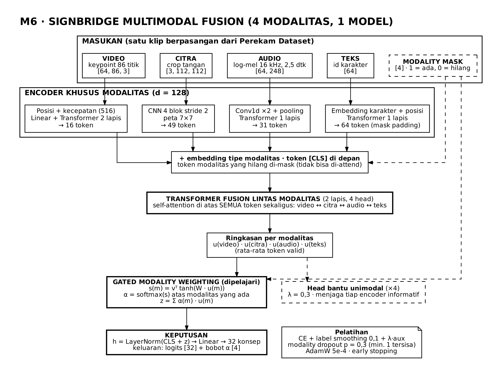

# M6 — SignBridge Multimodal Fusion (4 modalitas dalam satu model)

## 1. Latar belakang perubahan

Sebelum M6, SignBridge adalah **aplikasi multimodal**: setiap modalitas diproses model atau alat yang terpisah
(video → M0, citra → I1, suara → Web Speech API, teks → aturan B0), lalu hasilnya dirangkai berurutan.
Tidak ada satu model pun yang menggabungkan informasi dari beberapa modalitas.

M6 menjadikannya **model multimodal**: **satu model menerima video, citra, audio, dan teks sekaligus, menggabungkan
representasinya (fusion) dengan bobot yang dipelajari, dan keputusan akhirnya memakai semua sumber bersamaan.**



## 2. Tugas

Mengenali **1 dari 32 konsep kelas** (label sama dengan WL-BISINDO / `labels.json`) dari satu klip berpasangan:

| Modalitas | Isi | Tensor |
|---|---|---|
| Video | Deret keypoint 86 titik MediaPipe (pipeline Kontrak 3) | `pose [64, 86, 3]` |
| Citra | Crop tangan dari frame dengan tangan paling lengkap | `image [3, 112, 112]` |
| Audio | Ucapan kata/kalimat, mono 16 kHz, 2,5 detik → log-mel | `audio [64, 248]` |
| Teks | Kalimat konteks yang diketik/ditranskrip, token karakter | `text [64]` (int64) |
| Mask | 1 = modalitas tersedia, 0 = hilang | `modality_mask [4]` |

Urutan modalitas tetap: `video, image, audio, text` (Kontrak 7, `signbridge/multimodal/constants.py`).

## 3. Arsitektur (`signbridge/models/multimodal.py`)

1. **Encoder khusus modalitas** (d = 128): Transformer pose (16 token), CNN citra (49 token),
   Conv1d + Transformer audio (31 token), embedding karakter + Transformer teks (64 token).
2. **Transformer fusion lintas modalitas** (2 lapis, 4 head): semua token + embedding tipe modalitas + token `[CLS]`
   diproses bersama, sehingga token video dapat meng-attend token audio, citra, dan teks (dan sebaliknya).
   Token modalitas yang hilang di-mask dan tidak bisa di-attend.
3. **Gated modality weighting**: untuk tiap modalitas dihitung ringkasan `u_m`, skor `s_m = vᵀ tanh(W u_m)`,
   bobot `α = softmax(s)` atas modalitas yang tersedia, dan `z = Σ α_m · u_m`. Bobot `α` **dipelajari dan berbeda
   untuk tiap sampel**, serta dikeluarkan model sehingga terlihat modalitas mana yang paling berperan.
4. **Keputusan**: `LayerNorm(CLS + z) → Linear → 32 logits`.
5. **Head bantu unimodal** (λ = 0,3) dan **modality dropout** (p = 0,3, minimal satu modalitas tersisa) mencegah
   model bergantung pada satu modalitas saja dan membuatnya tetap bekerja saat sebagian modalitas tidak ada.

Model juga menerima sampel **berparsial** (mis. WL-BISINDO yang hanya punya video), karena modalitas yang hilang cukup
ditandai 0 di mask.

## 4. Pengumpulan data berpasangan

Menu **Perekam Dataset** di aplikasi web diperbaiki agar benar-benar merekam 4 modalitas:

| Sebelum | Sesudah |
|---|---|
| Keypoint diisi gerakan sintetis (`generateReferenceSignKeypoints`), bukan kamera | Keypoint dari kamera (MediaPipe) selama 2,5 detik |
| Audio, foto, video hanya tercatat namanya di manifest; berkasnya tidak ada di ZIP | WAV 16 kHz, crop tangan 224×224, dan portrait benar-benar disimpan |
| Tidak ada teks yang diisi perekam | Kolom kalimat (teks) diisi perekam; aman untuk koma/kutip |
| Tombol unduh membuat klip sintetis bila kosong | Unduh ditolak bila belum ada klip |

Protokol yang disarankan: **≥ 3 signer × 32 konsep × ≥ 10 pengulangan** (≥ 960 klip). Peragakan isyarat sambil
mengucapkan kalimatnya; variasikan kalimat konteks antar pengulangan.

## 5. Menjalankan

```bash
# 1) Kumpulkan ZIP dari menu Perekam Dataset ke data/raw/web_zips/, lalu bangun manifest
python scripts/build_multimodal_manifest.py --zips data/raw/web_zips --out data/multimodal
#    (opsional) tambahkan 1.600 klip WL-BISINDO sebagai sampel video-saja
python scripts/build_multimodal_manifest.py --zips data/raw/web_zips --out data/multimodal \
    --include-wlbisindo data/manifest_wl_bisindo.csv
#    protokol signer-independent
python scripts/build_multimodal_manifest.py ... --protocol si --test-signer S03

# 2) Uji pipa dengan data ACAK (bukan hasil penelitian)
python -m signbridge.train_multimodal --config configs/06_multimodal_fusion.yaml --smoke --epochs 2

# 3) Latih & evaluasi
python -m signbridge.train_multimodal --config configs/06_multimodal_fusion.yaml

# 4) Ekspor ONNX (+ uji paritas PyTorch vs onnxruntime < 1e-4)
python -m signbridge.export_onnx_multimodal

# 5) Server: POST /predict_multimodal (503 bila model belum diekspor; tidak ada prediksi palsu)
uvicorn server.app:app --port 7860
```

Contoh permintaan:

```json
POST /predict_multimodal
{ "keypoints": [[[0.51, 0.32, 0.0], ...]], "image_base64": "...", "audio_base64": "...", "text": "Saya mau makan." }
```

Jawaban berisi `gloss`, `confidence`, `top_k`, `modalities_used`, dan `modality_weights`
(mis. `{"video": 0.46, "image": 0.21, "audio": 0.24, "text": 0.09}`).

## 6. Evaluasi yang dihasilkan

`outputs/experiments/M6_multimodal_fusion/`:

- `evaluation_metrics.json` — akurasi & macro-F1 data uji dengan semua modalitas yang tersedia.
- `ablation_modalities.csv` — akurasi untuk **15 kombinasi modalitas** (video saja, video+audio, …, keempatnya).
  Baris `video` adalah pembanding langsung dengan model pose-saja; selisih terhadap baris lain menunjukkan
  sumbangan modalitas tambahan.
- `modality_weights.csv` — rata-rata bobot fusion `α` per konsep.
- `training_history.csv`, `best_model.pt`.

## 7. Catatan metodologis

- **Status: model belum dilatih.** Belum ada data berpasangan 4 modalitas; tidak ada angka hasil yang dilaporkan.
  Mode `--smoke` hanya memastikan pipa berjalan dengan data acak.
- **Risiko jalan pintas teks/audio.** Kalimat dan ucapan sering memuat kata targetnya sendiri, sehingga model bisa
  "menyontek" dari teks/audio. Karena itu laporkan selalu tabel ablasi (terutama `video` saja vs `video+image`),
  gunakan kalimat konteks yang bervariasi, dan pertimbangkan uji dengan teks dihapus.
- **Signer-independent.** Untuk klaim generalisasi, jalankan `--protocol si` (Leave-One-Signer-Out).
- Pengujian: `pytest tests/test_multimodal_features.py tests/test_multimodal_service.py tests/test_multimodal_model.py`
  dan `node --test tests/js/recorder.test.mjs`. Tes model membutuhkan PyTorch.
