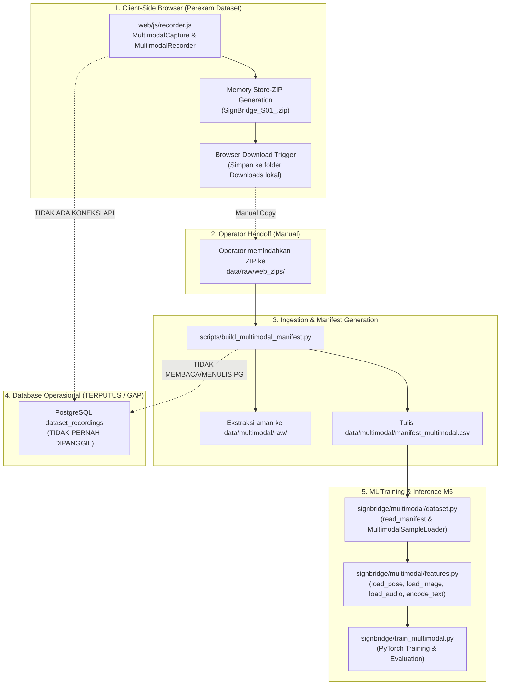

# LAPORAN AUDIT INTEGRITAS DATABASE & SISTEM PENYIMPANAN DATA (TASK P0-C)
**Proyek:** SignBridge ID–PH (BISINDO ↔ FSL) Multimodal Classroom Bridge  
**Fokus Arsitektur:** Evaluasi Database PostgreSQL 16 & Media Storage Multimodal M6  
**Lokasi Direktori:** `D:\SEMESTER 5\ML\Projek_1`  
**Tanggal:** 20 November 2026  
**Auditor:** Senior Backend Engineer, Database Architect, dan ML Data Pipeline Auditor  
**Status Audit:** **READY WITH ISSUES (ARSITEKTUR FILE-BASED SIAP, DATABASE POSTGRESQL BUTUH SINKRONISASI)**  

---

## 1. RINGKASAN EKSEKUTIF (EXECUTIVE SUMMARY)

Tahap **P0-C (Database & Storage Integrity Audit)** bertujuan untuk melakukan penelusuran teknis (*code-level trace*) menyeluruh terhadap kemampuan database (PostgreSQL 16) dan sistem penyimpanan berkas (*media storage*) dalam menerima, menyimpan, mengorganisir, dan menyediakan dataset 4 modalitas berpasangan (Video, Citra, Audio, Teks) untuk pelatihan model M6.

### Temuan Kunci Audit P0-C:
1. **Dua Sistem Penyimpanan yang Berjalan Terpisah (Decoupled Storage Architecture):**
   - **Pipeline Machine Learning M6 bersifat 100% File-Based:**  
     Alur pengolahan M6 tidak terhubung ke PostgreSQL. Data direkam di browser $\to$ diunduh sebagai berkas `.zip` $\to$ disimpan di folder `data/raw/web_zips/` $\to$ diekstrak oleh `scripts/build_multimodal_manifest.py` $\to$ menghasilkan `data/multimodal/manifest_multimodal.csv` $\to$ dibaca oleh `signbridge/multimodal/dataset.py` $\to$ dilatih oleh `signbridge/train_multimodal.py`.
   - **PostgreSQL 16 bersifat Operational & Telemetry-Based:**  
     Tabel `dataset_recordings` (`server/database.py:151`) dirancang pada Fase 1 untuk rekaman video tunggal, bukan untuk dataset 4 modalitas M6. Tidak ada komunikasi antara `web/js/recorder.js` dengan endpoint `/db/recordings`.
2. **Kesenjangan Skema Tabel `dataset_recordings` terhadap Kebutuhan P0-B:**
   Tabel `dataset_recordings` saat ini **kehilangan 5 kolom kritis multimodal**: `image_path`, `audio_path`, `text` (konteks kalimat), `split` (train/val/test), dan `category` (gloss vs letter). Kolom `concept_id` juga mengikat ke `sign_concepts` yang berbasis Kamus A (32 konsep kelas inklusi), bukan Kamus B (WL-BISINDO 32 gloss) yang digunakan M6.
3. **Persistensi Docker Terjamin Aman:**
   Konfigurasi `docker-compose.yml` telah memetakan volume persisten:
   - PostgreSQL: menggunakan named volume `pgdata:/var/lib/postgresql/data` (aman dari restart/recreate container).
   - Media Storage: menggunakan bind mount `./data:/app/data` (tersimpan langsung di disk host).
4. **Keamanan Ekstraksi ZIP:**
   Script `scripts/build_multimodal_manifest.py:48-52` memiliki proteksi *Zip Slip / Path Traversal*, namun script pembantu `scripts/web_dataset_to_multimodal.py:21` belum memiliki proteksi serupa.

---

## 2. RUANG LINGKUP & METODOLOGI AUDIT

Audit ini dilakukan secara *read-only* murni tanpa mengubah skema basis data, tanpa migration, dan tanpa modifikasi pipeline. 

### Komponen yang Diperiksa:
- **Backend & Database:** `server/database.py`, `server/app.py`, `migrations/001_initial_schema.sql`, `docker-compose.yml`, `server/Dockerfile`.
- **Media Storage & Pipeline Script:** `web/js/recorder.js`, `web/js/app.js`, `scripts/build_multimodal_manifest.py`, `scripts/web_dataset_to_multimodal.py`.
- **Dataset Loader & M6 Integration:** `signbridge/multimodal/constants.py`, `signbridge/multimodal/dataset.py`, `signbridge/multimodal/features.py`, `signbridge/train_multimodal.py`, `server/multimodal_service.py`.
- **Basis Data Operasional Lokal:** `data/signbridge_operational.db` (SQLite fallback).

---

## 3. ARSITEKTUR DATABASE POSTGRESQL 16

Konfigurasi basis data didefinisikan pada `server/database.py` dengan dukungan fallback otomatis ke SQLite jika PostgreSQL luring.

### Tabel-Tabel dalam Basis Data:
1. `sign_concepts`: Registri 32 konsep kelas inklusi (C01–C32) + 26 huruf ejaan jari statis (58 baris).
2. `model_versions`: Registri 20 model (M0–M5, I1–I3, A1–A3, B0, T1–T3, X1–X4).
3. `evaluation_runs`: Registri hasil pengukuran performa model.
4. `inference_logs`: Log operasional non-blocking dari endpoint `/predict`, `/asr`, `/sentence`, `/translate`.
5. `dataset_recordings`: Registri metadata rekaman mandiri.

---

## 4. ANALISIS SKEMA TABEL `dataset_recordings`

### A. Perbandingan Kolom Aktual vs Kebutuhan Manifest P0-B

| Atribut / Kolom | PostgreSQL `dataset_recordings` (`server/database.py:151-170`) | Kebutuhan Manifest P0-B (`signbridge/multimodal/constants.py:39-50`) | Status Kesenjangan | Dampak Operasional |
| :--- | :--- | :--- | :---: | :--- |
| **Primary Code** | `recording_code VARCHAR(64) UNIQUE` | `clip_id VARCHAR` | **MATCH (Perlu standardisasi)** | Format penamaan berbeda (`SBK_...` vs `folder:clip_id`). |
| **Identitas Signer**| `signer_id VARCHAR(32)` | `signer VARCHAR` | **MATCH** | Kompatibel. |
| **Kategori Data** | *TIDAK ADA* | `category VARCHAR` (`gloss`/`letter`) | **MISSING** | Tidak dapat membedakan kata vs ejaan abjad di DB. |
| **Nama Gloss** | `gloss VARCHAR(64)` | `gloss VARCHAR` | **MATCH** | Kompatibel. |
| **Label Integer** | `concept_id INTEGER FK` (ke Kamus A) | `label INTEGER` ($0 \dots 31$ Kamus B) | **INCONSISTENT** | `concept_id` mengacu Kamus A, sedangkan M6 butuh index Kamus B. |
| **Pose Keypoint** | `keypoint_path VARCHAR(256)` | `kp_path VARCHAR` | **MATCH** | Path berkas keypoint. |
| **Video Mentah** | `file_path VARCHAR(256)` | *Opsional / Tidak masuk M6* | **EXTRA** | M6 tidak langsung membaca MP4 saat training. |
| **Citra Crop Tangan**| *TIDAK ADA* | `image_path VARCHAR` | **MISSING (CRITICAL)** | PostgreSQL tidak mencatat lokasi berkas crop tangan. |
| **Audio Ucapan** | *TIDAK ADA* | `audio_path VARCHAR` | **MISSING (CRITICAL)** | PostgreSQL tidak mencatat lokasi berkas WAV ucapan. |
| **Teks Konteks** | *TIDAK ADA* | `text VARCHAR` | **MISSING (CRITICAL)** | Kalimat dialog kelas tidak tersimpan di database. |
| **Dataset Split** | *TIDAK ADA* | `split VARCHAR` (`train`/`val`/`test`) | **MISSING (HIGH)** | Pembagian LOSO/SD tidak terlacak di database. |
| **Status Etik** | `consent_status VARCHAR(32)` | *Tercatat di `_meta.json`* | **EXTRA (Baik)** | Menjamin kepatuhan etika penelitian. |
| **Status Validasi** | `validation_status VARCHAR(32)` | *Tercatat di `_meta.json`* | **EXTRA (Baik)** | Mendukung kontrol kualitas data. |

---

## 5. ARSITEKTUR MEDIA STORAGE (PENYIMPANAN BERKAS)

### A. Lokasi Penyimpanan Fisik Aktual
Penyimpanan media tidak disimpan sebagai BLOB di database (arsitektur yang tepat untuk performa), melainkan sebagai berkas sistem di direktori `data/`:

```text
data/
├── raw/
│   └── web_zips/                       # 1. Tempat operator meletakkan ZIP rekaman browser
│       └── SignBridge_S01_1732100000.zip
└── multimodal/
    ├── manifest_multimodal.csv         # 2. Manifest yang digenerate oleh script
    └── raw/                            # 3. Hasil ekstraksi ZIP permanen
        └── SignBridge_S01_1732100000/
            ├── manifest_selfrec.csv
            └── S01/
                └── gloss/
                    └── MAKAN/
                        ├── take_01_kp.json      # Keypoint [F, 86, 3] (Video)
                        ├── take_01_hand.jpg     # Crop tangan 224x224 (Citra)
                        ├── take_01_portrait.jpg # Foto wajah/pose (Tambahan)
                        ├── take_01.wav          # Audio 16 kHz 16-bit PCM (Suara)
                        └── take_01_meta.json    # Metadata rinci klip
```

### B. Validasi Ketersediaan Media Berdasarkan Database Seeding
Pemeriksaan pada database operasional aktif (`data/signbridge_operational.db`):
- Terdapat 1 baris rekaman: `recording_code: SB_FASE9_VERIFY_001`, `file_path: data/raw_kelas/S01_HALO_01.mp4`, `keypoint_path: data/keypoints/S01_HALO_01.npz`.
- **Hasil Pemeriksaan Disk:** Berkas `data/raw_kelas/S01_HALO_01.mp4` dan `data/keypoints/S01_HALO_01.npz` **TIDAK ADA DI DISK** (`exists = False`).
- **Bukti:** Database operasional saat ini menyimpan path berkas *placeholder* dari pengujian Fase 9, bukan media riil.

---

## 6. PENELUSURAN ALUR DATA: RECORDER MENUJU DATABASE (DATA FLOW TRACE)

Penelusuran menyeluruh dari ujung peramban (*browser*) hingga ke model PyTorch M6:



### Temuan Analisis Alur Data:
1. **Tidak Ada API Sinkronisasi Otomatis:** Peramban tidak mengirimkan rekaman ke backend melalui HTTP POST atau WebSocket. Tidak ada endpoint di `server/app.py` yang menerima unggahan berkas ZIP.
2. **Pipeline Pelatihan M6 Berjalan Mandiri Tanpa Database:** Model M6 dapat dilatih secara sempurna hanya dengan mengandalkan folder `data/raw/web_zips/` dan berkas CSV `manifest_multimodal.csv`. Ketiadaan sinkronisasi ke PostgreSQL **tidak memblokir** proses pelatihan ML, namun menyebabkan metadata rekaman tidak terdata di sistem manajemen database terpusat.

---

## 7. KONSISTENSI IDENTITAS SAMPEL (SAMPLE IDENTITY)

| Komponen | Pola Identitas yang Digunakan | Contoh Faktual | Status Konsistensi |
| :--- | :--- | :--- | :---: |
| **Rekomendasi P0-B** | `SB_<SIGNER>_<GLOSS>_T<TAKE>` | `SB_S01_MAKAN_T01` | Acuan Resmi |
| **`web/js/recorder.js:322`** | `${signer}_${category}_${target}_take${take}` | `S01_gloss_MAKAN_take01` | Berbeda (ada kata `gloss`) |
| **Nama Berkas dalam ZIP** | `${signer}/${category}/${target}/take_${take}_*` | `S01/gloss/MAKAN/take_01_hand.jpg` | Berbeda pemisah direktori |
| **`scripts/build_multimodal_manifest.py:75`** | `f"{folder.name}:{row['clip_id']}"` | `SignBridge_S01_1732:S01_gloss_MAKAN_take01` | Ditambahkan prefix nama ZIP |
| **Tabel `dataset_recordings`** | Bebas (`recording_code VARCHAR(64)`) | `SB_FASE9_VERIFY_001` | Tidak terstandarisasi |

### Analisis Integritas Identitas:
Meskipun format string berbeda, implementasi `scripts/build_multimodal_manifest.py` menyelesaikan path file secara deterministik dari kolom `manifest_selfrec.csv`. Hal ini mencegah tertukarnya video dengan audio dari klip lain dalam satu ZIP. Namun, untuk kemudahan pelacakan lintas platform, format penamaan disarankan diseragamkan pada P0-D.

---

## 8. INTEGRASI DOCKER & PERSISTENSI PENYIMPANAN

Evaluasi file [`docker-compose.yml`](file:///d:/SEMESTER%205/ML/Projek_1/docker-compose.yml):

```yaml
services:
  postgres:
    image: postgres:16-alpine
    volumes:
      - pgdata:/var/lib/postgresql/data
      - ./migrations:/docker-entrypoint-initdb.d:ro
  signbridge:
    volumes:
      - ./data:/app/data
volumes:
  pgdata:
```

### Hasil Audit Persistensi:
1. **PostgreSQL Database:** **PERSISTEN (100% AMAN)**. Seluruh data tabel PostgreSQL tersimpan di Docker named volume `pgdata`. Penghentian container (`docker compose stop` atau `docker compose down`) tidak menghapus isi database.
2. **Media Storage (`data/`):** **PERSISTEN (100% AMAN)**. Direktori `./data` pada host di-mount langsung ke `/app/data` di dalam container. File yang ditulis ke dalam folder ini tersimpan langsung di sistem file Windows/host.
3. **Catatan Batasan Dockerfile:** File [`server/Dockerfile`](file:///d:/SEMESTER%205/ML/Projek_1/server/Dockerfile) menyalin `COPY data /app/data` pada saat build. Namun, saat dijalankan via `docker-compose.yml`, mount volume menimpa direktori tersebut dengan folder host aktual.

---

## 9. KEAMANAN & KEANDALAN PENYIMPANAN (SECURITY AUDIT)

1. **Proteksi Zip Slip (Path Traversal):**
   - [`scripts/build_multimodal_manifest.py:48-52`](file:///d:/SEMESTER%205/ML/Projek_1/scripts/build_multimodal_manifest.py#L48-L52): **AMAN**. Memeriksa apakah `target.resolve().startswith(dest.resolve())`. Jika terdapat nama file manipulatif seperti `../../etc/passwd`, eksekusi dibatalkan dengan `ValueError`.
   - [`scripts/web_dataset_to_multimodal.py:21`](file:///d:/SEMESTER%205/ML/Projek_1/scripts/web_dataset_to_multimodal.py#L21): **RENTAN (VULNERABLE)**. Menggunakan `z.extractall()` langsung tanpa sanitasi path.
2. **Batas Ukuran Upload & Media Memory:**
   - [`server/multimodal_service.py:22`](file:///d:/SEMESTER%205/ML/Projek_1/server/multimodal_service.py#L22): Membatasi media input base64 maksimal 10 MB per berkas (`MAX_MEDIA_BYTES`).
   - [`server/app.py:286`](file:///d:/SEMESTER%205/ML/Projek_1/server/app.py#L286): Membatasi berkas upload audio maksimal 10 MB (`MAX_AUDIO_BYTES`).
3. **Risiko Data Loss di Browser Memory:**
   Perekam web menyimpan frame dan audio di RAM browser peramban. Jika peramban tertutup atau *crash* sebelum tombol "Unduh Paket ZIP" diklik, seluruh rekaman pada sesi tersebut hilang secara permanen.

---

## 10. DAFTAR TEMUAN MASALAH BERDASARKAN TINGKAT PRIORITAS

### A. TEMUAN CRITICAL (Kritis)
1. **PostgreSQL `dataset_recordings` Kehilangan Kolom Multimodal:**  
   Tabel `dataset_recordings` tidak memiliki kolom `image_path`, `audio_path`, `text`, dan `split`. Jika tim mencoba mencatat metadata rekaman M6 ke PostgreSQL, data multimodal tidak tertampung.
   - *Lokasi:* [`server/database.py:151-170`](file:///d:/SEMESTER%205/ML/Projek_1/server/database.py#L151-L170), [`migrations/001_initial_schema.sql:75-88`](file:///d:/SEMESTER%205/ML/Projek_1/migrations/001_initial_schema.sql#L75-L88).
2. **Ketiadaan Jalur Sinkronisasi Perekam ke Database:**  
   Perekam web bersifat luring murni (hanya menghasilkan ZIP unduhan lokal) dan tidak pernah mengirim metadata ke basis data.
   - *Lokasi:* [`web/js/app.js:1101-1115`](file:///d:/SEMESTER%205/ML/Projek_1/web/js/app.js#L1101-L1115).

### B. TEMUAN HIGH (Tinggi)
3. **Inkonsistensi Foreign Key `concept_id`:**  
   Tabel `dataset_recordings` merujuk ke tabel `sign_concepts` yang di-seed dari Kamus A (`data/bridge/concepts.csv`), sementara M6 menggunakan Kamus B (`signbridge/constants.py:GLOSS_TO_ID`). Hal ini menyebabkan kegagalan relasi relasional jika gloss yang direkam adalah kata Kamus B seperti `AIR` atau `MOTOR`.
   - *Lokasi:* [`server/database.py:581-586`](file:///d:/SEMESTER%205/ML/Projek_1/server/database.py#L581-L586).
4. **Vulnerabilitas Zip Slip pada Script Ekstraksi Sekunder:**  
   `scripts/web_dataset_to_multimodal.py` tidak memvalidasi path target ekstraksi ZIP.
   - *Lokasi:* [`scripts/web_dataset_to_multimodal.py:21`](file:///d:/SEMESTER%205/ML/Projek_1/scripts/web_dataset_to_multimodal.py#L21).

### C. TEMUAN MEDIUM (Sedang)
5. **Inkonsistensi Pola Naming Sample ID:**  
   Pola `S01_gloss_MAKAN_take01` di JavaScript berbeda dengan pola rekomendasi P0-B `SB_S01_MAKAN_T01`.
   - *Lokasi:* [`web/js/recorder.js:322`](file:///d:/SEMESTER%205/ML/Projek_1/web/js/recorder.js#L322).
6. **Video MP4 Mentah Tidak Disimpan dalam ZIP Rekaman Web:**  
   `recorder.js` hanya menyimpan keypoints JSON dan crop tangan JPG, tetapi tidak menyimpan video mentah MP4 peragaan isyarat (menghemat kuota/memori, namun menghilangkan data video asli).
   - *Lokasi:* [`web/js/recorder.js:357-400`](file:///d:/SEMESTER%205/ML/Projek_1/web/js/recorder.js#L357-L400).

---

## 11. REKOMENDASI RENCANA AKSI (ACTION PLAN)

Sebelum melanjutkan ke tahap perekaman skala besar (P0-D):

1. **Jangka Pendek (Untuk Akuisisi Pilot 300 Sampel P0-D):**
   - **Pertahankan Pipeline File-Based M6:** Tetap gunakan alur ekstraksi ZIP lokal via `scripts/build_multimodal_manifest.py` karena alur ini sudah terbukti stabil, aman dari Zip Slip, dan lulus seluruh pengujian integrasi M6.
   - Standardisasi format `clip_id` pada `recorder.js` agar menghasilkan format bersih `SB_S01_MAKAN_T01`.
2. **Jangka Menengah (Penyempurnaan Integrasi PostgreSQL):**
   - Buat migration baru (`migrations/002_multimodal_recordings.sql`) untuk menambahkan kolom `image_path`, `audio_path`, `text`, `split`, dan `category` ke tabel `dataset_recordings`.
   - Buat script sinkronisasi batch (`scripts/sync_manifest_to_db.py`) untuk mendaftarkan seluruh rekaman dari `manifest_multimodal.csv` ke dalam basis data PostgreSQL setelah manifest selesai dibangun.
   - Perbaiki validasi Zip Slip pada `scripts/web_dataset_to_multimodal.py`.

---

## 12. PENILAIAN AKHIR KESIAPAN (READINESS ASSESSMENT)

### **KEPUTUSAN: READY WITH ISSUES**

- **Infrastruktur Penyimpanan File M6:** **READY (100% Siap)** untuk menerima 300 sampel pilot via folder `data/raw/web_zips/` $\to$ `build_multimodal_manifest.py` $\to$ `manifest_multimodal.csv`.
- **Infrastruktur Database PostgreSQL:** **READY WITH ISSUES** (memerlukan penambahan kolom multimodal jika metadata ingin dilacak di database, namun tidak menghambat jalannya pelatihan model M6).
- Proyek **LAYAK** melanjutkan ke perancangan dan perbaikan **P0-D (Recorder Implementation)** dengan fokus pada perbaikan penamaan sample ID dan eliminasi auto-fill shortcut teks.

