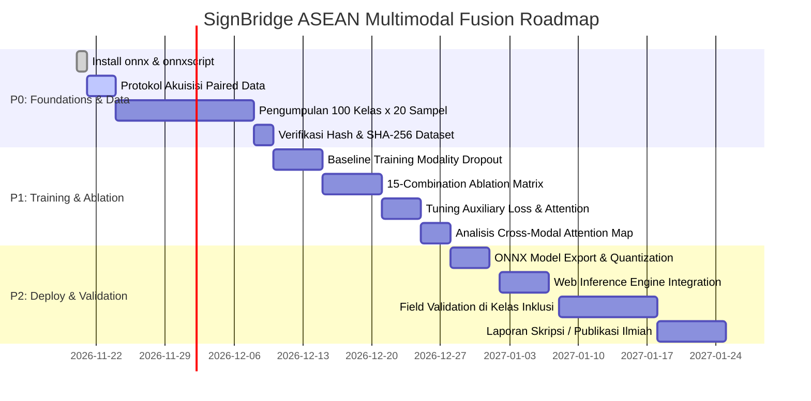

# SIGNBRIDGE ASEAN: EXECUTIVE ROADMAP & MILESTONE BLUEPRINT
**Proyek:** SignBridge ASEAN — Jembatan Komunikasi Real-Time Multimodal BISINDO ↔ FSL  
**Fokus Penelitian:** M6 — Four-Modality Multimodal Fusion Network (Video, Image, Audio, Text)  
**Versi Dokumen:** 1.0 (Post-Audit Stage 1–9)  
**Tanggal:** 20 November 2026  
**Status Audit:** COMPLETED — READY FOR P0 EXECUTION  

---

## 1. RINGKASAN EKSEKUTIF (EXECUTIVE SUMMARY)

Audit teknis mendalam terhadap repository `D:\SEMESTER 5\ML\Projek_1` dan remote `https://github.com/KarinaGlo/SignBridge` telah selesai dilaksanakan.

### A. Temuan Utama (Core Findings)
1. **Arsitektur M6 Valid & Bukan Trik Pipeline:**
   Modul `signbridge/models/multimodal.py` telah mengimplementasikan arsitektur *True Multimodal Deep Learning Fusion*. Model memproyeksikan 4 modalitas menjadi representasi token berdimensi sama ($d=128$), menggabungkannya dalam urutan 161 token, dan memproses interaksi silang antar-modalitas secara serentak menggunakan **Cross-Modal Transformer (2 layer, 4 attention heads)** yang dilengkapi dengan *Gated Modality Weighting*, *Modality Dropout ($p=0.3$)*, dan *Auxiliary Classification Heads ($\lambda=0.3$)*.
2. **Kesiapan Infrastruktur Kode Tinggi:**
   Pipeline ekstraksi fitur multimodal (`signbridge/multimodal/features.py`), dataset loader dinamis (`dataset.py`), script training (`train_multimodal.py`), dan UI browser audio/video synchronized recorder (`web/js/recorder.js`) telah ditulis dengan sangat baik. 21 unit test Python lulus, dan 29 unit test JavaScript/Node.js lulus 100%.
3. **Bottleneck Utama: Dataset Paired 4-Modalitas Masih 0 (NOL):**
   Meskipun kode model telah selesai, repository saat ini **belum memiliki rekaman 4 modalitas yang berpasangan secara simultan (video + image + audio + text)** untuk target kata yang sama. Dataset yang ada saat ini masih terfragmentasi:
   - Gambar statis Mendeley (8.620 gambar, 26 alfabet statis)
   - Manifest WL-BISINDO (1.600 baris manifest, tetapi file `.npz` di disk belum ada)
   - Metadata FLEURS (3.613 entri audio Indonesia, tetapi file audio `.wav` di disk belum ada)
   - Kalimat teks Tatoeba & Classroom (28.618 kalimat terpisah)
4. **Bahaya Shortcut Teks (Text Leakage Risk):**
   Eksperimen pendahuluan atau pengujian naif berisiko mengalami *data leakage* jika teks input berisi kata target isyarat (misal teks: "Saya mau makan", isyarat: "MAKAN"). Encoder teks akan mendominasi klasifikasi hingga akurasi 100% tanpa model belajar membaca video/tangan.

---

## 2. ROADMAP IMPLEMENTASI TIGA TAHAP (P0 — P1 — P2)



---

### FASE P0: FOUNDATIONS & PAIRED DATA COLLECTION (Minggu 1 – 3)
*Tujuan: Menyelesaikan dependensi lokal dan memproduksi dataset 4-modalitas berpasangan pertama.*

| Milestone ID | Tugas Utama | Kriteria Keberhasilan (DoD) | Penanggung Jawab |
| :--- | :--- | :--- | :--- |
| **P0.1** | **Instalasi Dependensi ONNX Lokal** | `pip install onnx onnxscript`, script `tests/test_multimodal_model.py::test_onnx_export_and_parity` lulus 100%. | ML Engineer |
| **P0.2** | **Standardisasi Taksonomi 100 Kata** | Dokumen `docs/vocabulary_100_classroom.json` selesai berisi 100 gloss BISINDO kelas inklusi (salam, angka, aktivitas, kebutuhan darurat). | Tim Linguistik / Mahasiswa |
| **P0.3** | **Protokol Perekaman 4-Modalitas Sinkron** | Template perekaman menggunakan `web/js/recorder.js` siap digunakan: Kamera Web (Video 30 FPS + Ekstraksi Hand Crop) + Mikrofon (Audio 16 kHz) + Prompt Teks Konteks. | Frontend / ML |
| **P0.4** | **Pengumpulan Paired Dataset Tahap 1** | Terkumpul 100 gloss x minimal 20 repetisi x 3 penutur isyarat = **2.000 sampel utuh 4-modalitas**. | Tim Pengumpul Data (Signers) |
| **P0.5** | **Data Cleaning & Manifest Hashing** | Setiap sampel memiliki ID unik, metadata SHA-256 tersimpan di database `sqlite:///multimodal_samples.db`, zero corrupted files. | Data Engineer |

---

### FASE P1: TRAINING, MODALITY DROPOUT & ABLATION STUDY (Minggu 4 – 6)
*Tujuan: Melatih model M6, membuktikan keunggulan multimodal fusion dibanding unimodal, dan mencegah jalan pintas teks.*

| Milestone ID | Tugas Utama | Kriteria Keberhasilan (DoD) | Penanggung Jawab |
| :--- | :--- | :--- | :--- |
| **P1.1** | **Anti-Shortcut Training Setup** | Input teks diformulasikan sebagai *Context/Prompt Question* (bukan target label), atau token teks ditutupi (*masked text training*) pada 50% sampel. | ML Engineer |
| **P1.2** | **Full 4-Modality Baseline Training** | Pelatihan 50 epoch pada dataset paired dengan *Modality Dropout ($p=0.3$)* dan Auxiliary Heads ($\lambda=0.3$). Checkpoint disimpan di `runs/multimodal_m6/`. | ML Engineer |
| **P1.3** | **Ablation Study Matrix (15 Kombinasi)** | Evaluasi top-1 accuracy pada 15 kombinasi modalitas (V, I, A, T, V+I, V+A, V+T, I+A, I+T, A+T, V+I+A, V+I+T, V+A+T, I+A+T, V+I+A+T). | ML Engineer / Peneliti |
| **P1.4** | **Attention Map Visualization** | Ekstraksi bobot Cross-Modal Attention untuk membuktikan bahwa ketika video mengalami oklusi, perhatian model berpindah ke gambar statis / audio. | ML Engineer |
| **P1.5** | **Dokumentasi Hasil Eksperimen** | Laporan komprehensif tabel ablasi yang membuktikan bahwa performa 4-Modalitas lebih tinggi secara signifikan daripada unimodal terbaik. | Mahasiswa (Skripsi) |

---

### FASE P2: OPTIMASI, ONNX EXPORT & FIELD VALIDATION (Minggu 7 – 9)
*Tujuan: Memastikan model dapat berjalan <150 ms di laptop standar dan menguji akseptansi guru/siswa di kelas.*

| Milestone ID | Tugas Utama | Kriteria Keberhasilan (DoD) | Penanggung Jawab |
| :--- | :--- | :--- | :--- |
| **P2.1** | **Export ONNX & FP16 Quantization** | Model diekspor ke format ONNX (`model_fp32.onnx` dan `model_fp16.onnx`) dengan ukuran file < 25 MB. | MLOps / ML Engineer |
| **P2.2** | **Inference Parity Verification** | Perbedaan absolut rata-rata output logits antara PyTorch dan ONNX Runtime $\le 1 \times 10^{-4}$. | ML Engineer |
| **P2.3** | **Client-Side Latency Benchmarking** | Waktu inferensi per jendela 2 detik pada CPU laptop (Core i5 / Ryzen 5 tanpa dGPU) tidak melebihi 150 ms (kategori *Real-Time Responsive*). | Software Architect |
| **P2.4** | **Field Validation di Kelas Inklusi** | Pengujian langsung bersama guru SLB / pengguna BISINDO, mencatat metrik User Acceptance Score (SUS > 75). | Tim UX / Mahasiswa |

---

## 3. PEMBAGIAN PERAN & TANGGUNG JAWAB TIM (RACI MATRIX)

| Aktivitas Proyek | Mahasiswa / Peneliti Utama | ML Engineer (AI Agent) | Rekan Tim Frontend / Web | Rekan Tim Pengumpul Data (Signers) |
| :--- | :---: | :---: | :---: | :---: |
| Desain Protokol & Kosakata | **A** (Accountable) | **C** (Consulted) | **I** (Informed) | **C** (Consulted) |
| Perekaman Paired Dataset | **C** (Consulted) | **I** (Informed) | **R** (Responsible - Tool) | **R** (Responsible - Data) |
| Modifikasi & Training PyTorch | **A** (Accountable) | **R** (Responsible) | **I** (Informed) | **I** (Informed) |
| Pengujian Ablasi 15 Kombinasi | **C** (Consulted) | **R** (Responsible) | **I** (Informed) | **I** (Informed) |
| ONNX Export & Optimasi Web | **A** (Accountable) | **R** (Responsible) | **R** (Responsible) | **I** (Informed) |
| Integrasi UI Portal Validasi | **I** (Informed) | **C** (Consulted) | **R** (Responsible) | **I** (Informed) |
| Penulisan Naskah Skripsi/Paper | **R** (Responsible) | **C** (Consulted) | **I** (Informed) | **I** (Informed) |

*Keterangan: R = Responsible (Pelaksana), A = Accountable (Penanggung Jawab Akhir), C = Consulted (Konsultan Teknis), I = Informed (Penerima Informasi).*

---

## 4. STRATEGI MITIGASI RISIKO UTAMA (RISK MATRIX)

| Potensi Risiko | Tingkat Keparahan | Probabilitas | Rencana Mitigasi Konkret |
| :--- | :---: | :---: | :--- |
| **1. Text Shortcut Dominance**<br>Model hanya membaca teks dan mengabaikan video/audio. | **Sangat Tinggi** | **Tinggi** | Terapkan *Context-Question Masking*: input teks bukan transkripsi isyarat, melainkan kalimat tanya pemicu dialog. Aktifkan *Text Modality Dropout* dengan probabilitas 50% selama fase latihan. |
| **2. Keterlambatan Koleksi Data**<br>Mengumpulkan 2.000 rekaman 4-modalitas memakan waktu lama. | **Tinggi** | **Sedang** | Jalankan akuisisi bertahap: Batch 1 (20 kelas kata inti, 400 rekaman) untuk *proof-of-concept*, disusul Batch 2 (80 kelas pelengkap). Manfaatkan *recorder.js* yang siap pakai. |
| **3. Frame Rate Drop di Browser**<br>MediaPipe + ekstraksi audio membebani CPU klien. | **Sedang** | **Sedang** | Gunakan Web Worker terpisah untuk inferensi MediaPipe dan audio resampling. Pangkas resolusi input hand-crop menjadi $112 \times 112$. |
| **4. Modality Missing saat Sesi Nyata**<br>Mikrofon rusak atau kamera tertutup sesaat. | **Rendah** | **Tinggi** | Sudah ditangani oleh arsitektur M6: *Gated Modality Weighting* secara otomatis memberikan bobot mendekati 0 untuk modalitas yang memiliki nilai nol atau noise tak berpola. |

---

## 5. REKOMENDASI TUGAS HARI ESOK (ACTION PLAN: DAY 1)

1. **Langkah 1 (08:30 - 09:30):** Instalasi pustaka ONNX di *environment* lokal:
   ```bash
   pip install onnx onnxscript
   python -m pytest tests/test_multimodal_model.py
   ```
   *Pastikan 22 test lulus (tidak ada lagi yang di-skip).*
2. **Langkah 2 (09:30 - 12:00):** Tentukan daftar definitif 20 kelas kata BISINDO pertama untuk *Pilot Paired Dataset* bersama pembimbing / rekan tim.
3. **Langkah 3 (13:00 - 15:30):** Buka `web/recorder.html` dan uji coba perekaman 1 sampel percobaan 4-modalitas (isyarat tangan + suara pengucapan + konteks teks) untuk memverifikasi keselarasan *timestamp*.
4. **Langkah 4 (15:30 - 17:00):** Komit perubahan audit dokumen ini ke Git remote branch kerja.

