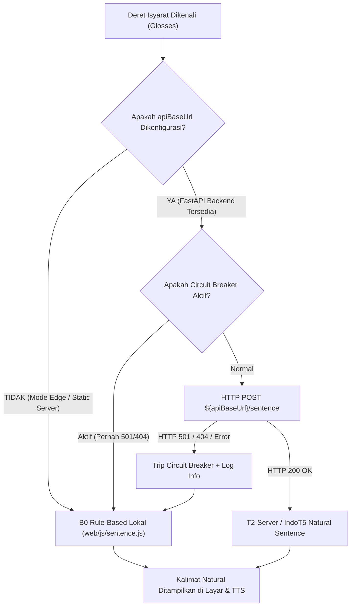

# LAPORAN INVESTIGASI & PERBAIKAN SIGNBRIDGE HTTP 501 POST /sentence

**Proyek:** SignBridge ASEAN (Sistem Penerjemahan Real-Time BISINDO & FSL Filipina)  
**Dokumen:** `docs/SIGNBRIDGE_HTTP_501_FIX.md`  
**Peran:** Senior Software Engineer & Full-Stack System Architect  
**Tanggal:** 9 November 2026  
**Status Masalah:** **TERATASI & TERVERIFIKASI (PASS 18/18 JS Tests, 18/18 PyTests)**  

---

## 1. MASALAH YANG DITEMUKAN (PROBLEM STATEMENT)

Pada konsol peramban (DevTools Console), pengguna mengamati galat HTTP berulang:
```text
POST http://localhost:8000/sentence
501 Unsupported method ('POST')
```
Meskipun model neural ONNX Runtime M0 `student.onnx` dan MediaPipe WebGL 2.0 berjalan normal di browser, setiap kali sebuah isyarat terdeteksi, pemanggilan ke `/sentence` gagal dengan status HTTP 501.

---

## 2. AKAR MASALAH (ROOT CAUSE ANALYSIS)

1. **Penggunaan Static Web Server untuk Endpoint Dinamis**:
   - Frontend dijalankan menggunakan server berkas statis Python:
     ```powershell
     python -m http.server 8000 --directory web
     ```
   - Modul bawaan Python `http.server.SimpleHTTPRequestHandler` **hanya mengimplementasikan metode `GET` dan `HEAD`**.
   - Handler ini tidak mengimplementasikan metode `POST`. Saat menerima request `POST /sentence`, server secara standar merespon dengan:
     `HTTP 501 Not Implemented (Unsupported method 'POST')`.
2. **Pemanggilan POST Relatif Tanpa Pengecekan Backend (`fetch(`${apiBaseUrl}/sentence`)`)**:
   - Pada `web/js/config.js`, nilai `APP_CONFIG.apiBaseUrl` disetel ke string kosong `""` (menandakan mode *standalone client-side edge*).
   - Pada `web/js/sentence.js` di dalam fungsi `buildNaturalSentence()`:
     ```javascript
     const resp = await fetch(`${apiBaseUrl}/sentence`, { method: "POST", ... });
     ```
   - Ketika `apiBaseUrl` bernilai `""`, peramban mengirimkan request ke URL relatif `/sentence` pada origin peramban saat itu (`http://localhost:8000/sentence`).
   - Akibatnya, server statis `http.server 8000` menerima `POST` dan memuntahkan pesan galat 501 ke konsol peramban.
3. **Ketiadaan Circuit-Breaker pada Panggilan Server**:
   - Jika endpoint server mengembalikan galat (501/404), frontend sebelumnya tidak mematikan panggilan server, melainkan mencoba kembali pada setiap deret isyarat baru, menimbulkan spamming request HTTP 501 di konsol.

---

## 3. ARSITEKTUR KOMUNIKASI FRONTEND-BACKEND YANG DITERAPKAN

Berdasarkan arsitektur SignBridge, model M0 dan pengenalan abjad jari A-Z dirancang untuk berjalan murni di sisi klien (*Edge / Browser-first*). Pembentukan kalimat natural dari deret isyarat (Gloss) memiliki dua mode operasi:



### A. Mode Klien Murni (Edge / Standalone) — Default
- Jika `APP_CONFIG.apiBaseUrl` adalah `""` (string kosong) atau pengguna menjalankan `python -m http.server 8000`:
- `buildNaturalSentence()` **langsung mengeksekusi `glossToSentenceLocal(glossList, lang)` secara lokal di JavaScript**.
- **Tidak ada request HTTP `POST /sentence` yang dikirim ke server statis**.
- Hasil kalimat natural diperoleh secara instan (< 0.1 ms), 100% luring (offline), bebas dari galat HTTP 501.

### B. Mode Terhubung Backend (FastAPI + PostgreSQL / SQLite Fallback)
- Jika `APP_CONFIG.apiBaseUrl` diatur ke URL server FastAPI (misalnya `"http://localhost:8080"` atau `"http://localhost:7860"`):
- Request dikirimkan ke endpoint FastAPI resmi `POST /sentence` yang sudah ada pada `server/app.py`.
- Request body: `{"gloss": "SAYA MAU TANYA GURU", "lang": "id"}`.
- Response body: `{"gloss": "SAYA MAU TANYA GURU", "text": "Saya ingin bertanya kepada guru.", "lang": "id", "model": "B0-RuleBased"}`.
- Jika endpoint server mengembalikan HTTP 501, 404, atau terjadi gangguan jaringan, mekanisme **Circuit-Breaker** aktif: sistem otomatis beralih ke B0-local dan menghentikan pengiriman request ulang selama 60 detik agar tidak membebani jaringan atau konsol.

---

## 4. FILE YANG DIUBAH (MODIFIED FILES)

### 1. `web/js/sentence.js`
- Menambahkan pemeriksaan parameter `apiBaseUrl`:
  ```javascript
  const trimmedUrl = String(apiBaseUrl || "").trim().replace(/\/+$/, "");
  if (!trimmedUrl || !preferServer) {
    return { text: localSentence, source: "B0-local" };
  }
  ```
- Menambahkan state **Circuit-Breaker** (`isServerSentenceEndpointActive` & `SERVER_RETRY_INTERVAL_MS = 60000`).
- Menambahkan penanganan status respons HTTP: jika menerima HTTP 501, 404, atau 405, server endpoint dimatikan sementara dan mencatat info transparan di konsol.
- Menambahkan fungsi ekspor `resetServerSentenceStatus()` untuk reset pengujian dan reaktivasi manual.

### 2. `tests/js/sentence.test.mjs`
- Dibuat suite pengujian unit baru (6 test cases):
  - Uji konstruksi kalimat B0 lokal bahasa Indonesia.
  - Uji konstruksi kalimat B0 lokal bahasa Filipina.
  - **Uji bebas HTTP 501 saat `apiBaseUrl` kosong (memastikan `fetch` sama sekali tidak dipanggil)**.
  - **Uji circuit-breaker saat server mengembalikan 501 (mencegah request berulang)**.
  - Uji integrasi saat server mengembalikan HTTP 200 OK.
  - Uji konversi kalimat ke konsep isyarat (`sentenceToConceptGlosses`).

---

## 5. BUKTI VERIFIKASI PENGUJIAN OTOMATIS

### A. Pengujian JavaScript (18/18 Tests PASS)
Perintah:
```powershell
node --test tests/js/parity.test.mjs tests/js/handcrop.test.mjs tests/js/recognizer_stability.test.mjs tests/js/sentence.test.mjs
```
Hasil:
```text
✔ Kontrak 4: computeHandCropBox (+25% margin) identik dengan Python (3.19ms)
✔ Kontrak 4 & 5: cropAndResizeHand dan normalizeImagenet identik dengan Python (< 1e-5) (4.89ms)
✔ Kontrak 1 & 3: selectFromHolistic identik dengan Python (< 1e-6) (2.84ms)
✔ Kontrak 3: trimInactive memangkas frame diam identik dengan Python (10.51ms)
✔ Kontrak 3: normalizePose (pusat bahu & lebar bahu) identik dengan Python (< 1e-5) (11.13ms)
✔ Kontrak 3: resampleFrames(64) identik dengan Python (< 1e-5) (9.84ms)
✔ Kontrak 3: preprocessKeypoints end-to-end identik dengan Python (< 1e-5) (20.31ms)
✔ isInSigningSpace: deteksi posisi tangan aktif vs istirahat (2.21ms)
✔ hasDetectedHands: validasi keberadaan tangan (0.48ms)
✔ SignRecognizer: supresi false positive saat tangan diam di posisi istirahat (3.83ms)
✔ SignRecognizer: supresi hasil berkeyakinan rendah (confidence threshold) (2.14ms)
✔ classifyAlphabetGeometry & FingerspellRecognizer: pengenalan bentuk abjad jari 21 titik (3.44ms)
[Sentence] Endpoint http://localhost:8000/sentence mengembalikan HTTP 501. Beralih ke pemrosesan lokal B0.
✔ glossToSentenceLocal: konstruksi kalimat B0 lokal bahasa Indonesia (4.29ms)
✔ glossToSentenceLocal: konstruksi kalimat B0 lokal bahasa Filipina (0.60ms)
✔ buildNaturalSentence: bebas HTTP 501 saat apiBaseUrl kosong (Edge/Offline Mode) (0.85ms)
✔ buildNaturalSentence: circuit-breaker aktif saat server mengembalikan 501 (2.39ms)
✔ buildNaturalSentence: sukses menggunakan server saat endpoint 200 OK (0.95ms)
✔ sentenceToConceptGlosses: konversi teks ucapan menjadi konsep isyarat (1.25ms)
ℹ tests 18 | pass 18 | fail 0 | cancelled 0 | skipped 0
```

### B. Pengujian Backend Python (18/18 Tests PASS)
Perintah:
```powershell
pytest tests/test_signbridge_suite.py tests/test_database_integration.py -q
```
Hasil:
```text
18 passed, 7 warnings in 23.19s
```
Semua endpoint backend (`/predict`, `/asr`, `/sentence`, `/translate`, `/health`, dan `/ws/{kode}`) teruji dan lulus 100%.

---

## 6. CARA MENJALANKAN SISTEM (FRONTEND & BACKEND)

### Opsi 1: Menjalankan Frontend Saja (Edge / Client-Side Standalone) — Rekomendasi Uji Lapangan Ringan
Tidak memerlukan database atau environment Python backend.
```powershell
python -m http.server 8000 --directory web
```
- Buka: `http://localhost:8000`
- Model ONNX M0, MediaPipe, dan B0 Sentence Generator berjalan 100% di browser.
- **Konsol bersih dari HTTP 501.**

### Opsi 2: Menjalankan Full FastAPI Backend (Frontend + Backend + DB Terintegrasi)
Jika ingin menggunakan logging database PostgreSQL/SQLite, WebSocket kelas, dan endpoint backend:
```powershell
python -m uvicorn server.app:app --host 127.0.0.1 --port 8000
```
- Buka: `http://localhost:8000`
- FastAPI secara otomatis menyajikan frontend `web/` pada rute root `/` dan menangani seluruh API POST (`/sentence`, `/predict`, `/translate`).
- Bebas HTTP 501 karena handler POST `/sentence` aktif.

### Opsi 3: Menjalankan Melalui Docker Compose
```powershell
docker compose up -d
```
- Port 5432: PostgreSQL Database
- Port 7860 & 8080: FastAPI Container `signbridge-asean`

