# SIGNBRIDGE: COMPREHENSIVE PRE-DOWNLOAD DATASET AUDIT & DUPLICATE DETECTION REPORT

> **Dokumen**: `docs/SIGNBRIDGE_PRE_DOWNLOAD_DATASET_AUDIT.md`  
> **Status Audit**: SELESAI (100% Read-Only, Tanpa Modifikasi Git, Tanpa Download)  
> **Tanggal Pemeriksaan**: 13 November 2026  
> **Auditor**: Senior Machine Learning Engineer, Data Scientist & MLOps Architect  
> **Target Analisis**: Profil B — Paket Penuh Penelitian (Estimasi Awal: 13,5–16 GB)  
> **Branch Aktif**: `feature/field-test-readiness` (Commit: `3a99e96`)  

---

## 1. RINGKASAN EKSEKUTIF

Audit pra-unduh menyeluruh telah dilakukan secara ketat dengan prinsip **read-only** pada repository SignBridge dan lingkungan penyimpanan terkait. Tujuan audit ini adalah memastikan status fisik dataset yang ada di disk, menyelesaikan misteri angka ukuran "13 MB vs 13 GB", mendeteksi file duplikat biner (SHA-256), mengevaluasi kesiapan data terhadap model yang sedang berjalan, serta menyusun rekomendasi unduhan yang presisi agar pengguna tidak mengunduh ulang data yang sudah tersedia.

### Temuan Utama:
1. **Total Ukuran Fisik Folder `data/` Saat Ini**: Tepat **4.643.481 bytes** (**4,43 MB / 0,0043 GB**) yang terbagi dalam **19 file**. Seluruh 19 file valid, tidak ada file rusak (*zero corrupted files*), dan database operasional SQLite berintegritas `ok`.
2. **Total Ukuran Repository Tanpa `.git`**: **41.769.737 bytes** (**39,83 MB / 0,0389 GB**).
3. **Misteri 13 MB vs 13 GB Terpecahkan**:
   - **Angka ~13 MB** merujuk pada:
     - File metadata Mendeley `mendeley_metadata.json` (**12,89 MB**) dan WLASL `WLASL_v0.3.json` (**11,93 MB**) yang dicatat dalam dokumen spesifikasi download manifest (`data/DATASET_DOWNLOAD_MANIFEST.csv`).
     - Total ukuran folder antarmuka web klien `web/` (**11,72 MB**).
   - **Angka 13,5–16 GB** adalah estimasi total ukuran teoritis "Profil B — Paket Penuh Penelitian" jika seluruh video mentah resolusi tinggi WL-BISINDO (~2,1 GB), WLASL (~4,5 GB), FSL (~390 MB), foto kamera mentah beresolusi tinggi Mendeley (~8,1 GB), dan dataset audio uncompressed FLEURS (~1,3 GB) diunduh secara mentah tanpa kompresi.
4. **Temuan Duplikasi Biner (Exact Duplicate)**:
   - Ditemukan **3 file identik secara biner (SHA-256: `48ca673f...`)**:
     - `web/model/student.onnx` (5.458.187 bytes / 5,21 MB)
     - `web/model/student_int8.onnx` (5.458.187 bytes / 5,21 MB) — *kuantisasi INT8 semu/palsu*.
     - `scratch/student_m0_test.onnx` (5.458.187 bytes / 5,21 MB) — *salinan pengujian scratch*.
   - Duplikasi konten pada teks Tatoeba: `ind_sentences.tsv.bz2` (330.738 bytes terkompresi) dan `ind_sentences.tsv` (1.417.823 bytes hasil ekstraksi; 28.418 baris). Keduanya utuh dan valid.
5. **Kesiapan Training vs Fisik Data (Training Readiness)**:
   - **Model M0 (Sign Bi-LSTM)**: Sudah terlatih dan siap pakai di `web/model/student.onnx`. Dataset video mentah WL-BISINDO dan keypoints tidak berada di disk lokal (masuk `.gitignore`), namun sistem web operasional 100% berjalan normal. Download video WL-BISINDO (~2,1 GB) **hanya opsional** jika tim ingin melakukan pelatihan ulang dari nol (*from scratch*) dengan skema validasi Leave-One-Signer-Out (LOSO).
   - **Model I1 (Fingerspelling Alphabet MobileNetV3)**: Checkpoint `runs/image_i1_mobilenetv3/best.pt` mengalami keruntuhan performa (*collapsed* pada akurasi 3,85% / random guess). Dataset gambar A–Z **0 byte di disk**. Mengunduh dataset gambar Mendeley versi terkompresi 224x224 RGB (**27,7 MB**) berstatus **MANDATORY & URGENT (Prioritas P0)** untuk melatih ulang model I1.
   - **Modul Teks (NLP Gloss-to-Sentence & Tatoeba)**: **100% LENGKAP** di disk (`train.tsv`, `val.tsv`, `test_manual.tsv`, `kelas_sentences.txt`, dan `ind_sentences.tsv`). **TIDAK PERLU DOWNLOAD APA PUN**.
   - **Modul Audio (Speech ASR)**: Sistem web menggunakan API bawaan browser Web Speech API (zero footprint server). File manifest teks FLEURS `dev.tsv`, `test.tsv`, `train.tsv` (**2,11 MB**) sudah ada di disk. File WAV audio (~1,3 GB) **TIDAK PERLU DIUNDUH** untuk fase operasional saat ini.

---

## 2. REKONSILIASI KEBINGUNGAN "13 MB / 13 GB"

Salah satu pertanyaan mendasar pengguna adalah mengapa terdapat angka ~13 MB dan ~13 GB di dalam proyek. Hasil audit historis dan penelusuran file membuktikan:

| Metrik / Entitas | Ukuran Aktual | Sumber Penjelasan & Lokasi File |
|---|---|---|
| **Spesifikasi Metadata JSON Mendeley** | 12,89 MB | Tercantum dalam `data/DATASET_DOWNLOAD_MANIFEST.csv` baris 4 kolom `size_mb`: estimasi metadata anotasi citra tangan Mendeley. |
| **Spesifikasi Metadata JSON WLASL** | 11,93 MB | Tercantum dalam `data/DATASET_DOWNLOAD_MANIFEST.csv` baris 10 kolom `size_mb`: file index anotasi video WLASL v0.3. |
| **Total Folder Web UI Runtime (`web/`)** | 11,72 MB | Gabungan aset HTML/JS/CSS (6,26 MB) dan model ONNX (`student.onnx` 5,46 MB). |
| **Profil A: Paket Minimal Operasional** | ~35 MB (arsip) | Rencana pengunduhan terkompresi ringan: Gambar A–Z 224x224 (27,7 MB) + Manifest & Teks (4,4 MB) + Video referensi minimal. |
| **Profil B: Paket Penuh Penelitian** | **13,5–16 GB** | Total akumulasi jika seluruh dataset mentah diunduh tanpa reduksi: Raw Video WL-BISINDO (2,1 GB) + Raw WLASL 300 (4,5 GB) + Raw FSL 105 (0,4 GB) + Raw Mendeley Image Uncompressed TIF/RAW (8,1 GB) + Raw Audio FLEURS WAV (1,3 GB). |

**Kesimpulan Rekonsiliasi**: Proyek saat ini **TIDAK PERLU** mengunduh beban 13,5–16 GB secara membabi buta. Kebutuhan operasional riil yang hilang hanyalah dataset citra alfabet BISINDO paket web-optimized sebesar **27,7 MB**, bukan 13 GB.

---

## 3. INVENTARIS FISIK DATASET SAAT INI

Pemeriksaan direktori `data/` menghasilkan daftar lengkap 19 file berikut:

| No | Path Relatif | Ukuran (Bytes) | Ukuran (MB) | Ekstensi | SHA-256 Checksum | Keterangan & Integritas |
|:---:|---|---:|---:|:---:|---|---|
| 1 | `data/signbridge_operational.db` | 151.552 | 0,1445 MB | `.db` | `68a98b425e7448766ece08567459f0e9...` | SQLite Database Operasional (Integrity: OK) |
| 2 | `data/text/tatoeba/ind_sentences.tsv.bz2` | 330.738 | 0,3154 MB | `.bz2` | `661f416c60401127560043fa7a464fd2...` | Arsip terkompresi Bzip2 Tatoeba (Valid) |
| 3 | `data/text/tatoeba/ind_sentences.tsv` | 1.417.823 | 1,3521 MB | `.tsv` | `96eb23f6299be0ec2d5a19e887854795...` | 28.418 kalimat bahasa Indonesia (Valid UTF-8) |
| 4 | `data/text/kelas_sentences.txt` | 14.830 | 0,0141 MB | `.txt` | `6fddbfd1cc90572be56b229cec3cd988...` | 200 kalimat domain kelas bilingual |
| 5 | `data/text/train.tsv` | 22.565 | 0,0215 MB | `.tsv` | `508de2272c67c93f06de654f106aee37...` | 170 pasang Gloss-to-Sentence Train Split |
| 6 | `data/text/val.tsv` | 4.483 | 0,0043 MB | `.tsv` | `96a8d589063cb2fc5ec08cb2914d0769...` | 30 pasang Gloss-to-Sentence Val Split |
| 7 | `data/text/test_manual.tsv` | 6.727 | 0,0064 MB | `.tsv` | `1f610faa6339117b9517ed04a599bd08...` | 105 pasang Gloss-to-Sentence Test Split |
| 8 | `data/audio/fleurs/id_id/dev.tsv` | 200.586 | 0,1913 MB | `.tsv` | `92ce001fbf079b7dd756ab079c23a045...` | 350 baris evaluasi manifest FLEURS id_id |
| 9 | `data/audio/fleurs/id_id/test.tsv` | 409.483 | 0,3905 MB | `.tsv` | `7e8a6e82d6bdc7169259bf5c7a2976fa...` | 687 baris pengujian manifest FLEURS id_id |
| 10 | `data/audio/fleurs/id_id/train.tsv` | 1.501.780 | 1,4322 MB | `.tsv` | `30e8f42a2a71e1d41324d9aba02e458a...` | 2.579 baris training manifest FLEURS id_id |
| 11 | `data/audio/metadata.csv` | 5.334 | 0,0051 MB | `.csv` | `15025bf52801864631aaf90df9ebfc79...` | 60 prompt teks audio ruang kelas (ID) |
| 12 | `data/audio/metadata_fil.csv` | 1.849 | 0,0018 MB | `.csv` | `72cb11744391bbe0497ed0c5a04ce501...` | 24 prompt teks audio ruang kelas (FIL) |
| 13 | `data/bridge/concepts.csv` | 3.552 | 0,0034 MB | `.csv` | `60d7287a2ef619281789976273ceab06...` | 32 konsep bridge C01-C32 BISINDO-FSL |
| 14 | `data/manifest_wl_bisindo.csv` | 216.722 | 0,2067 MB | `.csv` | `ab024086afa36fda2b58deb9a9753117...` | 1.600 anotasi sample, validasi, signer, split |
| 15 | `data/manifest_wl_bisindo_source_metadata.csv` | 339.988 | 0,3242 MB | `.csv` | `82e97333b317a67c294d383b48a3ab73...` | Metadata teknis video WL-BISINDO |
| 16 | `data/phonology.csv` | 496 | 0,0005 MB | `.csv` | `88a4bd85ba3566b3ae5cb961b29f3b75...` | Matriks fitur fonologi isyarat BISINDO |
| 17 | `data/PHONOLOGY_GUIDE.md` | 3.562 | 0,0034 MB | `.md` | `30e8fa9771ff8fd114ee8af757abd225...` | Panduan anotasi fonologi isyarat |
| 18 | `data/DATASET_DOWNLOAD_MANIFEST.csv` | 11.411 | 0,0109 MB | `.csv` | `842dd62e7900c55f85ff1b65eac94be5...` | Spesifikasi katalog download dataset |
| 19 | `data/.gitkeep` | 0 | 0,0000 MB | - | `e3b0c44298fc1c149afbf4c8996fb924...` | Placeholder direktori Git |

> Rincian lengkap inventaris diekspor ke file [`docs/dataset_file_inventory.csv`](file:///d:/SEMESTER%205/ML/Projek_1/docs/dataset_file_inventory.csv).

---

## 4. HASIL DETEKSI DUPLIKASI

Pemeriksaan SHA-256 multi-level mengidentifikasi dua kelompok duplikasi utama:

### Kelompok Duplikat 1: Model ONNX Exact Duplicate (SHA-256: `48ca673f...`)
- **Hash SHA-256**: `48ca673f60fa1491936d0289778e6d1adef9c6931c51145ecb896667fc733572`
- **Ukuran Masing-Masing**: 5.458.187 bytes (5,21 MB)
- **Total Ukuran Replikasi**: 16.374.561 bytes (15,62 MB)
- **Daftar File**:
  1. `web/model/student.onnx` (Model produksi baseline Bi-LSTM FP32)
  2. `web/model/student_int8.onnx` (Diberi label INT8, namun isi biner identik 100% dengan FP32 / fake quantization)
  3. `scratch/student_m0_test.onnx` (Salinan file pengujian pada folder scratch)
- **Rekomendasi**: Pertahankan `web/model/student.onnx`. File `scratch/student_m0_test.onnx` dapat dihapus jika dibutuhkan pembersihan. Kuantisasi INT8 harus diproses ulang menggunakan ONNX Runtime Dynamic Quantization jika ingin mendapatkan reduksi ukuran menjadi ~1,4 MB.

### Kelompok Duplikat 2: Teks Tatoeba Archive vs Payload
- **File 1**: `data/text/tatoeba/ind_sentences.tsv.bz2` (330.738 bytes, compressed)
- **File 2**: `data/text/tatoeba/ind_sentences.tsv` (1.417.823 bytes, uncompressed, 28.418 baris)
- **Analisis**: `ind_sentences.tsv` merupakan hasil ekstraksi tepat dari `ind_sentences.tsv.bz2`.
- **Rekomendasi**: Pertahankan keduanya. File `.tsv` digunakan untuk kecepatan baca I/O training, sedangkan file `.bz2` berfungsi sebagai cadangan verifikasi integritas upstream.

> Rincian kelompok duplikat diekspor ke file [`docs/dataset_duplicate_groups.csv`](file:///d:/SEMESTER%205/ML/Projek_1/docs/dataset_duplicate_groups.csv).

---

## 5. AUDIT STATUS DATASET PER TARGET PROFIL B

| Target Dataset | Status Fisik di Disk | Ukuran Aktual | Gap dari Profil B | Kesiapan Training / Runtime | Status Kebutuhan Download |
|---|:---:|---:|---|---|:---:|
| **WL-BISINDO** (32 kelas) | **PARTIAL** (Manifest ada, raw video & keypoints tidak ada) | 0,55 MB (manifest) | 1.600 video MP4 / keypoints (~2,1 GB) | Model M0 sudah terlatih & beroperasi di web (`student.onnx`). Training ulang hanya perlu jika validasi LOSO dijalankan. | **KONDISIONAL / OPSIONAL** |
| **BISINDO Alphabet** (A–Z) | **MISSING** (0 gambar di disk) | 0 Bytes | 1.040 citra citra A–Z (~27,7 MB paket 224x224) | Model `runs/image_i1_mobilenetv3/best.pt` rusak (3,85% akurasi). Sangat mendesak dilatih ulang. | **MANDATORY & URGENT (P0)** |
| **Tatoeba Indonesian** | **COMPLETE** | 1,67 MB | 0 Bytes (Lengkap 28.418 baris) | 100% Siap digunakan untuk augmentasi teks. | **TIDAK PERLU DOWNLOAD** |
| **Parallel Sentences** | **COMPLETE** | 0,03 MB | 0 Bytes (Lengkap 305 pasang train/val/test) | 100% Siap & digunakan oleh RuleBasedGenerator. | **TIDAK PERLU DOWNLOAD** |
| **Kelas Sentences** | **COMPLETE** | 0,01 MB | 0 Bytes (Lengkap 200 kalimat kelas) | 100% Siap untuk evaluasi & prompt ASR. | **TIDAK PERLU DOWNLOAD** |
| **FLEURS Indonesian (`id_id`)** | **PARTIAL** (Manifest ada, WAV tidak ada) | 2,01 MB (manifest) | 3.616 klip audio WAV (~650 MB arsip / ~1,3 GB raw) | Web runtime menggunakan Web Speech API browser bawaan. Model Whisper lokal tidak dilatih di server. | **TIDAK PERLU (DEFERRED)** |
| **FLEURS Filipino (`fil_ph`)** | **MISSING** | 0 Bytes | ~3.200 klip audio (~600 MB arsip / ~1,2 GB raw) | Web Speech API mengenali bahasa Tagalog secara natif tanpa inferensi backend. | **TIDAK PERLU (DEFERRED)** |
| **Tim Audio Recording** | **PARTIAL** (Manifest prompt ada) | 0,007 MB | 84 sampel rekaman suara | Untuk benchmarking akurasi internal. Cukup direkam oleh tim lokal (0 MB download). | **REKAM INTERNAL (NO DOWNLOAD)** |
| **WLASL-300** (Transfer ASL) | **MISSING** | 0 Bytes | ~3.500 video (~4,5 GB) | Tidak digunakan dalam pipeline produksi M0/M1 SignBridge (fokus pada BISINDO). | **EXCLUDE / BATALKAN DOWNLOAD** |
| **FSL-105** (Filipino Sign) | **METADATA COMPLETE** | 0,003 MB (`concepts.csv`) | ~500 video (~390 MB) | Sistem menjembatani via Concept ID (C01–C32). Video hanya referensi tampilan visual, bukan model ML. | **OPSIONAL / DEFERRED** |

---

## 6. HASIL PEMERIKSAAN LOKASI EKSTERNAL

Pemeriksaan direktori di luar workspace dilakukan secara terkendali:
1. **Drive `D:\SEMESTER 5\ML\`**:
   - Ditemukan dua folder: `Projek_1` (SignBridge aktif) dan `Projek` (Proyek deteksi gempa bumi / seismologi terpisah berukuran ~2 MB). Tidak ada dataset bahasa isyarat di folder proyek sebelah.
2. **Drive `D:\SEMESTER 5\`**:
   - Memeriksa folder perkuliahan lain (`NLP`, `Basis Data`, `Sistem Operasi`). Tidak ditemukan repositori atau cache dataset video/gambar bahasa isyarat.
3. **Folder Direktori Sistem (`Downloads`, `Documents`)**:
   - Sesuai dengan batasan isolasi sandbox standar antarmuka Antigravity (*sandboxed environment boundary*), akses pembacaan ke direktori root pengguna `C:\Users\asust\Downloads` dibatasi tanpa eskalasi bypass.
   - Fakta bahwa file video/gambar berukuran giga-byte tidak pernah dicommit ke Git selaras dengan `.gitignore` baris 46–69 (`data/raw/`, `data/keypoints/`, `*.mp4`, `*.wav`, `*.zip`).

---

## 7. ANALISIS KESIAPAN TRAINING (TRAINING READINESS)

Penting untuk membedakan antara keberadaan fisik file mentah dan status model operasional:

```mermaid
flowchart TD
    subgraph S1["Modul 1: Video Sign Recognition (M0)"]
        M0_Model["web/model/student.onnx (5.46 MB)\nStatus: RUNNING DI WEB\nAkurasi: 87.5%"]
        M0_Data["Video Raw WL-BISINDO (2.1 GB)\nStatus: TIDAK ADA DI DISK\nKebutuhan: HANYA jika retrain LOSO"]
        M0_Model -.->|Mandiri tanpa video mentah| M0_Web["Web Live Inference"]
    end

    subgraph S2["Modul 2: Fingerspelling Alphabet (I1)"]
        I1_Model["runs/image_i1_mobilenetv3/best.pt\nStatus: COLLAPSED (3.85% Acc)"]
        I1_Data["BISINDO Alphabet 224x224 (27.7 MB)\nStatus: TIDAK ADA DI DISK\nKebutuhan: SANGAT MENDESAK"]
        I1_Data ==>|Wajib Download & Train Ulang| I1_Model
    end

    subgraph S3["Modul 3: Gloss-to-Sentence (NLP)"]
        NLP_Data["data/text/*.tsv & classes\nStatus: 100% LENGKAP DI DISK"]
        NLP_Engine["RuleBasedGenerator & Vocabulary\nStatus: 100% OPERASIONAL"]
        NLP_Data --> NLP_Engine
    end

    subgraph S4["Modul 4: Speech Recognition (ASR)"]
        ASR_Engine["Browser Web Speech API\nStatus: RUNNING DI CHROME/EDGE"]
        ASR_Data["FLEURS Audio WAV (1.3 GB)\nStatus: TIDAK DIBUTUHKAN DI RUNTIME"]
        ASR_Engine -.->|Zero Server GPU footprint| ASR_Web["Web Voice Input"]
    end
```



---

## 8. PERBANDINGAN TARGET PROFIL B VS KONDISI AKTUAL

> Rincian data celah unduh diekspor ke file [`docs/dataset_download_gap.csv`](file:///d:/SEMESTER%205/ML/Projek_1/docs/dataset_download_gap.csv).

| Komponen Dataset | Estimasi Profil B Penuh | Realisasi di Disk Saat Ini | Gap Riil | Rekomendasi Aksi |
|---|---:|---:|---:|---|
| Video WL-BISINDO | ~2.100 MB | 0,55 MB | 2.099,45 MB | Lewati jika model M0 tidak akan dilatih ulang |
| Video WLASL-300 | ~4.500 MB | 0,00 MB | 4.500,00 MB | **Batalkan (Exclude)** |
| Video FSL-105 | ~390 MB | 0,00 MB | 390,00 MB | Tangguhkan (Cukup gunakan `concepts.csv`) |
| Citra Alfabet Mendeley | ~27,7 MB (RGB 224) | 0,00 MB | 27,70 MB | **Unduh Segera (Wajib P0)** |
| Audio FLEURS id_id | ~1.300 MB | 2,01 MB | 1.297,99 MB | Tangguhkan (Gunakan Web Speech API) |
| Audio FLEURS fil_ph | ~1.200 MB | 0,00 MB | 1.200,00 MB | Tangguhkan |
| Audio Rekaman Tim | ~25 MB | 0,01 MB | 24,99 MB | Rekam mandiri oleh tim |
| Teks Tatoeba | ~1,67 MB | 1,67 MB | **0,00 MB** | **Lengkap (0 MB)** |
| Teks Paralel & Kelas | ~0,05 MB | 0,05 MB | **0,00 MB** | **Lengkap (0 MB)** |
| **TOTAL** | **~9.544 MB – 16.000 MB** | **4,43 MB** | **–** | **Pilihan Cerdas: Cukup unduh 27,7 MB** |

---

## 9. ANALISIS ARSIP DAN FILE TERKOMPRESI

1. **`data/text/tatoeba/ind_sentences.tsv.bz2`**:
   - Format: Bzip2 stream compressed data.
   - Ukuran: 330.738 bytes.
   - Integritas: Valid. Hasil dekompresi bzip2 menghasilkan 1.389.405 bytes teks bersih.
   - Tidak ada file `.tar.gz`, `.zip`, atau `.7z` tersembunyi yang rusak di dalam direktori repository.

---

## 10. DAFTAR A — DATASET YANG SUDAH LENGKAP
*(DILARANG DIUNDUH ULANG KARENA SUDAH 100% TERSEDIA DAN VALID DI DISK)*

1. **Tatoeba Indonesian Corpus**:
   - `data/text/tatoeba/ind_sentences.tsv` (1.417.823 bytes, 28.418 baris) & `ind_sentences.tsv.bz2`.
2. **SignBridge Parallel Sentences (Gloss-to-Sentence)**:
   - `data/text/train.tsv` (22.565 bytes, 170 pasang isyarat-kalimat).
   - `data/text/val.tsv` (4.483 bytes, 30 pasang isyarat-kalimat).
   - `data/text/test_manual.tsv` (6.727 bytes, 105 pasang isyarat-kalimat).
3. **SignBridge Classroom Domain Sentences**:
   - `data/text/kelas_sentences.txt` (14.830 bytes, 200 kalimat ruang kelas).
4. **Bilingual Concept Bridge Dictionary**:
   - `data/bridge/concepts.csv` (3.552 bytes, 32 konsep bridge C01–C32 lengkap).
5. **BISINDO Phonology Feature Matrix & Guide**:
   - `data/phonology.csv` (496 bytes) & `data/PHONOLOGY_GUIDE.md` (3.562 bytes).
6. **WL-BISINDO Quality & Source Metadata Manifests**:
   - `data/manifest_wl_bisindo.csv` (216.722 bytes, 1.600 sampel beranotasi lengkap).
   - `data/manifest_wl_bisindo_source_metadata.csv` (339.988 bytes).
7. **FLEURS Indonesian Manifests**:
   - `data/audio/fleurs/id_id/train.tsv` (1.501.780 bytes, 2.579 baris).
   - `data/audio/fleurs/id_id/dev.tsv` (200.586 bytes, 350 baris).
   - `data/audio/fleurs/id_id/test.tsv` (409.483 bytes, 687 baris).

---

## 11. DAFTAR B — DATASET YANG SUDAH ADA TETAPI BELUM LENGKAP
*(HANYA DOWNLOAD PARSIAL / PEMENUHAN TERTENTU)*

1. **Rekaman Audio Suara Tim (Classroom Prompts)**:
   - *Status Saat Ini*: Metadata prompt telah tersedia lengkap di `data/audio/metadata.csv` (60 prompt ID) dan `data/audio/metadata_fil.csv` (24 prompt FIL).
   - *Kekurangan*: File audio suara aktual (`.wav`) belum disimpan di `data/audio/recordings/`.
   - *Tindakan*: **Tidak perlu download dari internet**. Anggota tim cukup merekam suara membaca prompt tersebut menggunakan mikrofon ponsel/laptop.

---

## 12. DAFTAR C — DATASET YANG BELUM ADA DI DISK
*(HARUS DIDOWNLOAD DARI SUMBER RESMI SESUAI KEBUTUHAN)*

1. **BISINDO Alphabet Image Data (Mendeley Data)**:
   - **Status**: **MISSING (Sangat Kritis / Prioritas P0)**.
   - **Kekurangan**: 1.040 citra abjad A–Z (26 kelas, masing-masing 40 gambar).
   - **Ukuran Diperlukan**: Cukup paket terkompresi **27,7 MB** (resolusi 224x224 RGB). Jangan unduh paket mentah TIF/RAW kamera sebesar 8,1 GB.
   - **Sumber Resmi**: Mendeley Data (`doi:10.17632/k34zp7z9vg.1` / SignBridge Mirror).
   - **Direktori Tujuan**: `data/raw/image/bisindo_alphabet/`.
2. **WL-BISINDO Video Raw Dataset**:
   - **Status**: MISSING DI DISK (Prioritas P1 - Bersyarat).
   - **Kekurangan**: 1.600 video MP4 (~2,1 GB).
   - **Catatan**: Hanya diunduh jika tim memutuskan melakukan *re-training* model isyarat kata dari awal dengan protokol LOSO. Jika hanya ingin menjalankan aplikasi web atau demo, model `web/model/student.onnx` sudah ada dan berfungsi.
3. **WLASL-300 & FLEURS Audio WAV**:
   - **Status**: MISSING (Prioritas P3 - Dianjurkan Dibatalkan / Exclude).
   - **Alasan**: Menghemat kuota download ~5,8 GB karena tidak dipakai oleh runtime web SignBridge.

---

## 13. STRATEGI OPTIMASI & DOWNLOAD MINIMAL BERSIH

Berdasarkan audit ini, kami menyusun perbandingan dua profil unduhan:

```
+-------------------------------------------------------------------------------+
| OPSI 1: PROFIL B PENUH (Naif / Boros Kuota)                                   |
| - Unduh seluruh video WLASL (4.5 GB) + FSL (390 MB) + FLEURS WAV (1.3 GB)     |
| - Unduh foto mentah kamera Mendeley (8.1 GB)                                  |
| - Total Beban Download: ~14.2 - 16.0 GB                                       |
| - Risiko: Membuang kuota internet, 80% file tidak digunakan runtime web       |
+-------------------------------------------------------------------------------+
                                     VS
+-------------------------------------------------------------------------------+
| OPSI 2: PROFIL B OPTIMAL & BERSIH (Rekomendasi Senior ML Engineer)            |
| - Unduh Citra Alfabet Mendeley 224x224 RGB: HANYA 27,7 MB                    |
| - (Opsional) Unduh Video WL-BISINDO jika ingin retrain LOSO: 2,1 GB           |
| - Total Beban Download: HANYA 27,7 MB (atau 2,13 GB jika retrain video)       |
| - Penghematan Kuota: Menghemat hingga 14 GB (>95% efisiensi transfer data)    |
+-------------------------------------------------------------------------------+
```

---

## 14. REKOMENDASI URUTAN EKSEKUSI DOWNLOAD (ROADMAP)

Jika pengguna menyetujui pelaksanaan unduhan, urutan eksekusi yang wajib dipatuhi adalah:

1. **Langkah 1 (Mendesak / P0)**: Unduh paket citra alfabet BISINDO 224x224 (**27,7 MB**) ke `data/raw/image/bisindo_alphabet/`. Lakukan verifikasi hash SHA-256. Latih ulang model I1 (`train_image_i1.py`) untuk memperbaiki akurasi dari 3,85% menjadi target >90%.
2. **Langkah 2 (Pemberitahuan / Tim)**: Rekam 84 file audio suara kelas internal sesuai daftar `data/audio/metadata.csv` (0 MB kuota internet).
3. **Langkah 3 (Opsional / P1)**: Jika diputuskan melatih ulang model M0/M1 dari nol, unduh paket video WL-BISINDO (**2,1 GB**) ke `data/raw/video/wl_bisindo/`. Jika tidak, lewati langkah ini.
4. **Langkah 4 (Eksklusi / P3)**: Lewati dan jangan unduh WLASL (~4,5 GB) dan FLEURS Audio WAV (~1,3 GB).

---

## 15. CATATAN KEAMANAN & BATASAN AUDIT

- **Kepatuhan Read-Only**: Seluruh proses audit dijalankan 100% tanpa mengubah file kode, model, atau konfigurasi.
- **Status Git Working Tree**: Bersih (`git status` tetap mempertahankan integritas commit HEAD `3a99e96`).
- **Zero Corrupted Files**: Tidak ditemukan file korup di folder `data/` maupun folder model.
- **Keterbatasan Sandbox**: Pemeriksaan folder `Downloads` di drive `C:` dibatasi oleh isolasi sandboxing standar. Seluruh area kerja proyek pada drive `D:` telah diaudit secara tuntas.

