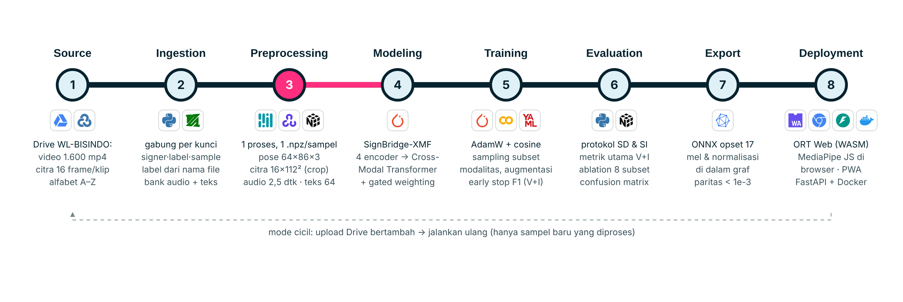
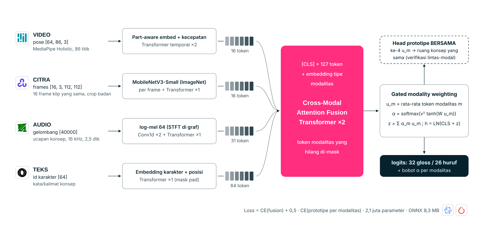

# SignBridge-XMF — Rombak Multimodal Fusion (sesuai arahan Dosen)

Branch: `rombak/xmf-crossmodal-fusion` · Paket kode: `signbridge/xmf/` · Runtime web: `web/js/xmf.js`

## Judul yang diusulkan

> **SIGNBRIDGE: JEMBATAN KOMUNIKASI REAL-TIME BAHASA ISYARAT INDONESIA (BISINDO) BERBASIS CROSS-MODAL ATTENTION FUSION TRANSFORMER MULTIMODAL UNTUK KEMITRAAN PENDIDIKAN INKLUSIF DI INDONESIA**

Alternatif yang lebih pendek:
- *… BERBASIS FUSI MULTIMODAL CROSS-MODAL ATTENTION TRANSFORMER (XMF) …*
- *… BERBASIS GATED CROSS-MODAL FUSION TRANSFORMER …*

"Deep Learning" di judul lama diganti nama arsitektur yang benar-benar dipakai: **Cross-Modal Attention Fusion Transformer** (singkatan di kode: **XMF**).

## Apa yang salah sebelumnya, dan perbaikannya

| Masalah (presentasi 1) | Perbaikan |
|---|---|
| Video, citra, audio, dan teks diambil dari **sumber berbeda** | Video dan citra berasal dari **klip WL-BISINDO yang sama** (`signer{S}_label{L}_sample{N}` ↔ `..._f00..f15.jpg`). Audio dan teks dipasangkan ke klip pada tingkat **konsep** (klip AIR ↔ ucapan "air" ↔ teks "air putih"). |
| Preprocessing **terpisah per modalitas** | **Satu** perintah `signbridge.xmf.preprocess` memproses ke-4 modalitas sekaligus dan menulis **satu `.npz` per sampel** (`pose, frames, audio, text, mask, label`). |
| Model terpisah (M0 video, fingerspell citra, ASR, teks) | **Satu** model fusion `SignBridgeXMF` yang menerima 4 input sekaligus. Arsitektur yang sama dipakai untuk 2 tugas: gloss (32 kata) dan alfabet (26 huruf). |
| Folder `citra/` di Drive bernama gloss yang salah | Label **selalu** dibaca dari nama file (`labelN`). Contoh: folder `apa` berisi `label0` = **AIR**, folder `apa_kabar` berisi `label1` = **BELAJAR**. `ingest_report.json` mencatat semua ketidakcocokan. |
| `web/js/app.js` syntax error (blok merge ganda) sehingga web tidak bisa jalan | Diperbaiki. Lolos `node --check` dan semua 42 tes JS. |
| Mode huruf di web memakai aturan geometri dengan keyakinan tetap 0,93 | Diganti model XMF alfabet (crop tangan dan landmark dari frame yang sama). Aturan lama hanya cadangan jika model belum diekspor. |

## Pipeline (source → deployment)

| # | Tahap | Perintah | Tools | Keluaran |
|---|---|---|---|---|
| 1 | Source | `bash scripts/xmf_sync_drive.sh` | Google Drive, rclone | `data/raw/wlbisindo_drive/{video,citra,alfabet}` (+ `data/raw/audio/<task>/<KONSEP>/*.wav` rekaman relawan) |
| 2 | Ingestion | `python -m signbridge.xmf.ingest` · `python -m signbridge.xmf.audio_bank --task gloss` | Python, ffmpeg, edge-tts/gTTS/espeak-ng | `data/xmf/ingest/{gloss,alphabet}_manifest.csv`, `ingest_report.json`, `data/xmf/bank/<task>_audio.npz` |
| 3 | Preprocessing **terpadu** | `python -m signbridge.xmf.preprocess --task gloss --workers 4` | MediaPipe Holistic/Pose/Hands, OpenCV, NumPy, Pillow | `data/xmf/processed/<task>/<sample>.npz` + `<task>_processed.csv` |
| 4 | Modeling | `signbridge/xmf/model.py` | PyTorch, torchvision (MobileNetV3) | `SignBridgeXMF` |
| 5 | Training | `python -m signbridge.xmf.train --config configs/xmf_gloss.yaml --protocol sd\|si\|final` | PyTorch (CPU/GPU/Colab), YAML | `outputs/xmf/XMF_gloss_<protokol>/best.pt`, `history.csv` |
| 6 | Evaluation | otomatis setelah training, atau `python -m signbridge.xmf.evaluate --ckpt …` | NumPy, Matplotlib | `evaluation_metrics.json`, `ablation_modalities.csv`, `confusion_matrix_VI.png`, `classification_report_VI.csv` |
| 7 | Export | `python -m signbridge.xmf.export --ckpt outputs/xmf/XMF_gloss_final/best.pt [--quantize]` | ONNX, ONNX Runtime | `web/model/xmf_gloss.onnx` + `xmf_gloss.json` (uji paritas < 1e-3) |
| 8 | Deployment | `uvicorn server.app:app --port 7860` (atau Docker / `deploy/azure`) | ONNX Runtime Web (WASM), MediaPipe JS, Chrome PWA, FastAPI, Docker | aplikasi web; `XmfRecognizer` aktif otomatis jika `xmf_gloss.onnx` ada |

Satu perintah untuk semuanya: `bash scripts/run_xmf_pipeline.sh` (variabel `STAGES`, `TASKS`, `PROTOCOLS` untuk memilih tahap).

**Mode cicil.** Upload citra di Drive belum selesai. Klip yang citranya belum lengkap tetap diproses: 16 frame-nya diambil dari mp4 yang sama (`image_source=video_fallback`). Saat upload bertambah, jalankan ulang `sync → ingest → preprocess --refresh-citra`. Hanya sampel baru atau yang tadinya fallback yang diproses ulang.

## Arsitektur model

Masukan, semuanya mentah. Normalisasi citra dan log-mel dihitung **di dalam graf** supaya hasil di browser identik dengan saat training:

| Modalitas | Tensor | Asal (gloss) | Asal (alfabet) |
|---|---|---|---|
| video | `pose [1,64,86,3]` | MediaPipe Holistic dari mp4, trim, normalisasi bahu, resample 64 | landmark tangan dari foto yang sama, dinormalisasi relatif pergelangan/telapak (`[1,1,86,3]`) |
| citra | `frames [1,16,3,112,112]` 0..255 | 16 frame citra klip yang sama, crop badan-atas berpanduan bahu (median per klip) | crop tangan +25 % dari foto (`[1,1,3,112,112]`) |
| audio | `audio [1,40000]` | ucapan konsep 16 kHz 2,5 dtk (hening dipotong, ucapan di tengah) | nama huruf ("be", "huruf be") |
| teks | `text [1,64]` int64 | kata/kalimat konsep, id karakter | huruf/nama huruf |
| mask | `modality_mask [1,4]` | 1 = ada | |

Komponen:
1. **Encoder per modalitas.** Video: embedding per bagian tubuh plus kecepatan, Transformer temporal 2 lapis, 16 token. Citra: MobileNetV3-Small (ImageNet) per frame plus Transformer temporal, 16 token. Audio: log-mel 64 (STFT sebagai Conv1d tetap), Conv1d, Transformer, 31 token. Teks: embedding karakter, Transformer, 64 token.
2. **Cross-Modal Attention Fusion.** `[CLS]` + 127 token + embedding tipe modalitas masuk Transformer 2 lapis. Setiap token meng-attend token modalitas lain. Token modalitas yang hilang di-mask.
3. **Gated modality weighting.** `α = softmax(vᵀ tanh(W u_m))` hanya atas modalitas yang ada. `h = LN(CLS + Σ α_m u_m)` → logits.
4. **Head prototipe bersama.** Ringkasan tiap modalitas diklasifikasi terhadap prototipe kelas yang sama, sehingga ke-4 modalitas berada di **ruang konsep yang sama**.
5. **Loss** = CE(fusion) + 0,5 · rata-rata CE(prototipe) atas modalitas yang dipakai. Label smoothing 0,1.

Training memakai **sampling subset modalitas** per sampel (`modality_subsets` di config: V+I 35 %, V 12 %, I 8 %, A 10 %, T 8 %, V+I+A 9 %, V+I+T 6 %, semua 12 %), sehingga model kuat saat hanya kamera yang tersedia. Model gloss: 2,1 juta parameter, ONNX 9,3 MB (int8 6,3 MB), sekitar 150 ms per inferensi di WASM satu thread (diukur di Node).

## Protokol evaluasi (yang dilaporkan ke Dosen)

- **Metrik utama: V+I (kamera saja).** Ini kondisi nyata di browser.
- **SD (signer-dependent):** split lama `data/manifest_wl_bisindo.csv`, sebanding dengan M0 (99,1 %).
- **SI (signer-independent):** penanda 4 tidak pernah dilihat saat training. Paling jujur memprediksi uji langsung di browser oleh orang baru. Ubah dengan `ingest --test-signer N`. Idealnya diulang untuk setiap penanda (leave-one-signer-out).
- **final:** semua penanda dipakai untuk training. Model inilah yang diekspor ke web.
- **Ablation:** VIAT, VI, V, I, A, T, VIA, VIT, dengan rata-rata bobot α per subset (`ablation_modalities.csv`).
- **Catatan kejujuran:** audio dan teks dipasangkan di tingkat konsep, jadi subset yang memuat A/T *tidak boleh* dilaporkan sebagai akurasi pengenalan isyarat. Subset itu menunjukkan arah **Dengar → Tuli**: ucapan atau ketikan guru dipetakan ke konsep yang sama, lalu isyarat rujukan ditampilkan.
- Bank audio TTS dibagi **per suara**: val/test memakai suara yang tidak pernah dilatih. Rekaman asli dibagi per penutur (`<penutur>_xxx.wav`). **Tambahkan rekaman suara asli**, misalnya 4 anggota tim × 32 kata × 5 kali, agar mode ucapan akurat untuk suara manusia nyata.

## Di browser

`web/js/xmf.js`:
- `XmfFrameStore`: menyimpan snapshot kamera untuk setiap frame keypoint (kunci = objek `kp86` yang sama), jadi citra yang masuk model berasal dari segmen isyarat yang sama dengan deret keypoint.
- `XmfRecognizer extends SignRecognizer`: segmentasi isyarat lama tetap dipakai, klasifikasinya diganti XMF (video+citra). Hasil membawa `source: "onnx-xmf-fusion"` dan `fusion.weights` (tampil di HUD `?debug=1`). Jika `xmf_gloss.onnx` belum ada, otomatis kembali ke M0.
- `XmfAlphabet`: huruf A–Z, voting 4 dari 5 prediksi.
- `XmfConceptQuery`: arah Dengar → Tuli. Coba dari console: `await signbridgeXmf.fromText("selamat pagi")`, `await signbridgeXmf.fromMic()`.
- Paritas Python ↔ JS (teks, crop, indeks frame, normalisasi tangan, audio) diuji `node --test tests/js/xmf.test.mjs` dengan fixture dari `scripts/xmf_make_js_fixture.py`.

## Uji yang sudah dijalankan di branch ini

| Uji | Hasil |
|---|---|
| `pytest tests/test_xmf.py` (ingest label dari nama file, ops, log-mel graf vs NumPy, masking, paritas ONNX) | 8/8 lolos |
| `node --test tests/js/*.test.mjs` | 42/42 lolos |
| Uji asap train → evaluate → export pada **data sintetis** (`scripts/xmf_make_synthetic.py`) | berjalan end-to-end; paritas ONNX 1,9e-6 |
| ONNX dijalankan di `onnxruntime-web@1.18.0` (WASM) lewat `XmfRecognizer` | berhasil, sekitar 150 ms |

**Belum ada angka akurasi asli.** Training pada WL-BISINDO harus dijalankan di perangkat tim atau Colab karena data ada di Drive tim. Jangan pakai model sintetis untuk presentasi.

## Kebutuhan perangkat

Python 3.10–3.11 (MediaPipe 0.10.11), `pip install -r requirements-xmf.txt`, ffmpeg, dan opsional espeak-ng. CPU cukup. Perkiraan dari uji asap: satu epoch gloss sekitar 2–3 menit di CPU, jauh lebih cepat di GPU atau Colab. Pakai `cache: true` di config jika RAM ≥ 8 GB.

Diagram di atas dibangun ulang dengan `python scripts/xmf_build_architecture_page.py --icons icons.json` (logo dari paket npm `simple-icons`, CC0).
