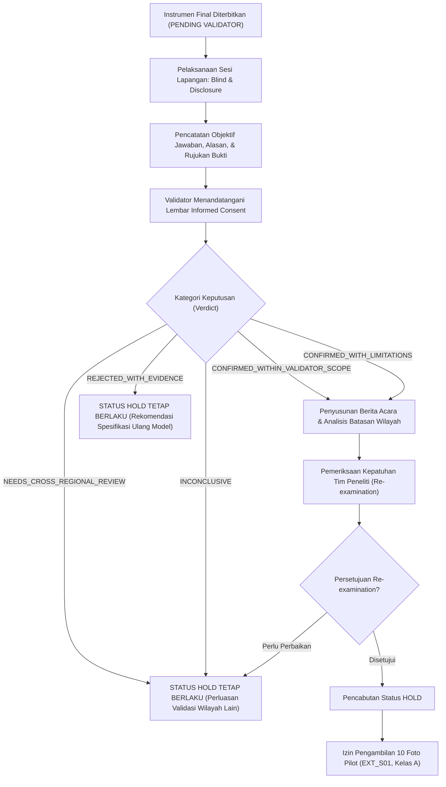

# INSTRUMEN VERIFIKASI FORMAL REFERENSI GESTUR BISINDO KELAS A
## Image Modality I1-P1 (BISINDO Alphabet Fingerspelling) — SignBridge ASEAN
### Final Methodological Revision — Multidisciplinary Protocol

**Dokumen**: `docs/validation_p1/BISINDO_A_FORMAL_VERIFICATION_FORM.md`  
**Proyek**: SignBridge ASEAN  
**Modul**: Image Modality I1 (MobileNetV3-Small I1-P1)  
**Target Pengujian**: Signer EXT_S01, Kelas A (Pilot 10 Foto Eksternal)  
**Dokumen Pendukung Sesi**: [`docs/validation_p1/BLIND_VALIDATION_SESSION_PROTOCOL.md`](file:///d:/SEMESTER%205/ML/Projek_1/docs/validation_p1/BLIND_VALIDATION_SESSION_PROTOCOL.md)  
**Dokumen Laporan Revisi**: [`docs/validation_p1/FINAL_METHODOLOGICAL_REVISION_REPORT.md`](file:///d:/SEMESTER%205/ML/Projek_1/docs/validation_p1/FINAL_METHODOLOGICAL_REVISION_REPORT.md)  
**Dokumen Audit Acuan**: [`docs/validation_p1/GESTURE_A_REFERENCE_AUDIT.md`](file:///d:/SEMESTER%205/ML/Projek_1/docs/validation_p1/GESTURE_A_REFERENCE_AUDIT.md)  
**Dokumen Laporan Pilot**: [`docs/validation_p1/PILOT_COLLECTION_REPORT.md`](file:///d:/SEMESTER%205/ML/Projek_1/docs/validation_p1/PILOT_COLLECTION_REPORT.md)  
**Tanggal Penerbitan Versi Final**: 16 November 2026  
**Status Verifikasi Instrumen**: **`PENDING VALIDATOR`** (Menunggu Pelaksanaan Sesi Lapangan Faktual)  
**Status Operasional Pilot**: **`HOLD (AWAITING GESTURE REFERENCE VERIFICATION)`**  

---

## 1. LANDASAN METODOLOGIS & KERANGKA KEPUTUSAN TIGA DIMENSI

Instrumen verifikasi ini dirancang oleh tim multidisiplin (Senior Research Methodologist, Sign Language Linguist, Deaf Community Research Advisor, Dataset Quality Auditor, dan Senior ML Engineer) untuk menjamin **objektivitas ilmiah mutlak, penghormatan terhadap budaya Tuli, dan pencegahan confirmation bias**.

Bentuk gestur dua tangan menyerupai segitiga yang ditemukan pada dataset pelatihan **tidak diasumsikan pasti benar atau pasti salah**, melainkan diperlakukan sebagai **objek penyelidikan empiris**.

Untuk menjaga kejernihan analisis, penelitian ini membedakan secara tegas tiga dimensi evaluasi:

```
+--------------------------------------------------------------------------------------------------------+
|                                  KERANGKA KEPUTUSAN TIGA DIMENSI                                       |
+------------------------------------+------------------------------------+------------------------------+
| 1. Dataset Label Consistency       | 2. Linguistic Validity             | 3. Ground Truth Suitability  |
+------------------------------------+------------------------------------+------------------------------+
| • Pertanyaan: Apakah gambar kelas  | • Pertanyaan: Apakah bentuk        | • Pertanyaan: Apakah bentuk  |
|   A dalam dataset konsisten secara |   tersebut dikenali dan digunakan  |   tersebut layak dijadikan   |
|   visual?                          |   dalam praktik komunitas BISINDO? |   ground truth evaluasi ML?  |
| • Bukti: Audit visual 172 citra,   | • Bukti: Jawaban blind & post-     | • Pertimbangan: Konsistensi, |
|   variasi pencahayaan, sudut,      |   disclosure, variasi regional,    |   keabsahan bahasa, risiko   |
|   anomali segmentasi.              |   eksplorasi sosio-linguistik.     |   bias, fairness penutur.    |
| • Sifat: Fakta Komputasional       | • Sifat: Fakta Sosio-Linguistik    | • Sifat: Keputusan Rekayasa  |
+------------------------------------+------------------------------------+------------------------------+
```

> [!IMPORTANT]
> **PRINSIP NON-INFERENSIAL**: Konsistensi label pada Dimensi 1 (fakta bahwa 172 citra dataset training menampilkan bentuk segitiga dua tangan) **TIDAK BOLEH** digunakan sebagai bukti langsung keabsahan linguistik pada Dimensi 2 ataupun kelayakan otomatis pada Dimensi 3. Setiap dimensi harus dibuktikan secara independen.

---

## 2. PROTOKOL MULTI-VALIDATOR & BATASAN LINGKUP GEOGRAFIS

### A. Kualifikasi & Profil Validator
Keahlian validator dinilai berdasarkan pengalaman hidup (*lived experience*) dan keterlibatan komunitas, **tanpa kewajiban memiliki sertifikasi formal**:
1. **Penutur Asli / Primer Tuli (*Native / Primary Deaf Signer*)**: Individu Tuli yang menggunakan BISINDO sebagai bahasa komunikasi utama sehari-hari.
2. **Pengajar / Instruktur BISINDO**: Pengajar bahasa isyarat baik formal (PUSBISINDO/lembaga) maupun fasilitator komunitas informal.
3. **Aktivis / Pengurus Organisasi Tuli**: Anggota/pengurus aktif GERKATIN atau organisasi pemuda Tuli setempat.
4. **Peneliti / Linguis Isyarat**: Akademisi yang mempelajari struktur dan penggunaan bahasa isyarat Indonesia.

### B. Jumlah Validator & Manajemen Perbedaan Pendapat
- **Target yang Direkomendasikan**: Minimal 2 (dua) validator independen dari latar belakang wilayah atau komunitas yang berbeda.
- **Pengelolaan Perbedaan Jawaban (*Inter-Rater Disagreement*)**:
  - Apabila terjadi perbedaan interpretasi antarvalidator, perbedaan tersebut **tidak dirata-ratakan atau diputuskan lewat voting mayoritas**, melainkan dianalisis sebagai indikasi variasi dialektal, perbedaan generasi, atau pengaruh sistem pendidikan SLB.
  - Kasus perbedaan didokumentasikan secara transparan pada laporan evaluasi.
- **Ketentuan Sesi Validator Tunggal ($n=1$)**:
  - Apabila keterbatasan lapangan hanya memungkinkan 1 (satu) validator, sesi tetap diizinkan sebagai **studi pendahuluan (*preliminary inquiry*)**.
  - **Larangan Generalisasi Nasional**: Hasil verifikasi validator tunggal secara tegas **DIBATASI** pada lingkup wilayah, dialek, dan komunitas validator tersebut, dan **DILARANG** diklaim sebagai standar nasional BISINDO seluruh Indonesia.
  - Sistem wajib mencatat kebutuhan validasi silang lintas-wilayah (*cross-regional review*).

---

## 3. PROTOKOL PENYAJIAN CITRA DUA TAHAP (TWO-PHASE BLIND PRESENTATION)

Untuk mencegah *confirmation bias*, gambar disajikan kepada validator dalam dua tahap terpisah:

### A. Tahap 1: Pengamatan Buta (Blind Observation)
1. **Tanpa Label & Identitas**: Seluruh teks nama file asli (misal `A _Hitam_Iphone_14Pro.jpg`), nama folder kelas, dan deskripsi peneliti dihilangkan sepenuhnya.
2. **Pengacakan & Kode Anonim**: Citra diberi kode acak anonim (misal `IMG_BLIND_01`, `IMG_BLIND_02`, dst.) dan urutan kemunculannya diacak.
3. **Penyertaan Citra Pembanding**: Validator disajikan campuran antara sampel Kelas A aktual dan sampel pembanding dari kelas lain yang relevan di repository (misal Kelas B, C, D) dengan kualitas visual sebanding.
4. **Pertanyaan Terbuka Murni**: Pewawancara dilarang menyebutkan kata "huruf A", "abjad", "segitiga", atau petunjuk apa pun sebelum validator memberikan interpretasi bebas.

### B. Tahap 2: Pengungkapan Label & Penilaian Ground Truth (Label Disclosure)
1. Setelah seluruh interpretasi pada Tahap 1 dicatat dan dikunci (*locked*), pewawancara mengungkap label kelas dataset dari masing-masing citra uji.
2. Peneliti menjelaskan bahwa citra tertentu dilabeli sebagai Kelas A pada dataset pelatihan model kecerdasan buatan SignBridge ASEAN.
3. Validator diminta mengevaluasi apakah label tersebut sesuai dengan pemahaman mereka, mengonfirmasi apakah ada perubahan interpretasi, dan memberikan penilaian kritis mengenai kelayakannya sebagai ground truth.
4. Jawaban sebelum dan sesudah pengungkapan dicatat pada **kolom terpisah** tanpa menimpa jawaban awal.

---

## 4. PERTANYAAN TERSTRUKTUR & TERBUKA

### Modul A: Pertanyaan Observasi Buta (Blind Phase) — Per Citra Uji
*(Diajukan secara berurutan untuk setiap kode citra anonim)*
1. *Apa yang Anda amati dari konfigurasi tangan pada gambar ini?*
2. *Apakah konfigurasi tangan tersebut dikenal dalam pengalaman komunikasi isyarat Anda?*
3. *Jika dikenal, apa makna, simbol, atau fungsi yang Anda pahami dari bentuk tersebut?*
4. *Dalam konteks atau situasi apa bentuk tersebut biasanya muncul atau digunakan?*
5. *Seberapa yakin Anda dengan interpretasi tersebut? Mohon jelaskan alasan atau rujukan Anda.*

### Modul B: Pertanyaan Pasca-Pengungkapan Label (Post-Disclosure Phase)
1. *Setelah mengetahui bahwa gambar ini dilabeli sebagai huruf 'A' dalam dataset pelatihan komputer: Bagaimana tanggapan Anda mengenai kesesuaian label tersebut?*
2. *Apakah ada perubahan pandangan dari interpretasi awal Anda? Jika ada, apa yang mendasari perubahan tersebut?*

### Modul C: Eksplorasi Sosio-Linguistik BISINDO & Variasi
1. *Bagaimana huruf 'A' biasanya dieja dalam percakapan sehari-hari di komunitas Tuli wilayah Anda?*
2. *Apakah Anda mengetahui adanya variasi bentuk huruf 'A' di wilayah lain di Indonesia, atau perbedaan antara penutur Tuli senior dan generasi muda Tuli? Mohon jelaskan.*

### Modul D: Eksplorasi Sistem SIBI (Terpisah & Netral)
1. *Apakah Anda mengenal konfigurasi tangan tertentu dari sistem atau praktik isyarat lain, termasuk SIBI (Sistem Isyarat Bahasa Indonesia)?*
2. *Jika ya, bagaimana konteks penggunaannya (misalnya di sekolah luar biasa/SLB, buku pelajaran, atau acara formal) dan bagaimana Anda membedakannya dari praktik BISINDO yang Anda gunakan bersama teman Tuli?*

### Modul E: Eksplorasi American Sign Language (ASL) (Terpisah & Netral)
1. *Apakah Anda pernah menjumpai atau menggunakan ejaan alfabet satu tangan dari ASL dalam lingkungan komunikasi Anda (misalnya saat mengeja istilah bahasa Inggris, nama internasional, atau di media sosial)?*
2. *Bagaimana interaksi antara ejaan ASL dan BISINDO di komunitas Anda?*

### Modul F: Eksplorasi International Sign (IS) (Terpisah & Netral)
1. *Apakah Anda memiliki pengalaman dengan International Sign (misalnya dalam konferensi internasional, pertemuan olahraga Tuli, atau konten video global)?*
2. *Bagaimana representasi alfabet atau penandaan huruf dipahami dalam konteks International Sign yang Anda ketahui?*

### Modul G: Eksplorasi Konfigurasi Telapak Tangan Terbuka (Netral Tanpa Pilihan Menggiring)
1. *Jika seseorang memperagakan telapak tangan terbuka dengan lima jari merenggang tegak ke atas: Apa makna atau fungsi gestur tersebut dalam pengalaman komunikasi Anda?*
2. *Apakah Anda pernah melihat konfigurasi telapak tangan terbuka tersebut digunakan sebagai representasi ejaan huruf? Jika pernah, dalam sistem atau konteks apa?*

### Modul H: Penilaian Kelayakan Ground Truth Penelitian SignBridge ASEAN
1. *Mempertimbangkan tujuan proyek untuk melatih model AI pembaca isyarat BISINDO: Apakah konfigurasi dua tangan berbentuk segitiga ini layak dan adil dijadikan ground truth (standar acuan kebenaran) untuk menguji model pada penutur baru (EXT_S01)?*
2. *Apa saran dan rekomendasi kritis Anda bagi peneliti terkait pengambilan data lapangan dan representasi budaya Tuli?*

---

## 5. LEMBAR INSTRUMEN ISIAN VALIDASI (BLANK VERIFICATION RECORD)

> [!WARNING]
> **INTEGRITAS ETIKA RISET**: Seluruh bagian di bawah ini **WAJIB DIBIARKAN KOSONG** hingga sesi verifikasi nyata bersama validator selesai diselenggarakan secara faktual. Dilarang keras mengarang data, mengisi identitas tiruan, atau mencentang keputusan secara prematur.

### A. Tabel Registrasi Validator Lapangan

| Parameter Profil | Validator 1 (`VAL_01`) | Validator 2 (`VAL_02`) |
|---|---|---|
| **Kode Anonim Validator** | `[ VAL_BISINDO_01 ]` | `[ VAL_BISINDO_02 ]` |
| **Tanggal Sesi Verifikasi** | `[ BELUM DILAKSANAKAN ]` | `[ BELUM DILAKSANAKAN ]` |
| **Metode Pelaksanaan** | `[ ] Tatap Muka  /  [ ] Daring` | `[ ] Tatap Muka  /  [ ] Daring` |
| **Bahasa Komunikasi Utama** | `[ ........................................ ]` | `[ ........................................ ]` |
| **Usia Mulai Menggunakan BISINDO** | `[ ...... tahun / sejak lahir ]` | `[ ...... tahun / sejak lahir ]` |
| **Durasi Pemakaian Aktif BISINDO** | `[ ...... tahun ]` | `[ ...... tahun ]` |
| **Kota / Wilayah Domisili** | `[ ........................................ ]` | `[ ........................................ ]` |
| **Dialek Isyarat yang Dikuasai** | `[ ........................................ ]` | `[ ........................................ ]` |
| **Peran Komunitas / Organisasi** | `[ ........................................ ]` | `[ ........................................ ]` |
| **Pengalaman Mengajar / Edukasi** | `[ ........................................ ]` | `[ ........................................ ]` |
| **Status Sertifikasi (Opsional)** | `[ ] Ada  /  [ ] Tidak Ada (Penutur Alami)` | `[ ] Ada  /  [ ] Tidak Ada (Penutur Alami)` |

---

### B. Tabel Pencatatan Observasi Citra Dua Tahap (Blind vs Post-Disclosure)

*(Kolom `Actual Class` dan `File Asli di Repository` **DISEMBUNYIKAN** dari validator selama Tahap 1 berlangsung)*

| Image Code | File Asli di Repository (Konteks Peneliti) | Actual Class | Display Order | Blind Interpretation (Tahap 1 — Sebelum Tahu Label) | Post-Disclosure Assessment (Tahap 2 — Setelah Tahu Label) |
|:---:|---|:---:|:---:|---|---|
| `IMG_BLD_01` | `data/raw/image/bisindo_alphabet/A/A _Hitam_Iphone_14Pro.jpg` | Kelas A | `[ ... ]` | `[ Interpretasi awal bebas validator ]` | `[ Evaluasi setelah pengungkapan label ]` |
| `IMG_BLD_02` | `data/raw/image/bisindo_alphabet/B/20240509_182924.jpg` | Kelas B (Pembanding) | `[ ... ]` | `[ Interpretasi awal bebas validator ]` | `[ Evaluasi setelah pengungkapan label ]` |
| `IMG_BLD_03` | `data/raw/image/bisindo_alphabet/A/A_ Polos Terang_Xiaomi _Note 8 Pro.jpg` | Kelas A | `[ ... ]` | `[ Interpretasi awal bebas validator ]` | `[ Evaluasi setelah pengungkapan label ]` |
| `IMG_BLD_04` | `data/raw/image/bisindo_alphabet/C/20240509_183146.jpg` | Kelas C (Pembanding) | `[ ... ]` | `[ Interpretasi awal bebas validator ]` | `[ Evaluasi setelah pengungkapan label ]` |
| `IMG_BLD_05` | `data/raw/image/bisindo_alphabet/A/20240509_182656.jpg` | Kelas A | `[ ... ]` | `[ Interpretasi awal bebas validator ]` | `[ Evaluasi setelah pengungkapan label ]` |
| `IMG_BLD_06` | `data/raw/image/bisindo_alphabet/D/20240509_183310.jpg` | Kelas D (Pembanding) | `[ ... ]` | `[ Interpretasi awal bebas validator ]` | `[ Evaluasi setelah pengungkapan label ]` |
| `IMG_BLD_07` | `data/raw/image/bisindo_alphabet/A/A_Background Baju (Garis)_Samsung_A53 5G.jpg` | Kelas A | `[ ... ]` | `[ Interpretasi awal bebas validator ]` | `[ Evaluasi setelah pengungkapan label ]` |

---

### C. Lembar Catatan Pertanyaan Kualitatif & Rekaman Bukti

#### 1. Eksplorasi BISINDO & Variasi Regional (Modul C)
- **Ringkasan Jawaban Validator**:
  ```text
  [ Catatan bebas validator mengenai penggunaan dan variasi huruf A ]
  ```
- **Alasan & Bukti yang Mendasari**:
  ```text
  [ Dasar rujukan, tradisi daerah, atau kebiasaan komunitas ]
  ```

#### 2. Eksplorasi Konteks SIBI (Modul D)
- **Ringkasan Jawaban Validator**:
  ```text
  [ Pandangan validator terhadap kepalan tangan satu tangan dan konteks SLB ]
  ```
- **Alasan & Bukti yang Mendasari**:
  ```text
  [ Pengalaman sekolah / interaksi dengan kurikulum formal ]
  ```

#### 3. Eksplorasi Pengaruh ASL & International Sign (Modul E & F)
- **Ringkasan Jawaban Validator**:
  ```text
  [ Pengalaman interaksi dengan ejaan jari ASL dan International Sign ]
  ```
- **Alasan & Bukti yang Mendasari**:
  ```text
  [ Interaksi media sosial, pergaulan internasional, dll. ]
  ```

#### 4. Eksplorasi Makna Telapak Tangan Terbuka (Modul G)
- **Ringkasan Jawaban Validator**:
  ```text
  [ Makna konfigurasi telapak tangan terbuka 5 jari menurut pengalaman validator ]
  ```
- **Alasan & Bukti yang Mendasari**:
  ```text
  [ Fungsi leksikal atau gestural dalam percakapan ]
  ```

#### 5. Rekomendasi Ground Truth Machine Learning (Modul H)
- **Ringkasan Jawaban Validator**:
  ```text
  [ Rekomendasi kelayakan sebagai acuan model SignBridge ASEAN ]
  ```
- **Saran Etis & Teknis untuk Pengumpulan Data Lapangan**:
  ```text
  [ Saran operasional bagi enumerator lapangan ]
  ```

---

### D. Kategori Keputusan Akhir (*Final Verdict*)

Keputusan kelayakan ground truth wajib dipilih dari salah satu kategori standar berikut:

- [ ] **`CONFIRMED_WITHIN_VALIDATOR_SCOPE`**  
  Bentuk dua tangan segitiga sah dan layak sebagai ground truth Kelas A dalam batas wilayah/komunitas validator yang diuji.
- [ ] **`CONFIRMED_WITH_LIMITATIONS`**  
  Bentuk dua tangan segitiga diakui sah, namun memiliki catatan atau variasi artikulasi tertentu yang harus diakomodasi model.
- [ ] **`NEEDS_CROSS_REGIONAL_REVIEW`**  
  Ditemukan indikasi kuat variasi regional atau ketidaksepakatan antarvalidator; diperlukan validasi silang di wilayah dialek lain sebelum ground truth ditetapkan.
- [ ] **`REJECTED_WITH_EVIDENCE`**  
  Bentuk dua tangan segitiga ditolak berdasarkan bukti linguistik; model dan dataset memerlukan spesifikasi ulang.
- [ ] **`INCONCLUSIVE`**  
  Bukti yang diperoleh dari sesi wawancara belum memadai untuk mengambil kesimpulan definitif.

*Status Keputusan Saat Ini*: **`BELUM ADA KEPUTUSAN (MENUNGGU SESI NYATA)`**  
*Alasan & Rujukan Keputusan*: `[ Belum Terisi ]`

---

### E. Lembar Informed Consent & Perlindungan Etika Riset

Persetujuan partisipan diatur secara granular dan sukarela:

1. **Persetujuan Partisipasi Wawancara**:
   - [ ] Partisipan telah membaca lembar penjelasan penelitian dan setuju berpartisipasi sukarela.
   - [ ] Partisipan memahami hak untuk menolak menjawab pertanyaan tertentu atau mengundurkan diri.
2. **Persetujuan Pencatatan & Dokumentasi**:
   - [ ] Setuju pencatatan tertulis jawaban dan argumen linguistik.
   - [ ] Setuju perekaman audio/video sesi (opsional, khusus arsip verifikasi internal).
   - [ ] Menolak perekaman video (hanya pencatatan tertulis).
3. **Perlindungan Anonimitas & Identitas**:
   - [ ] Identitas asli dirahasiakan; publikasi hanya menggunakan kode anonim (misal `VAL_BISINDO_01`).
   - [ ] Memberikan izin penyebutan nama/afiliasi (hanya jika diminta secara tertulis oleh validator).
4. **Status Informed Consent**:
   - Status Saat Ini: `[ ] CONSENT_PENDING  /  [ ] CONSENT_SIGNED  /  [ ] CONSENT_WITHDRAWN`
   - Paraf Validator: `[ ........................................ ]`
   - Paraf Penanggung Jawab Sesi: `[ ........................................ ]`

---

## 6. PROTOKOL PASCA-VERIFIKASI & KETENTUAN PENCABUTAN STATUS HOLD

Untuk memastikan transisi operasional berjalan aman dan terkontrol:



### Aturan Operasional Ketat:
1. **Kasus Penolakan / Keraguan**: Jika hasil verifikasi adalah `NEEDS_CROSS_REGIONAL_REVIEW`, `REJECTED_WITH_EVIDENCE`, atau `INCONCLUSIVE`, status **`HOLD` DILARANG KERAS DICABUT**.
2. **Tanpa Perubahan Sepihak**: Jika validator menolak bentuk tersebut, tim dilarang mengubah label dataset atau melatih ulang model secara sepihak tanpa analisis formal dan persetujuan tertulis dari penanggung jawab penelitian.
3. **Syarat Pencabutan HOLD**: Pengambilan 10 foto pilot penutur EXT_S01 hanya dapat dimulai setelah:
   - Sesi verifikasi nyata terlaksana.
   - Lembar consent bertanda `CONSENT_SIGNED`.
   - Keputusan berstatus `CONFIRMED_WITHIN_VALIDATOR_SCOPE` atau `CONFIRMED_WITH_LIMITATIONS`.
   - Laporan re-examination disetujui secara multidisiplin.

---

## 7. STATUS TAHAP SAAT INI

- **Status Instrumen Verifikasi**: **`PENDING VALIDATOR`**
- **Status Tahap Pilot Lapangan**: **`HOLD (AWAITING GESTURE REFERENCE VERIFICATION)`**
- **Defisit Data Pilot (EXT_S01, Kelas A)**: **10 foto** (0 terkumpul, 10 belum diambil)
- **Defisit Total Data Eksternal**: **780 foto** (0 terkumpul, 780 belum diambil)
- **Manifest Aktual**: [`data/external/bisindo_validation/external_manifest.csv`](file:///d:/SEMESTER%205/ML/Projek_1/data/external/bisindo_validation/external_manifest.csv) (0 baris data fiktif)
- **Integritas Checkpoint PyTorch & ONNX**: Terverifikasi **100% UTUH** melalui audit SHA-256.
