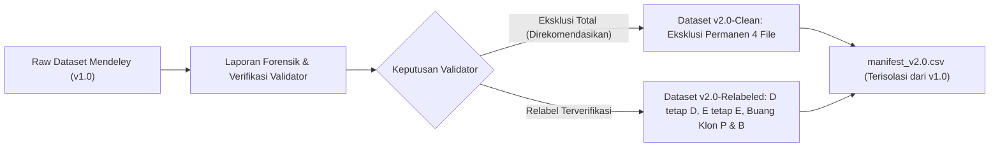

# RENCANA KOREKSI DATASET & PROTOKOL VALIDASI LINGUISTIK (DATASET CORRECTION PLAN)
## SignBridge ASEAN — Modality Image (BISINDO Alphabet Fingerspelling)

> **Dokumen**: `docs/validation_p1/DATASET_CORRECTION_PLAN.md`  
> **Tipe Dokumen**: Governance Plan, Risk Mitigation & Linguistic Validation Protocol  
> **Tanggal Audit**: 17 November 2026  
> **Auditor**: Senior Computer Vision Engineer, Dataset Forensics Specialist, & ML Methodology Reviewer  
> **Kebijakan Eksekusi**: **PERENCANAAN NON-DESTRUKTIF (ZERO IN-PLACE MUTATIONS)**  
> **Status Linguistik**: **`LINGUISTIC_LABEL_VALIDITY_PENDING_HUMAN_VALIDATION`**

---

## 1. PRIORITAS TEMUAN FORENSIK DATASET

Berdasarkan investigasi biner dan visual forensik, berikut adalah ringkasan temuan berprioritas tinggi pada dataset mentah:

| No | Temuan Forensik | File Terdampak | Masalah Utama Teridentifikasi | Tingkat Risiko Metodologis | Rekomendasi Penanganan |
|:---:|---|---|---|:---:|---|
| **1** | **Klon Biner Lintas-Kelas D vs P** | `D_Polos Gelap_iPhone_XR.jpeg` & `P_Polos Gelap_iPhone_XR.jpeg` | File identik bit-by-bit (SHA-256: `a99273b2...`). Bentuk visual membentuk huruf D dua tangan, namun disalin dan dinamai P di folder `P/`. | **SEDANG** (Telah dicegah oleh filter preprocessing saat ini) | **Pertahankan status EXCLUDED** pada baseline; ajukan ke validator jika hendak direlabel pada dataset v2. |
| **2** | **Klon Biner Lintas-Kelas B vs E** | `B_polos gelap_Iphone_13promax.jpg` & `E_polos gelap_Iphone_13promax.jpg` | File identik bit-by-bit (SHA-256: `99c4a156...`). Bentuk visual membentuk huruf E dua tangan (3 garis pada 1 tiang), namun disalin ke folder `B/`. | **SEDANG** (Telah dicegah oleh filter preprocessing saat ini) | **Pertahankan status EXCLUDED** pada baseline; ajukan ke validator jika hendak direlabel pada dataset v2. |
| **3** | **Cacat Anotasi Bawaan Mendeley** | Folder mentah `D/`, `P/`, `B/`, `E/` | Peneliti sumber asli Mendeley melakukan duplikasi file saat menyusun data mentah. Berpotensi ada label noise serupa yang tidak terdeteksi exact hash. | **TINGGI** (Memengaruhi validitas ekologis data internal) | Wajibkan validasi buta oleh penutur Tuli sebelum model P2 dilatih. |

---

## 2. REVIEW VALIDITAS LINGUISTIK BISINDO (TASK 7)

Tim engineering dan auditor AI secara metodologis **TIDAK MEMILIKI OTORITAS** untuk menetapkan keabsahan linguistik bahasa isyarat secara sepihak. Oleh karena itu, status linguistik untuk temuan ini secara formal ditetapkan sebagai:

$$\mathbf{LINGUISTIC\_LABEL\_VALIDITY\_PENDING\_HUMAN\_VALIDATION}$$

### Daftar Pertanyaan Diagnostik untuk Validator Tuli / Instruktur BISINDO Kompeten:
Ketika sesi validasi tatap muka dilaksanakan, validator akan dimintai konfirmasi terstruktur terhadap berkas citra temuan:

1. **Pertanyaan 1 (Konfigurasi Pasangan D/P)**:
   - *"Apakah gestur dua tangan pada citra `D_Polos Gelap_iPhone_XR.jpeg` (telunjuk kiri tegak, jempol-telunjuk kanan membentuk kurva menempel) dikenal dan diterima sebagai huruf **D** dalam komunitas Tuli di wilayah Anda?"*
   - *"Apakah ada kemungkinan atau dialek regional di mana konfigurasi ini merepresentasikan huruf **P**?"*
2. **Pertanyaan 2 (Konfigurasi Pasangan B/E)**:
   - *"Apakah gestur dua tangan pada citra `E_polos gelap_Iphone_13promax.jpg` (tiga jari kiri horizontal menempel pada telunjuk kanan vertikal) merupakan huruf **E** yang baku dalam BISINDO?"*
   - *"Apakah konfigurasi tersebut pernah digunakan untuk huruf **B** dalam konteks tertentu?"*
3. **Pertanyaan 3 (Bentuk Dua Tangan vs Satu Tangan)**:
   - *"Dalam percakapan sehari-hari penutur BISINDO di wilayah Anda, apakah alfabet D, P, B, dan E lebih lazim dieja menggunakan satu tangan (seperti sistem SIBI/ASL) atau dua tangan (seperti sistem BANZSL/Mendeley)?"*
4. **Pertanyaan 4 (Keterbacaan dan Kejelasan Morfologi Jari)**:
   - *"Apakah posisi jemari pada foto-foto tersebut cukup jelas dan natural untuk dijadikan bahan ajar sistem penerjemah AI?"*

---

## 3. STRATEGI VERSIONING & RENCANA KOREKSI DATASET (TASK 9)

### 3.1. Kebijakan Terhadap Baseline P0 dan P1 Saat Ini:
- **DILARANG MENGUBAH BASELINE (KEEP AS-IS)**:
  - Checkpoint P0 (`6767DCAA...`), P1 (`83C6A093...`), dan model ONNX produksi (`1C281E15...`) terbukti dilatih pada dataset yang **SUDAH MENGEKSKLUSI** 4 citra duplikat ini.
  - Mengubah dataset mentah atau processed saat ini akan merusak keterulangan (*reproducibility*) evaluasi baseline.

### 3.2. Strategi Pembuatan Dataset Versi Baru (Dataset v2.0):
Jika perbaikan data hendak diterapkan pada iterasi pelatihan P2, harus dibuat artefak terpisah tanpa menimpa data awal:

### Opsi Tindakan Formal untuk Dataset Masa Depan:
1. **Opsi A: Pertahankan Eksklusi Total (*Quarantine & Exclude*) — [DIREKOMENDASIKAN]**:
   - Keempat file tetap dieksklusi secara permanen dari dataset pelatihan dan pengujian masa depan.
   - *Justifikasi*: Meskipun secara visual mirip D dan E, file yang memiliki riwayat duplikasi dan nama file ganda memiliki risiko ketidakpastian metadata asal. Mengecualikan 4 file dari 4.466 file hanya mengurangi data sebesar 0,089% (sangat aman tanpa memengaruhi daya latih model).
2. **Opsi B: Relabeling Terverifikasi (*Verified Relabeling*)**:
   - Jika validator Tuli secara tertulis menyatakan `D_Polos Gelap_iPhone_XR.jpeg` adalah huruf D yang sah, file tersebut dipertahankan di kelas D, sementara file kembarannya `P_Polos Gelap_iPhone_XR.jpeg` dibuang permanen dari kelas P.
   - Prosedur yang sama berlaku untuk `E_polos gelap_Iphone_13promax.jpg` di kelas E (file kembar di B dibuang).
   - Opsi ini **hanya boleh dieksekusi setelah ada tanda tangan form verifikasi oleh validator**.

---

## 4. CHECKLIST VERIFIKASI SETELAH KOREKSI MASA DEPAN

Sebelum dataset versi baru (v2.0) disahkan untuk melatih model eksperimental P2:

- [ ] Formulir verifikasi ditandatangani oleh penutur asli Tuli / instruktur BISINDO.
- [ ] Perubahan label atau eksklusi dicatat pada file manifest baru berseri (`data/processed/bisindo_alphabet/manifest_v2.csv`).
- [ ] Manifest v1.0 asli (`manifest.csv`) dipertahankan tanpa perubahan bit untuk menjaga audit trail P0/P1.
- [ ] Dilakukan pemindaian SHA-256 ulang untuk memastikan 0 exact duplicate lintas-kelas pada manifest baru.
- [ ] Dilakukan evaluasi ulang rasio ketimpangan kelas ($IR$) untuk memastikan dataset v2 tetap seimbang.
- [ ] Seluruh artefak checkpoint P0/P1 lama tetap lulus verifikasi hash baseline.

