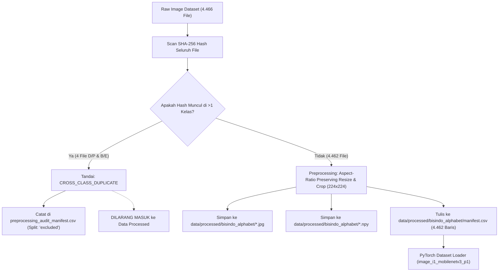

# LAPORAN PENELUSURAN ASAL-USUL LABEL DATASET (LABEL PROVENANCE AUDIT)
## SignBridge ASEAN — Modality Image I1-P1 (BISINDO A–Z)

> **Dokumen**: `docs/validation_p1/LABEL_PROVENANCE_AUDIT.md`  
> **Tipe Evaluasi**: Traceability & Pipeline Ingestion Audit  
> **Dasar Bukti**: Penelusuran `scripts/preprocess_bisindo_alphabet.py`, `preprocessing_audit_manifest.csv`, dan `manifest.csv`  
> **Tanggal Audit**: 17 November 2026  
> **Auditor**: Senior Computer Vision Engineer, Dataset Forensics Specialist, & ML Methodology Reviewer  
> **Status Provenance**: **`PIPELINE_HANDLING_VERIFIED_CLEAN`**

---

## 1. PENELUSURAN ASAL-USUL LABEL (TASK 4)

Dilakukan pelacakan silsilah label (*label provenance lineage*) dari folder mentah, filename, manifest, hingga skrip loader pelatihan:

| Suspected Image | Raw Folder | Filename Label | Audit Manifest Label | Processed Manifest Label | Training Set Label | Status Konsistensi Pipeline |
|---|:---:|:---:|:---:|:---:|:---:|:---:|
| `D_Polos Gelap_iPhone_XR.jpeg` | **`D`** | `D` | `D` (Index: 3) | **TIDAK ADA (EXCLUDED)** | **TIDAK ADA** | **TERISOLASI DI PREPROCESSING** |
| `P_Polos Gelap_iPhone_XR.jpeg` | **`P`** | `P` | `P` (Index: 15) | **TIDAK ADA (EXCLUDED)** | **TIDAK ADA** | **TERISOLASI DI PREPROCESSING** |
| `B_polos gelap_Iphone_13promax.jpg` | **`B`** | `B` | `B` (Index: 1) | **TIDAK ADA (EXCLUDED)** | **TIDAK ADA** | **TERISOLASI DI PREPROCESSING** |
| `E_polos gelap_Iphone_13promax.jpg` | **`E`** | `E` | `E` (Index: 4) | **TIDAK ADA (EXCLUDED)** | **TIDAK ADA** | **TERISOLASI DI PREPROCESSING** |

---

## 2. INVESTIGASI PIPELINE RAW-TO-PROCESSED (TASK 5)

Penelusuran arsitektur penanganan data mentah ke data siap latih (*raw-to-processed pipeline*):



### Mekanisme Eksklusi pada Skrip Preprocessing (`scripts/preprocess_bisindo_alphabet.py`):
Pada baris 73–91 skrip preprocessing:
1. Skrip secara otomatis memindai seluruh 4.466 citra dan membangun dictionary `sha_to_files`.
2. Jika suatu nilai hash SHA-256 terdeteksi memiliki lebih dari satu kelas unik (`len(unique_classes) > 1`), hash tersebut diklasifikasikan sebagai `cross_class_duplicate_shas`.
3. Keempat file langsung dimasukkan ke dalam `excluded_files` dengan label alasan:
   - `CROSS_CLASS_DUPLICATE (B vs E): sha256=99c4a1565f4c49c0`
   - `CROSS_CLASS_DUPLICATE (D vs P): sha256=a99273b2ca82794c`
4. File-file ini **tidak pernah diproses** menjadi array `.npy` atau citra visual `.jpg` di direktori `data/processed/bisindo_alphabet/`.
5. File-file ini **tidak dimasukkan** ke dalam `data/processed/bisindo_alphabet/manifest.csv` (jumlah baris manifest bersih pada angka 4.462).

---

## 3. AUDIT KONSISTENSI CLASS-TO-INDEX MAPPING

Pemetaan indeks alfabet pada pipeline image I1 (`scripts/preprocess_bisindo_alphabet.py` dan `signbridge/image/`):

```python
FINGERSPELL_26_LABELS = [
    "A", "B", "C", "D", "E", "F", "G", "H", "I", "J",
    "K", "L", "M", "N", "O", "P", "Q", "R", "S", "T",
    "U", "V", "W", "X", "Y", "Z"
]
```

- Kelas `A` = Indeks 0
- Kelas `B` = Indeks 1
- Kelas `D` = Indeks 3
- Kelas `E` = Indeks 4
- Kelas `P` = Indeks 15

Tidak ditemukan pergeseran indeks (*off-by-one errors*) atau pemetaan tertukar pada konfigurasi YAML maupun skrip data loader. Pemetaan indeks bersifat deterministik dan konsisten di seluruh pipeline P0 dan P1.

---

## 4. KESIMPULAN PENELUSURAN ASAL-USUL LABEL

1. **Pipeline Internal SignBridge Bekerja Sesuai Spesifikasi**: Tim perekayasa SignBridge telah menerapkan filter pengaman duplikasi lintas-kelas sejak tahap pembuatan dataset processed. Keempat file cacat bawaan Mendeley tersebut **telah dibendung dan tidak pernah mencemari dataset processed**.
2. **Asal Masalah Terisolasi pada Sumber Asli**: Kesalahan label murni berasal dari repositori publik Mendeley (kesalahan manusia saat pengorganisasian file mentah oleh peneliti asli), bukan disebabkan oleh bug pada pipeline preprocessing, kode ingestion, atau loader PyTorch repositori ini.

