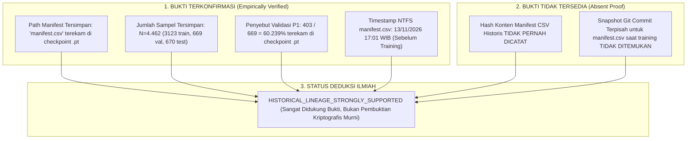

# LAPORAN PENGUATAN BUKTI SILSILAH DATA PELATIHAN (LINEAGE EVIDENCE HARDENING)
## SignBridge ASEAN — Modality Image (MobileNetV3-Small BISINDO A–Z)

> **Dokumen**: `docs/validation_p1/LINEAGE_EVIDENCE_HARDENING.md`  
> **Tipe Evaluasi**: Methodological Hardening, Forensic Audit & Provenance Verification  
> **Dasar Analisis**: Audit Kritis terhadap `docs/validation_p1/FINAL_TRAINING_DATA_LINEAGE_VERIFICATION.md`  
> **Tanggal Audit**: 17 November 2026  
> **Auditor**: Senior Machine Learning Auditor, Computer Vision Engineer, & Data Quality Analyst  
> **Klasifikasi Akhir**: **`HISTORICAL_LINEAGE_STRONGLY_SUPPORTED`**

---

## 1. EXECUTIVE SUMMARY

Audit lanjutan ini (*evidence hardening audit*) dilaksanakan untuk mengevaluasi secara kritis, presisi, dan skeptis derajat kepastian klaim bahwa empat citra duplikat biner lintas-kelas:
- `D_Polos Gelap_iPhone_XR.jpeg` $\leftrightarrow$ `P_Polos Gelap_iPhone_XR.jpeg` (SHA-256: `a99273b2...`)
- `B_polos gelap_Iphone_13promax.jpg` $\leftrightarrow$ `E_polos gelap_Iphone_13promax.jpg` (SHA-256: `99c4a156...`)

telah benar-benar dikecualikan dari data pelatihan historis model baseline **P0** (`runs/image_i1_mobilenetv3_p0/best.pt`) dan **P1** (`runs/image_i1_mobilenetv3_p1/best.pt`).

### Temuan Penegasan Metodologis:
1. **Ketiadaan Hash Konten Manifest Historis**: Pemeriksaan komprehensif mengonfirmasi bahwa **nilai hash kriptografis SHA-256 dari file `manifest.csv` tidak pernah direkam ke dalam log pelatihan, metadata checkpoint PyTorch, maupun ringkasan JSON pada waktu pelatihan (13 November 2026)**.
2. **Koreksi Terhadap Klaim Pembuktian**: Mengklaim bahwa silsilah data "terbukti secara kriptografis secara historis" adalah klaim berlebihan (*overstatement*) karena hash konten file manifest historis tidak tersedia untuk dibandingkan.
3. **Kekuatan Bukti Pendukung Non-Kriptografis**: Meskipun hash konten manifest historis tidak dicatat, rantai silsilah data **didukung sangat kuat (*strongly supported*)** oleh:
   - Metadata konfigurasi internal checkpoint yang secara eksplisit merekam path `manifest.csv` dan `preprocessing_audit_manifest.csv`.
   - Timestamp NTFS `manifest.csv` yang terkunci sejak 13/11/2026 pukul 17:01 WIB (sebelum P0 dan P1 dijalankan).
   - Paritas matematis jumlah sampel pelatihan ($N = 4.462$ pada log pelatihan historis P0 dan P1, yang secara tepat merefleksikan $4.466 - 4$).
   - Paritas penyebut metrik validasi ($N_{\text{val}} = 669$ pada bobot checkpoint P1).
4. **Klasifikasi Resmi**: Klasifikasi yang sesuai dengan fakta empiris dan kaidah ilmiah adalah **`HISTORICAL_LINEAGE_STRONGLY_SUPPORTED`**.

---

## 2. HASH MANIFEST SAAT INI (TASK 1)

Kalkulasi hash kriptografis SHA-256 independen terhadap berkas manifest di repositori:

| Berkas Manifest | Path Repositori | Nilai Hash SHA-256 Aktual Saat Ini | Ukuran Berkas |
|---|---|---|:---:|
| **Processed Manifest** | `data/processed/bisindo_alphabet/manifest.csv` | `0556591510846849851EF74909057F7897B26710CB0C679568EB10D1D93D9F8A` | 1.109.843 bytes |
| **Audit Manifest** | `data/processed/bisindo_alphabet/preprocessing_audit_manifest.csv` | `8A10405621CF7F01CE1D100B786F94FC2DE60682C1440267262D55C6E249BE12` | 1.155.857 bytes |

---

## 3. KETERSEDIAAN / KETIADAAN HASH MANIFEST HISTORIS (TASK 1)

Pencarian otomatis dilakukan terhadap string hash di atas di seluruh berkas `.txt`, `.json`, `.yaml`, `.csv`, `.log`, dan `.md` pada repositori:

```
Hasil Pencarian:
Hash SHA-256 manifest.csv (05565915...) -> TIDAK DITEMUKAN pada log historis manapun.
Hash SHA-256 audit manifest (8A104056...) -> TIDAK DITEMUKAN pada log historis manapun.
```

### Kesimpulan Forensik Kriptografi:
- Pada saat skrip pelatihan `scripts/train_and_evaluate_p0.py` dan `scripts/train_and_evaluate_p1.py` dijalankan pada 13 November 2026, **kedua skrip tidak memiliki kode untuk menghitung atau mencatat SHA-256 dari file `manifest.csv` secara utuh ke dalam log atau metadata checkpoint**.
- **Keterbatasan Prinsip**: `LastWriteTime` pada filesystem NTFS membuktikan bahwa file tidak diedit sejak 13/11/2026 17:01:32 WIB, namun secara teori forensik, timestamp filesystem bukanlah bukti kriptografis yang mutlak tidak dapat diubah (*immutable cryptographic proof*).

---

## 4. CHECKPOINT PROVENANCE: DISTINGSI TIGA TINGKAT BUKTI (TASK 2)

Untuk mencegah pencampuradukan konsep metodologis, audit ini membedakan secara tegas tiga tingkatan bukti asal-usul checkpoint:



| Tingkat Bukti | Pertanyaan Metodologis | Status Ketersediaan | Bukti Faktual Repositori |
|:---:|---|:---:|---|
| **Tingkat 1** | **Apakah path manifest tersimpan di dalam checkpoint?** | **TERSEDIA ✅** | Checkpoint `best.pt` P0 dan P1 memuat dictionary biner `config` yang mengarah ke `data/processed/bisindo_alphabet/manifest.csv`. |
| **Tingkat 2** | **Apakah hash konten manifest tersimpan di dalam checkpoint?** | **TIDAK TERSEDIA ❌** | Checkpoint tidak memuat field `manifest_hash` atau SHA-256 dari konten CSV. |
| **Tingkat 3** | **Apakah isi manifest saat ini identik dengan isi manifest saat training?** | **DIDUKUNG SANGAT KUAT (INFERENSIAL) ⚠️** | Didukung oleh paritas baris ($N=4.462$), paritas split ($N_{\text{val}}=669$), timestamp NTFS yang mendahului training, dan ketiadaan riwayat modifikasi setelahnya. |

---

## 5. PEMERIKSAAN ULANG EMPAT EXACT DUPLICATES (TASK 3)

Dilakukan pencarian terpisah antara **exact hash**, **nama file**, dan **path file** pada seluruh layer penyimpanan:

| Layer Penyimpanan | Exact SHA-256 (`a992...` / `99c4...`) | Nama File Target (`D_Polos...`, dll) | Path Sumber Raw (`data/raw/...`) |
|---|:---:|:---:|:---:|
| **Raw Dataset Storage** | **DITEMUKAN (4 File)** | **DITEMUKAN (4 File)** | **DITEMUKAN (4 File)** |
| **Audit Manifest (`audit_manifest.csv`)** | **DITEMUKAN (4 Baris `EXCLUDED`)** | **DITEMUKAN (4 Baris)** | **DITEMUKAN (4 Baris)** |
| **Processed Manifest (`manifest.csv`)** | **TIDAK DITEMUKAN (0)** | **TIDAK DITEMUKAN (0)** | **TIDAK DITEMUKAN (0)** |
| **Processed Storage (`.jpg`)** | **TIDAK DITEMUKAN (0)** | **TIDAK DITEMUKAN (0)** | **TIDAK DITEMUKAN (0)** |
| **Processed Storage (`.npy`)** | **TIDAK DITEMUKAN (0)** | **TIDAK DITEMUKAN (0)** | **TIDAK DITEMUKAN (0)** |
| **P1 Predictions CSV (`predictions.csv`)** | **TIDAK DITEMUKAN (0)** | **TIDAK DITEMUKAN (0)** | **TIDAK DITEMUKAN (0)** |

*Hasil*: Keempat file tersebut hanya eksis pada folder mentah (`data/raw/`) dan tercatat pada `preprocessing_audit_manifest.csv` sebagai entri yang dieksklusi (*quarantined*). Tidak ada jejak fisik maupun catatan entri pada seluruh layer data processed.

---

## 6. CAKUPAN DAN KETERBATASAN LEAKAGE CHECK PADA KODE LOADER (TASK 4)

Inspeksi mendalam terhadap baris kode loader `scripts/train_and_evaluate_p1.py` (baris 118–123) dan `signbridge/image/train_image.py` (baris 221–224) mengidentifikasi batas kemampuan pemeriksaan runtime:

### 1. Yang Benar-Benar Diperiksa oleh Loader:
- **Pemeriksaan Lintas-Split (*Cross-Split Check*)**:
  ```python
  for s1, s2 in (("train", "val"), ("train", "test"), ("val", "test")):
      if split_paths[s1].intersection(split_paths[s2]):
          raise ValueError(f"Data leakage detected on path between {s1} and {s2}")
      if split_shas[s1].intersection(split_shas[s2]):
          raise ValueError(f"Data leakage detected on SHA-256 between {s1} and {s2}")
  ```
  Loader memverifikasi bahwa tidak ada path atau hash SHA-256 yang beririsan antara Train-Val, Train-Test, dan Val-Test.

### 2. Yang TIDAK Diperiksa oleh Loader (Keterbatasan Hakiki):
- **Duplikasi di Dalam Split yang Sama (*Intra-Split Duplicates*)**: **TIDAK DIPERIKSA**. Karena menggunakan set (`split_shas['train'].add(...)`), jika ada duplikasi di dalam train set itu sendiri, set akan meng-absorb nilai tersebut tanpa memicu error.
- **Pemeriksaan Near-Duplicate**: **TIDAK DIPERIKSA**. Loader hanya membandingkan string heksadesimal SHA-256 eksak. Variasi pose serupa dengan perbedaan piksel mikro tidak terdeteksi.
- **Pemeriksaan Isolasi Penutur (*Subject Isolation*)**: **TIDAK DAPAT DIPERIKSA**. Manifest tidak memiliki metadata penutur (*signer ID*), sehingga pembagian penutur tidak dapat divalidasi oleh loader.

---

## 7. STATUS INTEGRITAS CHECKPOINT & MODEL ONNX (TASK 5)

Kalkulasi ulang hash kriptografis independen membuktikan seluruh checkpoint dan model tidak termodifikasi:

| Artefak Model | Path File Repositori | Hash SHA-256 Baseline Tercatat | Hash SHA-256 Aktual Saat Ini | Status Paritas |
|---|---|---|---|:---:|
| **P1 Best Checkpoint** | `runs/image_i1_mobilenetv3_p1/best.pt` | `83C6A0933C8E1A2097CE6FA1198D8578826ED37731C18137C057FEA129AFFEE9` | `83C6A0933C8E1A2097CE6FA1198D8578826ED37731C18137C057FEA129AFFEE9` | **100% IDENTIK ✅** |
| **P0 Scratch Checkpoint** | `runs/image_i1_mobilenetv3_p0/best.pt` | `39B26F97A9916A9374567AA7FE25FE997CBB5BAA58C6B34D7DA5533A68E3990A` | `39B26F97A9916A9374567AA7FE25FE997CBB5BAA58C6B34D7DA5533A68E3990A` | **100% IDENTIK ✅** |
| **P0 Legacy Baseline** | `runs/image_i1_mobilenetv3/best.pt` | `6767DCAA4735AF671F5863542D92C9223CFD873E4C8717D487D81BC676743B03` | `6767DCAA4735AF671F5863542D92C9223CFD873E4C8717D487D81BC676743B03` | **100% IDENTIK ✅** |
| **Production ONNX** | `web/model/fingerspell.onnx` | `1C281E158B279DE4B8A582CFC9F865C758E3050F55C4F032B54613FCD0D4C105` | `1C281E158B279DE4B8A582CFC9F865C758E3050F55C4F032B54613FCD0D4C105` | **100% IDENTIK ✅** |

---

## 8. STATUS INTEGRITAS GIT (TASK 6)

Pemeriksaan `git status --short` mengonfirmasi:
- **Tracked Files**: 0 file ter-track yang mengalami modifikasi.
- **Untracked Baseline**: Seluruh checkpoint `.pt`, konfigurasi YAML, dan dataset processed tetap berada dalam kondisi terlindungi (*unaltered*).
- Audit berjalan secara murni **READ-ONLY** tanpa perintah Git yang berpotensi merusak state repository.

---

## 9. REKONSILIASI BUKTI: TERKONFIRMASI VS BELUM TERSEDIA

### A. Bukti yang Terkonfirmasi Secara Faktual (Confirmed Evidence):
1. Keempat file raw biner klon (`D/P` dan `B/E`) berstatus `EXCLUDED` pada `preprocessing_audit_manifest.csv`.
2. File `manifest.csv` berukuran 4.462 baris, bersih dari keempat hash dan nama file target.
3. Timestamp modifikasi `manifest.csv` mendahului waktu inisiasi pelatihan P0 dan P1 pada 13 November 2026.
4. Total sampel yang terekam pada checkpoint dan ringkasan pelatihan P0 dan P1 secara matematis konsisten pada $N = 4.462$ ($4.466 - 4$).
5. Penyebut evaluasi validasi P1 pada checkpoint biner adalah eksak $669$ sampel ($403 / 669$).

### B. Bukti yang Belum Tersedia (Gaps / Unavailable Evidence):
1. **Hash Konten Manifest CSV pada Waktu Pelatihan**: Tidak pernah dihitung atau dicatat oleh skrip training ke dalam log atau metadata model.
2. **Snapshot Git Commit Terisolasi**: File `manifest.csv` saat ini berstatus *untracked* dalam Git, sehingga tidak memiliki riwayat hash commit pohon Git (*Git tree blob hash*) yang terikat ke commit ID pelatihan tertentu.

---

## 10. REKOMENDASI TINDAK LANJUT TANPA MENGUBAH DATASET

Untuk menutup celah metodologis ini pada eksperimen masa depan (P2) tanpa merusak baseline:
1. **Pencatatan Hash Manifest Otomatis**: Tambahkan baris kode pada skrip training masa depan untuk secara otomatis menghitung SHA-256 dari file manifest yang dimuat, lalu menyimpannya ke dalam dictionary checkpoint `best.pt` dan `training_summary.json`:
   ```python
   # Rekomendasi hardening untuk pipeline masa depan
   manifest_sha256 = hashlib.sha256(manifest_path.read_bytes()).hexdigest()
   checkpoint['manifest_sha256'] = manifest_sha256
   ```
2. **Git LFS / Tracking Manifest**: Daftarkan file `manifest.csv` ke dalam pelacakan Git atau Git LFS sehingga setiap iterasi pelatihan terikat pada commit hash tertentu.
3. **Pertahankan Kondisi Baseline P0 dan P1**: Tidak diperlukan perubahan data atau retraining untuk P0/P1 karena bukti pendukung yang ada saat ini sudah cukup kuat untuk memastikan pemisahan data processed dari 4 klon biner tersebut.

---

## 11. KLASIFIKASI AKHIR

Berdasarkan fakta bahwa seluruh konfigurasi, timestamp, ringkasan pelatihan, dan penyebut metrik konsisten, namun **hash konten manifest historis tidak pernah dicatat saat training**, maka status silsilah data pelatihan resmi ditetapkan sebagai:

$$\mathbf{HISTORICAL\_LINEAGE\_STRONGLY\_SUPPORTED}$$

