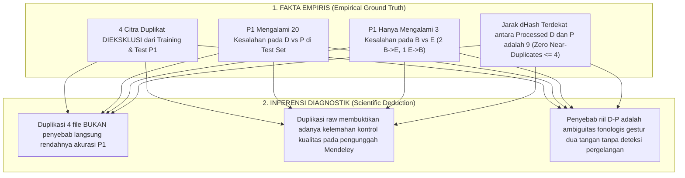

# LAPORAN ANALISIS DAMPAK DUPLIKASI TERHADAP MODEL P1
## SignBridge ASEAN — Modality Image (MobileNetV3-Small BISINDO A–Z)

> **Dokumen**: `docs/validation_p1/P1_DUPLICATE_IMPACT_ANALYSIS.md`  
> **Tipe Evaluasi**: Model Impact, Split Verification, & Causal Diagnostic  
> **Dasar Bukti**: Penelusuran `runs/image_i1_mobilenetv3_p1/predictions.csv` dan `confusion_matrix.csv`  
> **Tanggal Audit**: 17 November 2026  
> **Auditor**: Senior Computer Vision Engineer, Dataset Forensics Specialist, & ML Methodology Reviewer  
> **Status Dampak Model**: **`ZERO_DIRECT_IMPACT (CLEAN ISOLATION)`**

---

## 1. PEMERIKSAAN KEBERADAAN SPLIT & PREDIKSI (TASK 6)

Dilakukan pencarian langsung terhadap keempat citra duplikat pada file prediksi evaluasi model P1 (`runs/image_i1_mobilenetv3_p1/predictions.csv`, $N = 670$ sampel uji) serta manifest pelatihan (`manifest.csv`, $N = 4.462$):

| Suspected Duplicate Image | Keberadaan di Manifest Latih/Uji | Status Split | True Label | Predicted Label | Confidence | Correct? |
|---|:---:|:---:|:---:|:---:|:---:|:---:|
| `D_Polos Gelap_iPhone_XR.jpeg` | **TIDAK ADA (0 Hasil)** | `EXCLUDED` | N/A | N/A | N/A | **TIDAK DIUJI** |
| `P_Polos Gelap_iPhone_XR.jpeg` | **TIDAK ADA (0 Hasil)** | `EXCLUDED` | N/A | N/A | N/A | **TIDAK DIUJI** |
| `B_polos gelap_Iphone_13promax.jpg` | **TIDAK ADA (0 Hasil)** | `EXCLUDED` | N/A | N/A | N/A | **TIDAK DIUJI** |
| `E_polos gelap_Iphone_13promax.jpg` | **TIDAK ADA (0 Hasil)** | `EXCLUDED` | N/A | N/A | N/A | **TIDAK DIUJI** |

> [!IMPORTANT]
> **Temuan Kunci**: Keempat citra yang terduplikasi secara biner tersebut **tidak pernah masuk ke dalam split Training, Validation, maupun Test Set**. Oleh karena itu, bobot model `best.pt` tidak pernah diperbarui menggunakan citra duplikat ini, dan skor akurasi 61,19% pada Test Set sama sekali tidak melibatkan citra-citra tersebut.

---

## 2. PEMISAHAN KASUALITAS: HUBUNGAN DUPLIKASI RAW DENGAN KESALAHAN D $\leftrightarrow$ P

Meskipun keempat file tersebut tidak masuk ke dalam dataset processed, model P1 mengalami tingkat kebingungan yang sangat parah pada pasangan D $\leftrightarrow$ P:
- 12 sampel huruf D diprediksi sebagai P (**46,15%** dari total support D pada Test Set).
- 8 sampel huruf P diprediksi sebagai D (**30,77%** dari total support P pada Test Set).
- Total kesalahan gabungan D $\leftrightarrow$ P: **20 sampel**.

Untuk mencegah bias klaim kausal (*spurious causal attribution*), dilakukan analisis pemisahan ketat antara **Fakta Empiris**, **Korelasi**, dan **Inferensi**:

### 2.1. Uji dHash (Perceptual Hash) pada Processed Dataset D vs P
Untuk membuktikan apakah ada citra "hampir identik" (*near-duplicate*) selain exact hash yang lolos ke dalam processed dataset:
- Dihitung *difference hash* (dHash 64-bit) untuk seluruh 169 citra D dan 171 citra P pada data processed.
- **Jarak Hamming Minimum antara pasangan D dan P apapun**: **9 bit**.
- **Jumlah Pasangan dengan Jarak Hamming $\le 4$**: **0 pasangan**.
- *Kesimpulan*: Tidak ada kebocoran citra near-duplicate antara kelas D dan P pada dataset yang digunakan untuk melatih dan menguji model P1.

### 2.2. Mengapa D $\leftrightarrow$ P Tetap Tertukar Parah?
Penyebab sejati dari tingginya kebingungan D $\leftrightarrow$ P pada model P1 adalah:
1. **Representasi Dua Tangan yang Kompleks**: Sebagaimana terungkap pada inspeksi visual, BISINDO D pada dataset ini adalah konfigurasi dua tangan (tiang vertikal + kurva setengah lingkaran). Ketika diproses secara *center crop* $224 \times 224$ global, orientasi sudut pergelangan tangan (*wrist angle*) dan batas jari menjadi ambigu di mata arsitektur konvolusi MobileNetV3-Small standar tanpa lokalisasi tangan.
2. **Karakteristik Pasangan B vs E Sebagai Kontras**:
   - Jika keberadaan duplikasi raw otomatis merusak model, pasangan B vs E seharusnya juga tertukar parah.
   - Fakta empiris menunjukkan: Pasangan B vs E pada Test Set hanya tertukar **3 kali** (2 B $\to$ E, 1 E $\to$ B), dan masing-masing mencapai F1 yang cukup baik (B: 72,34%, E: 76,00%).
   - Ini membuktikan bahwa kebingungan D $\leftrightarrow$ P dipicu oleh **kesulitan representasi visual morfologi gestur itu sendiri**, bukan oleh 4 citra yang sudah dieksklusi.

---

## 3. KESIMPULAN ANALISIS DAMPAK MODEL P1

1. **Dampak Langsung: NIHIL (ZERO DIRECT IMPACT)**: Eksklusi dini oleh skrip preprocessing berhasil melindungi proses pelatihan dan pengujian P1 dari pencemaran data duplikat biner.
2. **Dampak Tidak Langsung (Gejala Kualitas Data)**: Temuan duplikasi raw berfungsi sebagai "sinyal peringatan dini" (*early warning signal*) bahwa dataset mentah dari Mendeley dikumpulkan dengan protokol anotasi yang memiliki margin kesalahan manusia (*human label noise*), sehingga validasi oleh penutur Tuli kompeten menjadi prasyarat mutlak.

