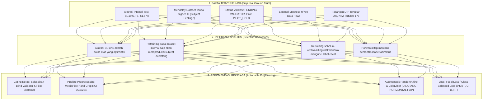

# LAPORAN KESIAPAN RETRAINING MODEL P2 (P2 RETRAINING READINESS REPORT)
## SignBridge ASEAN — Modality Image (MobileNetV3-Small BISINDO A–Z)

> **Dokumen**: `docs/validation_p1/P2_RETRAINING_READINESS.md`  
> **Modul**: Image Modality I1-P1 $\to$ I1-P2 (BISINDO Alphabet Fingerspelling)  
> **Tanggal Evaluasi**: 16 November 2026  
> **Tim Penilai**: Senior Research Methodologist, Sign Language Linguist, Dataset Auditor, & Senior ML Engineer  
> **Keputusan Resmi Kesiapan**: **`NOT_READY_FOR_P2_EXPERIMENTS`** (Gated / Tertahan Sementara)  

---

## 1. PEMISAHAN FORMAL: FAKTA, INFERENSI, DAN REKOMENDASI

Untuk menjamin objektivitas ilmiah dan mencegah bias optimisme (*confirmation bias*), evaluasi ini memisahkan secara ketat antara **Fakta Terverifikasi**, **Inferensi Analitis**, dan **Rekomendasi Rekayasa**.

---

### 1.1. Fakta Terverifikasi (Empirical Facts)
1. **Performa Baseline Rendah**: Model P1 hanya mencapai akurasi 61.19% dan Macro F1 61.57% pada internal test set ($N=670$), di bawah ambang minimum kelayakan ($75.00\%$).
2. **Ketiadaan Isolasi Subjek Penutur**: Dataset Mendeley (4,462 citra) tidak memiliki metadata identitas penutur (*signer ID*). Pembagian *train/val/test* acak mengakibatkan frame dari individu dan sesi perekaman yang sama tersebar di ketiga split (*data leakage via subject mixing*).
3. **Status Validasi Eksternal**:
   - Status instrumen verifikasi linguistik: `PENDING VALIDATOR`.
   - Status pilot eksternal: `PILOT_HOLD`.
   - Progress pengumpulan data eksternal: `0/780` foto terdaftar.
4. **Distribusi Kelas Seimbang**: Rasio ketidakseimbangan sangat rendah ($IR = 1.0545$, rentang 165 hingga 174 foto per kelas). Rendahnya performa kelas tertentu bukan disebabkan oleh ketimpangan frekuensi sampel.
5. **Titik Kegagalan Fonologis Terkonsentrasi**: 5 kelas memiliki F1-score di bawah 46% (P: 30.19%, C: 34.48%, D: 40.00%, R: 41.51%, I: 45.83%). Pasangan D $\leftrightarrow$ P menyumbang 20 kesalahan dan N $\leftrightarrow$ M menyumbang 17 kesalahan.
6. **Integritas Checkpoint Baseline Terjaga**: Checkpoint P1 (`best.pt`), P0 (`M0`), dan model produksi ONNX terverifikasi 100% cocok dengan SHA-256 baseline.

---

### 1.2. Inferensi Analitis (Analytical Inferences)
1. **Generalisasi Real-World yang Rapuh**: Karena akurasi 61.19% dicapai dalam kondisi *subject mixing*, performa model P1 pada penutur baru yang belum pernah dilihat (*unseen signers*) diproyeksikan akan jatuh di bawah 45%.
2. **Risiko Pelatihan Sia-Sia (*Premature Retraining Risk*)**: Jika retraining P2 dilakukan hanya menggunakan dataset Mendeley internal yang ada saat ini, model P2 akan tetap mewarisi *bias subjek* dan *overfitting latar belakang*, sehingga peningkatan metrik internal akan bersifat semu (*illusory generalization*).
3. **Risiko Label Cacat (*Label Corruption Risk*)**: Kelas A pada dataset training menggunakan konfigurasi dua tangan berbentuk segitiga yang saat ini masih diverifikasi keabsahannya oleh validator Tuli. Retraining sebelum hasil validasi buta keluar berisiko menanamkan representasi yang salah ke dalam bobot model P2.
4. **Penyebab Kegagalan Representasi**: MobileNetV3-Small memproses seluruh citra (termasuk baju, meja, dan dinding belakang). Ketiadaan modul lokalisasi tangan (*hand ROI extraction*) membuat representasi fitur rentan terhadap distraksi visual non-tangan.

---

## 2. EVALUASI KEBUTUHAN DATA DAN PRASYARAT RETRAINING

| Komponen Prasyarat | Kondisi Saat Ini | Kebutuhan Minimum Sebelum Retraining Formal | Status Kesiapan |
|---|---|---|---|
| **Data Internal Mendeley** | 4,462 citra (26 kelas) | Cukup untuk *code dry-run* arsitektur, TIDAK CUKUP untuk retraining produksi | Terbatas |
| **Data Eksternal (Out-of-Domain)** | 0 / 780 foto terdaftar | Minimal 10 foto pilot (EXT_S01 Kelas A) terverifikasi untuk unblock pipeline | **BLOCKED** |
| **Isolasi Subjek Penutur** | Tidak ada (*mixed signers*) | Skema validasi *Leave-One-Signer-Out* (LOSO) pada dataset eksternal | **BLOCKED** |
| **Verifikasi Ground Truth Kelas A** | `PENDING VALIDATOR` | Formulir verifikasi ditandatangani validator ahli/penutur Tuli | **BLOCKED** |
| **Audit Label Duplikat Mentah** | Anomali D/P dan B/E pada raw | Pemeriksaan visual manual terhadap sampel kelas P dan C yang berkinerja rendah | Perlu Dilakukan |

> [!CAUTION]
> **Data eksternal mutlak diperlukan sebelum retraining formal P2**. Retraining tanpa data eksternal dengan isolasi subjek hanya akan menghabiskan komputasi tanpa menyelesaikan akar masalah generalisasi.

---

## 3. EVALUASI KUALITAS CITRA, RESOLUSI, DAN PREPROCESSING

### 3.1. Resolusi Input (224x224 RGB)
- **Evaluasi**: Resolusi 224x224 sebenarnya memadai untuk deteksi gestur tangan secara umum. Namun, karena saat ini citra dipotong secara *center crop / global resize* dari frame kamera penuh, tangan penutur hanya menempati sekitar **25% hingga 40% dari total luas piksel**. Akibatnya, area tangan efektif hanya berukuran sekitar $110 \times 110$ piksel, menyebabkan detail lipatan jari halus (M vs N) kabur.
- **Rekomendasi**: Pertahankan input tensor model pada 224x224, namun terapkan **Crop Berbasis Bounding Box Tangan (*Hand-Centric ROI Preprocessing*)**.

### 3.2. Preprocessing Hand Bounding Box (MediaPipe Hand Crop)
- **Implementasi yang Direkomendasikan**:
  1. Jalankan MediaPipe Hand Detector pada citra mentah untuk mendeteksi koordinat *bounding box* tangan.
  2. Tambahkan margin perluasan (*padding*) sebesar 20–25% di sekitar bounding box tangan agar konteks orientasi pergelangan tangan (*wrist*) tetap terlihat (kritis untuk membedakan D vs P).
  3. Potong (*crop*) area tangan dan lakukan *aspect-ratio preserving resize* dengan padding ke dimensi $224 \times 224$.
  4. Untuk kelas dua tangan (seperti BISINDO A), gunakan *dual-hand union bounding box*.

---

## 4. REKOMENDASI DATA AUGMENTATION UNTUK GESTUR BISINDO

Augmentasi data untuk bahasa isyarat memiliki aturan linguistik ketat yang membedakannya dari klasifikasi objek umum:

### 4.1. Yang DILARANG KERAS (Strictly Forbidden Augmentations)
- ❌ **Horizontal Flip (RandomHorizontalFlip)**: 
  - **Bahaya Linguistik**: Sangat fatal. Banyak gestur alfabet BISINDO bersifat asimetris dan memiliki makna berbeda atau menjadi tidak valid jika dibalik secara cermin. Horizontal flip juga mengacaukan pembedaan tangan dominan vs non-dominan pada gestur dua tangan.
- ❌ **Rotasi Sudut Lebar ($> 30^\circ$)**:
  - **Bahaya Fonologis**: Memutar citra lebih dari $30^\circ$ secara langsung mengubah huruf D (tegak lurus) menjadi huruf P (mendatar/menukik), atau huruf I menjadi G.
- ❌ **Vertical Flip (RandomVerticalFlip)**:
  - **Bahaya Fonologis**: Membalik tangan secara vertikal membalikkan orientasi gravitasi jari, menciptakan gestur yang tidak ada dalam fonologi isyarat manusia.

### 4.2. Yang SANGAT DIREKOMENDASIKAN (Approved Augmentations)
-  **Random Rotation Terbatas ($\pm 10^\circ$)**: Mensimulasikan variasi kemiringan tangan alami penutur saat berbicara santai.
-  **Random Scaling & Translation ($\pm 10\%$)**: Mensimulasikan jarak kamera yang sedikit bervariasi (jarak $0.5\text{ m}$ s.d. $1.2\text{ m}$).
-  **Color Jittering Moderat (Brightness $\pm 0.15$, Contrast $\pm 0.15$, Saturation $\pm 0.10$)**: Meningkatkan ketahanan terhadap variasi pencahayaan ruangan (sebagaimana terungkap pada EDA: deviasi kontras mencapai 10.9).
-  **Random Erasing / Cutout Skala Kecil (area $< 5\%$)**: Melatih model agar tidak overfit pada satu cincin jari, jam tangan, atau aksesori penutur.

---

## 5. REKOMENDASI LOSS FUNCTION DAN REBOBOTAN KELAS

Mengingat ketimpangan performa drastis antar-kelas (F1 kelas P hanya 30.19% sementara kelas G 81.63%), Cross-Entropy Loss standar tidak optimal.

### 5.1. Focal Loss ($\gamma = 2.0, \alpha_t$)
- **Mekanisme**: Menurunkan bobot gradien dari sampel yang mudah diklasifikasikan (*well-classified samples*, seperti kelas G dan A yang sudah memiliki konfidensi tinggi), dan memusatkan gradien komputasi pada sampel sulit (*hard negatives*, seperti pasangan D-P dan N-M).
- **Formulasi**:
  $$\mathcal{L}_{\text{focal}} = -\alpha_t (1 - p_t)^\gamma \log(p_t)$$
  di mana $\gamma = 2.0$ memaksa model memprioritaskan batas keputusan pada kelas C, D, P, R, I.

### 5.2. Class-Difficulty Cost-Sensitive Weighting
- Bobot rugi (*loss weight*) untuk setiap kelas $c$ diatur berbanding terbalik dengan F1-score model P1:
  $$w_c \propto \frac{1}{\text{F1}_{P1}(c) + \epsilon}$$
  Dengan skema ini, kelas P ($F1 \approx 0.30$) dan C ($F1 \approx 0.34$) akan menerima bobot penalti kesalahan $\approx 2.7\times$ lebih besar daripada kelas G ($F1 \approx 0.82$).

---

## 6. HIPOTESIS EKSPERIMEN P2 YANG TERSTRUKTUR

Sebelum memulai pelatihan ulang formal, rencana eksperimen P2 disusun ke dalam 3 hipotesis teruji:

### Hipotesis 1 (H1: Hand-Centric Crop ROI)
- **Pernyataan**: *"Penerapan deteksi dan pemotongan ROI tangan menggunakan MediaPipe (dengan padding 25%) akan meningkatkan Macro F1 sebesar minimal $+8.0\%$ dibandingkan baseline P1, karena menghilangkan noise latar belakang dan meningkatkan kepadatan piksel jari."*
- **Metrik Verifikasi**: Macro F1 pada Test Set internal naik dari $61.57\% \to \ge 70.00\%$, dengan penurunan kesalahan pada pasangan N-M minimal 40%.

### Hipotesis 2 (H2: Orientation-Preserving Augmentation & Anti-Flip)
- **Pernyataan**: *"Menghilangkan augmentasi horizontal flip serta membatasi rotasi pada rentang $[-10^\circ, +10^\circ]$ yang dikombinasikan dengan color jittering moderat akan mengurangi kebingungan orientasi D $\leftrightarrow$ P sebesar minimal 50% tanpa menurunkan recall kelas lain."*
- **Metrik Verifikasi**: Jumlah kesalahan off-diagonal pasangan D $\to$ P dan P $\to$ D turun dari 20 sampel menjadi $\le 10$ sampel.

### Hipotesis 3 (H3: Focal Loss Hard-Mining)
- **Pernyataan**: *"Mengganti standard Cross-Entropy Loss dengan Focal Loss ($\gamma=2.0$) berpembobotan kesulitan F1 akan mendongkrak F1-score bottom-5 classes (P, C, D, R, I) dari rata-rata $38.40\%$ menjadi minimal $55.00\%$."*
- **Metrik Verifikasi**: F1-score kelas P meningkat dari $30.19\% \to \ge 50.00\%$; Macro Precision meningkat dari $63.30\% \to \ge 72.00\%$.

---

## 7. KEPUTUSAN RESMI DAN JUSTIFIKASI TAHAPAN

### Status Keputusan: **`NOT_READY_FOR_P2_EXPERIMENTS`**

### Justifikasi Metodologis:
1. **Integritas Ground Truth Tertahan (*Gated by Human Validator*)**: Instrumen verifikasi formal BISINDO Kelas A saat ini berstatus `PENDING VALIDATOR`. Memulai retraining model produksi sebelum validasi gestur selesai berisiko mengunci representasi yang tidak diakui oleh komunitas Tuli.
2. **Ketiadaan Data Eksternal (*Zero Out-of-Domain Data*)**: Manifest eksternal masih berisi 0 baris valid (`0/780`), dan pilot EXT_S01 berada pada status `PILOT_HOLD`. Model yang dilatih ulang hanya dengan data internal Mendeley akan tetap mengalami bias subjek penutur yang sama (*subject leakage*).
3. **Penyelesaian Prasyarat (*Actionable Path to Unfreeze*)**:
   - Status akan diubah menjadi **`READY_FOR_P2_EXPERIMENTS`** segera setelah:
     1. Validator Tuli menyelesaikan sesi verifikasi buta dan formulir ditandatangani.
     2. Pilot eksternal 10 foto EXT_S01 berhasil dikumpulkan dan lulus integrasi manifest.
     3. Script pipeline preprocessing MediaPipe ROI selesai dibuat dan diuji secara read-only.

