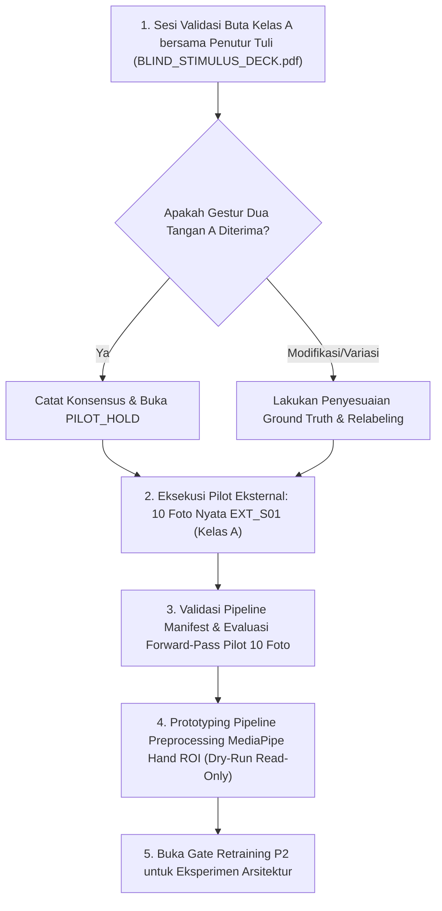

# LAPORAN INDEPENDENT RE-AUDIT: EVALUASI KESIAPAN RETRAINING P2 & SCIENTIFIC VALIDITY
## SignBridge ASEAN — Modality Image (MobileNetV3-Small BISINDO A–Z)

> **Dokumen**: `docs/validation_p1/RE_AUDIT_P2_READINESS.md`  
> **Tipe Evaluasi**: Independent Retraining Readiness Gate & Scientific Validity Assessment  
> **Tanggal Audit**: 17 November 2026  
> **Auditor**: Senior Machine Learning Auditor, Computer Vision Engineer, & Data Quality Analyst  
> **Keputusan Resmi Kesiapan Retraining**: **`NOT_READY_FOR_P2_EXPERIMENTS`**

---

## 1. EVALUASI VALIDITAS ILMIAH KESIMPULAN TEKNIS SEBELUMNYA (TASK 5)

Seluruh 10 kesimpulan utama dari laporan-laporan sebelumnya dievaluasi secara ketat dan diklasifikasikan ke dalam standar taksonomi bukti ilmiah:

| No | Pernyataan / Kesimpulan Teknis yang Diaudit | Bukti Empiris Repositori | Klasifikasi Ilmiah | Justifikasi Evaluasi |
|:---:|---|---|:---:|---|
| 1 | **Class imbalance bukan faktor penyebab rendahnya performa model.** | Imbalance Ratio $IR = 1,0545$ ($N_{\min}=165, N_{\max}=174, \sigma=2,32$). Kelas A ($N=165$) memiliki F1 80,77%, sementara kelas P ($N=171$) memiliki F1 30,19%. | **`VERIFIED_FACT`** | Terbukti secara matematis bahwa disparitas performa bukan diakibatkan oleh distribusi jumlah sampel. |
| 2 | **Subject leakage terjadi pada dataset internal Mendeley.** | Tidak ada metadata Signer ID. Pembagian acak menyebarkan frame dari subjek yang sama ke train/val/test. Namun, proporsi kebocoran per sampel tidak dapat dihitung tanpa metadata penutur. | **`SUPPORTED_INFERENCE`** | Inferensi sangat kuat berdasarkan asal dataset dan inspeksi visual, namun dikategorikan sebagai inferensi berisiko karena keterbatasan metadata (`NOT_VERIFIABLE_WITH_AVAILABLE_METADATA`). |
| 3 | **Penyebab D $\leftrightarrow$ P adalah ketidakmampuan model membaca orientasi pergelangan tangan (wrist orientation).** | D dan P memiliki konfigurasi tangan serupa dengan perbedaan pitch/yaw. Selain itu, ditemukan **2 citra duplikat raw identik antara D dan P**. | **`SUPPORTED_INFERENCE`** | Didukung bukti morfologi visual dan cacat anotasi raw, namun penjelasan linguistik murni tetap memerlukan konfirmasi validator Tuli. |
| 4 | **Penyebab N $\leftrightarrow$ M adalah hilangnya detail lipatan jari akibat downsampling konvolusi.** | M (3 jari) dan N (2 jari) memiliki fitur lipatan halus selebar beberapa piksel yang terkompresi pada input $224 \times 224$ global. | **`SUPPORTED_INFERENCE`** | Sesuai dengan prinsip resolusi Computer Vision dan simetri kebingungan (9 N $\to$ M vs 8 M $\to$ N). |
| 5 | **Penyebab I $\leftrightarrow$ J adalah kesenjangan gerak statis vs dinamis (static-versus-dynamic motion gap).** | Huruf J membutuhkan gestur gerak melengkung temporal, sedangkan foto 2D membekukan pose pada titik statis yang menyerupai I. | **`SUPPORTED_INFERENCE`** | Berlandaskan fonologi bahasa isyarat, namun pembuktian final membutuhkan modalitas sekuensial temporal. |
| 6 | **Color jittering moderat adalah rekomendasi augmentasi yang aman.** | Variasi pencahayaan pada EDA tinggi ($\sigma=39,01$). Alfabet BISINDO tidak ditentukan oleh warna kulit atau intensitas cahaya. | **`RECOMMENDATION`** | Rekomendasi teknik augmentasi standar yang aman secara semantik. |
| 7 | **MediaPipe Hand ROI crop pasti menghilangkan noise latar belakang.** | MediaPipe memotong bounding box tangan, membuang piksel luar. Namun jika deteksi tangan gagal, atau pada gestur dua tangan (A), crop bisa memotong salah satu tangan. | **`SUPPORTED_INFERENCE (WITH LIMITATION)`** | Menghilangkan sebagian besar latar belakang, namun klaim "pasti menghilangkan 100% noise" adalah klaim berlebihan tanpa evaluasi bounding box dua tangan. |
| 8 | **Focal Loss dan pembobotan kesulitan kelas layak diterapkan.** | Disparitas performa ekstrim (P: 30,19% vs G: 81,63%). Cross-entropy biasa gagal memprioritaskan sampel sulit. | **`RECOMMENDATION`** | Strategi rekayasa yang sangat beralasan untuk iterasi eksperimen berikutnya. |
| 9 | **Bobot rugi berbanding terbalik dengan F1 ($w_c \propto 1 / \text{F1}$) aman diterapkan.** | Jika kelas memiliki F1 mendekati nol, bobot $1/(\text{F1}+\epsilon)$ dapat meledak (*exploding weights*) dan merusak kestabilan gradien. | **`UNVERIFIED_HYPOTHESIS / RISK`** | Rumus naif $1/\text{F1}$ berisiko numerik; harus diganti dengan *smoothed inverse weighting* (misal $1/\sqrt{\text{F1}+\epsilon}$) atau pembobotan terikat (*bounded clipping*). |
| 10 | **Dilarang keras menggunakan Horizontal Flip pada augmentasi alfabet BISINDO.** | Alfabet BISINDO memiliki banyak gestur asimetris kiral. Membalik secara horizontal membalikkan makna fonologis atau menghasilkan bentuk non-kata. | **`VERIFIED_FACT` (Geometris) & `RECOMMENDATION` (Implementasi)** | Membalik secara horizontal terbukti merusak integritas semantik bahasa isyarat asimetris. |

---

## 2. AUDIT STATUS DATA EKSTERNAL & KESIAPAN VALIDASI (TASK 7)

Pemeriksaan berkas manifest eksternal pada `data/external/bisindo_validation/external_manifest.csv`:

| Parameter Audit Eksternal | Nilai Terverifikasi | Evaluasi Kepatuhan |
|---|---|---|
| **Header Kolom** | 14 kolom lengkap | Cocok 100% dengan `external_manifest_template.csv` |
| **Jumlah Baris Data Aktual** | **0 baris data** | Bersih (hanya baris header, tidak ada data sintetis/dummy) |
| **Status Validator Ahli** | **`PENDING VALIDATOR`** | Sesi validasi buta belum dilaksanakan |
| **Status Pilot Eksternal** | **`PILOT_HOLD`** | Pengambilan 10 foto EXT_S01 tertahan menunggu validator |
| **Progres Pengumpulan Data Eksternal** | **`0 / 780 foto`** (0,00%) | Belum dimulai (*NOT STARTED*) |

### Evaluasi Target 780 Foto:
- Target 780 foto (30 foto $\times$ 26 kelas, melibatkan multi-penutur dan multi-lingkungan) saat ini **berstatus Rencana Desain Eksperimen (*Planned Target*)**, bukan kebutuhan mutlak yang telah dibuktikan secara statistik melalui *power analysis*.
- Memaksakan pengumpulan 780 foto sebelum pilot 10 foto dievaluasi adalah **pelanggaran metodologi bertahap**. Pilot 10 foto EXT_S01 harus menjadi gerbang pembuktian pertama.

---

## 3. TABEL GATING KESIAPAN RETRAINING P2 (TASK 8)

Evaluasi terhadap seluruh 8 syarat minimal kelayakan retraining:

| Gate | Kriteria Persyaratan | Bukti Empiris dari Audit | Status Gate | Tindakan Wajib (*Required Action*) |
|:---:|---|---|:---:|---|
| **Gate 1** | **Dataset & Label Dapat Dipercaya** | Dataset Mendeley tidak memiliki isolasi penutur; terdapat 4 duplikasi raw (B/E dan D/P); label kelas A masih dipertanyakan. | **`BLOCKED`** | Selesaikan verifikasi formal kelas A bersama validator Tuli. |
| **Gate 2** | **Hasil Evaluasi P1 Dapat Direproduksi** | Akurasi 61,19% dan F1 61,57% terbukti 100% konsisten antara `predictions.csv`, `classification_report.txt`, dan `training_summary.json`. | **`PASS`** | Tidak ada tindakan tambahan; evaluasi P1 terbukti reliabel. |
| **Gate 3** | **Integritas Data Selesai Tanpa Masalah Tertunda** | Processed dataset 4.462 terbukti utuh (0 corrupt, 0 exact duplicate). 4 file duplikat raw telah diisolasi pada audit manifest. | **`PASS`** | Pertahankan integritas storage data processed. |
| **Gate 4** | **Risiko Split & Leakage Dipahami** | Exact leakage = 0. Namun ketiadaan Signer ID memicu risiko subject leakage yang tinggi pada evaluasi internal. | **`UNDERSTOOD WITH LIMITATION`** | Terapkan skema *Leave-One-Signer-Out* (LOSO) saat data eksternal tersedia. |
| **Gate 5** | **Validitas Label Gestur Kritis Terperiksa** | Konfigurasi dua tangan kelas A masih berstatus `PENDING VALIDATOR` pada stimulus deck buta. | **`BLOCKED`** | Laksanakan sesi validasi buta menggunakan `BLIND_STIMULUS_DECK.pdf`. |
| **Gate 6** | **Eksperimen Terisolasi Tanpa Merusak P0/P1** | Baseline checkpoint P0, P1, dan model ONNX produksi terverifikasi memiliki hash SHA-256 identik dengan baseline. | **`PASS`** | Kunci direktori `runs/image_i1_mobilenetv3_p1/` sebagai read-only baseline. |
| **Gate 7** | **Test Set Tetap Dikunci** | 670 sampel uji pada `manifest.csv` terkunci dan tidak boleh diubah susunannya. | **`PASS`** | Pastikan test set tidak bocor ke dalam data latih eksperimen baru. |
| **Gate 8** | **Metode Evaluasi P2 Telah Ditentukan** | Hipotesis eksperimen H1 (MediaPipe Crop), H2 (Anti-Flip), dan H3 (Focal Loss) telah terdefinisi metrik targetnya. | **`PASS`** | Siapkan script harness eksperimental secara terpisah. |

---

## 4. KEPUTUSAN RESMI KESIAPAN RETRAINING P2

### Keputusan: **`NOT_READY_FOR_P2_EXPERIMENTS`**

### Justifikasi Independen:
1. **Dua Gerbang Utama Masih Terkunci (Gate 1 dan Gate 5)**: Memulai pelatihan ulang model produksi P2 saat ini berisiko mengunci representasi gestur kelas A yang belum divalidasi oleh komunitas Tuli, serta melatih model di atas dataset yang memiliki cacat anotasi bawaan.
2. **Ketiadaan Data Uji Eksternal yang Sah**: Melatih ulang P2 hanya dengan dataset internal Mendeley hanya akan menghasilkan model yang mengalami *overfitting* pada subjek penutur yang sama tanpa kemampuan generalisasi dunia nyata yang teruji.

---

## 5. REKOMENDASI TAHAPAN TINDAKAN BERIKUTNYA (RECOMMENDED NEXT STEPS)

Untuk membuka status gating secara efisien tanpa langsung mengumpulkan 780 foto secara prematur, berikut urutan kerja prioritas:

1. **Langkah 1**: Fasilitasi sesi validasi buta BISINDO Kelas A bersama penutur asli Tuli / instruktur bersertifikat menggunakan `docs/validation_p1/participant_material/BLIND_STIMULUS_DECK.pdf`. Dokumentasikan hasil respons pada formulir formal.
2. **Langkah 2**: Setelah konsensus diperoleh, ubah status instrumen dari `PENDING VALIDATOR` menjadi `VALIDATOR_APPROVED` (atau tindakan korektif jika ditolak) dan buka status pilot dari `PILOT_HOLD` menjadi `PILOT_ACTIVE`.
3. **Langkah 3**: Laksanakan pilot pengumpulan 10 foto nyata dari penutur EXT_S01 untuk Kelas A, lengkapi formulir informed consent, dan daftarkan ke `external_manifest.csv`.
4. **Langkah 4**: Uji coba skrip validasi eksternal (`test_evaluate_external_images.py`) terhadap 10 foto pilot untuk memastikan pipeline siap sebelum penskalaan pengumpulan data.
5. **Langkah 5**: Kembangkan prototipe modul preprocessing MediaPipe ROI (dengan padding 25% dan dual-hand support) serta smoothed loss weighting secara terisolasi sebelum membuka eksekusi training P2 formal.

