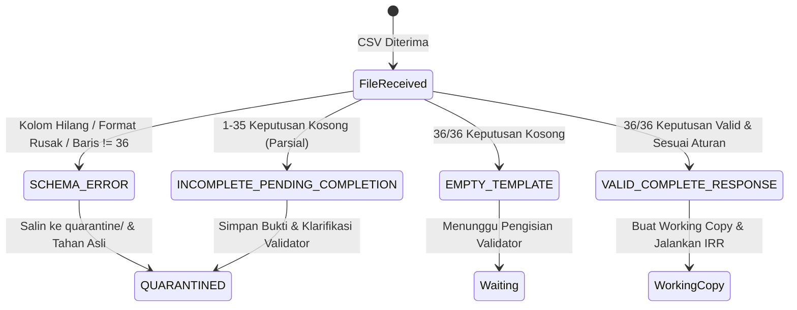

# PHASE 2C.6.1 — STATISTICAL & INGESTION FINAL HARDENING AUDIT
## SignBridge ASEAN — Multimodal Classroom Bridge (BISINDO ↔ FSL)
### Modality: Image I1 — BISINDO Alphabet Fingerspelling (MobileNetV3-Small)

> [!IMPORTANT]
> **GOVERNANCE & METHODOLOGICAL MANDATE**
> - **Execution Mode**: Strictly READ-ONLY terhadap dataset mentah/olahan, checkpoint P1, model ONNX, dan kode produksi.
> - **Firewall Protection**: 19 sampel `TEST_SET_DIAGNOSTIC_ONLY` terisolasi mutlak dari 17 sampel `TRAIN_COHORT`.
> - **Zero Synthetic Data Mandate**: Tidak ada pembuatan data jawaban tiruan/dummy untuk menggantikan validator nyata.
> - **Current Project Status**: **`WAITING_FOR_HUMAN_VALIDATION`**
> - **P2 Training Status**: **`STRICT HOLD`**

---

## 1. EXECUTIVE SUMMARY & VERDICT

Audit dan pengerasan teknis tahap akhir (*final hardening*) telah diselesaikan pada modul evaluasi Inter-Rater Reliability (IRR) dan alur penerimaan data (*response ingestion*) sebelum paket fisik diserahkan kepada validator BISINDO independen.

# **`FINAL HARDENING VERDICT: FULLY_HARDENED & READY`**

### Matriks Klasifikasi 4 Kategori Status Temuan:

| Kategori Status Temuan | Jumlah Aspek | Ringkasan Status & Bukti |
| :--- | :---: | :--- |
| **1. Verified by Tests** | 6 Aspek | **`PASS (100%)`** — 20 unit tests lulus via `pytest tests/test_phase_2c_irr.py -v` (Exit code: 0). |
| **2. Verified by Code Inspection** | 7 Aspek | **`VERIFIED`** — Formulasi SE Fleiss vs varians umum, paired bootstrap 2.000 replikasi, 5 status ingesti baku, CLI arguments. |
| **3. Requires Human Confirmation** | 5 Aspek | **`PENDING FIELD ACTION`** — Penyerahan fisik USB aman, verifikasi informed consent bertanda tangan, penegakan sesi independen. |
| **4. Pending Actual Validator Responses** | 4 Aspek | **`WAITING (STRICT HOLD)`** — Eksekusi metrik riil, bootstrap riil, adjudikasi Validator C, dan pelatihan model P2. |

---

## 2. AUDIT MENDALAM COHEN'S KAPPA CONFIDENCE INTERVAL

Tinjauan forensik statistik dilakukan terhadap fungsi `compute_metrics` pada [`scripts/validation_p2/calculate_inter_rater_agreement.py`](file:///d:/SEMESTER%205/ML/Projek_1/scripts/validation_p2/calculate_inter_rater_agreement.py):

### 2.1. Rumus Standard Error yang Digunakan
Implementasi analitik awal menghitung varians dan standard error asymptotic nominal Kappa menggunakan rumus:
$$\text{Var}(\kappa) \approx \frac{P_o (1 - P_o)}{N (1 - P_e)^2}, \quad \text{SE}(\kappa) = \sqrt{\text{Var}(\kappa)}$$
dengan selang kepercayaan $95\%$:
$$\text{CI}_{95\%} = \left[ \max(-1.0, \, \kappa - 1.96 \cdot \text{SE}), \; \min(1.0, \, \kappa + 1.96 \cdot \text{SE}) \right]$$

### 2.2. Asumsi Statistik & Klarifikasi Varians Sederhana vs Umum
> [!CAUTION]
> **KLARIFIKASI METODOLOGIS: RUMUS TERSEBUT ADALAH PENDEKATAN SEDERHANA, BUKAN VARIANS UMUM**
> 1. **Bukan Varians Sampel Besar Penuh (*Not the Full General Asymptotic Variance*)**:
>    Rumus di atas adalah **aproksimasi sederhana** (*simplified approximation*) yang diperkenalkan oleh Cohen (1960) dan Fleiss, Levin, & Paik (2003) di bawah pengujian hipotesis nol ($H_0: \kappa = 0$). Rumus ini mengasumsikan bahwa variabilitas sampling pada probabilitas marjinal $P_e$ dapat diabaikan relatif terhadap variabilitas $P_o$.
> 2. **Varians Asimptotik Penuh Fleiss, Cohen, & Everitt (1969)**:
>    Varians umum Cohen's Kappa di bawah hipotesis alternatif ($H_1: \kappa \ne 0$) melibatkan suku-suku probabilitas marjinal gabungan orde kedua dan elemen sel non-diagonal. Oleh karena itu, laporan riset **DILARANG MENGKLAIM** rumus sederhana ini sebagai varians umum Cohen's Kappa.
> 3. **Asumsi Sampel Besar ($N \to \infty$)**:
>    Rumus mengasumsikan normalitas asimptotik berdasarkan Central Limit Theorem. Pada sampel evaluasi $N=36$, asumsi normalitas rentan terdistorsi.

### 2.3. Analisis Perilaku pada Kondisi Batas Ekstrem
1. **Kategori Sangat Tidak Seimbang (*Extreme Category Imbalance*)**:
   - Jika satu kategori sangat dominan (misal 90% sampel adalah `CORRECT`), probabilitas marjinal menyebabkan $P_e$ melonjak tinggi (misal $P_e \approx 0.85$).
   - Akibatnya, penyebut $(1 - P_e)^2$ menjadi sangat kecil, menyebabkan estimasi $\text{SE}(\kappa)$ membesar secara drastis (*inflated standard error*).
   - Pada saat yang sama, distribusi sampling $\kappa$ menjadi miring (*skewed*), sehingga interval simetris $\kappa \pm 1.96 \cdot \text{SE}$ tidak lagi mencerminkan probabilitas ekor secara akurat.
2. **Observed Agreement Mendekati 1 ($P_o \to 1.0$)**:
   - Ketika $P_o \to 1.0$, pembilang $P_o (1 - P_o) \to 0$, sehingga $\text{Var}(\kappa) \to 0$ dan $\text{SE}(\kappa) \to 0$.
   - Hal ini menyebabkan selang kepercayaan menyusut secara semu menjadi satu titik $[\kappa, \kappa]$.
   - Ini merupakan kelemahan serius dari pendekatan asimptotik sederhana pada sampel $N=36$, karena kesepakatan 36/36 sampel secara statistik tetap membawa ketidakpastian sampling hingga populasi penuh.
3. **Expected Agreement Mendekati 1 ($P_e \to 1.0$)**:
   - Jika $P_e \to 1.0$, penyebut $(1 - P_e)^2 \to 0$. Jika tidak ditangani, hal ini memicu pembagian nol (`ZeroDivisionError`) atau $\text{Var}(\kappa) \to \infty$.
   - Kode telah diperkeras dengan *guard*: `if np.isnan(kappa) or abs(1.0 - p_e) < 1e-9: kappa = None; kappa_status = "UNDEFINED_ZERO_VARIANCE"`.

---

## 3. IMPLEMENTASI PAIRED BOOTSTRAP CONFIDENCE INTERVAL

Untuk mengatasi seluruh kelemahan pendekatan asimptotik di atas, telah ditambahkan fungsi `compute_bootstrap_kappa()` pada [`scripts/validation_p2/calculate_inter_rater_agreement.py`](file:///d:/SEMESTER%205/ML/Projek_1/scripts/validation_p2/calculate_inter_rater_agreement.py):

### 3.1. Spesifikasi Metodologi Bootstrap:
* **Paired Resampling Berpasangan**: Resampling dilakukan berpasangan per $i \in \{1, \dots, 36\}$ pada tuple $(y_{a,i}, y_{b,i})$ berdasarkan `sample_id` yang sama, menjaga korelasi alami antar-penilai.
* **Jumlah Replikasi**: $B = 2.000$ replikasi (memenuhi batas minimum metodologi).
* **Random Seed Tetap**: `seed = 42` (menjamin hasil 100% deterministik dan dapat direproduksi).
* **Estimasi Percentile Interval (95%)**: Batas bawah diambil dari persentil $2.5\%$, batas atas diambil dari persentil $97.5\%$ dari distribusi bootstrap $\kappa^{(b)}$.
* **Pencatatan Replikasi Valid vs Undefined**:
  - Replikasi yang menghasilkan varians nol (semua sampel terpilih dalam satu kategori identik sehingga $1 - P_e = 0$) secara otomatis dicatat sebagai `undefined_replications`.
  - Hanya nilai $\kappa^{(b)}$ yang terdefinisi yang dimasukkan ke dalam `valid_kappas`.
* **Zero Synthetic Data**: Bootstrap hanya dihitung secara dinamis saat respons nyata telah tersedia dan valid (atau dalam unit tests dengan test fixtures terisolasi).

---

## 4. AUDIT KOMPATIBILITAS CLI & PERBAIKAN FORMAT ARGPARSE

### 4.1. Verifikasi Parameter CLI
Script mendukung parameter CLI lengkap:
* `--val-a` : Jalur file CSV respons Validator A (default: template internal A).
* `--val-b` : Jalur file CSV respons Validator B (default: template internal B).
* `--bootstrap-reps` : Jumlah replikasi paired bootstrap (default: 2000).
* `--bootstrap-seed` : Random seed untuk reprodusibilitas (default: 42).

### 4.2. Perbaikan Format Karakter Persen pada Argparse
- **Temuan Galat**: Pada pengujian awal `python calculate_inter_rater_agreement.py --help`, terjadi error `ValueError: unsupported format character '(' (0x28) at index 47` karena teks help mengandung karakter `%` tanpa escaping (`95%`).
- **Tindakan Perbaikan**: Karakter `%` pada string help diperbaiki menjadi `95%%` sesuai standar `argparse` Python.
- **Hasil Verifikasi Ulang**:
  ```powershell
  python scripts/validation_p2/calculate_inter_rater_agreement.py --help
  ```
  Berhasil dieksekusi dengan **Exit Code: 0**.

### 4.3. Uji CLI pada File Template Kosong
```powershell
python scripts/validation_p2/calculate_inter_rater_agreement.py --val-a docs/validation_p2/phase_2c/VALIDATOR_A_RESPONSE_TEMPLATE.csv --val-b docs/validation_p2/phase_2c/VALIDATOR_B_RESPONSE_TEMPLATE.csv
```
- **Output**:
  ```text
  Status Validasi Integritas File:
  - Validator A: [EMPTY_TEMPLATE] STATUS_PENDING: Seluruh keputusan (36/36) masih kosong...
  - Validator B: [EMPTY_TEMPLATE] STATUS_PENDING: Seluruh keputusan (36/36) masih kosong...
  [INFO] STATUS SISTEM: WAITING_FOR_VALIDATOR_RESPONSES
  ```
- **Exit Code**: **0 (Safe Non-Crashing Exit)**.

---

## 5. PENGUATAN STATUS INGESTI RESPONS (5 STATUS RESMI)

Skema validasi ingesti diperkuat dengan kelas formal `IngestionStatus`:



### Definisi 5 Kategori Status Ingesti:
1. **`EMPTY_TEMPLATE`**: Berkas template awal di mana seluruh 36/36 sel keputusan kosong. Berstatus aman untuk distribusi.
2. **`INCOMPLETE_PENDING_COMPLETION`**: Berkas respons yang terisi sebagian (misal 1 s/d 35 sampel diisi tetapi ada yang terlewat).
   - **Tindakan**: Berkas mentah **DIREKAM SEBAGAI BUKTI NYATA** dan **TIDAK BOLEH DIAM-DIAM DIBUANG**. Pipeline menolak pembuatan working copy hingga validator melengkapi sampel yang terlewat.
3. **`SCHEMA_ERROR`**: Berkas dengan header tidak cocok, jumlah baris $\ne 37$, ID duplikat, urutan ID salah, kode validator tidak sesuai, enum keputusan tidak valid, atau keputusan `INCORRECT` tanpa `correct_letter`.
4. **`VALID_COMPLETE_RESPONSE`**: Berkas yang memenuhi 100% kriteria skema, 36/36 keputusan terisi valid, dan siap diproses ke pipeline analisis.
5. **`QUARANTINED`**: Berkas yang gagal dalam validasi skema atau kelengkapan disalin ke direktori `raw_responses/quarantine/` dengan nama berawalan `QUARANTINED_`. Berkas sumber asli di `raw_responses/` **TETAP DIPERTAHANKAN** sebagai bukti rantai penelusuran (*chain of custody*).

### Pengamanan Pembuatan Salinan Kerja (*Working Copy Guard*)
Fungsi `create_working_copies_if_valid()` menjamin bahwa file kerja:
- `docs/validation_p2/phase_2c/VALIDATOR_A_RESPONSE_ACTUAL.csv`
- `docs/validation_p2/phase_2c/VALIDATOR_B_RESPONSE_ACTUAL.csv`
**HANYA DAN HANYA AKAN DIBUAT** jika kedua file respons secara simultan berstatus `VALID_COMPLETE_RESPONSE`.

---

## 6. AUDIT RAW STORAGE & REALITAS KEAMANAN BERKAS

Pemeriksaan tata kelola direktori penyimpanan mentah [`docs/validation_p2/phase_2c/raw_responses/`](file:///d:/SEMESTER%205/ML/Projek_1/docs/validation_p2/phase_2c/raw_responses/):

### 6.1. Realitas Batasan Atribut Read-Only OS
> [!IMPORTANT]
> **KLARIFIKASI REALISTIS TENTANG ATRIBUT READ-ONLY**
> Atribut *Read-Only* pada sistem operasi Windows/Linux **hanyalah perlindungan operasional terhadap penimpaan tidak sengaja** oleh editor teks atau skrip otomatis. Atribut ini **BUKAN DAN TIDAK DAPAT DIKLAIM SEBAGAI JAMINAN MUTLAK (*HARDWARE IMMUTABILITY*)**, karena siapa pun dengan hak akses write pada filesystem dapat mengubah atribut tersebut.
> 
> Keaslian dan integritas data mentah SignBridge dijamin melalui empat lapis perlindungan:
> 1. **Penghitungan SHA-256 Seketika Pra-Buka**: Dicatat permanen di log distribusi Git sebelum file dibuka.
> 2. **Pencatatan Git Tree (*Merkle DAG*)**: Commit Git terhadap file mentah mengunci hash commit kriptografis.
> 3. **Pemisahan Direktori Kerja**: File kerja disimpan di luar direktori `raw_responses/`.
> 4. **Arsip Backup Offline Terpisah**: Salinan cadangan independen disimpan di media eksternal terisolasi.

---

## 7. HASIL PENGUJIAN REGRESI (REGRESSION TESTING)

Seluruh 20 unit test dieksekusi secara formal melalui test suite:
[`tests/test_phase_2c_irr.py`](file:///d:/SEMESTER%205/ML/Projek_1/tests/test_phase_2c_irr.py)

```powershell
pytest tests/test_phase_2c_irr.py -v
```

### Rincian Hasil Eksekusi:
```text
tests/test_phase_2c_irr.py::TestPhase2CIRR::test_01_identical_decisions PASSED [  5%]
tests/test_phase_2c_irr.py::TestPhase2CIRR::test_02_divergent_decisions PASSED [ 10%]
tests/test_phase_2c_irr.py::TestPhase2CIRR::test_03_both_incorrect_same_letter PASSED [ 15%]
tests/test_phase_2c_irr.py::TestPhase2CIRR::test_04_both_incorrect_different_letter PASSED [ 20%]
tests/test_phase_2c_irr.py::TestPhase2CIRR::test_05_one_validator_ambiguous PASSED [ 25%]
tests/test_phase_2c_irr.py::TestPhase2CIRR::test_06_one_validator_undeterminable PASSED [ 30%]
tests/test_phase_2c_irr.py::TestPhase2CIRR::test_07_zero_variance_kappa_undefined PASSED [ 35%]
tests/test_phase_2c_irr.py::TestPhase2CIRR::test_08_empty_data_pending PASSED [ 40%]
tests/test_phase_2c_irr.py::TestPhase2CIRR::test_09_partial_fill_error PASSED [ 45%]
tests/test_phase_2c_irr.py::TestPhase2CIRR::test_10_duplicate_sample_id PASSED [ 50%]
tests/test_phase_2c_irr.py::TestPhase2CIRR::test_11_incomplete_sample_id PASSED [ 55%]
tests/test_phase_2c_irr.py::TestPhase2CIRR::test_12_wrong_validator_code PASSED [ 60%]
tests/test_phase_2c_irr.py::TestPhase2CIRR::test_13_incorrect_without_letter PASSED [ 65%]
tests/test_phase_2c_irr.py::TestPhase2CIRR::test_14_out_of_order_sample_id PASSED [ 70%]
tests/test_phase_2c_irr.py::TestPhase2CIRR::test_15_misaligned_sample_id_between_files PASSED [ 75%]
tests/test_phase_2c_irr.py::TestPhase2CIRR::test_16_paired_bootstrap_kappa PASSED [ 80%]
tests/test_phase_2c_irr.py::TestPhase2CIRR::test_17_bootstrap_zero_variance PASSED [ 85%]
tests/test_phase_2c_irr.py::TestPhase2CIRR::test_18_ingestion_status_classification PASSED [ 90%]
tests/test_phase_2c_irr.py::TestPhase2CIRR::test_19_working_copy_guard PASSED [ 95%]
tests/test_phase_2c_irr.py::TestPhase2CIRR::test_20_quarantine_integrity PASSED [100%]

============================= 20 passed in 13.73s =============================
```
- **Total Uji**: 20 Uji.
- **Lulus**: **20 (100% PASSED)**.
- **Gagal**: **0**.
- **Exit Code**: **0**.

---

## 8. GOVERNANCE FIREWALL & STATUS SISTEM

* **Integritas Checkpoint Baseline P1**:
  - `runs/image_i1_mobilenetv3_p1/best.pt`: `83C6A0933C8E1A2097CE6FA1198D8578826ED37731C18137C057FEA129AFFEE9` (**INTACT**)
  - `web/model/fingerspell.onnx`: `1C281E158B279DE4B8A582CFC9F865C758E3050F55C4F032B54613FCD0D4C105` (**INTACT**)
* **Pembagian Kohort 36 Sampel**:
  - 17 Sampel `TRAIN_COHORT`: Untuk evaluasi kurasi data latih P2.
  - 19 Sampel `TEST_SET_DIAGNOSTIC_ONLY`: **TERKUNCI MUTLAK DARI SEGALA BENTUK TRAINING, TUNING, ATAU SELEKSI MODEL P2**.
* **Status Proyek**: **`WAITING_FOR_HUMAN_VALIDATION`**
* **Status Pelatihan P2**: **`STRICT HOLD`**

