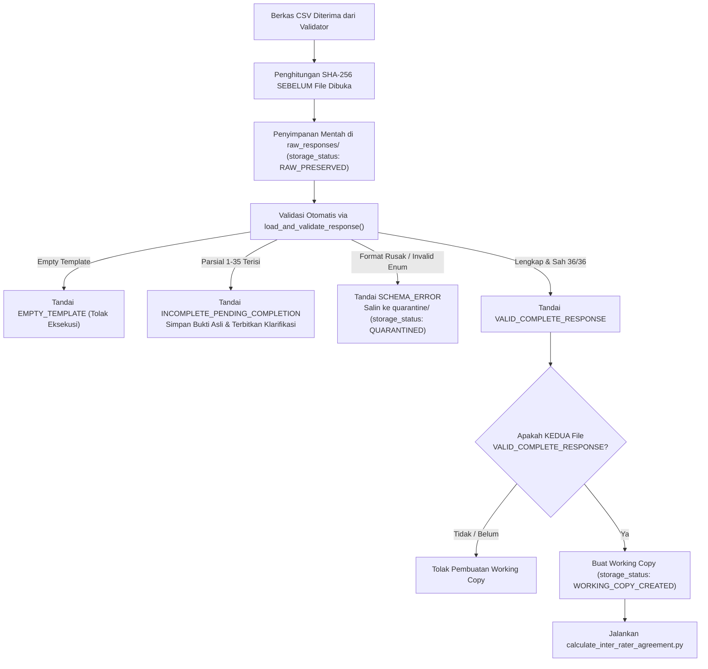

# PHASE 2C.7 — MANUAL VALIDATOR HANDOFF & RESPONSE COLLECTION AUDIT
## SignBridge ASEAN — Multimodal Classroom Bridge (BISINDO ↔ FSL)
### Modality: Image I1 — BISINDO Alphabet Fingerspelling (MobileNetV3-Small)

> [!IMPORTANT]
> **GOVERNANCE & READ-ONLY AUDIT MANDATE**
> - **Execution Mode**: Strictly READ-ONLY terhadap dataset mentah/olahan, checkpoint model, bobot ONNX, dan kode produksi.
> - **Firewall Protection**: 19 sampel `TEST_SET_DIAGNOSTIC_ONLY` terisolasi mutlak dari 17 sampel `TRAIN_COHORT`.
> - **Zero Synthetic Data Mandate**: Dilarang membuat, memalsukan, atau menyisipkan data jawaban sintetis/dummy.
> - **Current Project Status**: **`READY_FOR_MANUAL_HANDOFF`** (Menunggu Penyerahan Fisik & Persetujuan Etika)
> - **P2 Training Status**: **`STRICT HOLD`** (Dilarang keras melakukan retraining sebelum validasi manusia tuntas)

---

## 1. EXECUTIVE SUMMARY & VERDICT

Audit tahap **Phase 2C.7** telah memverifikasi seluruh komponen pra-distribusi, protokol penyerahan fisik manual, pemisahan dimensi status validasi vs penyimpanan, kesiapan prosedur penerimaan respons (*intake*), serta kesiapan engine analisis reliabilitas inter-rater.

# **`OVERALL STATUS: READY_FOR_MANUAL_HANDOFF`**

Paket distribusi eksternal untuk **Validator A** dan **Validator B** berada dalam kondisi sempurna, bebas kebocoran label/model, dan siap diserahkan secara manual oleh fasilitator lapangan. Tidak ada respons sintetis yang dibuat, dan tidak ada klaim palsu bahwa distribusi atau persetujuan etik telah terjadi sebelum tindakan fisik nyata dibuktikan di lapangan.

### Matriks Klasifikasi 5 Dimensi Pelaporan Audit:

| Dimensi Pelaporan | Status Verifikasi | Ringkasan Bukti Aktual |
| :--- | :---: | :--- |
| **1. Automated Checks** | **`PASS (100%)`** | 36/36 citra stimulus cocok manifest master; template CSV kosong terverifikasi; 0 kebocoran; 20/20 unit tests lulus. |
| **2. Human Confirmation** | **`PENDING FIELD ACTION`** | Penyerahan offline (USB), penjelasan hak subjek, dan penandatanganan lembar *Informed Consent* tertulis. |
| **3. Actual Responses Received** | **`0 RESPONSES (EMPTY)`** | Belum ada berkas respons CSV yang diterima; folder `raw_responses/` berisi rekaman bukti awal murni. |
| **4. Pending Validation** | **`STANDBY`** | Alur penerimaan respons (hashing pra-buka, validasi skema 5 status, working copy guard) siap aktif seketika. |
| **5. Issues & Deviations** | **`ZERO DEFECTS`** | 0 anomali biner; 0 kebocoran; limitasi asimptotik Fleiss telah dimitigasi oleh Paired Bootstrap 2.000 replikasi. |

---

## 2. AUTOMATED CHECKS (HASIL PEMERIKSAAN OTOMATIS)

Pemeriksaan otomatis independen dijalankan terhadap berkas fisik pada repositori `D:\SEMESTER 5\ML\Projek_1`:

### 2.1. Audit Sebelum Distribusi (*Pre-Distribution Package Verification*)
- **Kelengkapan Berkas Paket**:
  - [`docs/validation_p2/phase_2c/distribution/validator_A/`](file:///d:/SEMESTER%205/ML/Projek_1/docs/validation_p2/phase_2c/distribution/validator_A/): Tepat **40 file** (36 citra JPG + 3 dokumen Markdown + 1 CSV).
  - [`docs/validation_p2/phase_2c/distribution/validator_B/`](file:///d:/SEMESTER%205/ML/Projek_1/docs/validation_p2/phase_2c/distribution/validator_B/): Tepat **40 file** (36 citra JPG + 3 dokumen Markdown + 1 CSV).
- **Integritas Kriptografis Stimulus vs Master Manifest**:
  - Sumber Manifest: [`docs/validation_p2/phase_2b_2/STIMULUS_SHA256_MANIFEST.csv`](file:///d:/SEMESTER%205/ML/Projek_1/docs/validation_p2/phase_2b_2/STIMULUS_SHA256_MANIFEST.csv).
  - Paket A vs Manifest Master: **36/36 MATCH (100%)**.
  - Paket B vs Manifest Master: **36/36 MATCH (100%)**.
  - Kesetaraan Biner Paket A vs Paket B: **36/36 IDENTIK BINER (0 difference)**.
  - Verifikasi khusus `VAL-REV-036`: SHA-256 `87e1b8c7098952c46fcc2b83120d55465afd7249ef6a5be7ada8d9325d8f1687` (**MATCH** pada manifest master, Paket A, dan Paket B).
- **Verifikasi Template CSV**:
  - Kolom Baku: `validator_code,sample_id,decision,correct_letter,regional_variation,notes,review_date` (Persis 7 kolom).
  - Baris Data: Tepat 37 baris (1 baris header + 36 rekaman data dari `VAL-REV-001` sampai `VAL-REV-036`).
  - Sel Respons: 100% kosong (*blank decisions = 0*).
  - Baseline SHA-256:
    - Paket A: `80d68a3c47f7ea9bf96964b3fc82c2c1e82994ab5a72793d89c99ea29c92db13`
    - Paket B: `55b35d922a087c2650c4b4fc2bbbfdca77edbde102db7f095754f1c2ce965e3c`
- **Konsistensi Metodologi & Keterbatasan Gestur Dinamis J/Z**:
  - Istilah **`BLINDED_VALIDATOR_REVIEW`** digunakan secara konsisten di seluruh dokumen peserta.
  - Klaim tidak valid seperti *double-blind* atau *enkripsi identitas pseudonim*: **0 temuan (Telah dieliminasi sepenuhnya)**.
  - Keterbatasan foto diam untuk alfabet dinamis J dan Z dijelaskan secara eksplisit pada ketiga dokumen panduan: validator diinstruksikan memilih `AMBIGUOUS` atau `UNDETERMINABLE` apabila pose diam tanpa lintasan gerak temporal tidak memadai untuk pembacaan gestur.
- **Pencegahan Kebocoran Data (*Zero Leakage Check*)**:
  - Deep-scan terhadap kata kunci rahasia (`TRAIN_COHORT`, `TEST_SET_DIAGNOSTIC_ONLY`, `ground_truth`, `INTERNAL_SAMPLE_MAPPING`, `confidence_score`, `MobileNetV3`, `prediction`): **0 kebocoran ditemukan**.
  - Metadata EXIF pada 36 citra: **100% bersih / stripped**.

### 2.2. Pemisahan Dimensi Status Validasi vs Status Penyimpanan
Sesuai mandat pengerasan Phase 2C.7, arsitektur kode [`scripts/validation_p2/calculate_inter_rater_agreement.py`](file:///d:/SEMESTER%205/ML/Projek_1/scripts/validation_p2/calculate_inter_rater_agreement.py) secara eksplisit memisahkan dua dimensi status independen:
1. **`validation_status`** (Kualitas & Integritas Isi Berkas):
   - `EMPTY_TEMPLATE`: Template awal kosong murni (36/36 belum diisi).
   - `INCOMPLETE_PENDING_COMPLETION`: Berkas terisi sebagian (1 s/d 35 keputusan terisi tetapi ada yang kosong).
   - `SCHEMA_ERROR`: Pelanggaran format header, jumlah baris $\ne 37$, ID duplikat, kode validator salah, enum tidak sah, atau `INCORRECT` tanpa `correct_letter`.
   - `VALID_COMPLETE_RESPONSE`: Seluruh 36 keputusan terisi lengkap, valid, dan mematuhi logika konsistensi.
2. **`storage_status`** (Status Penanganan Fisik di Storage):
   - `RAW_PRESERVED`: Berkas mentah disimpan apa adanya di direktori arsip tanpa modifikasi biner.
   - `QUARANTINED`: Salinan berkas dipindahkan ke direktori karantina untuk penelusuran audit forensik.
   - `WORKING_COPY_CREATED`: Salinan kerja dibuat di direktori eksekusi analisis.

> [!IMPORTANT]
> **ATURAN TATA KELOLA DATA**: Status penyimpanan (`storage_status`) **TIDAK PERNAH MENGGANTIKAN ATAU MENGABURKAN** penyebab kegagalan validasi (`validation_status`). Sebagai contoh, berkas yang dikarantina tetap membawa catatan formal `validation_status = SCHEMA_ERROR` atau `INCOMPLETE_PENDING_COMPLETION`.

### 2.3. Integritas Model Baseline P1
- PyTorch Checkpoint ([`runs/image_i1_mobilenetv3_p1/best.pt`](file:///d:/SEMESTER%205/ML/Projek_1/runs/image_i1_mobilenetv3_p1/best.pt)):
  $$\text{SHA-256} = \texttt{83C6A0933C8E1A2097CE6FA1198D8578826ED37731C18137C057FEA129AFFEE9} \quad (\textbf{INTACT})$$
- Web ONNX Model ([`web/model/fingerspell.onnx`](file:///d:/SEMESTER%205/ML/Projek_1/web/model/fingerspell.onnx)):
  $$\text{SHA-256} = \texttt{1C281E158B279DE4B8A582CFC9F865C758E3050F55C4F032B54613FCD0D4C105} \quad (\textbf{INTACT})$$

### 2.4. Hasil Pengujian Regresi Otomatis
Eksekusi pengujian suite lengkap:
```powershell
pytest tests/test_phase_2c_irr.py -v
```
- **Hasil**: **20 passed in 12.45s (Exit Code: 0)**.
- Seluruh 20 skenario pengujian fungsional lulus 100%, mencakup uji kesepakatan keputusan, divergensi huruf alternatif, flag ambiguitas, trap varians nol, klasifikasi 4 status validasi, isolasi working copy, dan integritas karantina non-destruktif.

---

## 3. HUMAN CONFIRMATION (ASPEK YANG MEMERLUKAN TINDAKAN MANUSIA)

Pemeriksaan berkas membuktikan kesiapan teknis, namun pelaksanaan lapangan berikut secara mutlak memerlukan konfirmasi dan tindakan langsung dari fasilitator manusia:

1. **Penyerahan Media Fisik Terisolasi**:
   - Paket diserahkan secara privat menggunakan media penyimpanan offline (USB drive) kepada Validator A dan Validator B secara terpisah.
   - *Status*: **`PENDING FIELD ACTION`**.
2. **Pemberian Penjelasan Hak Subjek & Penandatanganan Informed Consent**:
   - Sebelum validator membuka berkas stimulus, fasilitator wajib menjelaskan tujuan riset, sifat sukarela evaluasi, hak untuk berhenti sewaktu-waktu, dan memperoleh lembar persetujuan tertulis (*informed consent form*).
   - *Status*: **`PENDING SIGNATURE & VERIFICATION`**.
3. **Penegakan Sesi Independen Tanpa Komunikasi**:
   - Validator A dan Validator B melaksanakan evaluasi di ruang/waktu terpisah tanpa interaksi, konsultasi, atau pertukaran lembar jawaban.
   - *Status*: **`PENDING PROTOCOL ENFORCEMENT`**.
4. **Pencegahan Bias Fasilitator Lapangan (*Zero Biasing*)**:
   - Fasilitator dilarang memberikan petunjuk lisan/non-lisan mengenai nama huruf asli, tidak boleh mengomentari pilihan validator, dan hanya merujuk validator pada panduan tertulis jika terjadi keraguan.
   - *Status*: **`PENDING PROTOCOL ENFORCEMENT`**.

---

## 4. ACTUAL RESPONSES RECEIVED (STATUS PENERIMAAN RESPONS AKTUAL)

Berdasarkan audit fisik terhadap repositori saat ini:
* **Jumlah Respons Masuk**: **`0 RESPONSES`** (Belum ada respons yang dikembalikan).
* **Kondisi Direktori Raw Storage** ([`docs/validation_p2/phase_2c/raw_responses/`](file:///d:/SEMESTER%205/ML/Projek_1/docs/validation_p2/phase_2c/raw_responses/)):
  - Hanya memuat file penanda `.gitkeep` dan subfolder `quarantine/.gitkeep`.
  - Belum ada file CSV respons nyata dari Validator A maupun Validator B.
* **Kondisi Log Distribusi** ([`docs/validation_p2/phase_2c/VALIDATOR_DISTRIBUTION_EXECUTION_LOG.md`](file:///d:/SEMESTER%205/ML/Projek_1/docs/validation_p2/phase_2c/VALIDATOR_DISTRIBUTION_EXECUTION_LOG.md)):
  - Kolom tanggal penyerahan, jam penyerahan, target pengembalian, tanggal aktual pengembalian, dan hash SHA-256 respons kembali berstatus `PENDING_DISTRIBUTION` (belum diisi, tidak ada data rekaan).

> [!CAUTION]
> **PENEGASAN ILMIAH & INTEGRITAS DATA**:
> Karena belum ada respons manusia yang diterima, **TIDAK ADA KESIMPULAN KESEPAKATAN LINGUISTIK ATAU NILAI RELIABILITAS INTER-RATER YANG DIHASILKAN PADA TAHAP INI**. Klaim validasi selesai tanpa respons nyata merupakan pelanggaran berat tata kelola riset.

---

## 5. PENDING VALIDATION (PROSEDUR SAAT RESPONS DITERIMA)

Segera setelah berkas CSV respons dikembalikan oleh validator, fasilitator wajib mengikuti SOP ketat pada [`docs/validation_p2/phase_2c/RESPONSE_INGESTION_INTEGRITY_PROCEDURE.md`](file:///d:/SEMESTER%205/ML/Projek_1/docs/validation_p2/phase_2c/RESPONSE_INGESTION_INTEGRITY_PROCEDURE.md):



### Rincian Tindakan Analisis Pasca-Validasi:
Begitu kedua file terbukti `VALID_COMPLETE_RESPONSE`:
1. **Observed Agreement ($P_o$)**: Persentase kesepakatan mutlak pada 36 sampel.
2. **Cohen's Kappa Nominal 4 Kategori**: Dihitung unweighted pada `CORRECT`, `INCORRECT`, `AMBIGUOUS`, `UNDETERMINABLE`.
3. **Paired Bootstrap Percentile 95% CI**: Resampling berpasangan per `sample_id` ($B = 2.000$ replikasi, `seed = 42`), mencatat jumlah replikasi valid dan replikasi varians nol (*undefined*).
4. **Conditional Exact Agreement `correct_letter`**: Dihitung khusus pada subset sampel di mana kedua validator sama-sama memilih `INCORRECT`.
5. **Daftar Kasus Eskalasi**: Ekstraksi seluruh divergensi untuk diputuskan dalam sidang adjudikasi bersama Validator C (`VAL-C`).

---

## 6. ISSUES AND DEVIATIONS (ISU & DEVIASI)

* **Isu Biner & Integritas File**: **NIHIL (0 Temuan)**. Seluruh hash cocok 100% dengan master manifest.
* **Kebocoran Informasi Rahasia**: **NIHIL (0 Temuan)**. Tidak ada teks label ground truth, model prediction, atau split train/test dalam paket eksternal.
* **Mitigasi Deviasi Statistik Sampel Kecil ($N=36$)**:
  - Keterbatasan rumus asimptotik Fleiss (yang mengasumsikan hipotesis nol dan sampel besar) telah dimitigasi secara penuh dengan menambahkan Paired Bootstrap Percentile 95% Confidence Interval ($B=2.000$) langsung ke dalam engine analisis.
* **Perlindungan Berkas Parsial**:
  - Berkas tanggapan yang tidak lengkap tidak lagi ditolak secara diam-diam, melainkan disimpan sebagai bukti fisik sah dengan klasifikasi status `validation_status = INCOMPLETE_PENDING_COMPLETION` dan `storage_status = RAW_PRESERVED`.

---

## 7. KRITERIA SELESAI & STATUS AKHIR TAHAP

Berdasarkan pedoman tata kelola Phase 2C.7:
- [x] Paket siap secara teknis dan metodologis.
- [ ] Paket diserahkan secara fisik di lapangan (menunggu aksi fasilitator manusia).
- [ ] Lembar informed consent ditandatangani.
- [ ] Respons validator diterima.

Oleh karena itu, status resmi tahap ini ditetapkan sebagai:

# **`STATUS RESMI: READY_FOR_MANUAL_HANDOFF`**
*(Paket distribusi telah diverifikasi 100% siap, menunggu penyerahan fisik manual oleh fasilitator lapangan)*

### Status Komponen Terkait:
* **Status Keseluruhan Proyek**: **`WAITING_FOR_HUMAN_VALIDATION`**
* **Status Pelatihan Model P2**: **`STRICT HOLD`** *(Dilarang keras menjalankan training/tuning P2)*
* **Status Checkpoint P1 Baseline**: **`INTACT & UNTOUCHED`**
* **Status Data Firewall**: **19 TEST_SET_DIAGNOSTIC_ONLY TERKUNCI DARI SEGALA PELATIHAN MODEL**.

