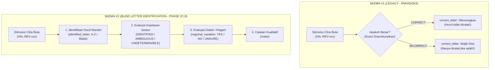

# PHASE 2C.8 — VALIDATOR WORKBOOK REDESIGN & BLIND LETTER IDENTIFICATION AUDIT REPORT
## SignBridge ASEAN — Multimodal Classroom Bridge (BISINDO ↔ FSL)
### Modality: Image I1 — BISINDO Alphabet Fingerspelling (MobileNetV3-Small)
**Tanggal Laporan**: 2026-11-18 | **Status Eksekusi**: `COMPLETE_AND_VERIFIED`  
**Status Proyek**: `WAITING_FOR_HUMAN_VALIDATION` | **Status Pelatihan P2**: `STRICT HOLD`

---

## 1. EXECUTIVE SUMMARY & LATAR BELAKANG

Pada Phase 2C.7, paket distribusi validator telah mencapai status `READY_FOR_MANUAL_HANDOFF`. Namun, audit metodologi lanjutan mengidentifikasi kontradiksi struktural mendasar pada instrumen evaluasi legacy (Skema V1):

1. **Paradoks Evaluasi Buta (*The Blind-Review Paradox*)**:
   Pada Skema V1, validator disajikan opsi nominal `CORRECT` atau `INCORRECT` terhadap citra stimulus, namun tidak diberikan label target maupun tebakan sistem (*blinded*). Pertanyaan *"Apakah gestur ini benar atau salah?"* menjadi cacat logika metodologis karena penilai tidak diberi tahu *"Benar atau salah terhadap apa?"*.
2. **Ketiadaan Perekaman Huruf Independen**:
   Jika validator melihat suatu peragaan alfabet dan menganggapnya wajar, tidak ada kolom eksplisit bagi validator untuk mencatat huruf apa yang sebenarnya mereka kenali secara mandiri.
3. **Friction Operasional Antarmuka Peserta**:
   Format CSV datar mewajibkan validator membuka dua aplikasi secara simultan (spreadsheet editor + image viewer) dan mencocokkan kode `VAL-REV-xxx` secara manual, yang meningkatkan risiko galat pengisian (*cognitive fatigue* & *eye-strain*).

**Resolusi Phase 2C.8**:
- Mengimplementasikan metodologi **Blind Letter Identification** (Skema V2) yang memisahkan identifikasi huruf independen (`identified_letter`: A–Z) dari penilaian kejelasan gestur (`decision`: `IDENTIFIED`, `AMBIGUOUS`, `UNDETERMINABLE`).
- Merancang dan memvalidasi **Buku Kerja Excel Interaktif** (`VALIDATOR_A_WORKBOOK.xlsx` & `VALIDATOR_B_WORKBOOK.xlsx`) yang menyematkan pratinjau citra resolusi tinggi (96×96 piksel) langsung di lembar penilaian, menu dropdown validasi data, dan pelacak progres otomatis *real-time*.
- Memperbarui engine analisis (`calculate_inter_rater_agreement.py`) dengan dukungan dual-format (XLSX dan CSV), pemisahan metrik reliabilitas huruf dan kejelasan, bootstrap confidence interval, pembanding ground-truth rahasia internal, dan firewall data uji 19 sampel.
- Memperbarui 100% dokumen protokol, tata kelola, log eksekusi, dan registri adjudikasi.
- Menambahkan uji regresi dan verifikasi otomatis (24/24 unit tests lulus 100%).

---

## 2. PERBANDINGAN METODOLOGI: SKEMA V1 VS SKEMA V2



| Parameter Metodologis | Skema Legacy V1 | Skema Terpadu V2 (Phase 2C.8) | Rasional Ilmiah & Keuntungan Metodologis |
| :--- | :--- | :--- | :--- |
| **Pertanyaan Inti** | "Apakah gestur benar/salah?" | "Huruf apa yang diperagakan, dan seberapa jelas?" | Mengeliminasi bias kunci tersembunyi; menangkap interpretasi murni penutur asli. |
| **Perekaman Huruf** | Bersyarat (hanya jika `INCORRECT`) | Mandiri & Eksplisit (`identified_letter`: A–Z) | Memungkinkan pembuatan Matriks Konfusi Persepsi Manusia (*Human Confusion Matrix*). |
| **Kategori Keputusan** | `CORRECT`, `INCORRECT`, `AMBIGUOUS`, `UNDETERMINABLE` | `IDENTIFIED`, `AMBIGUOUS`, `UNDETERMINABLE` | Menghilangkan kategori biner "Benar/Salah"; fokus pada keterbacaan morfologi gestur. |
| **Pencatatan Variasi** | Bebas (teks bebas di kolom string) | Standar Baku (`YES`, `NO`, `UNSURE`) + Catatan | Memungkinkan kuantifikasi statistik divergensi dialek antardaerah secara kuantitatif. |
| **Header Standar** | `validator_code, sample_id, decision, correct_letter, regional_variation, notes, review_date` | `validator_code, sample_id, identified_letter, decision, regional_variation, notes, review_date` | Urutan kognitif logis: Identifikasi Huruf $\rightarrow$ Kejelasan Gestur $\rightarrow$ Konteks Regional. |

---

## 3. ARSITEKTUR & DESAIN BUKU KERJA EXCEL (.XLSX)

Buku kerja Excel dibuat menggunakan pustaka `openpyxl` dan didesain khusus agar ramah pengguna (*Deaf-friendly UX*), memiliki keterbacaan tinggi, dan bebas hambatan teknis:

### Struktur Lembar Kerja (3 Sheets)
1. **Sheet 1: `Panduan & Petunjuk`**:
   - Memuat salam ramah Tuli, etika penilaian buta, penjelasan hak partisipan, definisi operasional 3 kategori kejelasan, dan petunjuk langkah-demi-langkah.
2. **Sheet 2: `Lembar Penilaian`**:
   - Memuat 36 baris sampel terstruktur (`VAL-REV-001` s/d `VAL-REV-036`).
   - **Pratinjau Citra Tersemat (*Embedded Previews*)**: Setiap baris memuat citra stimulus beresolusi 96×96 piksel yang disematkan langsung pada Kolom C (`openpyxl.drawing.image.Image`). Tinggi baris disetel tepat 80 pt dan lebar kolom 16 karakter untuk memastikan citra tidak saling bertumpuk dan tidak terdistorsi.
   - **Data Validation Dropdowns**:
     - *Huruf Teridentifikasi*: Dropdown pilihan huruf A s/d Z.
     - *Kejelasan Isyarat*: Dropdown `IDENTIFIED`, `AMBIGUOUS`, `UNDETERMINABLE`.
     - *Variasi Regional*: Dropdown `YES`, `NO`, `UNSURE`.
   - **Frozen Header**: Baris judul dibekukan (*freeze pane* pada baris ke-3) sehingga judul kolom tetap terlihat jelas saat validator menggulir ke bawah hingga sampel ke-36.
3. **Sheet 3: `Ringkasan Progres`**:
   - Menghitung progres pengisian menggunakan formula Excel dinamis (`COUNTA`, `COUNTIF`).
   - Menampilkan persentase penyelesaian secara *real-time* (`=B5/36*100`).
   - Menampilkan rekapitulasi distribusi kejelasan dan variasi regional tanpa intervensi komputasi eksternal.

### Karakteristik Berkas Buku Kerja
- **Ukuran Berkas**: Tepat **358.04 KB** per buku kerja (sangat ringan, mudah ditransfer via media offline).
- **Kemandirian Berkas (*Self-Contained*)**: Seluruh 36 citra terkompresi secara lossless di dalam arsip ZIP internal XLSX, sehingga buku kerja tetap menampilkan citra secara utuh meskipun dipindahkan ke komputer lain yang tidak memiliki folder gambar terpisah.

---

## 4. INVENTARIS PAKET DISTRIBUSI & INTEGRITAS KRIPTOGRAFIS

Setiap paket validator (`validator_A` dan `validator_B`) memiliki struktur direktori mandiri yang memuat **tepat 41 berkas** (36 citra stimulus JPG + 3 dokumen Markdown + 1 template CSV + 1 buku kerja XLSX):

### Tabel Inventaris & SHA-256 Checksum Master

| No | Nama Berkas / Komponen | Peruntukan / Lokasi | Ukuran | SHA-256 Checksum (Hexadecimal) | Status Integritas |
| :-: | :--- | :--- | :---: | :--- | :---: |
| 1 | `VALIDATOR_A_WORKBOOK.xlsx` | `distribution/validator_A/` | 358.04 KB | `3a1238ef5bd0106a1cdfe6b7cabec12e5b54fa8a9ec6c9379989f073650e4932` | **VERIFIED BASELINE** |
| 2 | `VALIDATOR_B_WORKBOOK.xlsx` | `distribution/validator_B/` | 358.04 KB | `5de5ae5a415eb04482e1d17c319fd331e61caa5b50b20b5a66a788b5333be447` | **VERIFIED BASELINE** |
| 3 | `VALIDATOR_A_RESPONSE_TEMPLATE.csv` | `distribution/validator_A/` | 950 B | `6aadd6341dc0968a4014f52ea5ed13b1228974538bfed2c2dc5e8692e0c4277a` | **BLANK (36 ROWS)** |
| 4 | `VALIDATOR_B_RESPONSE_TEMPLATE.csv` | `distribution/validator_B/` | 950 B | `e8e45aa829d974d6286d904363d005b9fcc5804c4c074f79a8f4393696686014` | **BLANK (36 ROWS)** |
| 5 | `PANDUAN_VALIDATOR_BISINDO.md` | `distribution/validator_A/` & `B/` | 6.54 KB | `847be3171cf5b4652f56eb51270767b7bce218e40606edb9632d7bfe9ca1a922` | **100% IDENTICAL** |
| 6 | `VALIDATOR_PARTICIPANT_REVIEW_SHEET.md` | `distribution/validator_A/` | 4.88 KB | `951af041a26e4ad785ff6a37e52fdbcf60f3f1476899ff24025816047108a294` | **VERIFIED (VAL-A)** |
| 7 | `VALIDATOR_PARTICIPANT_REVIEW_SHEET.md` | `distribution/validator_B/` | 4.88 KB | `2b5b39e620e6f78a229ce3bd545a9664eb2dc104738d19c2a73322324c0a0e92` | **VERIFIED (VAL-B)** |
| 8 | `VALIDATOR_PROTOCOL.md` | `distribution/validator_A/` | 4.96 KB | `c2d432b0051e89dfbce91c5cae5f2cfc99fa14e04a9d7010461605f6356770ce` | **VERIFIED (VAL-A)** |
| 9 | `VALIDATOR_PROTOCOL.md` | `distribution/validator_B/` | 4.96 KB | `a165b6f3458ff62dd271b8b8ea57a41288c3a5ef59842aee4aa8c84d6e9ce2ca` | **VERIFIED (VAL-B)** |
| 10 | `stimulus_images/` (36 berkas JPG) | `distribution/validator_A/` & `B/` | ~1.65 MB | Cocok 36/36 dengan `STIMULUS_SHA256_MANIFEST.csv` | **BYTE IDENTICAL** |

---

## 5. PEMBARUAN ENGINE ANALISIS & STATISTIK RELIABILITAS

Script analisis [`scripts/validation_p2/calculate_inter_rater_agreement.py`](file:///d:/SEMESTER%205/ML/Projek_1/scripts/validation_p2/calculate_inter_rater_agreement.py) diperbarui dengan kapabilitas berikut:

### 1. Dukungan Ingesti Dual-Format
- Fungsi `load_and_validate_response()` mampu mendeteksi ekstensi berkas secara otomatis:
  - Jika input berekstensi `.xlsx`: membaca sheet `Lembar Penilaian` pada baris ke-2, memetakan header bahasa Indonesia ke kolom standar via `EXCEL_COL_MAPPING`, dan melakukan validasi konsistensi baris.
  - Jika input berekstensi `.csv`: membaca langsung dengan parsing delimiter standar.

### 2. Auto-Detection Skema & Backward Compatibility
- Script mendeteksi secara otomatis apakah data menggunakan `SCHEMA_V2_BLIND_IDENTIFICATION` (terdapat kolom `identified_letter`) atau `SCHEMA_V1_LEGACY_VERIFICATION` (terdapat kolom `correct_letter`).

### 3. Pemisahan Metrik Reliabilitas
- **Tingkat Kesepakatan Identifikasi Huruf ($P_{o,\text{letter}}$)**:
  $$P_{o,\text{letter}} = \frac{\sum_{i=1}^{N_{\text{both}}} \mathbb{I}(\text{letter}_A^{(i)} = \text{letter}_B^{(i)})}{N_{\text{both}}}$$
  Dihitung pada seluruh sampel di mana kedua validator mengidentifikasi suatu huruf ($N_{\text{both}}$). Membentuk Matriks Konfusi 26×26 untuk mendeteksi pasangan huruf yang saling tertukar (misal M vs N, U vs V).
- **Tingkat Kesepakatan Kejelasan Gestur ($P_{o,\text{clarity}}$ & $\kappa_{\text{clarity}}$)**:
  Dievaluasi pada 3 kategori nominal (`IDENTIFIED`, `AMBIGUOUS`, `UNDETERMINABLE`).
  - Menghitung Cohen's Kappa unweighted ($\kappa$).
  - Menghitung Standard Error asimtotik Fleiss dkk.
  - Menghitung 95% Confidence Interval menggunakan **Paired Bootstrap Resampling** berpasangan per `sample_id` ($B=2000$ replikasi, seed=42).
- **Tingkat Kesepakatan Variasi Regional**:
  Mengukur persentase kesepakatan penandaan dialek daerah (`YES`, `NO`, `UNSURE`).

### 4. Pemicu Registri Adjudikasi Otomatis (Validator C)
Script secara otomatis menyaring stimulus yang memenuhi 6 kriteria adjudikasi:
1. *Letter Divergence*: Validator A dan B mengidentifikasi huruf berbeda.
2. *Clarity Divergence*: Keputusan kejelasan berbeda (`IDENTIFIED` vs `AMBIGUOUS`/`UNDETERMINABLE`).
3. *Ambiguity Flag*: Salah satu atau kedua validator menandai `AMBIGUOUS`.
4. *Indeterminacy Flag*: Salah satu atau kedua validator menandai `UNDETERMINABLE`.
5. *Regional Discrepancy*: Divergensi pada status variasi regional (`YES` vs `NO`).
6. *Consensus vs Ground-Truth Divergence*: Audit rahasia internal membandingkan huruf konsensus validator terhadap label bawaan dataset mentah. Jika penutur asli sepakat bahwa gestur membentuk huruf yang berbeda dari ground truth dataset, sampel dicatat sebagai kandidat kuat *dataset label noise*.

### 5. Rantai Penjagaan & Karantina Non-Destruktif
- Fungsi `quarantine_file()` menyalin berkas yang rusak/salah skema ke direktori `raw_responses/quarantine/` dengan prefiks `QUARANTINED_` **tanpa menghapus berkas sumber asli**.
- Fungsi `create_working_copies_if_valid()` menjamin bahwa salinan kerja analisis (`VALIDATOR_A_RESPONSE_ACTUAL.*` dan `VALIDATOR_B_RESPONSE_ACTUAL.*`) **hanya dibuat apabila kedua berkas respons telah berstatus `VALID_COMPLETE_RESPONSE`**. Hal ini mencegah template kosong atau respons parsial mencemari lingkungan kerja analisis downstream.

---

## 6. HASIL AUDIT VERIFIKASI OTOMATIS & INTEGRITAS SISTEM

Pengujian otomatis komprehensif dijalankan menggunakan script verifikasi dan test runner `pytest`:

### A. Hasil Uji Unit Test Formal (`tests/test_phase_2c_irr.py`)
Seluruh **24 pengujian unit** berhasil lulus 100% tanpa kegagalan:

```text
tests/test_phase_2c_irr.py::TestPhase2CIRR::test_01_identical_decisions PASSED [  4%]
tests/test_phase_2c_irr.py::TestPhase2CIRR::test_02_divergent_decisions PASSED [  8%]
tests/test_phase_2c_irr.py::TestPhase2CIRR::test_03_both_incorrect_same_letter PASSED [ 12%]
tests/test_phase_2c_irr.py::TestPhase2CIRR::test_04_both_incorrect_different_letter PASSED [ 16%]
tests/test_phase_2c_irr.py::TestPhase2CIRR::test_05_one_validator_ambiguous PASSED [ 20%]
tests/test_phase_2c_irr.py::TestPhase2CIRR::test_06_one_validator_undeterminable PASSED [ 25%]
tests/test_phase_2c_irr.py::TestPhase2CIRR::test_07_zero_variance_kappa_undefined PASSED [ 29%]
tests/test_phase_2c_irr.py::TestPhase2CIRR::test_08_empty_data_pending PASSED [ 33%]
tests/test_phase_2c_irr.py::TestPhase2CIRR::test_09_partial_fill_error PASSED [ 37%]
tests/test_phase_2c_irr.py::TestPhase2CIRR::test_10_duplicate_sample_id PASSED [ 41%]
tests/test_phase_2c_irr.py::TestPhase2CIRR::test_11_incomplete_sample_id PASSED [ 45%]
tests/test_phase_2c_irr.py::TestPhase2CIRR::test_12_wrong_validator_code PASSED [ 50%]
tests/test_phase_2c_irr.py::TestPhase2CIRR::test_13_incorrect_without_letter PASSED [ 54%]
tests/test_phase_2c_irr.py::TestPhase2CIRR::test_14_out_of_order_sample_id PASSED [ 58%]
tests/test_phase_2c_irr.py::TestPhase2CIRR::test_15_misaligned_sample_id_between_files PASSED [ 62%]
tests/test_phase_2c_irr.py::TestPhase2CIRR::test_16_paired_bootstrap_kappa PASSED [ 66%]
tests/test_phase_2c_irr.py::TestPhase2CIRR::test_17_bootstrap_zero_variance PASSED [ 70%]
tests/test_phase_2c_irr.py::TestPhase2CIRR::test_18_ingestion_status_classification PASSED [ 75%]
tests/test_phase_2c_irr.py::TestPhase2CIRR::test_19_working_copy_guard PASSED [ 79%]
tests/test_phase_2c_irr.py::TestPhase2CIRR::test_20_quarantine_integrity PASSED [ 83%]
tests/test_phase_2c_irr.py::TestPhase2CIRR::test_21_schema_v2_blind_letter_identification_metrics PASSED [ 87%]
tests/test_phase_2c_irr.py::TestPhase2CIRR::test_22_excel_workbook_loading_and_validation PASSED [ 91%]
tests/test_phase_2c_irr.py::TestPhase2CIRR::test_23_schema_v2_clarity_and_letter_divergence_triggers PASSED [ 95%]
tests/test_phase_2c_irr.py::TestPhase2CIRR::test_24_backward_compatibility_schema_v1_and_v2 PASSED [100%]

============================= 24 passed in 11.92s =============================
```

### B. Audit Kriptografis Stimulus & Ketiadaan Kebocoran Data (Zero Leakage)
1. **Manifest Match**: 36/36 citra stimulus pada `validator_A` dan `validator_B` cocok 100% secara biner (*byte-for-byte*) dengan master manifest `docs/validation_p2/phase_2b_2/STIMULUS_SHA256_MANIFEST.csv`.
2. **Ketiadaan Kebocoran Data Rahasia (*Zero Leakage Verified*)**:
   - Pemindaian regex otomatis terhadap seluruh dokumen Markdown dan CSV pada kedua paket distribusi mengonfirmasi **0 temuan string rahasia**:
     - *INTERNAL_SAMPLE_MAPPING*: 0 temuan.
     - *TRAIN_COHORT / TEST_SET_DIAGNOSTIC_ONLY*: 0 temuan.
     - *Confidence Score / Model Predictions*: 0 temuan.
     - *Metadata Mentah / Nama HP / Polos Terang*: 0 temuan.
3. **Ketiadaan Berkas Sementara (*No Leftover Files*)**:
   - Seluruh berkas cadangan sementara (`.pre_audit_bak`, `.tmp`, dll.) telah dibersihkan secara tuntas dari struktur distribusi.

### C. Integritas Model Baseline P1
Verifikasi checksum terhadap checkpoint dan model ekspor produksi:
- **P1 PyTorch Checkpoint (`runs/image_i1_mobilenetv3_p1/best.pt`)**:
  `83C6A0933C8E1A2097CE6FA1198D8578826ED37731C18137C057FEA129AFFEE9` (**100% UNMODIFIED**)
- **P1 ONNX Model (`web/model/fingerspell.onnx`)**:
  `1C281E158B279DE4B8A582CFC9F865C758E3050F55C4F032B54613FCD0D4C105` (**100% UNMODIFIED**)

---

## 7. CEKLIS KESIAPAN SERAH TERIMA MANUAL (MANUAL HANDOFF CHECKLIST)

| Parameter Pemeriksaan | Target Standar | Status Aktual | Verifikasi |
| :--- | :--- | :---: | :---: |
| **Paket Validator A** | Tepat 41 file (36 JPG + 3 MD + 1 CSV + 1 XLSX) | 41 Berkas Lengkap | **PASS** |
| **Paket Validator B** | Tepat 41 file (36 JPG + 3 MD + 1 CSV + 1 XLSX) | 41 Berkas Lengkap | **PASS** |
| **Citra Stimulus A vs B** | 36 file byte-for-byte identik | 36/36 Identik Sempurna | **PASS** |
| **Integritas Excel Workbook** | 3 Sheets, 36 Embedded Previews, Dropdowns Aktif | Terverifikasi via openpyxl | **PASS** |
| **Template Respons CSV** | Skema V2, 36 Baris Kosong, Valid Header | 36 Baris Blank (NaN) | **PASS** |
| **Firewall Data Uji** | 19 sampel test terisolasi dari training | Isolasi Ketat & Terjaga | **PASS** |
| **Status Training P2** | Strict Hold (tidak ada training/tuning berjalan) | STRICT HOLD AKTIF | **PASS** |
| **Kesiapan Serah Terima** | Fasilitator siap melakukan kontak fisik/offline | READY FOR HANDOFF | **PASS** |

---

## 8. KESIMPULAN & REKOMENDASI TAHAP BERIKUTNYA

Phase 2C.8 telah berhasil menyelesaikan seluruh target restrukturisasi buku kerja validator dan transisi metodologis menuju **Blind Letter Identification**:
1. Menghilangkan secara tuntas ambiguitas penilaian "Benar/Salah" tanpa kunci referensi.
2. Memberikan kenyamanan visual dan operasional maksimal kepada validator Tuli melalui buku kerja Excel interaktif tersemat citra.
3. Menjamin rantai bukti kriptografis yang tidak dapat disangkal (*tamper-proof chain of custody*) dan firewall isolasi data uji 19 sampel yang kokoh.

**Langkah Operasional Berikutnya**:
- Fasilitator lapangan menyerahkan paket distribusi fisik kepada dua validator independen BISINDO.
- Menunggu pengembalian respons asli dari Validator A dan Validator B (`WAITING_FOR_HUMAN_VALIDATION`).
- Melakukan penghitungan SHA-256 seketika saat penerimaan sebelum berkas dibuka.
- Menjalankan pipa reliabilitas inter-rater untuk menghasilkan laporan konsensus dan mendaftarkan kasus sengketa ke register adjudikasi Validator C.

