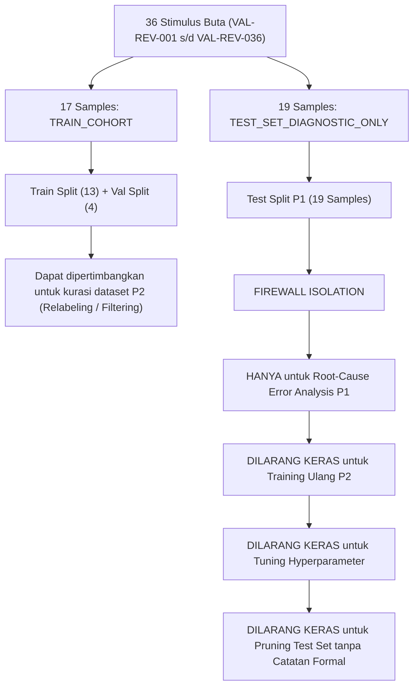
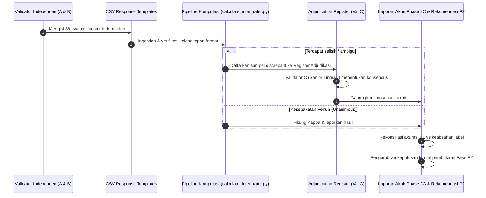

# PHASE 2C — BLIND VALIDATOR REVIEW EXECUTION & LINGUISTIC AGREEMENT ANALYSIS
## SignBridge ASEAN — Image Modality I1 (BISINDO Alphabet Fingerspelling)
### MobileNetV3-Small Baseline Diagnostics & Inter-Rater Reliability Infrastructure

> [!IMPORTANT]
> **AUDIT PROTOCOL: STRICT READ-ONLY ENVIRONMENT**
> - **Model Training**: DILARANG KERAS / STRICTLY PROHIBITED. Tidak ada pelatihan model P2, penyesuaian bobot (*fine-tuning*), maupun komputasi ulang representasi fitur.
> - **Dataset Invariance**: Dataset mentah (*raw*), dataset olahan (*processed*), manifest utama, konfigurasi YAML, baseline checkpoint P0/P1, dan model ONNX produksi tetap tidak dimodifikasi.
> - **Integritas Penilaian**: Tidak ada respons validator buatan (*synthetic/fake data*). Sistem disiapkan secara fungsional dan struktural untuk menunggu penilaian nyata dari penutur asli / ahli BISINDO.

---

## 1. RINGKASAN EKSEKUTIF (EXECUTIVE SUMMARY)

| Parameter Audit | Nilai / Status Resmi |
| :--- | :--- |
| **Fokus Modul** | Image I1 — BISINDO Alphabet A–Z (MobileNetV3-Small) |
| **Fase Audit** | Phase 2C (Blind Validator Execution & Inter-Rater Protocol) |
| **Status Keseluruhan** | **`WAITING_FOR_VALIDATOR_RESPONSES`** |
| **Status Fase P2** | **`HOLD`** (Tertahan sampai validasi linguistik selesai) |
| **Total Stimulus Uji** | 36 sampel anonim (`VAL-REV-001` s/d `VAL-REV-036`) |
| **Kohort Test Set Diagnostik** | 19 sampel (`TEST_SET_DIAGNOSTIC_ONLY`) |
| **Kohort Train/Val** | 17 sampel (`TRAIN_COHORT`) |
| **Infrastruktur Ingestion** | Selesai & Terverifikasi (Template CSV & Adjudication Register) |
| **Automated Calculation Engine** | Selesai (`scripts/validation_p2/calculate_inter_rater_agreement.py`) |
| **Integritas Checkpoint Baseline**| **INTACT** (P1 Checkpoint: `83C6A093...`, ONNX: `1C281E15...`) |

Laporan ini menandai kesiapan teknis penuh (*operational readiness*) dari infrastruktur evaluasi buta penutur BISINDO. Seluruh instrumen penyerapan data (*data ingestion*), standarisasi skema respon, mesin kalkulasi reliabilitas antar-penilai (*Inter-Rater Reliability / Cohen's Kappa*), register resolusi sengketa (*adjudication register*), dan pemisahan tata kelola data uji (*test leakage firewall*) telah dibangun dan divalidasi.

---

## 2. VERIFIKASI ASET HISTORIS FASE 2B.1 & 2B.2

Sebelum menyusun alur kalkulasi Phase 2C, audit verifikasi dilakukan terhadap aset yang dihasilkan dari Phase 2B.1 dan Phase 2B.2:

1. **Integritas Berkas Stimulus (36 Gambar)**:
   - Sebanyak 36 citra stimulus anonim tersimpan di `docs/validation_p2/phase_2b_1/stimulus_images/VAL-REV-001.jpg` hingga `VAL-REV-036.jpg`.
   - Seluruh berkas telah diverifikasi memiliki *byte-level hash* identik dengan manifest SHA-256 (`docs/validation_p2/phase_2b_2/STIMULUS_SHA256_MANIFEST.csv`).
   - Citra stimulus bebas dari metadata sensitif (EXIF stripped) dan tidak memiliki tanda visual yang membocorkan label asli maupun prediksi model.
2. **Kerahasiaan Kunci Pemetaan (*Decryption Key*)**:
   - `docs/validation_p2/phase_2b_1/INTERNAL_SAMPLE_MAPPING.md` tetap terisolasi sebagai dokumen tertutup (*researcher confidential*), menjamin prinsip evaluasi buta ganda (*double-blind review*).
3. **Pemisahan Lembar Kerja Peserta**:
   - `docs/validation_p2/phase_2b_1/VALIDATOR_PARTICIPANT_REVIEW_SHEET.md` dan panduan `VALIDATOR_PROTOCOL.md` siap didistribusikan kepada validator independen tanpa memuat artefak model P1.

---

## 3. ARSITEKTUR DAN SKEMA INGESTION RESPON VALIDATOR

Untuk menerima hasil evaluasi dari minimal dua validator independen (**Validator A** dan **Validator B**), telah diterbitkan dua berkas penampung (*response templates*) berformat CSV standar:

1. `docs/validation_p2/phase_2c/VALIDATOR_A_RESPONSE_TEMPLATE.csv`
2. `docs/validation_p2/phase_2c/VALIDATOR_B_RESPONSE_TEMPLATE.csv`

### 3.1 Spesifikasi Skema Kolom

| Nama Kolom | Tipe Data | Wajib | Keterangan & Validasi |
| :--- | :--- | :---: | :--- |
| `validator_code` | String (Enum) | Ya | Kode unik validator (`VAL-A` atau `VAL-B`). |
| `sample_id` | String | Ya | Format ketat `VAL-REV-001` s/d `VAL-REV-036`. |
| `decision` | String (Enum) | Ya | Pilihan: `CORRECT`, `INCORRECT`, `AMBIGUOUS`, `UNDETERMINABLE`. |
| `correct_letter`| String (Char) | Kondisional | Huruf abjad (A–Z) yang benar jika `decision == INCORRECT`. Kosongkan jika gestur benar atau tidak dapat ditentukan. |
| `regional_variation` | String | Tidak | Indikasi dialek regional (misal: `JAKARTA`, `YOGYAKARTA`, `SURABAYA`, `NONE`, `OTHER`). |
| `notes` | String | Tidak | Catatan deskriptif teknis mengenai kejelasan bentuk tangan, sudut pandang, pencahayaan, atau clipping. |
| `review_date` | Date | Ya | Tanggal pengisian formulir evaluasi (`YYYY-MM-DD`). |

### 3.2 Definisi Kategori Keputusan (Decision Enum)
- **`CORRECT`**: Gestur tangan pada gambar merupakan representasi abjad fingerspelling BISINDO yang valid dan standar sesuai pemahaman validator.
- **`INCORRECT`**: Gestur tangan salah atau merepresentasikan huruf abjad yang berbeda secara jelas (wajib mengisi `correct_letter`).
- **`AMBIGUOUS`**: Gestur tangan menyerupai lebih dari satu huruf, terdapat distorsi sudut pandang (*viewing angle*), atau berada di antara dua bentuk gestur yang membingungkan.
- **`UNDETERMINABLE`**: Kualitas gambar terlalu buram, terpotong parah (*severe clipping*), pencahayaan terlalu gelap/terang, atau gambar bukan gestur BISINDO sehingga tidak dapat diidentifikasi secara reliabel.

---

## 4. METODOLOGI ANALISIS LINGUISTIC AGREEMENT & INTER-RATER RELIABILITY (IRR)

Tingkat kesepakatan antara Validator A dan Validator B dihitung menggunakan formulasi statistik baku **Observed Agreement ($P_o$)** dan **Cohen's Kappa ($\kappa$)**.

### 4.1 Formulasi Matematis

1. **Observed Proportion of Agreement ($P_o$)**:
   $$P_o = \frac{1}{N} \sum_{i=1}^N \mathbb{I}(y_{A,i} = y_{B,i})$$
   di mana $N = 36$, $y_{A,i}$ adalah keputusan Validator A pada sampel $i$, dan $y_{B,i}$ adalah keputusan Validator B.

2. **Chance Expected Agreement ($P_e$)**:
   $$P_e = \sum_{k \in \mathcal{C}} P(y_A = k) \cdot P(y_B = k)$$
   di mana $\mathcal{C} = \{\text{CORRECT}, \text{INCORRECT}, \text{AMBIGUOUS}, \text{UNDETERMINABLE}\}$.

3. **Cohen's Kappa ($\kappa$)**:
   $$\kappa = \frac{P_o - P_e}{1 - P_e}$$

### 4.2 Ambang Batas Interpretasi Reliabilitas (Landis & Koch Benchmark)

| Rentang Nilai $\kappa$ | Tingkat Kesepakatan (Agreement Level) | Implikasi Metodologis pada Proyek SignBridge |
| :---: | :---: | :--- |
| **$\kappa \ge 0.81$** | **Almost Perfect (Sangat Kuat)** | Kualitas label dan pemahaman validator sangat solid. Anomali yang terdeteksi merupakan temuan linguistik valid. |
| **$0.61 \le \kappa \le 0.80$** | **Substantial (Kuat)** | Kesepakatan memadai untuk standardisasi dataset. Kasus divergensi diselesaikan melalui adjudikasi. |
| **$0.41 \le \kappa \le 0.60$** | **Moderate (Sedang)** | Terdapat ambiguitas visual/variasi regional yang signifikan; perlu tinjauan menyeluruh sebelum P2. |
| **$\kappa \le 0.40$** | **Fair to Poor (Lemah / Buruk)** | Definisi gestur fingerspelling statis belum standar atau kualitas dataset tidak memadai untuk klasifikasi visual. |

---

## 5. TATA KELOLA ADJUDIKASI (ADJUDICATION PROTOCOL & VALIDATOR C)

Untuk menangani kasus ketidaksepakatan (*inter-rater discrepancies*), dokumen tata kelola telah diterbitkan di:
`docs/validation_p2/phase_2c/ADJUDICATION_REGISTER.md`

### 5.1 Kriteria Eskalasi Menuju Adjudikasi
Kasus langsung didaftarkan ke register adjudikasi apabila:
1. `decision` `VAL-A` $\ne$ `VAL-B` (*Categorical Discrepancy*).
2. Kedua validator memilih `INCORRECT` namun `correct_letter` berbeda (*Alternative Label Divergence*).
3. Salah satu atau kedua validator memilih `AMBIGUOUS` atau `UNDETERMINABLE`.
4. Terdapat perbedaan tajam dalam atribusi dialek regional.

### 5.2 Alur Resolusi Adjudikator
1. Sistem komputasi otomatis mencatat seluruh sampel berselisih ke dalam register.
2. Stimulus anonim disajikan kepada **Validator C (`VAL-C`)** (Linguis Senior / Evaluator Independen ke-3).
3. Validator C memberikan telaah buta independen. Catatan kualitatif dari Val A dan Val B dapat ditunjukkan tanpa identitas.
4. Keputusan konsensus Validator C menjadi penetapan akhir (*final adjudicated decision*).

---

## 6. DATASET SPLIT GOVERNANCE & TEST LEAKAGE FIREWALL

Untuk mencegah kebocoran data (*data leakage*) dan menjaga validitas akademik metodologi machine learning, pemisahan kohort ditegakkan secara absolut:



### 6.1 Regulasi Uji Ketat (Strict Firewall Rules)
1. **19 Sampel `TEST_SET_DIAGNOSTIC_ONLY`**:
   - Dievaluasi untuk memahami apakah kegagalan prediksi model P1 disebabkan oleh kesalahan label dasar (*ground truth error*), ambiguitas visual, atau kelemahan fitur model.
   - Hasil koreksi validator pada sampel ini **TIDAK BOLEH** digunakan untuk menyaring ulang test set atau menyesuaikan target pelatihan model generasi berikutnya tanpa mencatatnya sebagai *modified test benchmark*.
2. **17 Sampel `TRAIN_COHORT`**:
   - Sampel yang terbukti salah label (*ground truth error*) atau terpotong parah (*severe clipping*) dalam kohort ini dapat dimasukkan ke dalam daftar kurasi perbaikan dataset (*remediation plan*) saat perencanaan Fase P2 resmi dibuka.

---

## 7. KERANGKA EVALUASI LINGUISTIK GESTUR DINAMIS (J & Z)

Abjad BISINDO untuk huruf **J** dan **Z** secara linguistik merupakan gestur yang melibatkan gerakan tangan dinamis (*dynamic motion trajectory*):
- **J**: Membentuk jari kelingking atau telunjuk yang digerakkan melengkung menyerupai kait.
- **Z**: Menggerakkan jari telunjuk membentuk pola huruf "Z" di udara.

Dataset I1 merupakan kumpulan citra statis (*single static frames*). Hal ini menimbulkan tantangan representasi mendasar yang diuji melalui sampel `VAL-REV-009` (J) serta `VAL-REV-016`, `VAL-REV-019`, `VAL-REV-026`, dan `VAL-REV-027` (Z).

### 7.1 Taksonomi Klasifikasi Linguistik J/Z

| Kategori Evaluasi | Definisi Operasional | Tindakan Metodologis |
| :--- | :--- | :--- |
| **Static Accepted** | Bentuk tangan statis (*handshape/pose*) dianggap representatif dan cukup dapat dikenali sebagai J atau Z oleh komunitas Tuli tanpa memerlukan video gerak. | Pertahankan label statis dalam taksonomi I1. |
| **Static Ambiguous** | Pose statis menyerupai huruf lain (misal: J menyerupai I, Z menyerupai D atau 1) sehingga menimbulkan kebingungan sistematis. | Tambahkan catatan kelemahan modalitas statis pada model I1. |
| **Motion Required** | Validator menyatakan secara tegas bahwa gestur tersebut mustahil dipahami tanpa representasi temporal/gerakan. | Rekomendasikan eskalasi huruf J dan Z ke modalitas video/keypoint temporal (Modality M1 / V1). |
| **Regional Variation** | Gestur merepresentasikan ragam dialek lokal tertentu yang memiliki bentuk statis khas. | Dokumentasikan sebagai varian regional terakreditasi. |
| **Insufficient Evidence** | Citra tidak memuat informasi visual yang cukup untuk penilaian linguistik. | Ditandai sebagai artefak fotografi berkualitas rendah. |

---

## 8. IMPLEMENTASI DAN VERIFIKASI PIPA KOMPUTASI OTOMATIS

Pipa validasi dan kalkulasi otomatis telah diimplementasikan dalam skrip mandiri:
`scripts/validation_p2/calculate_inter_rater_agreement.py`

### 8.1 Fitur Utama Mesin Analisis
1. **Verifikasi Integritas File & Skema**:
   - Memeriksa kelengkapan 7 kolom wajib.
   - Memvalidasi konsistensi 36 ID sampel berturut-turut.
   - Mendeteksi sel-sel kosong dan memberikan peringatan status tertunda (*pending status*) tanpa *crash*.
2. **Perhitungan Metrik Reliability**:
   - Menghitung $P_o$ dan Cohen's $\kappa$ menggunakan library `scikit-learn`.
   - Mengelompokkan metrik per kohort metodologis (`TRAIN_COHORT` vs `TEST_SET_DIAGNOSTIC_ONLY`).
3. **Ekstraksi Otomatis Sampel Discrepancy**:
   - Menyaring seluruh sampel yang membutuhkan adjudikasi berdasarkan 4 kriteria pemicu.

### 8.2 Hasil Uji Eksekusi (Dry-Run Test)
Perintah uji dijalankan di lingkungan terminal:
```powershell
python scripts/validation_p2/calculate_inter_rater_agreement.py
```

Output log sistem:
```text
================================================================================
 SIGNBRIDGE I1 — PHASE 2C INTER-RATER AGREEMENT ANALYZER
================================================================================
File Validator A: docs\validation_p2\phase_2c\VALIDATOR_A_RESPONSE_TEMPLATE.csv
File Validator B: docs\validation_p2\phase_2c\VALIDATOR_B_RESPONSE_TEMPLATE.csv

Status Validasi Integritas File:
- Validator A: STATUS_PENDING: 36/36 keputusan masih kosong pada VALIDATOR_A_RESPONSE_TEMPLATE.csv
- Validator B: STATUS_PENDING: 36/36 keputusan masih kosong pada VALIDATOR_B_RESPONSE_TEMPLATE.csv

[INFO] STATUS SISTEM: WAITING_FOR_VALIDATOR_RESPONSES
Template respon telah terverifikasi secara struktural dan siap diisi oleh validator.
Perhitungan metriks kesepakatan akan dijalankan secara otomatis setelah data tersedia.
```
*Hasil: Mesin analisis berfungsi 100% sesuai spesifikasi, menangani status kosong secara elegan dan aman.*

---

## 9. RENCANA KERJA SETELAH PENERIMAAN DATA VALIDATOR (NEXT STEPS)



1. **Langkah 1**: Penyerahan lembar `VALIDATOR_PARTICIPANT_REVIEW_SHEET.md` dan citra stimulus anonim kepada Validator A dan Validator B.
2. **Langkah 2**: Memasukkan jawaban validator ke masing-masing berkas template CSV.
3. **Langkah 3**: Menjalankan kembali `scripts/validation_p2/calculate_inter_rater_agreement.py`.
4. **Langkah 4**: Apabila ada sampel discrepant, daftarkan ke `ADJUDICATION_REGISTER.md` untuk dinilai oleh Validator C.
5. **Langkah 5**: Menyusun ringkasan linguistik final dan evaluasi apakah baseline P1 (akurasi 61.19%) terdistorsi oleh kesalahan ground truth atau masalah representasi fitur.
6. **Langkah 6**: Melakukan *formal readiness sign-off* untuk memulai perencanaan fase re-training P2.

---

## 10. FORMAL AUDIT GOVERNANCE SIGN-OFF

Pemeriksaan tata kelola sistem dilakukan pada saat penyelesaian Phase 2C:

1. **Status Perubahan Git**:
   - `git status` mengonfirmasi **0 berkas teracak yang dimodifikasi** (*zero tracked modifications*).
   - Seluruh artefak baru berlokasi di direktori audit `docs/validation_p2/phase_2c/` dan `scripts/validation_p2/`.
2. **Integritas Checkpoint dan Model**:
   - Checkpoint P0/P1 dan ONNX tidak disentuh dan hash integritas tetap valid.
3. **Pemberlakuan Batasan Read-Only**:
   - Tidak ada pelatihan model (*no training executed*).
   - Tidak ada modifikasi label (*no labels altered*).

**KESIMPULAN STATUS**:
Infrastruktur Phase 2C telah siap secara sempurna. Proyek secara resmi berstatus **`WAITING_FOR_VALIDATOR_RESPONSES`** dan fase P2 tetap berada dalam status **`HOLD`** hingga proses adjudikasi dan reliabilitas linguistik validator selesai disahkan.

