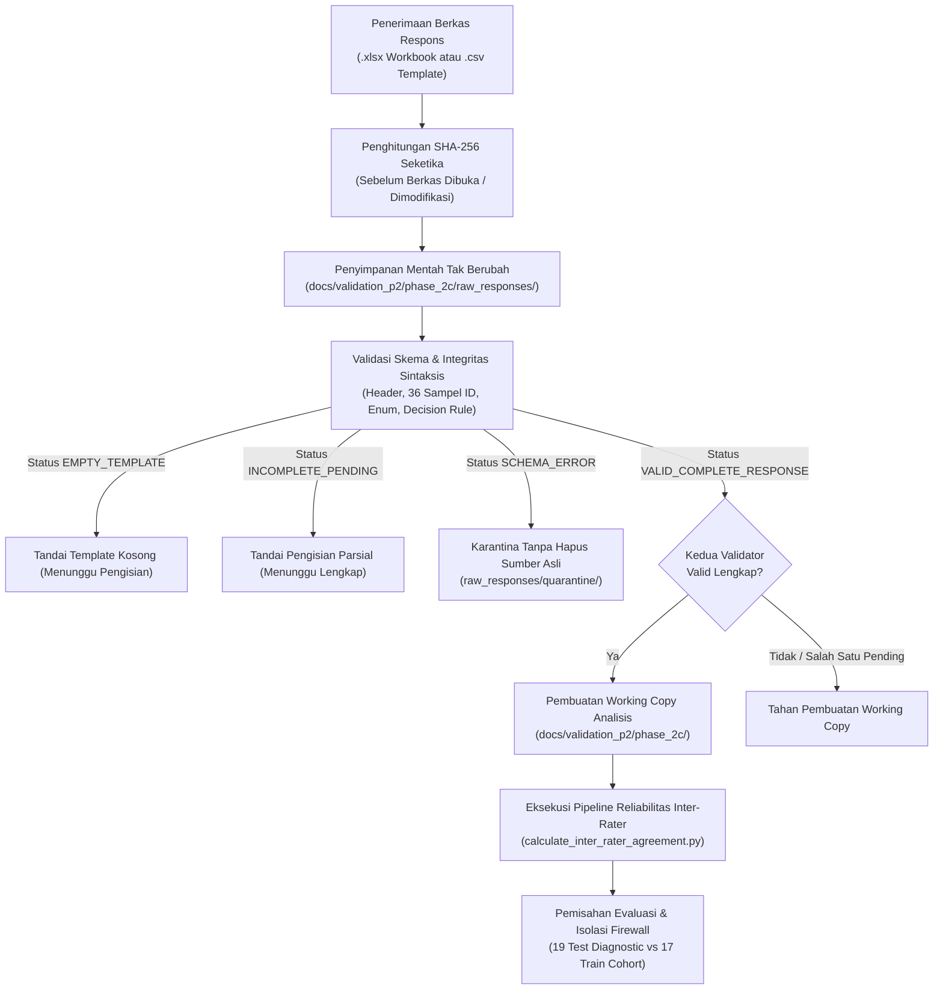

# PHASE 2C — RESPONSE INGESTION INTEGRITY PROCEDURE
## SignBridge ASEAN — Multimodal Classroom Bridge (BISINDO ↔ FSL)
### Standard Operating Procedure (SOP) for Human Validator Response Intake & Processing (Phase 2C.8 Standard)

> [!IMPORTANT]
> **DATA GOVERNANCE & CHAIN-OF-CUSTODY MANDATE**
> Prosedur ini mengatur tata kelola penerimaan, pengamanan kriptografis, verifikasi integritas skema, dan pra-pemrosesan berkas respons (baik format Excel `.xlsx` maupun CSV `.csv`) dari Validator Independen BISINDO.
> Tujuan utama: Menjamin keaslian data mentah (*raw data immutability*), mencegah kontaminasi data uji (*test-set leakage*), dan memastikan *audit trail* yang dapat direproduksi 100%.

---

## 1. IKHTISAR ALUR INGESTI DATA (INGESTION LIFECYCLE)



---

## 2. LANGKAH-LANGKAH OPERASIONAL INGESTI

### Langkah 1: Penerimaan Berkas & Verifikasi Saluran Aman
1. Fasilitator menerima berkas respons dari validator melalui media penyimpanan offline aman (USB drive terenkripsi) atau penyerahan fisik. Format berkas dapat berupa:
   - **Buku Kerja Excel**: `VALIDATOR_A_WORKBOOK.xlsx` / `VALIDATOR_B_WORKBOOK.xlsx` (pilihan utama).
   - **Berkas CSV**: `VALIDATOR_A_RESPONSE_TEMPLATE.csv` / `VALIDATOR_B_RESPONSE_TEMPLATE.csv` (pilihan alternatif).
2. **PERINGATAN KERAS**: Berkas mentah **TIDAK BOLEH** disunting, dinormalisasi manual, atau di-*save-as* sebelum hash kriptografis dihitung.

### Langkah 2: Penghitungan Checksum Kriptografis Seketika (*Immediate Pre-Open Hashing*)
Segera setelah berkas berada di perangkat penerima dan **SEBELUM** dibuka oleh aplikasi apa pun, hitung nilai hash SHA-256:
```powershell
Get-FileHash -Path "path/to/received_file.xlsx" -Algorithm SHA256
```
atau via Python:
```bash
python -c "import hashlib; print(hashlib.sha256(open('received_file.xlsx','rb').read()).hexdigest())"
```
Catat nilai hash ini secara permanen ke dalam [`docs/validation_p2/phase_2c/VALIDATOR_DISTRIBUTION_EXECUTION_LOG.md`](file:///d:/SEMESTER%205/ML/Projek_1/docs/validation_p2/phase_2c/VALIDATOR_DISTRIBUTION_EXECUTION_LOG.md) Seksi 3.

### Langkah 3: Pengarsipan Mentah (*Raw Immutable Archival*)
1. Pindahkan berkas asli langsung ke direktori penyimpanan mentah yang telah disediakan:
   - `docs/validation_p2/phase_2c/raw_responses/VALIDATOR_A_RAW_RESPONSE_<TIMESTAMP>.<ext>`
   - `docs/validation_p2/phase_2c/raw_responses/VALIDATOR_B_RAW_RESPONSE_<TIMESTAMP>.<ext>`
2. Berkas di dalam folder `raw_responses/` diberi atribut *Read-Only* dan **TIDAK PERNAH DIUBAH ATAU DITIMPA LAGI SELAMANYA** (`StorageStatus: RAW_PRESERVED`).

### Langkah 4: Validasi Pra-Ingesti Skema & Integritas (*Automated Pre-Ingestion Validation*)
Script analisis menjalankan fungsi `load_and_validate_response()`:
1. **Dukungan Format Dual (.xlsx & .csv)**:
   - Berkas `.xlsx` dibaca secara otomatis dari sheet `Lembar Penilaian` dengan header baris ke-2 (skip baris instruksi atas) dan dinormalisasi menggunakan kamus `EXCEL_COL_MAPPING`.
   - Berkas `.csv` dibaca langsung dengan validasi header baku.
2. **Pemeriksaan Skema V2 (Blind Letter Identification)**:
   Header baris wajib memuat:
   `validator_code, sample_id, identified_letter, decision, regional_variation, notes, review_date`
3. **Pemeriksaan Jumlah Baris & Identitas Sampel**:
   Tepat 36 sampel berurutan dari `VAL-REV-001` hingga `VAL-REV-036`. Sampel hilang, duplikat, atau tidak berurutan memicu penolakan (*SCHEMA_ERROR*).
4. **Pemeriksaan Kode Validator**:
   Seluruh nilai pada kolom `validator_code` harus seragam (`VAL-A` untuk lembar A, `VAL-B` untuk lembar B).
5. **Klasifikasi Status Validasi vs Status Penyimpanan**:
   - `EMPTY_TEMPLATE`: 36/36 baris keputusan kosong. Template belum diisi (aman, menunggu pengerjaan validator).
   - `INCOMPLETE_PENDING_COMPLETION`: 1 s/d 35 keputusan terisi tetapi ada baris kosong. Ditolak dari pipeline analisis sampai validator melengkapi seluruh sampel.
   - `SCHEMA_ERROR`: Pelanggaran kolom, enum tidak dikenal, atau aturan kondisional tidak terpenuhi.
   - `VALID_COMPLETE_RESPONSE`: 36/36 sampel terisi lengkap dan valid.
6. **Pemeriksaan Nilai Kategori Kejelasan Gestur (`decision`)**:
   Hanya boleh berisi salah satu dari enum resmi:
   - `IDENTIFIED`
   - `AMBIGUOUS`
   - `UNDETERMINABLE`
7. **Pemeriksaan Konsistensi Huruf Teridentifikasi (`identified_letter`)**:
   - Jika `decision == 'IDENTIFIED'`, kolom `identified_letter` **wajib terisi** dengan huruf kapital alfabet (A–Z). Jika kosong, memicu penolakan (*SCHEMA_ERROR*).
   - Jika `decision == 'UNDETERMINABLE'`, kolom `identified_letter` diharapkan kosong (atau jika terisi akan diberikan peringatan).

### Langkah 5: Protokol Karantina (*Non-Destructive Quarantine Protocol*)
Jika berkas gagal verifikasi skema:
1. Berkas **DITOLAK DARI PIPELINE** dan salinan berkas dibuat di direktori karantina:
   `docs/validation_p2/phase_2c/raw_responses/quarantine/QUARANTINED_<nama_file>`
2. Berkas sumber asli di `raw_responses/` **TETAP DIPERTAHANKAN UTUH** sebagai bukti audit (*StorageStatus: RAW_PRESERVED*).
3. Tim dilarang keras mengubah atau mengisi data secara sintetis (*Zero Synthetic Data Mandate*).

### Langkah 6: Pembuatan Salinan Kerja Analisis (*Working Copy Guard*)
Hanya ketika Validator A DAN Validator B berstatus `VALID_COMPLETE_RESPONSE`:
1. Salin berkas mentah ke lokasi input kerja pipeline analisis:
   - `docs/validation_p2/phase_2c/VALIDATOR_A_RESPONSE_ACTUAL.<ext>`
   - `docs/validation_p2/phase_2c/VALIDATOR_B_RESPONSE_ACTUAL.<ext>`
2. Jika input berupa `.xlsx`, salinan CSV yang telah dinormalisasi juga dibuat berdampingan (`VALIDATOR_A_RESPONSE_ACTUAL.csv`) untuk kompatibilitas downstream.
3. Jalankan engine penghitungan reliabilitas:
   ```bash
   python scripts/validation_p2/calculate_inter_rater_agreement.py --val-a docs/validation_p2/phase_2c/VALIDATOR_A_RESPONSE_ACTUAL.xlsx --val-b docs/validation_p2/phase_2c/VALIDATOR_B_RESPONSE_ACTUAL.xlsx
   ```

---

## 3. FIREWALL ISOLASI DATA TEST SET (19 SAMPEL)

> [!CAUTION]
> **TEST SET LEAKAGE PREVENTION & MODEL RETRAINING BARRIER**
> Seluruh output validasi inter-rater wajib dipisahkan menjadi dua domain analisis:
> 1. **`TRAIN_COHORT` (17 Sampel)**:
>    - Dapat digunakan sebagai bahan evaluasi kualitas data latih untuk persiapan Phase 2 (P2).
> 2. **`TEST_SET_DIAGNOSTIC_ONLY` (19 Sampel)**:
>    - **DILARANG KERAS** digunakan untuk memodifikasi bobot model, tuning hyperparameter, pemilihan preprocessing, atau pemilihan model P2.
>    - Hanya diizinkan untuk pelaporan diagnostik generalisasi model terhadap penutur asli BISINDO independen.
>    - Pelatihan Phase 2 (P2) berstatus **STRICT HOLD**.

---

## 4. PENANGGUNG JAWAB TATA KELOLA DATA

| Peran | Tanggung Jawab Utama |
| :--- | :--- |
| **Data Governance Specialist** | Menjaga integritas direktori `raw_responses/`, memvalidasi hash kriptografis sebelum pembukaan berkas, mengelola folder `quarantine/`, dan memverifikasi ketiadaan modifikasi manual. |
| **Field Facilitator** | Menyerahkan paket buku kerja secara aman, menjaga kerahasiaan label selama sesi, memastikan informed consent ditandatangani, dan mencatat log serah terima. |
| **ML Validation Engineer** | Memastikan pipeline analisis hanya membaca working copy yang lolos validasi skema dan menjaga integritas firewall 19 test samples. |
